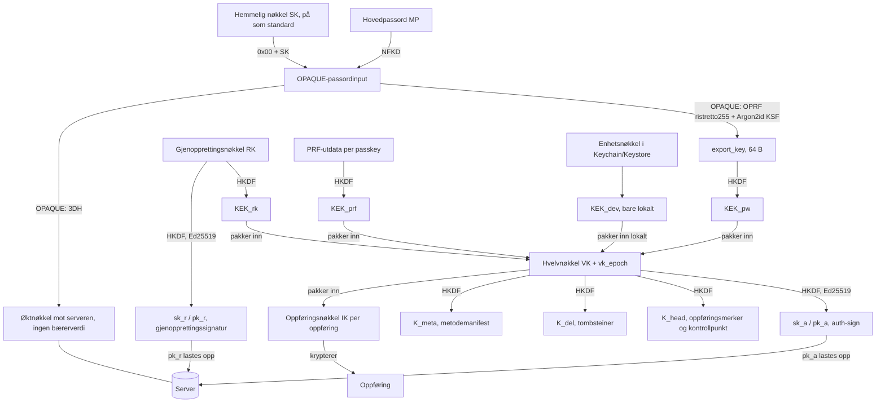

# Fase 1 – Sikkerhetsdesign for Faithful Ferret

> [!NOTE] Status
> Dette er utkast 2. Det bygger på utkast 1 og en uavhengig gjennomgang med 38 funn. Alle funn er behandlet (§ 0).
> Utkastet bygger på idénotatet, veikartet for v1 og rapporten fra fase 0. De er ikke publisert.
> - **Henvisninger** som U2, U17 og E11 viser til avklaringer i implementeringsplanen. Der en avklaring betyr noe for konstruksjonen, er innholdet skrevet inn her.
> - **Gjelder alle klienter:** webhvelv, utvidelse, iOS og Android. Steg B trenger derfor ikke nytt design.
> - **Hensikt:** dekke port 3, 4 og 6, og designdelen av port 5.
> - **Kryptografi:** ingenting her er egenutviklet. Vi bruker etablerte konstruksjoner: OPAQUE (RFC 9807), Argon2id (RFC 9106), HKDF-SHA256 (RFC 5869), XChaCha20-Poly1305, Ed25519 (RFC 8032), ECDSA P-256. Bibliotekene er `opaque-ke`, RustCrypto og dalek.
> - **Merking:** «Standardvalg» er standarder som kan endres senere. «Eierens valg» er markert der eieren allerede har bestemt.
> - **Én eierbeslutning reverseres:** innloggingen går fra «Bitwarden-stil med innloggingsverdi» til OPAQUE i v1. Se E11 i § 16. Den gamle designen ligger i vedlegg A.
> - **Til slutt:** dokumentet ender med en liste over beslutninger eieren må ta (§ 16).

---

## 0. Endringer fra utkast 1

Én linje per funn. Alvorlighet står i parentes. Alle fikser er tatt inn slik gjennomgangen la dem frem, med de presiseringene som kom etterpå.

| ID | Endring |
|---|---|
| F-01 (kritisk) | Klienten har innebygde gulv og tak for Argon2id-parametere. Med OPAQUE kommer de aldri fra serveren. Pinning per enhet, oppgradering styres bare av klienten, og nødarket har en QR med server og konto (§ 4.1, 4.2, 13). |
| F-02 (høy) | OPAQUE erstatter innloggingsverdien (E11, reverserer eierens valg). SK er på som standard (E12). SK-biten pinnes lokalt og tas aldri fra serveren. A1–A3 er skrevet om til å være nøyaktige. Gammel LV-design ligger i vedlegg A (§ 2.2, 4.2). |
| F-03 (høy) | «Roter hvelvnøkkel» er nå full rekey: ny VK, nye IK, `vk_epoch`, atomisk endepunkt, tilbakekalling av alle andre. Prosedyre for stjålet enhet. Backup beholdes 30 dager (E14) (§ 4.7, 7.6). |
| F-04 (høy) | Fylling skjer primært utenfor sidens DOM. Menyen i siden er sekundær med full ancestry-sjekk, `isTrusted`, ventetid og tainting (§ 10.3). |
| F-05 (middels) | Gjenopprettingsbeviset er byttet fra MAC og verifikator til en Ed25519-signatur fra RK. RK roteres etter bruk, økter tilbakekalles, bruker varsles (§ 6.3). |
| F-06 (middels) | OPAQUE sin falske respons dekker pre-login. Øvrige veier for kontooppdaging og timing er spesifisert (§ 4.2, 11). |
| F-07 (middels) | Innpakningens AAD er TLV med suite, konto, hvelv, metode, `vk_epoch`, `kek_generation` og KDF-parametere. Metodemanifest inne i hvelvet. Alle endringer av innpakninger krever signert bevis (§ 3.1, 4.3, 4.6). |
| F-08 (middels) | Oppføringsmerker (`tag`, HMAC under `K_head`) og signerte kontrollpunkter (`{seq, digest, mac}`) erstatter en head-kjede, slik at skrivinger på ulike oppføringer fortsatt er uavhengige (*standardvalg*). Varig ikke-hemmelig post og handlingen «godta eldre tilstand». Restrisiko er skrevet ut (§ 8.6). |
| F-09 (middels) | Tombsteiner er autentisert med `K_del`. Lokal papirkurv i 30 dager. Uverifiserte slettinger settes i karantene (§ 8.4). |
| F-10 (middels) | Mobil-PIN er bundet til maskinvarestyrt begrensning. Utvidelsens PIN er bare en bekvemmelighet og kun i minnet. Valget «PIN etter omstart» er fjernet (E3 er borte) (§ 7). |
| F-11 (middels) | Auto-lås med `chrome.alarms` og `lockAt`. VK bare i offscreen-dokument eller arbeider, kryptert under en øktnøkkel i `storage.session`. Streng CSP og Trusted Types (§ 7.2). |
| F-12 (middels) | Opprinnelse for passkey er den kallende rammen. Kryss-opprinnelse nektes i v1. Forespørselen bindes til `(tabId, frameId, documentId, origin, rpId, challenge-hash)`. Eksakt `rp_id` ved signering (§ 9.2). |
| F-13 (middels) | Overstyringen er av på Ferrets egen opprinnelse. Ferret-passkeys kan aldri være opplåsingsfaktor (§ 9.4). |
| F-14 (middels) | § 2.4 er skrevet om ærlig: SRI hjelper ikke mot en ondsinnet operatør. Egen opprinnelse og full headerliste. PWA-pinning og hash-sjekk i utvidelsen er «etter v1» (§ 2.4, 12). |
| F-15 (middels) | Liste over sensitive operasjoner med MP på nytt, 2FA og signatur fra en VK-avledet Ed25519-nøkkel. Tilbakekalling av økter og varsler. Forsinkelse ved e-postbytte (§ 4.6). |
| F-16 (middels) | Ingen tokens i URL. Korte tilgangstokens, roterende refresh-tokens med gjenbruksdeteksjon, enhetsnøkkel (DPoP). SSE via fetch. CSRF-vern (§ 7.6, 8.2). |
| F-17 (middels) | `Secret<T>`, tillatelsesliste for feilrapportering, kanari-tester, proxy uten kroppslogg, `RLIMIT_CORE=0` (§ 11). |
| F-18 (middels) | Rate-begrensning på operasjoner og byte, kvoter per konto, tak på størrelser, ingen server-Argon2id (§ 8.2, 11). |
| F-19 (middels) | «Deterministisk CBOR» er fjernet for kropper. Ukjente felt bevares, nyere schema er skrivebeskyttet, parsergrenser (§ 5.2, 13). |
| F-20 (middels) | Én Rust-kjerne, WASM og UniFFI (Swift og Kotlin som bindinger). AutoFill-utvidelsen kjører aldri Argon2id (§ 3, 14). |
| F-21 (middels) | Nødarket er to ark. Oppsettet krever full innskriving av RK og SK, og pakker faktisk opp lokalt (§ 6.1). |
| F-22 (middels) | Standard treff er eksakt vert. Registrerbart domene er valg per oppføring (E13). PSL med private domener. Rammeregel per ramme (§ 10.4, 10.5). |
| F-23 (lav) | Unicode-versjonen er låst for suite 1. Avvisningsregler og enhet for lengde. Flere testvektorer (§ 3.1, 4.1, 14). |
| F-24 (lav) | Alle AAD er TLV. UUID er 16 rå byte. Alle AAD har `suite`; hvilke som i tillegg har `version` og `kind`, står i AAD-listene i § 4.3, § 5 og § 8.4 (kropp og manifest har alle tre) *(presisert 30.10)*. Utfylling er ISO/IEC 7816-4 (§ 3.1, 5). |
| F-25 (lav) | Nøkkelforpliktelse (`commit`) på innpakninger fra menneskelige hemmeligheter: passord og PIN (§ 4.3). |
| F-26 (lav) | Eksakte koder for RK og SK med sjekksummer. 14 grupper à 4 og 6 grupper à 5 (§ 6.1, 6.2). |
| F-27 (lav) | Eksportformatet binder hele headeren i AAD, validerer parametere ved import, bruker sterkere parametere, og beskytter CSV (§ 6.4). |
| F-28 (lav) | Idempotens lagrer forespørselshash. Definert `min_valid_since`, `as_of_seq`, dedikert `seq`-teller og reglene for batch (§ 8.3, 8.4). |
| F-29 (lav) | To PRF-frø (med og uten UV), én fast AAGUID som er åpen, `NotAllowedError` ved manglende UV, ingen skille mellom «finnes ikke» og «avbrutt» (§ 9.3, 9.5). |
| F-30 (lav) | `https`-oppføringer fylles aldri på `http`. Utklippstavle, MV3-manifest og privat bro mellom MAIN-verden og innholdsskript (§ 10). |
| F-31 (lav) | TOTP: tillatelsesliste for `otpauth://`. Ferret-kontoens egen 2FA-hemmelighet skal ikke lagres i hvelvet (§ 5.2). |
| F-32 (lav) | Zeroize-funksjon i `argon2`, dedikert arbeider som termineres, `mlock` på mobil, konstant-tid også på WASM-utdata (§ 2.3 L6, 3). |
| F-33 (lav) | `account_id` står i nødarket og QR. Egen flyt for å flytte til ny server (§ 4.1, 6.1). |
| F-34 (lav) | Rate-begrensning på (konto, IP) pluss mykt tak per konto, ingen hard utestenging (§ 11). |
| F-35 (notat) | iOS: `WhenPasscodeSetThisDeviceOnly` og ingen passkode-reserve på biometrien. Android: per-operasjon-autentisering med `CryptoObject`, StrongBox, bare sterk biometri (§ 7.4, 7.5). |
| F-36 (notat) | Regel for mobil passkey-leverandør: stol bare på opprinnelsen operativsystemet oppgir (§ 9.7). |
| F-37 (notat) | README sier at det ikke finnes noen ekstern revisjon. Betalt gjennomgang eller bug bounty før 1.0 er en eierbeslutning (E15) (§ 2.3 L7, 14). |
| F-38 (notat) | Minste MP-lengde er 12 med SK og 15 uten, pluss estimator og lokal blokkeringsliste uten SK (§ 4.1, E8). |

**Andre endringer:** E3 er fjernet. E11–E15 er nye. Enhetstokenet fra utkast 1 er erstattet av tilgangs- og refresh-tokens (§ 8.2). Fase 2 i vole-kit får en OPAQUE-modul i stedet for innloggingsverdi (§ 16).

---

## 1. Omfang og begreper

| Begrep | Betydning |
|---|---|
| **Konto** | Innlogging på Ferret-serveren (vole-kit): e-post, OPAQUE-post (ingen passordverdi), 2FA/passkey for serveren. |
| **Hvelv** | Brukerens krypterte oppføringer. Ett hvelv per bruker i v1 (ingen deling). |
| **MP** | Hovedpassordet. Forlater aldri klienten. |
| **SK** | Hemmelig nøkkel (*Secret Key*), 128 bit tilfeldig. **På som standard**, kan velges bort med advarsel (E12). Eierens valg: valgfri per bruker. |
| **VK** | Hvelvnøkkelen, 256 bit tilfeldig. Krypterer nøklene til oppføringene. Serveren ser den aldri. |
| **`vk_epoch`** | Teller (u64, starter på 1) som øker ved hver full rekey. Står i AAD for alle innpakninger. |
| **IK** | Oppføringsnøkkel, 256 bit tilfeldig per oppføring, pakket inn med VK. |
| **KEK** | Nøkkel som pakker inn VK. Én per opplåsingsmetode. |
| **`kek_generation`** | Teller per metode (u64, starter på 1). Øker hver gang innpakningen for metoden byttes. Største gyldige verdi er 2^32 − 1; en større verdi avvises (*presisert 30.10*). |
| **RK** | Gjenopprettingsnøkkel, 256 bit tilfeldig. Vises ved oppsett. |
| **`export_key`** | Utdata fra OPAQUE (64 byte) som bare klienten kjenner. Gir `KEK_pw`. |
| **`sk_a` / `pk_a`** | Ed25519-nøkkel avledet fra VK. Signerer endringer av innpakninger. Serveren har bare `pk_a`. |
| **`sk_r` / `pk_r`** | Ed25519-nøkkel avledet fra RK. Signerer gjenoppretting. Serveren har bare `pk_r`. |
| **Opplåsing** | Klienten får tak i VK lokalt. Skilt fra innlogging. |

---

## 2. Trusselmodell (port 3)

### 2.1 Verdier som skal beskyttes
1. Hvelvets klartekst: passord, TOTP-frø, passkey-privatnøkler, notater.
2. VK, IK, MP, SK, RK, `export_key`, `sk_a`, `sk_r` og alle KEK-er.
3. Integriteten til hvelvet: ingen stille endring, bytting eller sletting.
4. Tilgjengelighet: ingen stille datatap ved synk, migrering eller gjenoppretting.

### 2.2 Angripere og hva de skal ikke få til

Ett prinsipp styrer tallene under: **den som har serverens database og dens OPAQUE-oppsett (`opaque_setup`) kan prøve MP-gjetninger offline, til en pris av én Argon2id (64 MiB, t = 3) per forsøk.** Ingen design hindrer det, for innpakningen av VK er selv en kontroll av gjetningen. Det som hjelper er SK. At `opaque_setup` ligger i en egen fil utenfor databasen (§ 11) gjør bare at en lekket databasefil alene ikke kan brukes. Et fullt backupsett og full serverovertakelse inneholder `opaque_setup` også.

| # | Angriper | Har | Skal **ikke** få |
|---|---|---|---|
| A1 | Tyv av database eller backup | A: bare databasefilen (for eksempel en kopiert `ferret.db`). B: et fullt backupsett, som også inneholder `opaque_setup` som egen fil | Klartekst. **A:** MP kan ikke gjettes i det hele tatt, fordi OPRF-nøkkelen mangler. **B:** hver gjetning koster én Argon2id, og med SK er det umulig uten SK. |
| A2 | Nysgjerrig driftsansvarlig | Root på serveren, `session.key`, `opaque_setup`, logger | Klartekst, VK eller MP for brukere **med SK**. Uten SK kan A2 gjette MP til en pris av én Argon2id per forsøk. Admin-panelet viser aldri hvelvinnhold. |
| A3 | Ondsinnet server (aktiv) | Kan endre API-svar, har databasen og `opaque_setup` | Det samme som A2. Den kan heller ikke bytte, endre eller blande oppføringer uten at det oppdages (§ 5.3, 8.6). Den kan ikke senke Argon2id-parameterne (§ 4.2). **Unntak:** webhvelvets JavaScript (§ 2.4). |
| A4 | Nettverk (MITM) eller bare logger og proxyer | Ser og endrer trafikk | Det samme som A3 hvis TLS brytes. Det som sees gir ingen verdi å gjette mot, fordi OPAQUE ikke sender noen bærerverdi. TLS kreves. |
| A5 | Ondsinnet nettside | Kjører JS i en fane | Legitimasjon for andre opprinnelser. Autofyll eller passkey-bruk uten brukerens handling i Ferrets eget UI. |
| A6 | Annen utvidelse eller side-skript | Kan endre DOM og etterligne knapper | Kan ikke utløse autofyll eller passkey-signering ved å etterligne Ferret-UI (§ 10.3, § 9.4). |
| A7 | Tyv av låst enhet | Disken, nettleserprofilen | Klartekst. PIN gir ikke offline-gjetting uten maskinvarevern (§ 7). |
| A8 | Tidligere enhet, utlogget eller tilbakekalt | Gammel lokal cache og VK fra før tilbakekallingen | Nye endringer etter tilbakekalling. **Men** enheten har fortsatt VK og IK for det den hadde. Bare full rekey (§ 4.7) endrer det. Se § 7.6. |

### 2.3 Utenfor trusselmodellen (dokumenterte begrensninger)
- **L1 Kompromittert enhet eller OS mens hvelvet er låst opp.** Angriperen kan lese det som er åpent.
- **L2 Ondsinnet oppdatering av en klient.** Det gjelder utvidelse, app og webhvelvets kode. Vernet er signerte utgivelser og en dokumentert utgivelsesprosess (§ 12).
- **L3 Tap av både MP og alle gjenopprettingsmetoder.** Da er dataene borte. Det er nullkunnskap.
- **L4 Tilbakerulling, tilbakeholding og gaffel fra serveren.** Oppføringsmerker og kontrollpunkter (§ 8.6) fanger blanding av oppføringer og tilbakerulling av enkeltoppføringer for enheter som har sett et nyere kontrollpunkt. **Restrisiko:** en tilbakerulling av de nyeste skrivingene siden siste kontrollpunkt, eller av hele hvelvet til et eldre, konsistent kontrollpunkt, merkes bare av enheter som har sett et nyere kontrollpunkt. En server kan vise to enheter to ulike historier (gaffel) uten at det oppdages i v1. Å holde tilbake nye endringer kan heller ikke oppdages.
- **L5 Metadata.** Serveren ser antall oppføringer, størrelse etter utfylling (*padding*), tidspunkter, revisjoner, enheter og IP-adresser (§ 2.5). Utfyllingen skjuler ikke størrelsesklassen.
- **L6 Minne.** JavaScript og WASM kan ikke garantere at nøkler slettes fra minnet. MP er en JS-streng før den når kjernen. Vi nullstiller så godt det går (§ 3).
- **L7 Ingen ekstern revisjon.** Prosjektet har ikke hatt en uavhengig kryptografisk revisjon av et menneske. README sier det rett ut. Se E15.
- **L8 Gammelt chiffertekst.** Rekey beskytter ikke chiffertekst som allerede er lekket, for eksempel gamle backuper, og ikke noe en tyv allerede har lest. Derfor har backup en fast oppbevaringstid (E14).

### 2.4 Webhvelvets tillitsgrense (eierens valg, 2026-10-27)
- Webhvelvet stoler på serveren som leverer koden. En ondsinnet driftsansvarlig kan levere modifisert JavaScript som stjeler MP ved opplåsing. Dette står i README og på innloggingssiden.
- **SRI og CSP beskytter ikke mot dette.** HTML-en med integritetshashene kommer fra samme server som skriptene. De hjelper mot injisert kode (XSS) og mot tredjeparts-CDN-er, og vi har ingen eksterne opprinnelser.
- Mottiltak som faktisk virker mot XSS og feilkonfigurasjon:
  - webhvelvet ligger på en **egen opprinnelse** (eget vertsnavn), atskilt fra admin-panelet og andre vole-kit-sider (XSS i admin ville ellers vært XSS i hvelvet);
  - full headerliste (§ 12);
  - administrator kan slå av webhvelvet.
- Det **ekte** vernet for dem som frykter operatøren er utvidelsen og appene. De anbefales.
- **Etter v1:** installerbar PWA med service worker som låser utgivelsen med hash og krever bekreftelse ved ny kode, og en hash-sjekk i utvidelsen mot den signerte utgivelseslisten.

### 2.5 Metadata serveren ser

| Ser | Ser ikke |
|---|---|
| E-post, kontoopprettelse, innloggingstider og IP, enheter (navn satt av klienten) | MP, SK, RK, VK, IK, `export_key` |
| Oppførings-ID (tilfeldig UUIDv4), revisjon, `seq`, slettet ja/nei, størrelse **etter utfylling**, tidspunkter, oppføringsmerker (`tag`) og kontrollpunkt (`seq`, `digest`, `mac`) | Type, navn, URL, brukernavn, passord, notater, TOTP, passkeys |
| OPAQUE-posten, `ksf_profile`, `pk_a`, `pk_r`, hvilke opplåsingsmetoder som finnes (passord, RK, PRF-ID-er), et valgfritt `sk_hint` (bare et forslag i UI-et) | PRF-utdata, enhetsnøkler |

---

## 3. Primitiver og biblioteker

| Bruk | Konstruksjon | Crate |
|---|---|---|
| Innlogging og passordbeskyttelse mot server | **OPAQUE** (RFC 9807) | `opaque-ke` |
| Passordbasert nøkkelavledning (OPAQUE-KSF, PIN, eksport) | **Argon2id** v1.3 (RFC 9106) | `argon2` (med `zeroize`) |
| Nøkkelavledning og domeneskille | **HKDF-SHA256** (RFC 5869) | `hkdf`, `sha2` |
| Symmetrisk kryptering | **XChaCha20-Poly1305** (24-byte tilfeldig nonce) | `chacha20poly1305` |
| Signaturer for endringsbevis (VK og RK) | **Ed25519** (RFC 8032) | `ed25519-dalek` |
| Passkeys | **ECDSA P-256 / SHA-256** (ES256) | `p256` (`ecdsa`) |
| TOTP | HMAC-SHA1/256/512 (RFC 6238) | `hmac`, `sha1`, `sha2` |
| Oppføringsmerker og kontrollpunkter | HMAC-SHA256 | `hmac`, `sha2` |
| Tilfeldighet | OS-CSPRNG | `getrandom` (WASM: `crypto.getRandomValues`) |
| Nullstilling | `Zeroize`/`ZeroizeOnDrop` på alle nøkkeltyper | `zeroize` |
| Konstant-tid-sammenligning | – | `subtle` |
| Unicode-normalisering av MP | NFKD, tabellversjon låst | `unicode-normalization` |

**Regler:**
- **Én kjerne.** All kryptokode (konvolutt, AAD, utfylling, CBOR, KDF, OPAQUE-klient, TOTP, WebAuthn) finnes bare **én gang**, i en Rust-kjerne. Den kompileres til WASM (web og utvidelse) og til native biblioteker via UniFFI for iOS og Android. Swift og Kotlin er bindinger, ikke egne implementasjoner.
- AutoFill-utvidelsen på iOS og tilsvarende på Android kjører **aldri** Argon2id. De bruker den delte `KEK_dev` (§ 7.4).
- Alle nøkler er egne typer (`VaultKey`, `ItemKey` og så videre) som ikke kan kopieres og som nullstilles.
- Det er ingen `Debug` eller `Display` for nøkkeltyper.
- `argon2` kjøres med `zeroize`-funksjonen på. I nettleseren kjøres Argon2id for innlogging i den langlivede hvelv-arbeideren, som termineres og startes på nytt ved lås (U2). Bare eksport og import bruker en egen arbeider som termineres etter hver bruk *(rettet 30.10)*. På mobil brukes `mlock` der det går, og sikkerhetskopi av appdata er av.
- Avhengigheter låses med `cargo-deny` (lisenser og RustSec-varsler) og `cargo-vet`.
- **Kryptosuite** ligger i hver konvolutt som `suite: 1`. Suite 1 betyr: OPAQUE med Argon2id-profilene i § 4.2, HKDF-SHA256, XChaCha20-Poly1305, Ed25519. Ny suite gir ny verdi og nye etikettprefiks (`ferret/v2/...`), og gammel kan leses.

### 3.1 Kodingsregler (gjelder overalt)

- **UUID** (`account_id`, `vault_id`, `item_id`, `method_id`) er alltid **16 rå byte** i RFC 4122-rekkefølge. Aldri tekstform.
- **Heltall** er big-endian: `u8`, `u32be`, `u64be`.
- **TLV:** `tlv(tag, value) = tag (1 byte) ‖ len (u16be) ‖ value`. `value` er maks 65 535 byte.
- **AAD og HKDF-salter** er en sammenstilling av TLV-felt i den rekkefølgen som er oppgitt, uten annen skilletegn. Skrives `TLV[felt1, felt2, ...]`. Hvert feltnavn har ett fast tag fra tabellen.
- **Etiketter** (`label`) er ASCII og starter med `ferret/v1/` for suite 1.
- **`AEAD(nøkkel, nonce, pt, aad)`** er XChaCha20-Poly1305. Resultatet lagres som `nonce (24) ‖ ct ‖ tag (16)`. Nonce er 24 tilfeldige byte, ny for hver kryptering.

| Tag | Felt | Koding |
|---|---|---|
| 0x01 | `label` | ASCII |
| 0x02 | `version` | u8 |
| 0x03 | `suite` | u8 |
| 0x04 | `kind` | u8 (1 = oppføring, 2 = manifest) |
| 0x10 | `account_id` | 16 byte |
| 0x11 | `vault_id` | 16 byte |
| 0x12 | `item_id` | 16 byte |
| 0x13 | `method_id` | 16 byte |
| 0x14 | `method_type` | u8 (1 = password, 2 = recovery, 3 = prf, 4 = pin, 5 = device) |
| 0x20 | `vk_epoch` | u64be |
| 0x21 | `kek_generation` | u64be |
| 0x22 | `rev` | u64be |
| 0x23 | `seq` | u64be |
| 0x30 | `kdf` | `m_kib` u32be ‖ `t` u32be ‖ `p` u32be (12 byte) |
| 0x31 | `credential_id` | byte |
| 0x32 | `prf_salt` | 32 byte |
| 0x33 | `nonce` (utfordring fra server) | 32 byte |
| 0x35 | `hash` | 32 byte |
| 0x36 | `op` | ASCII |
| 0x37 | `device_salt` | 16 byte |
| 0x38 | `salt_a` (bare vedlegg A) | 16 byte |
| 0x39 | `header` | byte (eksportheader, lagret ordrett) |

**MP-normalisering (F-23):** `mp = NFKD(MP)` som UTF-8, Unicode-tabellversjon **låst i spesifikasjonen for suite 1** (Unicode 16.0, *standardvalg*).
- Avvis: enkeltstående surrogater, tegn som ikke er tildelt i den låste tabellen, og alle kontrolltegn (kategori Cc, også U+0000).
- Lengde regnes i Unicode-skalarverdier. Minimum regnes etter NFC, maksimum (1 024) etter NFKD (avklart 29.10, U9). NFC er aldri lengre enn NFKD, så minimumet blir aldri svakere. Inndata med mer enn 1 024 skalarer avvises før NFKD. Maks 4 096 byte som UTF-8.
- NFKD slår sammen visuelt ulike tegn («fi» og «fi», fullbredde-tall). Det gir en liten reduksjon i entropi. Det er akseptert og dokumentert.

---

## 4. Nøkkelhierarki (port 4)



### 4.1 Fra hovedpassord til OPAQUE-input
1. `mp = NFKD(MP)` som i § 3.1. Lengde: **minst 12** med SK, **minst 15** uten SK (E8). Maks 1 024.
2. **Uten SK** krever klienten i tillegg et estimat fra en styrkemåler (zxcvbn-score 4 eller tilsvarende), og avviser passord på en lokal liste over de vanligste lekkede passordene (kompakt blokkeringsliste som følger med klienten). UI-et anbefaler genererte passfraser (for eksempel 6 ord) og viser et anslag over hvor lenge passordet varer mot en angriper med databasen.
3. **OPAQUE-input:**
   - uten SK: `pwd = mp`;
   - med SK: `pwd = mp ‖ 0x00 ‖ SK` (SK er 16 rå byte). Skilletegnet er entydig, fordi MP aldri kan inneholde U+0000.
4. **Ingen salt og ingen parametere kommer fra serveren.** Det er OPAQUE sin oppgave (§ 4.2). Utkast 1 hadde `salt_a` og et HKDF-trinn her, og de er borte.
5. **KDF-gulv og -tak er innebygd i klienten** og kan ikke slås av. De gjelder alle steder Argon2id brukes (OPAQUE-KSF, PIN, import av eksport):
   - gulv: `m ≥ 64 MiB`, `t ≥ 3`, `p` fra 1 til 4. Gulvet heves for hver utgivelse;
   - tak: `m ≤ 512 MiB`, `t ≤ 16`, `p ≤ 4`;
   - utenfor området: hard feil «serveren oppgir uforsvarlige parametere». Da beregnes ingenting.
6. **`account_id`** er en UUID serveren tildeler ved registrering. Den står i HKDF-salter og i alle innpakninger, slik at like passord på to kontoer aldri gir samme nøkler. Den pinnes lokalt (§ 4.2) og står i nødarket og QR-koden. Ved flytting til ny server finnes en egen flyt: eksporter, importer, eller pakk om under ny `account_id` mens hvelvet er åpent (F-33).

### 4.2 Innlogging mot serveren: OPAQUE (E11, reverserer eierens valg fra 2026-10-27)

> [!WARNING] Reversering av eierbeslutning
> Eieren valgte 2026-10-27 «Bitwarden-stil nå, OPAQUE etter v1». Gjennomgangen viser at innloggingsverdien (LV) er en bærerverdi og et offline-orakel for MP når SK ikke brukes (F-02). OPAQUE fjerner begge deler. Anbefalingen er derfor OPAQUE i v1. Det er E11 i § 16. Sier eieren nei, gjelder vedlegg A.

**Konfigurasjon (RFC 9807, krate `opaque-ke`, versjon låses):**

| Del | Valg |
|---|---|
| Gruppe og OPRF | ristretto255 med SHA-512 |
| Nøkkelutveksling | 3DH over ristretto255 |
| Hash, MAC, KDF | SHA-512, HMAC-SHA-512, HKDF-SHA-512 |
| KSF (strekking) | **Argon2id** v1.3, salt = 16 nullbyte, utdata 64 byte (= `Nh`), parametere fra `ksf_profile` |
| Konvolutt | intern modus (standard i RFC 9807) |
| Kontekst | ASCII `ferret/v1/opaque` |
| `credential_identifier` | `account_id` (16 rå byte). Bare serveren trenger den. |
| Identiteter | klient og server bruker standard (offentlige nøkler). E-post inngår ikke, så e-postbytte rører ikke posten. |

**KSF-profiler (innebygd i klienten, i en tabell):**

| `ksf_profile` | `m` | `t` | `p` |
|---|---|---|---|
| 1 | 64 MiB (65 536 KiB) | 3 | 1 |

- Serveren oppgir bare tallet `ksf_profile`. Klienten slår det opp i sin egen tabell. Ukjent profil, eller en profil under det som er pinnet på enheten, er en hard feil. Parametrene sendes aldri over nettet.
- Fordi `ksf_profile` bestemmer `export_key`, blir en nedgradering uansett oppdaget: en annen profil gir en annen `KEK_pw`, og opplåsingen feiler (og AAD for innpakningen har `kdf`, § 4.3).
- `opaque-ke` sin Argon2-trait skal brukes via en egen innpakning som bærer profilens parametere. En testvektor i kryssklienttestene låser dette (§ 14).

**Registrering** (`POST /api/auth/opaque/register/start` og `/finish`, kun med invitasjon eller gyldig økt):
1. Klienten sender e-post og `registration_request`. Serveren svarer med `registration_response` og en ny `account_id` og `vault_id`.
2. Klienten genererer VK, SK (hvis på), RK, `sk_a`, `pk_a`, `sk_r`, `pk_r`, lager innpakninger og manifest (§ 4.3, 4.5, 6), og sender alt i `finish` sammen med `registration_record`.
3. Serveren lagrer posten i `opaque_records` med `ksf_profile`. Den lagrer ikke noe som kan brukes til å logge inn uten at OPAQUE kjøres.

**Innlogging** (`POST /api/auth/opaque/login/start` og `/finish`):
1. Klienten sender e-post og `ke1`. Serveren svarer med `ke2`, en `login_id`, `ksf_profile` og et `sk_hint` (bare forslag).
2. Klienten sjekker `ksf_profile` mot sin tabell og sin pinnede verdi, kjører Argon2id, og sender `ke3` i `finish`. Hele delen etter `ke2` skjer lokalt, så en ondsinnet server ser ingen MP-avhengig verdi den kan gjette mot.
3. Svaret gir `account_id`, `vault_id` og en økt. Er 2FA på for kontoen, er økten **delvis** til 2FA er fullført. En delvis økt får ikke hente innpakninger eller endringer (§ 4.6).
4. `export_key` brukes til å lage `KEK_pw` (§ 4.3). Øktnøkkelen fra 3DH brukes ikke til noe annet.

**Pinning og SK-bit (F-01, F-02):**
- Etter første vellykkede opplåsing lagrer enheten en ikke-hemmelig post: `(server_url, account_id, ksf_profile, kek_generation_max, vk_epoch_max, sk_bit, pk_a)`. Se også § 8.6. *Presisert 30.10:* den fullstendige posten er den i § 8.6. Den har i tillegg `vault_id` og serverens offentlige OPAQUE-nøkkel (U19). `kek_generation_max` holdes per metodetype (passord, gjenoppretting) og per passkey, ikke én for hele kontoen.
- Serveren kan ikke endre noen av disse. Avvik gir en høylytt feil, ikke «feil passord».
- **SK-biten tas aldri fra serveren.** På en ny enhet spør innloggingsbildet eksplisitt: «Har denne kontoen en hemmelig nøkkel?». `sk_hint` er bare forhåndsvalg. Står enheten med `sk_bit = ja` og serveren hevder «ingen SK», er det en hard feil med advarsel om mulig angrep. Nødarkets QR bærer også «SK: ja/nei».
- På en helt ny enhet uten nødark er første innlogging en tillit ved første bruk (TOFU) for `account_id`, men ikke for KSF-parametrene (gulvet gjelder) og ikke for SK.

**Oppgradering av KSF-profil** (F-01 punkt 3): bare klienten starter den. Serveren kan si «oppgradering tilgjengelig» (ja/nei). Klienten velger `max(nåværende, profilen i egen build)`, kjører ny OPAQUE-registrering ved neste opplåsing med MP, lager ny `KEK_pw` og ny passord-innpakning, og sender alt som én signert endring (§ 4.6). Lavere profil enn pinnet er aldri tillatt.

**Ukjente e-poster og kontooppdaging (F-06):**
- OPAQUE sin falske respons for ukjent bruker (`ServerLogin::start` uten post) erstatter det falske saltet fra utkast 1. Falsk `credential_identifier` er `HMAC-SHA256(server_secret_prelogin, "prelogin-id" ‖ lower(email))[..16]`. Falsk `ksf_profile` er serverens standard. Falsk `sk_hint` er en stabil bit fra samme HMAC.
- `server_secret_prelogin` er varig, sikkerhetskopiert og atskilt fra `session.key`. Roteres den, endres falske svar over tid mens ekte ikke gjør det, så den roteres ikke.
- Samme kodesti, samme feilkropp, statuskode og headere for kjente og ukjente kontoer. Én rate-begrenser **per IP** (ikke per konto) på `login/start`.
- Andre veier som ikke skal avsløre om en konto finnes: registrering («e-post finnes»), invitasjon, 2FA-gjenoppretting, e-post fra administratorens tilbakestilling, endepunkter for enheter, og 429-svar. Alle gir samme svar uansett.
- Integrasjonstest: sammenlign svar-byte og forsinkelsesfordeling for kjent og ukjent e-post.

**Hva OPAQUE gir og ikke gir (ærlig):**
- Gir: ingen bærerverdi på serveren eller i logger. Ingen forhåndsberegning. Serveren kan ikke gjette på det den ser i nettverkstrafikk. Parametre kan ikke senkes. Ingen server-Argon2id å angripe (§ 8.2).
- Gir ikke: beskyttelse mot den som har både databasen og `opaque_setup`. Da koster hver gjetning én klient-Argon2id (A2, A3). SK er svaret på det.

### 4.3 Hvelvnøkkel og innpakning
- **VK** = 32 tilfeldige byte, laget én gang ved oppsett. `vk_epoch = 1`. Den endres bare ved full rekey (§ 4.7).
- **KEK-avledninger** (HKDF-SHA256, 32 byte ut):

  ```
  KEK_pw  = HKDF(salt = TLV[label="ferret/v1/kek/password", account_id],
                 ikm  = export_key,
                 info = "ferret/v1/kek/password")
  KEK_rk  = HKDF(salt = TLV[label="ferret/v1/recovery", account_id],
                 ikm  = RK,
                 info = "ferret/v1/kek/recovery")
  KEK_prf = HKDF(salt = TLV[label="ferret/v1/prf", credential_id],
                 ikm  = prf_output,
                 info = "ferret/v1/kek/prf")
  ```
- **Innpakning** (*wrap*) per metode:

  ```
  wrap = AEAD(key = KEK_x, nonce, pt = VK, aad = aad_wrap)

  aad_wrap = TLV[ label="ferret/v1/wrap", suite, account_id, vault_id,
                  method_type, method_id, vk_epoch, kek_generation,
                  + metodespesifikt ]
  ```
  - `password`: legger til `kdf` (= parametrene i `ksf_profile`). Det er ingen `salt_a` i OPAQUE-designet.
  - `prf`: legger til `credential_id` og `prf_salt`.
  - `recovery`: ingen ekstra felt.
  - `device` (lokal metode, aldri på serveren): ingen ekstra felt og ingen nøkkelforpliktelse. AAD er 104 byte, innpakningen 72 byte *(presisert 30.10, se `docs/WRAP-AAD.md` i repoet)*.
- **Nøkkelforpliktelse (F-25):** for `password` (og for lokal `pin`) er `wrap` utvidet med 32 byte på slutten: `commit = HKDF(salt = ingen, ikm = KEK_x, info = "ferret/v1/commit")`. Mottaker sjekker `commit` i konstant tid **før** AEAD åpnes. Det stopper angrep der ett chiffertekst åpnes under flere nøkler. Lengde: `password` 24 + 32 + 16 + 32 = 104 byte. De andre 72 byte.
- **Lagres på serveren** i `unlock_methods`: `method_id` (UUID), `method_type` (`password`, `recovery`, `prf`), `wrap`, `kek_generation`, `created_at`, og for PRF også `credential_id`, `prf_salt` og AAGUID. Enhetsmetoder (`device`, `pin`) lagres bare lokalt.
- **Klienten husker** høyeste `kek_generation` og `vk_epoch` per konto og avviser lavere (§ 4.2, § 8.6). Dermed kan ikke serveren rulle en gammel innpakning tilbake.
- **Metodemanifest (F-07):** et AEAD-element inne i hvelvet (`kind = 2`, nøkkel `K_meta`, § 4.5) som lister `(method_type, method_id, kek_generation)` for alle serverlagrede metoder, med `vk_epoch`. For en passkey (`prf`) står også `credential_id` i oppføringen (vedlegg B, nøkkel `c`), slik at gulvet for `kek_generation` knyttes til legitimasjonen av det autentiserte manifestet og ikke av en tilordning fra serveren (29.10, oppgave 6). Etter hver opplåsing sammenligner klienten serverens liste med manifestet og varsler om manglende eller ukjente metoder. Brukeren ser også «gjenopprettingsnøkkel finnes: ja». Manifestet oppdateres i samme forespørsel som en endring av innpakninger.
- **Bytte av MP:** ny OPAQUE-registrering, ny `KEK_pw`, ny passord-innpakning med `kek_generation + 1`. VK, IK og oppføringene er uendret. Sensitiv operasjon (§ 4.6). Det rører ikke gamle backuper: den som kjenner gammelt MP og har en gammel backup kan fortsatt åpne VK. Bare full rekey (§ 4.7) endrer det.
- **Fjerne en metode** sletter bare den innpakningen. Det må alltid finnes minst `password` og `recovery`. Serveren og klienten nekter å fjerne den siste av hver.

### 4.4 Oppføringsnøkler
- **Hvorfor IK per oppføring:** det gir deling etter v1 uten å kryptere om alt, rotasjon av VK ved å pakke inn IK på nytt, og et tydelig skille for passkeys. Kostnaden er 72 byte per oppføring.
- **Innpakning av IK:**

  ```
  ik_wrap = AEAD(VK, nonce, pt = IK,
            aad = TLV[ label="ferret/v1/item-key", version, suite,
                       vault_id, item_id, vk_epoch ])
  ```
  `vk_epoch` gjør at en innpakning fra feil epoke feiler lukket.

### 4.5 Avledninger fra VK og signaturnøkler

Alle fire avledes med samme funksjon. `name` er `info`.

```
vk_derive(name) = HKDF-SHA256(
    salt = TLV[ label="ferret/v1/vk-derive", account_id, vault_id, vk_epoch ],
    ikm  = VK,
    info = name,  L = 32 )
```

| Nøkkel | `name` | Bruk |
|---|---|---|
| `K_head` | `ferret/v1/head` | HMAC for oppføringsmerker og kontrollpunkter (§ 8.6) |
| `K_del` | `ferret/v1/tomb` | AEAD-tag på tombsteiner (§ 8.4) |
| `K_meta` | `ferret/v1/meta` | Metodemanifest (§ 4.3) |
| `seed_a` | `ferret/v1/auth-sign` | Ed25519-frø for `(sk_a, pk_a)` |

Fordi `vk_epoch` er i saltet, får hver epoke nye nøkler.

**Auth-sign-nøkkelen:** `(sk_a, pk_a) = Ed25519(seed_a)`. `pk_a` lastes opp ved oppsett og ved hver rekey. Serveren har bare `pk_a`.

**Gjenopprettingsnøkkelen:**

```
seed_r = HKDF-SHA256(salt = TLV[ label="ferret/v1/recovery-sign", account_id ],
                     ikm = RK, info = "ferret/v1/recovery-sign", L = 32)
(sk_r, pk_r) = Ed25519(seed_r)
```

### 4.6 Sensitive operasjoner og signerte bevis (F-15, F-05, F-07)

**Sensitive operasjoner:** legge til eller fjerne opplåsingsmetode, bytte MP, regenerere eller vise RK, bytte e-post, eksport, vise SK eller SK-QR, full rekey, tilbakekalle alle enheter, oppgradere KSF-profil.

Hver sensitiv operasjon krever **alle tre**:
- (a) MP på nytt i klienten de siste 5 minuttene (en ny OPAQUE-innlogging med `purpose: "reauth"`, selv om hvelvet allerede er åpent);
- (b) ferskt 2FA for kontoen, når 2FA er på;
- (c) for endringer av innpakninger og manifest: en **signatur** fra `sk_a` (eller `sk_r` ved gjenoppretting).

**Signaturen:**
1. Klienten henter en utfordring: `POST /api/auth/challenge` gir `{nonce (32 byte), expires_in: 300}`. Nonce er engangs og knyttet til økten.
2. Klienten sender kroppen sammen med headerne `Ferret-Nonce` og `Ferret-Proof`. Beviset er:

   ```
   Ferret-Proof = Ed25519.Sign(sk_a,
       TLV[ label="ferret/v1/mutation", op, account_id, nonce,
            vk_epoch, hash = SHA-256(request body) ])
   ```
   `op` er navnet på operasjonen (for eksempel `unlock-method.add`). Ved gjenoppretting brukes `sk_r` og `label = "ferret/v1/recovery-req"`.
3. Serveren sjekker signaturen mot `pk_a` (eller `pk_r`), at `nonce` er ubrukt og under 5 minutter gammel, og at `hash` stemmer. Beviset er bundet til den eksakte kroppen, inkludert den nye innpakningen.

Uten beviset kan en angriper med bare en økt ikke engang slette en innpakning. Delvise økter (før 2FA) får ikke `unlock-methods` eller `changes`.

**Etter MP-bytte, gjenoppretting og rekey:** alle andre økter og enhetstokens tilbakekalles (for MP-bytte kan brukeren velge bort, med tydelig advarsel).

**Varsler på e-post** (til gammel og ny adresse ved e-postbytte): ny enhet, ny opplåsingsmetode, MP-bytte, gjenoppretting brukt, RK regenerert, eksport, e-postbytte, 2FA-endring, enhet tilbakekalt.

**E-postbytte** trer i kraft etter 24 timer med en avbrytelseslenke, når 2FA er av.

**Ferret-kontoens egen 2FA-hemmelighet skal ikke lagres i hvelvet.** UI-et advarer ved innskriving (ellers blir sikkerheten sirkulær). Admins tilbakestilling av kontoinnlogging og 2FA-gjenopprettingskoder rører aldri hvelvet, men gir varsler.

**Endepunkter for hvelvet:**

| Metode | Sti | Bevis | Kropp |
|---|---|---|---|
| `GET` | `/api/vault/unlock-methods` | full økt | liste over innpakninger, `pk_a`, `kek_generation`, `vk_epoch` |
| `POST` | `/api/vault/unlock-methods` | sensitiv + `sk_a` | `{method_type, method_id, wrap, kek_generation, credential_id?, prf_salt?, manifest}` |
| `DELETE` | `/api/vault/unlock-methods/{method_id}` | sensitiv + `sk_a` | `{manifest}` |
| `PUT` | `/api/vault/unlock-methods/password` | sensitiv + `sk_a` | `{registration_record, ksf_profile, wrap, kek_generation, manifest}` (MP-bytte og KSF-oppgradering) |
| `PUT` | `/api/vault/unlock-methods/recovery` | sensitiv + `sk_a` | `{wrap, kek_generation, pk_r, manifest}` (RK regenereres) |
| `POST` | `/api/vault/recover` | `sk_r` | se § 6.3 |
| `POST` | `/api/vault/rekey` | sensitiv + `sk_a` (gammel) | se § 4.7 |
| `POST` | `/api/auth/challenge` | økt | `{nonce, expires_in}` |

### 4.7 Full rekey (F-03)

Utkast 1 kalte dette «roter hvelvnøkkel», men det byttet ikke IK. Nå er det en full rekey.

- **Endepunkt:** `POST /api/vault/rekey`, én atomisk transaksjon. Ingen serie av enkelt-PUT-er (en halvferdig rekey gir blandet tilstand).
- **Klienten gjør:**
  1. `VK' = random(32)`, `vk_epoch' = vk_epoch + 1`. Nye `K_head`, `K_del`, `K_meta`, `seed_a` (og dermed `pk_a'`).
  2. For hver oppføring: ny `IK' = random(32)`, krypter kroppen på nytt (ny nonce, `rev + 1`), ny `ik_wrap`. For hver tombstein: ny tag under `K_del'`.
  3. Nye innpakninger for metodene: `password` (samme `KEK_pw`, ny AAD og `kek_generation + 1`). `recovery`: **alltid ny RK**, vist for brukeren, med ny `pk_r`. `prf`: fjernes, brukeren registrerer på nytt etterpå. `device`: andre enheter må låse opp med MP.
  4. Nytt manifest, nye oppføringsmerker (`tag`) under ny `K_head` og et nytt kontrollpunkt (§ 8.6).
- **Forespørselen:** `{base_seq, vk_epoch', pk_a', pk_r', items[], unlock_methods[], manifest, checkpoint}`, signert av gammel `sk_a`. Serveren bruker alt eller ingenting, og feiler hvis `base_seq` ikke er toppen.
- **I samme transaksjon:** alle andre økter og enhetstokens tilbakekalles. Alle gjenstående enheter ser `vk_epoch'` og må gjøre full avstemming (§ 8.4). Rekey-beviset (signert med forrige `sk_a`) lagres, og enhetene sjekker det mot `pk_a` de har pinnet.
- **Alternativ handling:** «Bytt MP og roter nøkler» i én operasjon. Anbefalt ved lekket MP.
- **Dokumentert ærlig:** rekey beskytter ikke chiffertekst som allerede er lekket, og ikke det en tyv allerede har lest (L8).

---

## 5. Oppføringsformat og integritet

### 5.1 Konvolutt (det serveren lagrer, som bytes)
```
version  u8   = 1
suite    u8   = 1
kind     u8   = 1 (oppføring) eller 2 (manifest)
ik_wrap  [24 nonce ‖ 32 ct ‖ 16 tag]   (bare kind = 1)
body     [24 nonce ‖ ciphertext ‖ 16 tag]
```
- For `kind = 2` finnes ingen `ik_wrap`, og kroppen krypteres med `K_meta` i stedet for IK.
- **Serveren avviser** ukjent `version`, `suite` eller `kind`, og for stor størrelse, **før** noe arbeid i databasen.
- `version`, `suite` og `kind` står i AAD (se under), så en server kan ikke bytte dem uten at det oppdages.

### 5.2 Kropp
- **Format:** klarteksten er CBOR. **Ikke** deterministisk koding for kroppen: ingenting hasher eller signerer klarteksten, så det trengs ikke og kan ikke håndheves på tvers av fire språk. Det som hashes er chifferteksten (§ 8.6).
- **Innhold:** `{ schema: 1, type, name, fields[], urls[], totp?, passkey?, notes?, created, modified, favorite, … }`.
- **Dekoderen avviser:** duplikate nøkler, uendelige lengder, tagger utenfor en tillatelsesliste, dybde over 16, matriser eller kart med over 10 000 elementer, tekst eller byte-strenger over 64 KiB. *Presisert 30.10:* tillatelseslisten for tagger er tom. Flyttall i kjente felt avvises. I ukjente felt beholdes de og skrives tilbake uendret. Ukjente nøkler skrives tilbake etter de kjente nøklene (i skjemarekkefølge), i den rekkefølgen de ble lest. Det gjelder både kropp og manifest.
- **Ukjente felt bevares.** Klienten dekoder til en typet struktur pluss `extra: Map` som skrives ut uendret. En oppføring med `schema` høyere enn klienten kjenner åpnes **skrivebeskyttet** og skrives aldri om («oppdater appen for å redigere»). Migrering mellom schema er eksplisitt, enveis, og gjøres bare av en klient som forstår begge.
- **Utfylling (padding):**
  ```
  padded = klartekst ‖ 0x80 ‖ 0x00 × n
  ```
  (ISO/IEC 7816-4). Lengden på `padded` er den minste av 256, 512, 1 024, 2 048, 4 096, deretter hver 4 096, som er minst `len(klartekst) + 1`. Maks 61 440 byte utfylt kropp i v1, slik at hele konvolutten er ≤ 65 536 byte (avklart 29.10). Fjernes ved å lete bakfra etter siste `0x80` med bare nullbyte etter. Ingen komprimering før kryptering. Størrelsesklassen lekker (L5).
- **AEAD for kroppen:**
  ```
  body = AEAD(IK, nonce, pt = padded_cbor,
         aad = TLV[ label="ferret/v1/item", version, suite, kind,
                    vault_id, item_id, rev ])
  ```
  For `kind = 2` er nøkkelen `K_meta` og `label = "ferret/v1/manifest"`.
- **`rev`** er revisjonen oppføringen **får** etter skrivingen, alltid `base_rev + 1`, som serveren tildeler deterministisk.
  - Klienten krypterer med forventet `rev`.
  - Serveren lagrer bare hvis `base_rev` stemmer.
  - Godtar serveren en skriving med en annen `rev` enn klienten krypterte for, feiler dekrypteringen på alle klienter, og det oppdages.
  - Klienten stoler på `rev` først etter at AAD-sjekken har gått gjennom.
- **TOTP (F-31):** frø ligger i kroppen. `otpauth://` leses med tillatelsesliste: algoritme SHA1/SHA256/SHA512, siffer 6–8, periode 1–120, base32 med toleranse for fyll, ukjente parametere avvises, maks lengde på hemmeligheten. Koder lages bare i kjernen fra enhetens klokke. Koder logges aldri. UI-et har en advarsel om at passord og TOTP i samme hvelv betyr at et hvelvinnbrudd også tar den andre faktoren.

### 5.3 Det binding i AAD gir
- **Bytting:** serveren kan ikke vise oppføring X sitt innhold som oppføring Y, fordi `item_id` er i AAD.
- **Revisjonsforfalskning:** serveren kan ikke vise gammelt innhold under ny revisjon, fordi `rev` er i AAD. **Men** et gammelt gyldig par `(blob, rev)` dekrypterer riktig hvis serveren viser det som gjeldende. Det fanges av oppføringsmerker og kontrollpunkter (§ 8.6), ikke av AAD alene.
- **Hvelvblanding:** serveren kan ikke flytte en oppføring til et annet hvelv, fordi `vault_id` er i AAD.
- **Nedgradering:** `version`, `suite` og `kind` er i AAD.
- **Endring:** all endring gir dekrypteringsfeil, også ukjente `version`-, `suite`- og `kind`-byte så lenge bare suite 1 finnes (avklart 29.10), så serveren ikke kan få klienten til å be om oppdatering. Klienten viser «oppføringen er skadet», beholder siste gode lokale versjon og logger det, uten innhold.

### 5.4 Nonce-er
- Alle nonce-er er 24 tilfeldige byte fra OS-CSPRNG, nye ved hver kryptering.
- XChaCha20 gjør tilfeldige nonce-er trygge: kollisjonssannsynligheten er rundt 2⁻⁹⁷ ved 2⁴⁸ meldinger per nøkkel.
- Ingen tellere eller deterministiske nonce-er.

---

## 6. Gjenoppretting (eierens valg: RK + kryptert eksport, bare brukerens egen)

### 6.1 Gjenopprettingsnøkkel (RK) og nødark
- **RK** er 32 tilfeldige byte.
- **Kode (F-26):** de 256 bitene skrives som en bitstrøm, mest signifikante bit først, og fylles med 4 nullbit til 260 bit. Det blir 52 tegn i Crockford Base32. Deretter 4 sjekktegn: de første 20 bitene av `SHA-256("ferret/v1/rk-check" ‖ RK)`. Til sammen 56 tegn, vist i **14 grupper à 4**, med prefiks `FFR1-` og bindestrek mellom gruppene.
- **Lesing:** store bokstaver, `O` blir `0`, `I` og `L` blir `1`, bindestrek og mellomrom fjernes. Avvis hvis de fire sparebitene ikke er null (kanonisk koding) eller sjekksummen ikke stemmer («skrivefeil»). Sjekksummen gjelder før noen KDF.
- **Bruk:** `KEK_rk` og `seed_r` (§ 4.3, 4.5). RK har full entropi, så Argon2id trengs ikke.
- **Nødark (F-21):** PDF laget lokalt i klienten, i to ark. Ingenting sendes til serveren.
  - **Ark 1:** server-URL, e-post, `account_id`, `ksf_profile`, SK (hvis på) og en QR med server-URL, `account_id`, `ksf_profile` og «SK: ja/nei». *Presisert 30.10:* QR-en bærer også serverens offentlige OPAQUE-nøkkel (U19). Formatet er `ferret-setup:v1?u=…&a=…&k=…&s=…&o=…` med prosentkoding og høyst 512 byte URL (U17). Dette lukker tillit ved første bruk på ny enhet (F-01 punkt 6).
  - **Ark 2:** bare RK. Merket med at den åpner hvelvet alene og må lagres atskilt fra ark 1.
  - Ingen lagring i synkroniserte mapper som standard. Skriv ut, eller «lagre som fil» med advarsel. PDF-buffere nullstilles etter bruk.
  - Valgfritt: RK-arket kryptert med en passfrase (samme KDF som eksportformatet, § 6.4) for dem som lagrer kitet digitalt.
- **Bekreftelse ved oppsett:** brukeren skriver inn **hele** RK. Klienten pakker faktisk opp gjenopprettingsinnpakningen lokalt med den innskrevne RK og sammenligner VK. Det samme for SK: brukeren skriver den inn, og den sammenlignes i konstant tid med den som ble laget. Oppsettet fullføres ikke før begge stemmer.

### 6.2 Hemmelig nøkkel (SK)
- SK er 16 tilfeldige byte (128 bit). Kode: fyll til 130 bit med 2 nullbit, 26 Crockford Base32-tegn, pluss 4 sjekktegn (de første 20 bitene av `SHA-256("ferret/v1/sk-check" ‖ SK)`). Til sammen 30 tegn, vist i **6 grupper à 5**, med prefiks `FFS1-`. Lesing som for RK.
- Lagres lokalt på hver enhet (i Keychain/Keystore der det finnes) og i nødarket.
- Ny enhet får SK ved innskriving eller QR fra en eksisterende enhet. QR-en vises bare når hvelvet er åpent og etter en sensitiv-operasjon-sjekk.
- **På som standard (E12).** Velger bruker bort SK, kommer en advarsel om at MP da er eneste barriere mot den som har databasen og OPAQUE-oppsettet, og kravet til MP skjerpes (15 tegn, estimator, blokkeringsliste, § 4.1).

### 6.3 Gjenopprettingsflyt (ny enhet, glemt MP)
1. Brukeren får en økt til kontoen. Har brukeren også glemt MP, kan ikke OPAQUE kjøres, så administrator tilbakestiller **kontoinnloggingen** (engangskode, vole-kit). Det rører aldri hvelvet. Økten er en tilbakestillingsøkt: den får bare hente gjenopprettingsinnpakningen og kalle `recover`.
2. Klienten ber om RK og pakker opp VK via `KEK_rk` (`method_type = recovery`).
3. Brukeren velger nytt MP (og beholder eller bytter SK). Klienten kjører en ny OPAQUE-registrering, lager ny passord-innpakning (`kek_generation + 1`), **ny RK** med ny `pk_r` og ny gjenopprettingsinnpakning, og nytt manifest.
4. `POST /api/vault/recover`:

   ```
   body  = { registration_record, ksf_profile, pw_wrap, rk_wrap, pk_r_new, manifest }
   proof = Ed25519.Sign(sk_r,
             TLV[ label="ferret/v1/recovery-req", op="recover", account_id,
                  nonce, vk_epoch, hash = SHA-256(body) ])
   ```
   Serveren sjekker mot lagret `pk_r`, engangsnonce (fra `/api/auth/challenge`) og 5 minutters utløp. Ingen Argon2id, ingen bærerhemmelighet, og beviset er bundet til den nye innpakningen.
5. Etter gjenoppretting: alle andre økter og enhetstokens tilbakekalles, ny RK vises, og brukeren varsles på e-post. Brukeren tilbys full rekey hvis kompromittering mistenkes.
6. Uten RK er det **ingen vei til hvelvet**. Det er L3, og det forklares tydelig ved oppsett.

*Hva beviset beskytter:* det stopper en angriper med bare en økt (kontoovertakelse, tilbakestilt innlogging) fra å bytte innpakning og låse brukeren ute. Det gir ikke tilgang til VK.

### 6.4 Kryptert eksport
- **Format** `.ferretexport`:
  ```
  header = cbor{ v:1, suite:1, kdf:{salt,m,t,p}, created_at }   (lagres ordrett)
  file   = header ‖ ek_wrap ‖ body
  ```
  - `K_exp = HKDF(salt = TLV[label="ferret/v1/export"], ikm = Argon2id(export_pw, salt, m, t, p, 32), info = "ferret/v1/export/key")`.
  - `EK` er 32 tilfeldige byte.
  - `ek_wrap = AEAD(K_exp, nonce, EK, aad = TLV[label="ferret/v1/export/ek", header])`.
  - `body = AEAD(EK, nonce, cbor(alle oppføringer i klartekst-skjema), aad = TLV[label="ferret/v1/export/body", header])`.
  - AAD bruker **header-bytene slik de står i filen**, uten ny koding.
- **Parametere ved eksport:** sterkere enn innlogging: `m = 256 MiB, t = 3, p = 1`, siden filen kan ligge hos andre og angripes offline. Dette testes i WASM (§ 15).
- **Ved import** valideres parametrene mot gulv og tak (§ 4.1). Utenfor området feiler importen.
- **Eksportpassordet** er eget, ikke MP, og minst 12 tegn med samme styrkemåler. Klienten sammenligner med MP (kjent mens hvelvet er åpent) og avviser likhet. UI-et viser et anslag over hva det koster å gjette passordet.
- **Ukryptert eksport** (CSV/JSON for migrering) finnes bare bak MP på nytt, dobbel bekreftelse, en advarsel om indeksering og synk, og en sti brukeren velger selv. CSV neutraliserer formler: felt som starter med `=`, `+`, `-`, `@`, tab eller CR får `'` foran. Passkey-privatnøkler og `prf`-frø skrives **aldri** til CSV. I ukryptert JSON er de bare med hvis brukeren velger det. *(E4 avgjort, presisert 30.10.)*
- **Påminnelse** i UI hver 30. dag om å ta en ny eksport (*standardvalg*).

---


**Presisert 29.10 (oppgave 7 i kryptokjernen):**
- **Salt** er 16 byte.
- **`m`** oppgis i KiB.
- **Headeren** har nøyaktig fire nøkler (`v`, `suite`, `kdf`, `created_at`). `ek_wrap` er ikke en nøkkel i headeren: den står rett etter headeren i fila (`header ‖ ek_wrap ‖ body`, se over). Hele headeren er bundet i AAD for både `ek_wrap` og kroppen. *(Rettet 30.10: et tidligere notat sa fem nøkler. § 6.4, `OPS.md`, Rust og den uavhengige JS-referansen bruker fire.)*
- **Antall oppføringer** er maks 10 000 per eksport. Det er det samme som maks antall oppføringer i et hvelv i v1, så en eksport trenger aldri deles.
- **Ukryptert JSON/CSV:** oppsettet er som i vedlegg B.

## 7. Lokal opplåsing per klient

### 7.1 Felles regler
- Lokal opplåsing (PIN og biometri) er en **ekstra innpakning av VK som bare finnes på enheten**. Den lastes aldri opp.
- **MP kreves** ved ny enhet, utlogging, sletting av appdata, endret biometri (iOS og Android ugyldiggjør nøkkelen) eller tapt lokal nøkkel.
- **Låsing** sletter VK, alle IK og dekrypterte objekter fra minnet. Nullstilling så langt plattformen tillater.
- **Auto-lås:** standard 15 minutter inaktivitet, og ved skjermlås eller dvale der det kan oppdages. Kan settes til 1 min–8 t eller «ved nettleserlukking» (*standardvalg*).
- **PIN er en bekvemmelighet.** Den er bare en sikkerhetsgrense der maskinvaren begrenser antall forsøk (iOS, Android). I utvidelsen er den ikke det.

### 7.2 Nettleserutvidelse (Firefox og Chromium)
- **Hovedpassord** finnes alltid.
- **PRF-passkey (A)** registreres på Ferrets RP-ID, som er serverens domene, hos en ekte maskinvareautentikator (§ 9.4). PRF-salt er 32 tilfeldige byte per registrering. `KEK_prf` som i § 4.3. `wrap` lagres på serveren som metode `prf`. Synker til nettlesere som har samme passkey bare hvis brukeren registrerer den der. Hver enhet kan ha sin egen.
- **Hvor VK bor (F-11):**
  - VK finnes bare i et **offscreen-dokument** (Chromium) eller en bakgrunnsside/arbeider (Firefox). Utvidelsens UI-kontekster (popup, sidepanel, innstillinger, iframe fra utvidelsens opprinnelse) får **aldri** VK. De ber kjernen om operasjoner og får bare resultater (for eksempel dekrypterte felt, ett om gangen).
  - Skal noe overleve at tjenestearbeideren sover, ligger en kopi i `storage.session` som `VK_enc = AEAD(K_session, VK)`. `K_session` er tilfeldig og finnes bare i minnet til offscreen-dokumentet eller arbeideren. Dør den som holder `K_session`, låses hvelvet. Det er med vilje (feiler lukket). Hvor ofte det skjer i Firefox testes i fase 6.
  - `storage.session.setAccessLevel("TRUSTED_CONTEXTS")` brukes bare etter funksjonsdeteksjon. Fraværet av kallet betyr ikke at innholdsskript er utestengt. Det testes per nettleserversjon.
- **Auto-lås overlever MV3:** `chrome.alarms` (varig), `idle.onStateChanged`, og et absolutt tidspunkt `lockAt` ved siden av nøkkelen. `lockAt` sjekkes **hver gang** arbeideren våkner og før all bruk av VK. Testes med tvunget avslutning av arbeideren.
- **Utvidelsens sider:** streng CSP, ingen `innerHTML`, sanitering og Trusted Types der nettleseren støtter det (`require-trusted-types-for 'script'`; i Firefox håndheves det med lint-regler inntil støtte finnes).
- **PIN** (valgfritt, minst 6 siffer) er **kun en bekvemmelighet**:
  ```
  KEK_pin = Argon2id(PIN, device_salt, m = 64 MiB, t = 3, p = 1, L = 32)
  pin_wrap = AEAD(KEK_pin, nonce, VK, aad = TLV[label="ferret/v1/pin", suite, account_id, vault_id, method_type=4, method_id(lokal), vk_epoch, device_salt])  (vault_id og lokal method_id lagt til 29.10) ‖ commit
  ```
  - `pin_wrap` ligger **bare i `storage.session`** (minne). Etter omstart av nettleseren kreves MP eller PRF.
  - Eksponentiell tilbakegang mellom forsøk med en monoton teller i `storage.session`. Etter **5 feil** slettes `pin_wrap`, og MP kreves.
  - **Valget «PIN etter omstart» (`storage.local`) er fjernet.** E3 er dermed løst (§ 16).
- **Native helper (B)** er bare aktuell hvis eierens ekte PRF-tester feiler (E1).

### 7.3 Webhvelv
- MP eller PRF-passkey på serverens domene.
- **Ingen** varig lokal opplåsing. VK ligger bare i minnet i fanen.
- Kryptert cache i IndexedDB (konvolutter, aldri klartekst) gir rask oppstart.
- Egen opprinnelse og headere som i § 12.

### 7.4 iOS (steg B, designet nå)
- **Biometri:** VK pakkes inn med en tilfeldig `KEK_dev_bio`, lagret i Keychain med `kSecAttrAccessibleWhenPasscodeSetThisDeviceOnly` og `kSecAccessControlBiometryCurrentSet` (ikke i iCloud-backup; fjernes hvis passkoden fjernes). **Ingen** `.devicePasscode`-reserve på dette elementet. Endret Face ID gir ugyldig nøkkel, og MP kreves.
- Elementet er en hemmelighet som slippes til appen etter biometri, ikke en Secure Enclave-nøkkel. Å gjøre det maskinvarebasert (SE P-256-nøkkel med `.biometryCurrentSet`) vurderes i steg B.
- **AutoFill-utvidelsen** deler Keychain-gruppe med appen og bruker samme `KEK_dev_bio`. Den kjører aldri Argon2id.
- **PIN (F-10):** bundet til maskinvaren. Et eget Keychain-element `KEK_dev_pin` har tilgangskontroll `.devicePasscode`. Så:
  ```
  KEK_pin = HKDF(salt = TLV[label="ferret/v1/kek/pin", device_salt],
                 ikm  = KEK_dev_pin ‖ Argon2id(PIN, device_salt, m=64 MiB, t=3, p=1, 32),
                 info = "ferret/v1/kek/pin")
  ```
  Dermed kan PIN bare prøves på enheten, med Secure Enclave som begrenser antall forsøk. Etter 5 feil slettes innpakningen.

### 7.5 Android (steg B)
- **Biometri:** AES-256-GCM-nøkkel i Android Keystore, `setIsStrongBoxBacked(true)` der det finnes (ellers TEE). `setUserAuthenticationRequired(true)`, `setUserAuthenticationParameters(0, AUTH_BIOMETRIC_STRONG)` (per operasjon), `setInvalidatedByBiometricEnrollment(true)`. `BiometricPrompt` kalles alltid med et `CryptoObject`. Bare sterk (klasse 3) biometri. `KeyPermanentlyInvalidatedException` gir fall tilbake til MP. Pakker inn VK lokalt.
- **PIN (F-10):** som på iOS. Innpakningen pakkes i tillegg inn med en Keystore-nøkkel med `AUTH_BIOMETRIC_STRONG or AUTH_DEVICE_CREDENTIAL` og per-operasjon-autentisering via `CryptoObject`, slik at passkodens maskinvarebegrensning (Gatekeeper/Weaver) gjelder.
- `allowBackup=false` og `dataExtractionRules` utelater alle innpakninger.

### 7.6 Enheter og tilbakekalling
- **Enhetsregister:** hver klient registrerer seg som enhet med navn, plattform, sist sett og en **enhetsnøkkel** (et ikke-eksporterbart ECDSA P-256-nøkkelpar: WebCrypto i IndexedDB i nettleseren, Keychain/Keystore på mobil).
- **Tokens (F-16):**
  - Kortlevde tilgangstokens (15 minutter) og roterende refresh-tokens med gjenbruksdeteksjon (gjenbruk tilbakekaller hele familien).
  - Hver fornyelse krever et bevis fra enhetsnøkkelen (DPoP, RFC 9449). Et kopiert token alene er da ubrukelig.
  - **Aldri tokens i URL.** Webhvelvet bruker en `__Host-`-informasjonskapsel (`HttpOnly; Secure; SameSite=Strict`) i tillegg til samme fornyelsesbevis.
- **Tilbakekalling** stopper synk umiddelbart og lukker alle åpne SSE-strømmer for enheten. En tilbakekalt enhet ser ingen nye endringer. Dette gjelder **bare serveren**: enheten beholder VK, IK og cachen.
- **Hvis enheten er stjålet** (prosedyre, i denne rekkefølgen):
  1. Tilbakekall enheten.
  2. Kjør full rekey (§ 4.7). Det gjør at nye og fremtidige data er beskyttet.
  3. UI-et markerer **alle oppføringer** som «lå på den stjålne enheten». Bytt passord og TOTP-frø hos tjenestene. Kryptografi kan ikke gjøre noe med det tyven allerede kan ha lest.
  4. Bytt MP bare hvis MP noen gang ble skrevet inn på enheten. «Bytt MP og roter nøkler» finnes som én handling.
- Backup beholdes i **30 dager** (E14), siden bare rekey gjør gamle backuper ubrukelige for en som kjenner gammelt MP.

---

## 8. Synkprotokoll (port 6)

Bygget på prototypen i fase 0A (7/7 scenarier). Se rapporten fra fase 0 (ikke publisert). Utkast 2 legger til oppføringsmerker, signerte kontrollpunkter og autentiserte tombsteiner. Skrivinger på ulike oppføringer er fortsatt uavhengige.

### 8.1 Modell
- **Per oppføring** finnes `rev` (u64, starter på 1). Konflikt oppstår når `base_rev` er ulik gjeldende `rev`.
- **Per hvelv** finnes `seq`, monotont økende, fra en **egen tellerrad** (`vault_counters`), aldri `MAX(seq)+1` og aldri en rowid som kan gjenbrukes. Tildeles i samme skrivetransaksjon. SQLite har én skriver, så det blir ingen synlige hull.
- **Per hvelv** finnes også ett lagret kontrollpunkt (§ 8.6) og `restore_epoch`.
- **Uavhengige skrivinger:** skrivinger på ulike oppføringer krever ingen felles tilstand og konflikter ikke med hverandre (fase 0A-scenarioet `different_items_no_conflict`). Bare `base_rev` for samme oppføring avgjør en konflikt.
- **Ingen klienttid** brukes i protokollen, bortsett fra `modified` inne i den krypterte kroppen.

### 8.2 API (bak tilgangstoken, eller økt-cookie for webhvelvet)

Alle muterende kall krever headeren `Ferret-Protocol: 1` (tvinger CORS-forhåndssjekk). På cookie-autentiserte kall sjekkes `Origin` og `Sec-Fetch-Site`, og `cross-site` avvises. Ingen åpen CORS.

| Metode | Sti | Kropp og svar |
|---|---|---|
| `GET` | `/api/sync/changes?since=<seq>&limit=500` | `{changes:[{id,rev,seq,deleted,blob?,tag?,tomb?}], latest_seq, vk_epoch, restore_epoch, checkpoint?:{seq,digest,mac}, has_more}`. Svaret er begrenset til 4 MiB og 500 oppføringer. |
| `PUT` | `/api/sync/items/{id}` | `{base_rev, blob, tag, idem, resurrect?}` eller `{base_rev, deleted:true, tomb, idem, resurrect?}` gir `200 {rev,seq,replayed}`, `409 {current_rev,blob?,tag?,deleted}` eller `422` (idem brukt med annen forespørsel). Skrivinger på ulike oppføringer er uavhengige. |
| `POST` | `/api/sync/batch` | Inntil 100 operasjoner, behandlet i rekkefølge, med resultat per operasjon i samme rekkefølge. Hver er sin egen transaksjon, så én konflikt stopper ikke de andre. To operasjoner på samme `item_id` i ett batch avvises. |
| `PUT` | `/api/sync/checkpoint` | `{seq, digest, mac, entries}` (§ 8.6) gir `200`, eller `409` hvis `seq` er lavere enn det lagrede (harmløst). |
| `GET` | `/api/sync/checkpoint` | `{seq, digest, mac, entries}` for det lagrede kontrollpunktet. |
| `GET` | `/api/sync/events` | SSE via `fetch` med `Authorization`-header (eller cookie i webhvelvet): `hello {seq}` (først etter autentisering), deretter `sync {seq}`. Bare et hint; klienten henter selv. Heartbeat-kommentar hvert 25. sekund. Maks 2 strømmer per enhet. Proxy-buffering av. |

- Utkast 1 hadde `DELETE /api/sync/items/{id}`. Det er fjernet. En sletting er en `PUT` med `deleted: true` og en autentisert tomb (§ 8.4).
- Blob-er sendes som rå bytes, base64 bare i JSON-varianten.
- **Grenser:** maks 65 536 byte per konvolutt (utfylt kropp ≤ 61 440 byte pluss konvoluttoverhead), kropp maks 8 MiB.
- **Kvoter per konto (F-18):** 10 000 oppføringer, 256 MiB chiffertekst, 20 enheter, 10 opplåsingsmetoder, begrenset antall tombsteiner. `idem`-rader: de siste 1 000 per enhet og maks 30 dager.
- **Rate-begrensning:** token bucket på operasjoner (120 per minutt vedvarende, støt 300) og på byte (20 MiB per minutt per enhet). Global samtidighetsgrense og avgrenset kø på skrivestien.

### 8.3 Idempotens
- `idem` er en UUID **per skriving**, laget når endringen lagres lokalt.
- Klienten holder `inflight{idem, op}` og sender **nøyaktig samme** forespørsel på nytt til den får svar.
- Serveren sjekker `idem` **før** `base_rev` og svarer med det opprinnelige resultatet (`replayed: true`).
- Serveren lagrer `SHA-256(forespørsel)` sammen med `idem`. Kommer samme `idem` med en annen forespørsel, svarer den `422`. Entydighet gjelder `(vault, enhet)`, så `422` ikke blir et orakel på tvers av kontoer.
- `idem` lagres i 30 dager. Får en klient `409` etter utløpet, og `409.blob` er byte for byte lik det klienten sendte, regnes skrivingen som utført, og ingen konflikt vises.

### 8.4 Sletting og tombsteiner
- **Sletting** er en ny revisjon med `deleted = true`, ingen blob, men en **autentisert tomb**:

  ```
  tomb = AEAD(K_del, nonce, pt = tom,
         aad = TLV[ label="ferret/v1/tomb", version, suite,
                    vault_id, item_id, rev ])
  ```
  `K_del` (ikke IK) brukes, så sletting ikke krever oppføringsnøkkelen.
- **Klienten avviser** tombsteiner uten gyldig tag. Oppføringen settes da i en **karantene** («serveren sier slettet, uverifisert») og brukeren varsles. Lokal kopi slettes ikke.
- **Lokal papirkurv:** en *verifisert* sletting flytter oppføringen til en lokal papirkurv i 30 dager før den fjernes fra enheten.
- **Ingen gjenoppliving uten aktivt valg:** en `PUT` med gammel `base_rev` mot en tombstein gir `409 deleted`. Gjenoppliving krever `base_rev` lik tombsteinens `rev` **og** `resurrect: true`, som klienten bare setter etter at brukeren har valgt «behold min».
- **Oppbevaring:** tombsteiner beholdes i **400 dager** (*standardvalg*, E5).
  - Horisonten er `min_valid_since`: en monoton serverteller lik høyeste `seq` blant slettede tombsteiner.
  - En klient med `since` lavere enn `min_valid_since` får `410 Gone {min_valid_since}` og må gjøre **full avstemming**: hente alle aktive oppføringer i `item_id`-rekkefølge og sammenligne med lokal cache. Avstemmingen returnerer en `as_of_seq`-øyeblikksverdi, og klienten fortsetter inkrementelt derfra, slik at skrivinger under listingen ikke går tapt.
  - Lokale oppføringer serveren ikke kjenner, vises som «finnes bare på denne enheten». **Standardhandling er «behold og last opp igjen».** Å forkaste krever eksplisitt bekreftelse, fordi en ondsinnet server kan skjule oppføringer for å få brukeren til å forkaste eneste kopi.
- En endring av `vk_epoch` (rekey) utløser også full avstemming (§ 4.7).

### 8.5 Konflikter (eierens valg: brukeren velger)
- **Ved `409`** lagrer klienten serverversjonen og beholder sin egen som `pending_conflict`.
- **UI-et** viser begge felt for felt, med tidspunkt og enhetsnavn fra den krypterte kroppen.
- **Autofyll** bruker serverversjonen til konflikten er løst.
- **Løsning:**
  - «Behold min» gir `PUT` med `base_rev = current_rev`.
  - «Behold deres» forkaster den lokale endringen.
  - «Behold begge» lager en ny oppføring.
- **Ingen automatisk sammenslåing av felt** i v1.

### 8.6 Tilbakerullingsvern: oppføringsmerker og signerte kontrollpunkter (L4)

*Standardvalg.* Skrivinger på ulike oppføringer er uavhengige (§ 8.1). Vernet bygger derfor på merker per oppføring og kontrollpunkter, ikke på en kjede som krever felles rekkefølge.

**Oppføringsmerke.** Hver skriving bærer et merke:

```
tag = HMAC-SHA256(K_head,
        TLV[ label="ferret/v1/item-tag", item_id, rev, hash = SHA-256(blob) ])
```

- Tombsteiner bruker taggen under `K_del` (`tomb`, § 8.4) i stedet.
- Serveren lagrer merket med raden og returnerer det i `/changes`.
- Klienten verifiserer merket **før** den godtar en rad. Serveren har ikke `K_head`, så den kan ikke lage gyldige `(item_id, rev, blob)`-trippel. Det stopper blanding av oppføringer og forfalskede revisjoner.
- Det stopper **ikke** at serveren viser et gammelt, gyldig trippel som gjeldende, eller skjuler en rad. Det er kontrollpunktets oppgave.

**Kontrollpunkt.** Etter en vellykket synk der klienten står ved toppen, kan den laste opp et kontrollpunkt for toppen `S`:

```
entries = for alle rader i klientens tilstand ved seq = S, sortert stigende på item_id:
            item_id (16) ‖ u64be(rev) ‖ h
          # h = SHA-256(blob), eller 32 nullbyte for en tombstein. En levende rad med hash lik 32 nullbyte avvises (kan ikke skilles fra en tombstein).
digest  = SHA-256(entries)
mac     = HMAC-SHA256(K_head, TLV[ label="ferret/v1/checkpoint", seq = S, hash = digest ])
checkpoint = { seq: S, digest, mac }
```

- Serveren beholder kontrollpunktet med **høyest `seq`** per hvelv. Et lavere kontrollpunkt får `409`, og det er harmløst. Kontrollpunktets `seq` kan ikke være høyere enn hvelvets `seq`.
- Gjeldende rader kan senere ha blitt overskrevet, så en annen enhet kan ikke gjenskape tilstanden ved `S` fra dem. Derfor lagrer serveren også selve `entries`-listen (56 byte per rad, rundt 560 KB ved 10 000 oppføringer) sammen med kontrollpunktet. Klienten laster den opp i samme kall. `/changes` returnerer bare `{seq, digest, mac}`. Listen hentes med `GET /api/sync/checkpoint` når den trengs. Dette er det eneste tillegget til den godkjente `{seq, digest, mac}`-formen, og det trengs for at kontrollen skal kunne gjøres uten falske alarmer.
- Takt: høyst ett kontrollpunkt per enhet per 10 minutter, og bare hvis noe har endret seg siden forrige.

**Hva en mottaker sjekker** (ved full nedlasting, ved `410`-avstemming og ved opplåsing etter lang tid):
1. Hver rad: merket (eller `tomb`) er gyldig. Ellers avvises raden.
2. Kontrollpunktet: `digest = SHA-256(entries)` og `mac` er gyldig. Ellers hard advarsel.
3. For hver levende oppføring i `entries` må serveren nå vise raden med `rev` lik eller høyere. Er `rev` lik, må `SHA-256(blob)` være lik `h`. Er raden slettet, må tomben være gyldig og ha høyere `rev`. Fraværende rad, lavere `rev` eller annen hash gir en hard advarsel: «serveren viser en eldre tilstand eller skjuler en oppføring».
4. For en tombstein i `entries` er fravær greit (tombsteiner fjernes etter 400 dager). En levende rad med lavere `rev` enn tomben gir hard advarsel.
5. Står serverens topp på `S`, må radene stemme nøyaktig med oppføringene: hver rad har en oppføring med samme `rev` og samme hash (eller begge slettet), og en rad uten oppføring er alarm. En tombstein-oppføring uten rad godtas (tombsteiner fjernes etter 400 dager); en levende oppføring uten rad er alltid alarm (avklart 29.10).

**Lokalt minne.** Hver klient husker høyeste `rev` den har sett per oppføring og høyeste `seq`, og avviser lavere (varsel). Den **varige, ikke-hemmelige posten** overlever utlogging og tømt cache: `{server_url, account_id, max_seq, checkpoint_seq, vk_epoch, kek_generation_max, ksf_profile, sk_bit, pk_a}`, der `checkpoint_seq` er høyeste verifiserte kontrollpunkt. Den slettes bare ved eksplisitt «glem denne serveren». I nettleseren ligger den i IndexedDB/`storage.local`. En angriper som tømmer nettstedsdata kan nullstille den, og det er en restrisiko.

**Etter rekey** gjelder en ny `K_head`. Alle rader får nye merker, og rekey-forespørselen bærer et nytt kontrollpunkt som erstatter det gamle uansett `seq`. Det nye kontrollpunktet lages for `seq = base_seq`, og radene i det er de nye radene med `rev + 1`, tombsteinene og manifestet (29.10, oppgave 6). Tombsteiner kan slettes av serveren etter 400 dager. Ved sammenligning på toppen (`top == cp.seq`) må radene derfor stemme nøyaktig med oppføringene i kontrollpunktet, men en **tombstein**-oppføring uten tilhørende rad godtas (den er slettet). En **levende** oppføring uten rad er alltid alarm (avklart 29.10 etter gjennomgang av oppgave 6). Enheter som husker en eldre epoke sjekker rekey-beviset (signatur fra forrige `sk_a`) mot sin pinnede `pk_a` (§ 4.7).

**Legitime tilbakerullinger:** hvis administrator gjenoppretter serveren fra en eldre backup, setter den `restore_epoch` høyere. Klienten ser lavere `seq` med høyere `restore_epoch` og viser «serveren er gjenopprettet fra en eldre backup». Handlingen **«godta eldre tilstand»** er eksplisitt, med advarsel, og klienten laster opp lokale endringer som serveren mangler.

**Restrisiko (L4), ærlig:**
- En tilbakerulling av de **nyeste skrivingene siden siste kontrollpunkt** merkes ikke.
- En tilbakerulling av **hele hvelvet til et eldre, konsistent kontrollpunkt** merkes bare av enheter som har sett et nyere kontrollpunkt.
- Gaffel (to historier for to enheter) og tilbakeholding av nye endringer merkes ikke i v1.
- Sammenligning av kontrollpunkter mellom enheter kommer etter v1.

### 8.7 Ytelsesmål
- Endringer synlige på en åpen klient innen **5 sekunder** via SSE (eierens krav).
- Ingen polling oftere enn hvert 5. minutt når SSE ikke virker.
- Synk ved fokus og opplåsing.

---

## 9. Passkey-leverandør (designdelen av port 5)

### 9.1 Lagring
- Passkey-privatnøkkelen er P-256 (PKCS#8 DER). *Presisert 30.10:* formen er nøyaktig 138 byte: PKCS#8 v1 (`version 0`), `AlgorithmIdentifier` = `id-ecPublicKey` med `prime256v1`, og inni den en `ECPrivateKey` (RFC 5915) med `version 1`, den 32 byte lange skalaren og `[1] publicKey` (65 byte, ukomprimert), uten `[0] parameters`. Kjernen skriver alltid denne formen, og det er samme form som WebCrypto `exportKey("pkcs8")` gir.
- Den lagres i oppføringens krypterte kropp (`passkey: {cred_id, rp_id, user_handle, user_name, priv, sign_count, created, prf_seed_uv?, prf_seed_nouv?}`).
- Den synker som alle andre oppføringer. Nøkkelen lages og brukes **bare i kryptokjernen** (den ene Rust-kjernen, § 3), aldri i sidekontekst.

### 9.2 Opprinnelse og RP-ID (F-12)
- **Opprinnelsen** er `sender.origin` for **rammen som kaller**, kontrollert mot `webNavigation.getFrame` med `frameId` og `documentId`. Aldri fra siden. Gjelder bare `https` (og `http://localhost` for utvikling).
- **Kryss-opprinnelse nektes i v1.** Hvis kallende ramme har en annen opprinnelse enn toppen, avvises forespørselen. (WebAuthn L3 krever ellers `crossOrigin` og `topOrigin` og tillatelsespolitikk. Det kan komme senere.)
- **Kanonisering:** vert i IDNA A-label, små bokstaver, uten sluttpunktum. Avvis IP-verter, porter i RP-ID, og ugyldige opprinnelser (`null`, `about:blank`, `srcdoc`, `data:`, `file:`, ramme med opak opprinnelse).
- **RP-ID** må være lik verten eller en punktavgrenset endelse av den, og ikke et offentlig suffiks.
- **Public Suffix List** er innebygd, **med de private domenene** (`github.io`, `vercel.app` og så videre). Øyeblikksbildet oppdateres ved hver utgivelse, og en test feiler hvis det er eldre enn 90 dager.
- **Binding mot navigasjon:** hver ventende forespørsel bindes til `(tabId, frameId, documentId, origin, rpId, hash av challenge)`. Ved `webNavigation.onCommitted` eller `onHistoryStateUpdated` for rammen avbrytes den. Godkjenningsbildet viser kanonisk opprinnelse, RP-ID og brukernavn fra Ferret, aldri strenger fra siden på en tillitsplass.
- **Grenser:** én ventende forespørsel per fane. `timeout` klemmes. Challenge maks 1 KiB, `allowCredentials` og `excludeCredentials` maks 200. Krever transient brukeraktivering for `create`.
- **Ved signering** må lagret `rp_id` være **eksakt lik** forespurt `rpId`. Ingen endelseslogikk her.

### 9.3 Flagg og svar (F-29)
- **`UP`** settes bare etter et klikk i **Ferrets eget UI**: utvidelsens popup, sidepanel eller et vindu fra utvidelsens opprinnelse, aldri DOM i siden.
- **`UV`** settes bare hvis brukeren har bekreftet seg **i denne forespørselen** med MP, PIN, PRF eller biometri. Alternativt, hvis brukeren har slått på «stol på nylig opplåsing (≤ 5 min)» (E7), er det nok med en opplåsing de siste 5 minuttene. Det valget er av som standard (*standardvalg*). Krever nettstedet `userVerification: "required"` og Ferret ikke kan verifisere, svarer Ferret `NotAllowedError`, ikke en stille `UV = 0`. Ved `discouraged` er `UV = 0` greit.
- **`BE` = `BS` = 1** (synkronisert passkey). `BE` er fast for credentialens levetid. `signCount` er alltid 0, som for andre synkroniserte passkeys. `AT` og tilknyttet credential-data settes ved `create`, `ED` når utvidelsesutdata finnes.
- **Attestering** er `none`. Ferret har **én fast AAGUID** (UUIDv4) for alle installasjoner. Verdien er `dc704a44-b994-410c-a689-ed8d71a84ac3` *(fastsatt 30.10)*. Den er ikke per instans og ikke per bruker (en egen AAGUID per instans ville identifisert selvhostere). Den **eksponeres** og dokumenteres, slik at nettsteder kan tillate Ferret på en tillatelsesliste.
- **Ved `create`** respekteres `excludeCredentials` mot Ferrets lagrede nøkler.
- **Personvern:** «ingen treff» og «bruker avbrøt» kan ikke skilles av siden (verken feiltype eller timing). Ellers kan en side finne ut om Ferret har en credential for en RP.

### 9.4 Valg mellom Ferret og nettleseren (F-13)
- Overstyringen av `navigator.credentials` i siden sender forespørselen til bakgrunnen.
- **Overstyringen er av** på Ferret-serverens opprinnelse(r) og på utvidelsens egne sider. Opplåsing med PRF kaller alltid den ekte WebAuthn-APIen mot en maskinvareautentikator.
- Registrering av en opplåsingsmetode avvises hvis `credential_id` tilhører en passkey Ferret selv lagrer, og hvis AAGUID er Ferrets egen. Ellers blir PRF-frøet avhengig av VK, som trenger `KEK_prf`: en sirkel som gir utestengelse.
- **Valget** «Ferret eller nettleser eller sikkerhetsnøkkel» vises **i utvidelsens UI**, ikke i siden. Siden kan ikke etterligne eller klikke på det.
- **Nettleserens egen dialog** gis bare hvis brukeren velger den.
- Overstyringen kan oppdages av siden (egenskaper, `toString`, timing). Vi regner den som detekterbar og bygger ikke på at den er usynlig.

### 9.5 Betinget UI og PRF via Ferret
- **Betinget mediering** (`mediation: "conditional"`, autofyll av passkeys) er med i fase 6.
- **PRF levert av Ferret** følger WebAuthn L3 `prf` og CTAP `hmac-secret`:
  ```
  prf_out = HMAC-SHA256(prf_seed, SHA-256("WebAuthn PRF" ‖ 0x00 ‖ input))
  ```
  - Det finnes **to frø** per passkey, `prf_seed_uv` og `prf_seed_nouv` (32 tilfeldige byte hver), tilsvarende `CredRandomWithUV` og `CredRandomWithoutUV`. Frøet velges etter om UV faktisk ble utført.
  - Støtt `eval.first`/`eval.second` og `evalByCredential`. Resultatet går bare i `clientExtensionResults.prf.results`, og `prf.enabled` settes ved `create`.
  - Dette kan komme i fase 6 eller senere. Det er ikke en v1-blokker (E10).

### 9.6 Eksport og passkeys
Passkey-privatnøkler og PRF-frø er med i den krypterte eksporten, og ikke i CSV som standard (§ 6.4).

### 9.7 Mobil passkey-leverandør (F-36)
Dette er regelen, selv om implementasjonen er steg B:
- På iOS (`ASCredentialProviderViewController`) og Android (Credential Manager) oppgir operativsystemet hvem som kaller. Ferret **stoler bare på det operativsystemet oppgir**.
- For apper: assosiert domene (`webcredentials`) på iOS, Digital Asset Links (`assetlinks.json`) på Android. Leverandøren sjekker forholdet.
- For nettlesere på Android: kun nettlesere på en innebygd tillatelsesliste over privilegerte kallere får oppgi `origin`.
- Samme regler for kanonisering og eksakt `rp_id` ved signering som i § 9.2.

---

## 10. Nettleserutvidelse – sikkerhetsregler

1. **Meldinger** mellom innholdsskript og bakgrunn valideres strengt: skjema, størrelse og avsender (`sender.id`, `sender.tab`, `frameId`). Opprinnelse kommer **alltid** fra `sender`.
2. **Autofyll** skjer bare etter en handling i Ferrets UI. Det fylles aldri automatisk ved sidelasting.
3. **Clickjacking (F-04).** Gjennomgangen viser at en meny i sidens DOM med `IntersectionObserver v2` ikke holder (v2 finnes bare i Chromium, og siden kontrollerer forfedrene). Derfor:
   1. **Primære veier ligger utenfor sidens DOM** og kan ikke gis stil av siden: verktøylinjens popup (`action`), sidepanelet, hurtigtast (`commands`) og kontekstmeny. Menyen i siden er valgfri og sekundær.
   2. **Hvis menyen i siden beholdes**, ber bakgrunnen innholdsskriptet bekrefte «ren forfedrekjede» før en handling godtas: gå fra vertselementet opp til `documentElement` (også gjennom shadow roots) og krev `opacity == 1`, `visibility == visible`, ingen `filter`, `transform`, `clip-path`, `mask` eller `mix-blend-mode` på forfedre, at rektangelet ligger i visningsområdet med minstestørrelse, og at `elementsFromPoint` i klikkpunktet har vertselementet først. En `MutationObserver` på `style`/`class` hos forfedrene **forurenser** menyen for resten av siden hvis noe endres mens den er åpen (krever ny lasting).
   3. Klikket må ha `event.isTrusted`, og det må gå minst 400 ms fra menyen ble synlig til klikket godtas.
   4. Fylling skjer bare i synlige, aktive felt med størrelse over null, i visningsområdet, uten `aria-hidden`, ikke dekket og med full opasitetskjede. Aldri skjulte felt.
   5. Kort, TOTP og valg av passkey skjer alltid i utvidelsens UI (popup eller sidepanel), aldri i menyen i siden.
   6. `web_accessible_resources` for menysiden med `use_dynamic_url: true` (Chromium). Firefox har en tilfeldig UUID per profil.
   7. En adversarial testserie i Playwright for begge nettlesere: opasitet på `html`, overlegg, popover/top-layer-misbruk, `iframe sandbox`.
4. **Treff mot nettsted (F-22, E13):** **standard er eksakt vert.** Registrerbart domene (via PSL med private domener) er et valg per oppføring, eller «tilby også på beslektede underdomener» med ett klikk.
   - Fyll-tidspunktet sjekker gjeldende URL på nytt, ikke URL-en fra forslaget.
   - En lagret `https://`-oppføring tilbys **aldri** på en `http://`-side (nedgradering). Mixed-content-rammer og alle usikre forfedre avvises. Unntak: `http://localhost` og loopback.
   - Andre porter regnes som annen opprinnelse.
5. **Iframes (F-22):** opprinnelsen til **rammen** tas fra `sender.origin` for den rammen. Rammer med opak opprinnelse (sandkasse uten `allow-same-origin`, `about:blank`, `srcdoc`) avvises. Fyll bare i rammer der opprinnelsen passer oppføringen **og** rammen er på samme område (*same-site*) som toppen. Aldri i en kryss-site-ramme uten en eksplisitt oppføring «tillat denne innbyggingen» per oppføring.
6. **Utklippstavle:** å lese utklippstavlen for å sammenligne krever tillatelse og i MV3 et offscreen-dokument (`CLIPBOARD`) og brukerhandling. Er lesing ikke mulig, tømmes den etter 30 sekunder bare hvis kopieringen var Ferrets siste handling. Nettleser-API-er kan ikke sette plattformens «sensitiv»-flagg (Windows-historikk, Android `EXTRA_IS_SENSITIVE`, iOS `UIPasteboard`); native apper setter dem. Kopi er en svakere vei enn autofyll, og autofyll tilbys først.
7. **Ingen fjernkode:** ingen `eval`, ingen ekstern JS. CSP for utvidelsessider: `script-src 'self' 'wasm-unsafe-eval'; object-src 'self'; base-uri 'none'; frame-ancestors 'none'`. Ingen `externally_connectable`. Minimale `permissions`. `host_permissions` bare der det trengs (valgfri tillatelse for server-URL-en). `web_accessible_resources` så små som mulig. Innholdsskript har hverken nøkler eller kryptokode.
8. **Bro mellom MAIN-verden og innholdsskript:** en privat `MessageChannel` eller `CustomEvent`-håndtrykk, ikke åpen `window.postMessage`, fordi alle sideskript kan observere og forfalske `postMessage`.
9. **Oppdaging av nye og endrede passord:** skjemainnsending og navigasjon fanges i innholdsskriptet. Forslaget vises i Ferrets UI. Ingenting lagres uten brukerens klikk.
10. **Personvern:** innsatt UI er synlig for siden. Det lekker at brukeren har en oppføring for nettstedet. Lav alvorlighet, og dokumentert.

---

## 11. Server og vole-kit – grenser

- **Arkitekturtest** (fase 3): hvelvmodulene kan ikke importere `vole_kit::crypto` eller lese `session.key`. Testen ser på modulgrafen.
- **OPAQUE-oppsett:** `opaque_setup` (serverens OPRF-frø og nøkkelpar) ligger i en **egen fil** med rettighet 0600, **ikke i databasen** (*standardvalg*). Den holdes atskilt fra `session.key` og `server_secret_prelogin`.
  - **Den skal være med i backup.** Backupsettet inneholder `opaque_setup` som en separat fil ved siden av databasen. En gjenoppretting uten den bryter alle innlogginger, fordi alle OPAQUE-poster blir ubrukelige.
  - En lekket **databasefil alene** (for eksempel en kopiert `ferret.db`) kan ikke brukes til å gjette passord (A1, variant A).
  - Et **fullt backupsett** eller **full serverovertakelse** kan brukes til å gjette passord, til en pris av én Argon2id per forsøk. Med SK er det umulig uten SK.
  - Gjenopprettingsprosedyren skal sjekke at `opaque_setup` er på plass før serveren starter. Er den tapt for godt, kan ingen logge inn med passord, men hvelvene er trygge, og brukerne gjenoppretter via RK (§ 6.3).
- **Logging (F-17):**
  - **Synk-API-et logger aldri forespørsels- eller svarkropper.** Feil logges med oppførings-ID og statuskode, aldri blob.
  - Tokens, signaturer, blob-er og OPAQUE-meldinger ligger i en `Secret<T>` hvis `Debug`, `Display` og `Serialize` skjuler verdien. `#[derive(Debug)]` er forbudt på forespørselstyper som inneholder dem (lint i CI).
  - Feilrapportering (også Keen Kestrel) bruker en **tillatelsesliste** for headere og kropper. `Authorization`, `Cookie`, `Set-Cookie` fjernes alltid.
  - Test: send et kanari-token og kanari-OPAQUE-melding, og søk i logger og feilrapportør-nyttelaster etter dem.
  - Reverse proxy: ingen kroppslogg, `Authorization` fjernet fra tilgangslogg, ingen URL-spørring i logg for `/api/*`.
  - `RLIMIT_CORE=0` for serverprosessen. IP-adresser lagres ikke lenger enn nødvendig.
- **Admin-panelet** viser brukere, enheter (antall og sist sett), antall oppføringer, lagringsbruk og backup-status. **Aldri** innhold.
- **vole-kit-funksjoner:**
  - **Med:** brukere og roller, invitasjon (*standardvalg*), 2FA og passkey for **kontoen**, varsler (ny innlogging, feilet backup, og lista i § 4.6). Fase 2 trenger en **OPAQUE-modul**.
  - **Uten:** API-tokener, API-dokumentasjon og MCP (eierens valg).
- **Begrensning av forespørsler (F-34):**
  - Innlogging: 10 per minutt per IP, og begrensning per `(konto, IP)`. I tillegg et mykt tak per konto med eksponentiell tilbakegang, **uten hard utestenging** (ellers kan hvem som helst låse ute en kjent bruker). Ukjente kontoer får samme svar.
  - Synk: operasjonsbasert (§ 8.2).
  - Ingen server-Argon2id: OPAQUE gjør at serveren ikke har noen passordhash å beregne, så det er ingen CPU-forsterker.
- **Backup (E9, E14):** vole-kits automatiske SQLite-backup. Settet inneholder databasen (bare krypterte data, innpakninger og OPAQUE-poster) **og `opaque_setup` som en separat fil**. Oppbevares i **30 dager**. Se også punktet om OPAQUE-oppsett over.

---

## 12. Utgivelser og oppdateringskjede (L2)

- **Utvidelser:** byggene er reproduserbare.
  - **Firefox:** signert av AMO (ulistet eller listet).
  - **Chromium:** Chrome Web Store, eller signert `.crx` for selvhosting.
  - Kildekode og sjekksummer ligger på GitHub-releases.
- **iOS:** App Store eller TestFlight. **Android:** APK signert med en offline-nøkkel. Appen verifiserer signatur og sjekksum før oppdatering (designet).
- **Webhvelvet** følger serveren (Docker-image, signert med cosign, *standardvalg*). Det leveres fra en **egen opprinnelse** med disse headerne:
  ```
  Content-Security-Policy: default-src 'none'; script-src 'self' 'wasm-unsafe-eval';
      style-src 'self'; connect-src 'self'; img-src 'self' data:; frame-ancestors 'none';
      base-uri 'none'; form-action 'self'; require-trusted-types-for 'script';
      trusted-types ferret
  Cross-Origin-Opener-Policy: same-origin
  Cross-Origin-Resource-Policy: same-origin
  Referrer-Policy: no-referrer
  Strict-Transport-Security: max-age=63072000; includeSubDomains; preload
  ```
  Ingen tredjepartsskript.
- **Forsyningskjede:** lockfil og `npm ci --ignore-scripts`, reproduserbart bygg, SBOM, `cargo-deny` og `cargo-vet` for Rust-kjernen.
- **URL-er i oppføringer:** bare `http`, `https` og `mailto` kan åpnes ved klikk. Favicon-henting via tredjepart er av som standard (eller går via egen proxy).
- **Etter v1:** PWA med låst utgivelse, og hash-sjekk av webhvelvet mot den signerte listen (§ 2.4).

---

## 13. Versjonering og smidighet

- Følgende har egne versjonsnumre:
  - konvolutt (`version`, `suite`, `kind`);
  - kroppens `schema`;
  - AAD-prefiks (avledet av `suite`: `ferret/v1/...` for suite 1);
  - `ksf_profile`;
  - synk-API-et (`/api/sync`, med header `Ferret-Protocol: 1`);
  - eksportformatet.
- **KDF-oppgradering:** klientstyrt (§ 4.2). Klienten går til en høyere `ksf_profile` ved neste opplåsing med MP. Det gir ny OPAQUE-post, ny `KEK_pw` og ny passord-innpakning i én signert endring. Serveren kan bare si «oppgradering tilgjengelig».
- **Bakoverkompatibilitet:** klienter leser alle kjente `suite`- og `schema`-verdier og skriver den nyeste de forstår. Ukjente felt bevares (§ 5.2). Nyere `schema` er skrivebeskyttet. Serveren avviser `suite`, `version` og `kind` den ikke kjenner.

---

## 14. Testvektorer og verifisering

1. **Kryssklient-testvektorer** i repoet (JSON): MP, SK og `ksf_profile` til OPAQUE-input og `KEK_pw` (med faste OPAQUE-tilfeldigheter i testmodus); RK til `KEK_rk` og `seed_r`; VK til `K_head`, `K_del`, `K_meta` og `seed_a`; TLV-AAD; RK- og SK-koder med sjekksummer; innpakning og oppføring med faste nonce-er (bare i testmodus). Samme vektorer kjøres i Rust, WASM, Swift- og Kotlin-bindingene. Fordi kjernen er én (§ 3), er dette en vakt mot bindingsfeil.
2. **Unicode-vektorer:** ligaturer, Hangul, kombinerende tegn, Ångström- og Ohm-tegn, fullbredde-tall, og æøå i både NFC og NFD.
3. **Kjente vektorer:** RFC 9497 (OPRF) og RFC 9807 (OPAQUE), de vektorene som passer valgt suite, RFC 9106 (Argon2id), RFC 5869 (HKDF), RFC 8032 (Ed25519), draft-irtf-cfrg-xchacha (XChaCha20-Poly1305) og Wycheproof for ECDSA P-256, ChaCha20-Poly1305 og Ed25519.
4. **`proptest`:**
   - innpakking og utpakking er en rundtur;
   - all endring av byte i AAD eller ciphertext gir feil;
   - utfylling er reversibel;
   - TLV er entydig (to ulike feltlister gir aldri samme byte).
5. **Fuzzing** (`cargo-fuzz`) av alle parsere: konvolutt, CBOR-kropp, eksportfil, PSL-oppslag, WebAuthn-forespørsler, OPAQUE-meldinger.
6. **Konstant tid:** sammenligning av verifikatorer, `commit`-tagger og MAC-er via `subtle`. Trail of Bits `constant-time-analysis` kjøres på kryptokjernen og på den **kompilerte WASM-utdataen**, ikke bare kildekoden.
7. **Synk:** prototypens 7 scenarier blir integrasjonstester, pluss `410`/full avstemming, batch der hver operasjon er sin egen transaksjon, `different_items_no_conflict`, oppføringsmerker, kontrollpunkt (godkjent, lavere `seq`, skjult oppføring, tilbakerullet oppføring), tilbakerulling, `restore_epoch`, tombsteiner uten gyldig tag, og 10 000 oppføringer.
8. **Kontooppdaging:** sammenlign svar-byte og forsinkelsesfordeling for kjent og ukjent e-post på alle endepunkter i § 4.2.
9. **Adversarielle klikkjackingtester** i Playwright (§ 10.3), og en test for at auto-lås virker etter tvunget avslutning av arbeideren.
10. **Zeroize:** test at `argon2` kjører med `zeroize`, og at nøkkeltyper nullstilles ved drop.
11. **Uavhengig gjennomgang** av hver kryptonær PR av en person eller et verktøy som ikke har forfatterens konklusjoner, med Trail of Bits-verktøy og en gjennomgang på høyt nivå.
12. **Ingen ekstern revisjon (L7).** RustCrypto-crates har hatt en revisjon for `chacha20poly1305` og `aes-gcm` (NCC Group, 2020); `argon2`, `hkdf` og `p256` er så vidt vi vet ikke revidert. Vi låser versjoner, følger RustSec, holder API-flaten liten og kjører alle RFC-vektorer. README sier at prosjektet ikke har hatt ekstern revisjon. Et tidsbegrenset betalt review av kryptokjernen, eller en bug bounty, før 1.0 er E15.

---

## 15. Hva fase 0A ikke har bevist ennå (påvirker valg)

- **PRF** med ekte Windows Hello og Touch ID i Firefox og Chrome. Avgjør A eller B (§ 7.2).
- **Argon2id** i ekte Firefox, Safari og mobil. Avgjør profil 1 sine parametere (§ 4.2). Gulvet er `m ≥ 64 MiB, t ≥ 3`.
- **OPAQUE med Argon2id** i WASM og på mobil: ytelse og minne, og at `opaque-ke` sin Argon2-trait kan bære profilparametrene.
- **Eksport med `m = 256 MiB`** i WASM og på mobil.
- **Passkey-leverandøren** i Firefox. Avgjør om Firefox står på støttelista ved 1.0.
- **`storage.session`-atferd** i Firefox ESR (tilgangsnivå, overlevelse ved avlasting av bakgrunnssiden).

---

## 16. Beslutninger eieren må ta

| # | Spørsmål | Mitt forslag |
|---|---|---|
| E1 | **A eller B** for biometri i utvidelsen | A (PRF) – men først etter dine ekte tester |
| E2 | Argon2id-parametere | Profil 1: m = 64 MiB, t = 3, p = 1. Nå **innebygd i klienten per suite**, aldri fra serveren. Foreløpig, etter dine målinger i § 15. |
| E3 | ~~«PIN etter omstart av nettleseren»~~ | **Fjernet** fra designet (F-10). Ingen beslutning trengs. |
| E4 | Ukryptert eksport (CSV/JSON) | Tillat bak MP på nytt og dobbel bekreftelse (nødvendig for å flytte til andre tjenester) |
| E5 | Oppbevaring av tombsteiner | 400 dager, deretter full avstemming |
| E6 | Auto-lås standard | 15 min inaktivitet + skjermlås |
| E7 | «Stol på nylig opplåsing» for passkey-UV | Av som standard |
| E8 | Minste MP-lengde | 12 tegn med SK. 15 tegn uten SK, pluss estimator (score 4) og lokal blokkeringsliste. |
| E9 | **Port 7 – backup** | Serverens automatiske SQLite-backup (bare krypterte data, pluss `opaque_setup` som egen fil i settet) **og** brukerens krypterte eksport med påminnelse hver 30. dag. Ingen server-side gjenopprettingsnøkkel. |
| E10 | PRF levert av Ferret (§ 9.5) i v1? | Ja hvis det er lite arbeid i fase 6, ellers etter v1 |
| **E11** ✅ | **OPAQUE i v1 i stedet for innloggingsverdi.** **Avgjort 29.10: eieren valgte OPAQUE.** | **Ja.** Det fjerner bærerverdien og orakelet i logger og nettverkstrafikk, og gjør at serveren ikke kan senke KDF-parametrene. Det betyr en OPAQUE-modul i fase 2 og mer arbeid der. Sier du nei, gjelder vedlegg A. |
| E12 | SK på som standard | Ja, på som standard, kan velges bort med advarsel og strengere MP-krav |
| E13 | Autofyll: standard treff | Eksakt vert. Registrerbart domene er valg per oppføring. |
| E14 | Oppbevaring av backup | 30 dager (rekey er eneste måte å gjøre gamle backuper ubrukelige på) |
| E15 | Tidsbegrenset betalt review av kryptokjernen, eller bug bounty, før 1.0 | **Avgjort: ingen betalt ekstern revisjon.** Designet og kjernen er offentlige, og `docs/REVIEW-PACKAGE.md` gjør det lettere for andre å se på dem. README sier at det ikke finnes ekstern revisjon. |

**Neste steg etter godkjenning:** plan for fase 2 (vole-kit: **OPAQUE-modul**, invitasjon, tilbakestilling uten SMTP, tokens med enhetsnøkkel) og fase 4A (kryptokjernen etter denne spesifikasjonen, som én Rust-kjerne). Fase 2 og 4A kan gå parallelt.

---

## Vedlegg A – Alternativ hvis E11 = nei (innloggingsverdi)

Dette er designen fra utkast 1 med alle tiltakene fra F-01 og F-02. Bruk den bare hvis eieren holder fast på «Bitwarden-stil».

**Avledning:**
```
stretched = Argon2id(mp, salt_a, m, t, p, len = 32)       # salt_a: 16 byte, laget av KLIENTEN
ikm       = stretched                  (uten SK)
          = stretched ‖ SK             (med SK, 16 byte)
master    = HKDF-Extract(salt = TLV[label="ferret/v1/master", account_id], ikm)
KEK_pw    = HKDF-Expand(master, info = "ferret/v1/kek/password", 32)
LV        = HKDF-Expand(master, info = "ferret/v1/login", 32)
```
Serveren lagrer `Argon2id(LV, salt_s)` med vole-kits parametere og sammenligner i konstant tid. `salt_a` og parametere lagres på serveren og returneres av pre-login.

**Tiltak (alle påkrevd):**
1. **Gulv og tak** innebygd i klienten, som i § 4.1. Utenfor området beregnes `LV` aldri.
2. **Pinning** av `(server_url, account_id, salt_a, m, t, p, kek_generation, sk_bit)` etter første opplåsing. Avvik, unntatt en oppgradering, avvises.
3. **Oppgradering er klientstyrt.** Målet er `max(nåværende, anbefalt i bygget)`. Serveren kan bare si «oppgradering tilgjengelig». Klienten lager nytt `salt_a`. Aldri lavere parametere, aldri et salt serveren velger.
4. **`salt_a` lages av klienten** ved registrering og lastes opp.
5. **Parametere og `salt_a` i AAD** for passord-innpakningen (`kdf` og `salt_a` i `TLV`), slik at endring feiler ved neste opplåsing.
6. **Nødark med QR** som i § 6.1: `server_url`, `account_id`, `m`, `t`, `p` og «SK: ja/nei».
7. **SK på som standard** (E12). SK-biten pinnes, tas aldri fra serveren, og avvik er en hard feil.
8. **Pre-login (F-06):** én funksjon `prelogin_response(email)` med samme kodesti: `salt = HMAC-SHA256(server_secret_prelogin, "prelogin-salt" ‖ lower(email))[..16]`, `account_id = HMAC(..., "prelogin-id")[..16]` som UUID, parametere fra kontoraden eller standard, SK-flagg fra raden eller en fast bit fra HMAC. Kjent og ukjent konto kjører en dummy `Argon2id(LV, fake_salt_s)` med samme kostnad og gir samme feilkropp, status og headere. Samtidige server-Argon2id begrenses med en semafor. Én rate-begrenser per IP. Integrasjonstest på svar-byte og forsinkelse.
9. **LV er en bærerverdi (F-17):** den skjules overalt (`Secret<T>`, ingen kroppslogg, kanari-tester), og er bare gyldig sammen med 2FA.
10. **Strengere MP uten SK:** 15 tegn, estimator og blokkeringsliste (E8).

**Nøyaktige påstander i denne varianten:**
- **A1** (databasetyv): hver gjetning koster én klient-Argon2id (64 MiB, t = 3). Serverens `Argon2id(LV, salt_s)` er ikke med i regnestykket, for den som tyver innpakningen bruker `KEK_pw` til å kontrollere gjetningen. Med SK er det umulig uten SK.
- **A2/A3/A4:** `LV` kommer i klartekst til serveren ved hver innlogging, og er en direkte kontroll av MP-gjetninger: for hver gjetning beregnes `Argon2id`, HKDF og sammenlignes med `LV`. Uten SK betyr det at den som får tak i `LV` (logger, proxy, TLS-terminerende mellomledd, kjernedump) kan gjette MP til en pris av én Argon2id per forsøk, og når MP er funnet, åpner innpakningen VK. Med SK er det umulig uten SK. Derfor er SK på som standard.
- `LV` er en bærerverdi: den gir innlogging til MP byttes.
- At `LV` og `KEK_pw` er HKDF-uavhengige er riktig, men er ikke den egenskapen som mangler: begge avhenger av samme MP med lav entropi.
- Server-nedgradering av parametrene hindres av tiltak 1–5. Uten dem kunne en ondsinnet server svart `m = 8 KiB, t = 1`, fått en LV som den knekker på sekunder, og hentet VK fra sin egen database.


---

## Vedlegg B – Skjema: kropp, manifest, eksport

*Flyttet hit 30.10 fra planen for fase 4A (U4, godkjent), med senere presiseringer. Alle nøkler er tekst. Ukjente nøkler bevares overalt og skrives tilbake etter de kjente nøklene (i skjemarekkefølge), i den rekkefølgen de ble lest.*

**Oppføringskropp (`schema: 1`)**

```text
{ "schema": 1,
  "type":     "login" | "note" | "card" | "identity" | <ukjent tekst, bevares>,
  "name":     text,
  "fields":   [ { "id": text, "label": text, "kind": "text"|"password"|"hidden"|"url"|"email"|"phone",
                  "value": text } ],
  "urls":     [ { "url": text, "match": "host"|"domain"|"exact" (E13, standard host) } ],
  "totp":     { "uri": text }?,                         // otpauth://, tolkes ved lagring
  "passkey":  { "cred_id": bytes, "rp_id": text, "user_handle": bytes, "user_name": text,
                "priv": bytes (PKCS#8 DER, 138 byte, § 9.1), "sign_count": 0, "created": u64,
                "prf_seed_uv": bytes(32)?, "prf_seed_nouv": bytes(32)? }?,
  "notes":    text?,
  "created":  u64 (unix ms), "modified": u64 (unix ms), "favorite": bool,
  "device":   text? (navn på enheten som skrev)        // brukes av konfliktvisning § 8.5
}
```

- Grenser (§ 5.2): ≤ 64 KiB per tekst/byte, ≤ 10 000 elementer, dybde ≤ 16.
- `fields[].kind` med ukjent verdi bevares og behandles som `text`.
- `passkey` og `totp` er felt, ikke egne typer i v1.
- **Nyere skjema** (`schema` > 1) er skrivebeskyttet. Kroppen vises, og ved eksport (kryptert og ukryptert JSON) skrives den ut nøyaktig slik den ble lest. CSV-eksport avviser slike oppføringer (`unsupported`), slik at ingen hemmelige felt forsvinner i stillhet. *(Presisert 30.10.)*

**Manifest (`kind = 2`)**

`{ "v": 1, "vk_epoch": u64, "methods": [ { "t": u8 method_type, "id": bytes(16), "g": u64 kek_generation, "c": bytes? credential_id (bare for passkey, t = 3) } ] }`

Manifestet er utfylt som oppføringer, med `item_id = 00…00` og vanlig `rev` (U5).

**Eksport (kropp)**

`{ "v": 1, "items": [ { "id": bytes(16), "body": <oppføringskropp> } ] }`, uten utfylling (U18). Kroppen er høyst 128 MiB og 1 000 000 noder.

**Passkey-poster** i eksport og kropp bruker samme felt. `priv` og `prf_seed_*` er aldri med i `item_view` over WASM-grensen.
