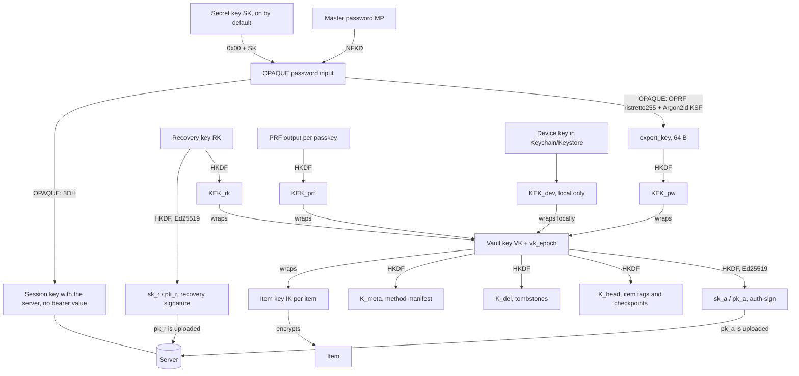

# Phase 1 – Security design for Faithful Ferret

> [!NOTE] Status
> This is draft 2. It builds on draft 1 and on an independent review with 38 findings. Every finding has been handled (§ 0).
> The draft builds on the idea note, the roadmap for v1 and the phase 0 report. These are not published.
> - **References** such as U2, U17 and E11 point to clarifications in the implementation plan. Where a clarification matters for the design, its content is written into this document.
> - **Applies to all clients:** web vault, browser extension, iOS and Android. Step B therefore needs no new design.
> - **Purpose:** cover gates 3, 4 and 6, and the design part of gate 5.
> - **Cryptography:** nothing here is home-grown. We use established constructions: OPAQUE (RFC 9807), Argon2id (RFC 9106), HKDF-SHA256 (RFC 5869), XChaCha20-Poly1305, Ed25519 (RFC 8032), ECDSA P-256. The libraries are `opaque-ke`, RustCrypto and dalek.
> - **Labels:** "Default choices" are defaults that can be changed later. "Maintainer's decisions" are marked where the maintainer has already decided.
> - **One maintainer decision is reversed:** sign-in moves from "Bitwarden style with a login value" to OPAQUE in v1. See E11 in § 16. The old design is in Appendix A.
> - **Finally:** the document ends with a list of decisions the maintainer must make (§ 16).

---

## 0. Changes from draft 1

One line per finding. Severity is in parentheses. All fixes are included as the review presented them, with the clarifications that came afterwards.

| ID | Change |
|---|---|
| F-01 (critical) | The client has built-in floors and ceilings for Argon2id parameters. With OPAQUE they never come from the server. Pinning per device, upgrades controlled by the client only, and the emergency sheet carries a QR with server and account (§ 4.1, 4.2, 13). |
| F-02 (high) | OPAQUE replaces the login value (E11, reverses a maintainer's decision). SK is on by default (E12). The SK bit is pinned locally and never taken from the server. A1–A3 are rewritten to be accurate. The old LV design is in Appendix A (§ 2.2, 4.2). |
| F-03 (high) | "Rotate vault key" is now a full rekey: new VK, new IK, `vk_epoch`, atomic endpoint, revocation of all others. Procedure for a stolen device. Backup is kept for 30 days (E14) (§ 4.7, 7.6). |
| F-04 (high) | Filling happens primarily outside the page DOM. The in-page menu is secondary, with a full ancestry check, `isTrusted`, a delay and tainting (§ 10.3). |
| F-05 (medium) | The recovery proof is changed from MAC and verifier to an Ed25519 signature from RK. RK is rotated after use, sessions are revoked, and the user is notified (§ 6.3). |
| F-06 (medium) | OPAQUE's fake response covers pre-login. Other paths for account discovery and timing are specified (§ 4.2, 11). |
| F-07 (medium) | The wrap AAD is TLV with suite, account, vault, method, `vk_epoch`, `kek_generation` and KDF parameters. A method manifest sits inside the vault. All changes to wraps require signed proof (§ 3.1, 4.3, 4.6). |
| F-08 (medium) | Item tags (`tag`, HMAC under `K_head`) and signed checkpoints (`{seq, digest, mac}`) replace a head chain, so writes to different items stay independent (*default choice*). A durable non-secret record and the action "accept older state". The residual risk is spelled out (§ 8.6). |
| F-09 (medium) | Tombstones are authenticated with `K_del`. Local trash for 30 days. Unverified deletions are quarantined (§ 8.4). |
| F-10 (medium) | The mobile PIN is bound to hardware-enforced rate limiting. The browser extension's PIN is only a convenience and is kept in memory only. The "PIN after restart" option is removed (E3 is gone) (§ 7). |
| F-11 (medium) | Auto-lock with `chrome.alarms` and `lockAt`. VK lives only in an offscreen document or worker, encrypted under a session key in `storage.session`. Strict CSP and Trusted Types (§ 7.2). |
| F-12 (medium) | The passkey origin is the calling frame. Cross-origin requests are denied in v1. The request is bound to `(tabId, frameId, documentId, origin, rpId, challenge-hash)`. Exact `rp_id` at signing (§ 9.2). |
| F-13 (medium) | The override is off on Ferret's own origin. Ferret passkeys can never be an unlock factor (§ 9.4). |
| F-14 (medium) | § 2.4 is rewritten honestly: SRI does not help against a malicious operator. Own origin and a full header list. PWA pinning and a hash check in the browser extension are "after v1" (§ 2.4, 12). |
| F-15 (medium) | List of sensitive operations that need MP again, 2FA and a signature from a VK-derived Ed25519 key. Session revocation and notifications. Delay on e-mail change (§ 4.6). |
| F-16 (medium) | No tokens in URLs. Short-lived access tokens, rotating refresh tokens with reuse detection, device key (DPoP). SSE via fetch. CSRF protection (§ 7.6, 8.2). |
| F-17 (medium) | `Secret<T>`, an allowlist for error reporting, canary tests, a proxy without body logging, `RLIMIT_CORE=0` (§ 11). |
| F-18 (medium) | Rate limiting on operations and bytes, quotas per account, size limits, no server-side Argon2id (§ 8.2, 11). |
| F-19 (medium) | "Deterministic CBOR" is removed for bodies. Unknown fields are preserved, a newer schema is read-only, parser limits (§ 5.2, 13). |
| F-20 (medium) | One Rust core, WASM and UniFFI (Swift and Kotlin as bindings). The AutoFill extension never runs Argon2id (§ 3, 14). |
| F-21 (medium) | The emergency sheet is two sheets. Setup requires typing RK and SK in full, and actually unwraps locally (§ 6.1). |
| F-22 (medium) | The default match is the exact host. Registrable domain is a per-item choice (E13). PSL with private domains. Frame rule per frame (§ 10.4, 10.5). |
| F-23 (low) | The Unicode version is pinned for suite 1. Rejection rules and the unit of length. More test vectors (§ 3.1, 4.1, 14). |
| F-24 (low) | All AADs are TLV. UUIDs are 16 raw bytes. All AADs carry `suite`; which ones also carry `version` and `kind` is stated in the AAD lists in § 4.3, § 5 and § 8.4 (body and manifest have all three) *(clarified 2026-10-30)*. Padding is ISO/IEC 7816-4 (§ 3.1, 5). |
| F-25 (low) | Key commitment (`commit`) on wraps made from human secrets: password and PIN (§ 4.3). |
| F-26 (low) | Exact encodings for RK and SK with checksums. 14 groups of 4 and 6 groups of 5 (§ 6.1, 6.2). |
| F-27 (low) | The export format binds the whole header in the AAD, validates parameters on import, uses stronger parameters, and protects CSV (§ 6.4). |
| F-28 (low) | Idempotency stores the request hash. `min_valid_since`, `as_of_seq`, a dedicated `seq` counter and the rules for batches are defined (§ 8.3, 8.4). |
| F-29 (low) | Two PRF seeds (with and without UV), one fixed AAGUID that is open, `NotAllowedError` when UV is missing, no distinction between "does not exist" and "cancelled" (§ 9.3, 9.5). |
| F-30 (low) | `https` items are never filled on `http`. Clipboard, MV3 manifest and a private bridge between the MAIN world and the content script (§ 10). |
| F-31 (low) | TOTP: allowlist for `otpauth://`. The Ferret account's own 2FA secret must not be stored in the vault (§ 5.2). |
| F-32 (low) | Zeroize feature in `argon2`, a dedicated worker that is terminated, `mlock` on mobile, constant time also on WASM output (§ 2.3 L6, 3). |
| F-33 (low) | `account_id` is on the emergency sheet and in the QR. A separate flow for moving to a new server (§ 4.1, 6.1). |
| F-34 (low) | Rate limiting on (account, IP) plus a soft limit per account, no hard lockout (§ 11). |
| F-35 (note) | iOS: `WhenPasscodeSetThisDeviceOnly` and no passcode fallback on biometrics. Android: per-operation authentication with `CryptoObject`, StrongBox, strong biometrics only (§ 7.4, 7.5). |
| F-36 (note) | Rule for the mobile passkey provider: trust only the origin the operating system supplies (§ 9.7). |
| F-37 (note) | The README says there is no external audit. A paid review or a bug bounty before 1.0 is a maintainer's decision (E15) (§ 2.3 L7, 14). |
| F-38 (note) | The minimum MP length is 12 with SK and 15 without, plus an estimator and a local blocklist without SK (§ 4.1, E8). |

**Other changes:** E3 is removed. E11–E15 are new. The device token from draft 1 is replaced by access and refresh tokens (§ 8.2). Phase 2 in vole-kit gets an OPAQUE module instead of a login value (§ 16).

---

## 1. Scope and terms

| Term | Meaning |
|---|---|
| **Account** | Sign-in on the Ferret server (vole-kit): e-mail, OPAQUE record (no password value), 2FA/passkey for the server. |
| **Vault** | The user's encrypted items. One vault per user in v1 (no sharing). |
| **MP** | The master password. Never leaves the client. |
| **SK** | Secret key (*Secret Key*), 128 random bits. **On by default**, can be opted out of with a warning (E12). Maintainer's decision: optional per user. |
| **VK** | The vault key, 256 random bits. Encrypts the keys of the items. The server never sees it. |
| **`vk_epoch`** | Counter (u64, starts at 1) that increases on every full rekey. Part of the AAD of all wraps. |
| **IK** | Item key, 256 random bits per item, wrapped with VK. |
| **KEK** | Key that wraps VK. One per unlock method. |
| **`kek_generation`** | Counter per method (u64, starts at 1). Increases each time the wrap for the method is replaced. The largest valid value is 2^32 − 1; a larger value is rejected (*clarified 2026-10-30*). |
| **RK** | Recovery key, 256 random bits. Shown at setup. |
| **`export_key`** | Output of OPAQUE (64 bytes) known only to the client. Yields `KEK_pw`. |
| **`sk_a` / `pk_a`** | Ed25519 key derived from VK. Signs changes to wraps. The server has only `pk_a`. |
| **`sk_r` / `pk_r`** | Ed25519 key derived from RK. Signs recovery. The server has only `pk_r`. |
| **Unlock** | The client obtains VK locally. Separate from sign-in. |

---

## 2. Threat model (gate 3)

### 2.1 Assets to protect
1. The plaintext of the vault: passwords, TOTP seeds, passkey private keys, notes.
2. VK, IK, MP, SK, RK, `export_key`, `sk_a`, `sk_r` and all KEKs.
3. The integrity of the vault: no silent change, swap or deletion.
4. Availability: no silent data loss during sync, migration or recovery.

### 2.2 Attackers and what they must not achieve

One principle governs the numbers below: **whoever has the server's database and its OPAQUE setup (`opaque_setup`) can try MP guesses offline, at a cost of one Argon2id (64 MiB, t = 3) per attempt.** No design prevents this, because the wrap of VK is itself a check of the guess. What helps is SK. Keeping `opaque_setup` in a separate file outside the database (§ 11) only means that a leaked database file alone cannot be used. A full backup set and a full server takeover also contain `opaque_setup`.

| # | Attacker | Has | Must **not** get |
|---|---|---|---|
| A1 | Thief of database or backup | A: only the database file (for example a copied `ferret.db`). B: a full backup set, which also contains `opaque_setup` as a separate file | Plaintext. **A:** MP cannot be guessed at all, because the OPRF key is missing. **B:** each guess costs one Argon2id, and with SK it is impossible without SK. |
| A2 | Curious operator | Root on the server, `session.key`, `opaque_setup`, logs | Plaintext, VK or MP for users **with SK**. Without SK, A2 can guess MP at a cost of one Argon2id per attempt. The admin panel never shows vault content. |
| A3 | Malicious server (active) | Can change API responses, has the database and `opaque_setup` | The same as A2. It also cannot swap, change or mix items without detection (§ 5.3, 8.6). It cannot lower the Argon2id parameters (§ 4.2). **Exception:** the web vault's JavaScript (§ 2.4). |
| A4 | Network (MITM) or just loggers and proxies | Sees and changes traffic | The same as A3 if TLS is broken. What is seen gives nothing to guess against, because OPAQUE sends no bearer value. TLS is required. |
| A5 | Malicious web page | Runs JS in a tab | Credentials for other origins. Autofill or passkey use without a user action in Ferret's own UI. |
| A6 | Another browser extension or page script | Can change the DOM and imitate buttons | Cannot trigger autofill or passkey signing by imitating the Ferret UI (§ 10.3, § 9.4). |
| A7 | Thief of a locked device | The disk, the browser profile | Plaintext. A PIN does not allow offline guessing without hardware protection (§ 7). |
| A8 | Former device, signed out or revoked | Old local cache and VK from before the revocation | New changes after the revocation. **But** the device still has VK and IK for what it had. Only a full rekey (§ 4.7) changes that. See § 7.6. |

### 2.3 Outside the threat model (documented limitations)
- **L1 Compromised device or OS while the vault is unlocked.** The attacker can read what is open.
- **L2 Malicious update of a client.** This covers the browser extension, the app and the web vault's code. The protection is signed releases and a documented release process (§ 12).
- **L3 Loss of both MP and all recovery methods.** Then the data is gone. That is zero knowledge.
- **L4 Rollback, withholding and forking by the server.** Item tags and checkpoints (§ 8.6) catch mixing of items and rollback of single items for devices that have seen a newer checkpoint. **Residual risk:** a rollback of the newest writes since the last checkpoint, or of the whole vault to an older, consistent checkpoint, is noticed only by devices that have seen a newer checkpoint. A server can show two devices different histories (fork) without detection in v1. Withholding new changes cannot be detected either.
- **L5 Metadata.** The server sees the number of items, size after padding, timestamps, revisions, devices and IP addresses (§ 2.5). Padding does not hide the size class.
- **L6 Memory.** JavaScript and WASM cannot guarantee that keys are erased from memory. MP is a JS string before it reaches the core. We zeroize as well as we can (§ 3).
- **L7 No external audit.** The project has not had an independent cryptographic audit by a person. The README says so plainly. See E15.
- **L8 Old ciphertext.** Rekey does not protect ciphertext that has already leaked, for example old backups, or anything a thief has already read. That is why backup has a fixed retention period (E14).

### 2.4 The web vault's trust boundary (maintainer's decision, 2026-10-27)
- The web vault trusts the server that delivers the code. A malicious operator can deliver modified JavaScript that steals MP at unlock. This is stated in the README and on the sign-in page.
- **SRI and CSP do not protect against this.** The HTML with the integrity hashes comes from the same server as the scripts. They help against injected code (XSS) and against third-party CDNs, and we have no external origins.
- Countermeasures that do work against XSS and misconfiguration:
  - the web vault lives on its **own origin** (its own hostname), separate from the admin panel and other vole-kit pages (XSS in the admin panel would otherwise be XSS in the vault);
  - a full header list (§ 12);
  - the administrator can turn off the web vault.
- The **real** protection for those who fear the operator is the browser extension and the apps. They are recommended.
- **After v1:** an installable PWA with a service worker that pins the release by hash and requires confirmation for new code, and a hash check in the browser extension against the signed release list.

### 2.5 Metadata the server sees

| Sees | Does not see |
|---|---|
| E-mail, account creation, sign-in times and IP, devices (name set by the client) | MP, SK, RK, VK, IK, `export_key` |
| Item ID (random UUIDv4), revision, `seq`, deleted yes/no, size **after padding**, timestamps, item tags (`tag`) and checkpoint (`seq`, `digest`, `mac`) | Type, name, URL, username, password, notes, TOTP, passkeys |
| The OPAQUE record, `ksf_profile`, `pk_a`, `pk_r`, which unlock methods exist (password, RK, PRF IDs), an optional `sk_hint` (only a suggestion in the UI) | PRF output, device keys |

---

## 3. Primitives and libraries

| Use | Construction | Crate |
|---|---|---|
| Sign-in and password protection against the server | **OPAQUE** (RFC 9807) | `opaque-ke` |
| Password-based key derivation (OPAQUE KSF, PIN, export) | **Argon2id** v1.3 (RFC 9106) | `argon2` (with `zeroize`) |
| Key derivation and domain separation | **HKDF-SHA256** (RFC 5869) | `hkdf`, `sha2` |
| Symmetric encryption | **XChaCha20-Poly1305** (24-byte random nonce) | `chacha20poly1305` |
| Signatures for change proofs (VK and RK) | **Ed25519** (RFC 8032) | `ed25519-dalek` |
| Passkeys | **ECDSA P-256 / SHA-256** (ES256) | `p256` (`ecdsa`) |
| TOTP | HMAC-SHA1/256/512 (RFC 6238) | `hmac`, `sha1`, `sha2` |
| Item tags and checkpoints | HMAC-SHA256 | `hmac`, `sha2` |
| Randomness | OS CSPRNG | `getrandom` (WASM: `crypto.getRandomValues`) |
| Zeroization | `Zeroize`/`ZeroizeOnDrop` on all key types | `zeroize` |
| Constant-time comparison | – | `subtle` |
| Unicode normalization of MP | NFKD, table version pinned | `unicode-normalization` |

**Rules:**
- **One core.** All crypto code (envelope, AAD, padding, CBOR, KDF, OPAQUE client, TOTP, WebAuthn) exists only **once**, in a Rust core. It is compiled to WASM (web and browser extension) and to native libraries through UniFFI for iOS and Android. Swift and Kotlin are bindings, not separate implementations.
- The AutoFill extension on iOS and its equivalent on Android **never** run Argon2id. They use the shared `KEK_dev` (§ 7.4).
- All keys are dedicated types (`VaultKey`, `ItemKey` and so on) that cannot be copied and that are zeroized.
- There is no `Debug` or `Display` for key types.
- `argon2` runs with the `zeroize` feature on. In the browser, Argon2id for sign-in runs in the long-lived vault worker, which is terminated and restarted on lock (U2). Only export and import use a separate worker that is terminated after each use *(corrected 2026-10-30)*. On mobile, `mlock` is used where possible, and app data backup is off.
- Dependencies are locked with `cargo-deny` (licenses and RustSec advisories) and `cargo-vet`.
- **Crypto suite** is in every envelope as `suite: 1`. Suite 1 means: OPAQUE with the Argon2id profiles in § 4.2, HKDF-SHA256, XChaCha20-Poly1305, Ed25519. A new suite gets a new value and new label prefixes (`ferret/v2/...`), and the old one stays readable.

### 3.1 Encoding rules (apply everywhere)

- **UUID** (`account_id`, `vault_id`, `item_id`, `method_id`) is always **16 raw bytes** in RFC 4122 order. Never text form.
- **Integers** are big-endian: `u8`, `u32be`, `u64be`.
- **TLV:** `tlv(tag, value) = tag (1 byte) ‖ len (u16be) ‖ value`. `value` is at most 65 535 bytes.
- **AAD and HKDF salts** are a concatenation of TLV fields in the order given, with no other delimiter. Written `TLV[field1, field2, ...]`. Each field name has one fixed tag from the table.
- **Labels** (`label`) are ASCII and start with `ferret/v1/` for suite 1.
- **`AEAD(key, nonce, pt, aad)`** is XChaCha20-Poly1305. The result is stored as `nonce (24) ‖ ct ‖ tag (16)`. The nonce is 24 random bytes, new for every encryption.

| Tag | Field | Encoding |
|---|---|---|
| 0x01 | `label` | ASCII |
| 0x02 | `version` | u8 |
| 0x03 | `suite` | u8 |
| 0x04 | `kind` | u8 (1 = item, 2 = manifest) |
| 0x10 | `account_id` | 16 bytes |
| 0x11 | `vault_id` | 16 bytes |
| 0x12 | `item_id` | 16 bytes |
| 0x13 | `method_id` | 16 bytes |
| 0x14 | `method_type` | u8 (1 = password, 2 = recovery, 3 = prf, 4 = pin, 5 = device) |
| 0x20 | `vk_epoch` | u64be |
| 0x21 | `kek_generation` | u64be |
| 0x22 | `rev` | u64be |
| 0x23 | `seq` | u64be |
| 0x30 | `kdf` | `m_kib` u32be ‖ `t` u32be ‖ `p` u32be (12 bytes) |
| 0x31 | `credential_id` | bytes |
| 0x32 | `prf_salt` | 32 bytes |
| 0x33 | `nonce` (challenge from the server) | 32 bytes |
| 0x35 | `hash` | 32 bytes |
| 0x36 | `op` | ASCII |
| 0x37 | `device_salt` | 16 bytes |
| 0x38 | `salt_a` (Appendix A only) | 16 bytes |
| 0x39 | `header` | bytes (export header, stored verbatim) |

**MP normalization (F-23):** `mp = NFKD(MP)` as UTF-8, Unicode table version **pinned in the specification for suite 1** (Unicode 16.0, *default choice*).
- Reject: lone surrogates, characters that are not assigned in the pinned table, and all control characters (category Cc, including U+0000).
- Length is counted in Unicode scalar values. The minimum is checked after NFC, the maximum (1 024) after NFKD (clarified 2026-10-29, U9). NFC is never longer than NFKD, so the minimum is never weaker. Input with more than 1 024 scalars is rejected before NFKD. At most 4 096 bytes as UTF-8.
- NFKD merges visually different characters ("fi" and "fi", full-width digits). This causes a small loss of entropy. It is accepted and documented.

---

## 4. Key hierarchy (gate 4)



### 4.1 From master password to OPAQUE input
1. `mp = NFKD(MP)` as in § 3.1. Length: **at least 12** with SK, **at least 15** without SK (E8). At most 1 024.
2. **Without SK** the client also requires an estimate from a strength meter (zxcvbn score 4 or equivalent), and rejects passwords on a local list of the most common leaked passwords (a compact blocklist shipped with the client). The UI recommends generated passphrases (for example 6 words) and shows an estimate of how long the password would last against an attacker who has the database.
3. **OPAQUE input:**
   - without SK: `pwd = mp`;
   - with SK: `pwd = mp ‖ 0x00 ‖ SK` (SK is 16 raw bytes). The delimiter is unambiguous, because MP can never contain U+0000.
4. **No salt and no parameters come from the server.** That is OPAQUE's job (§ 4.2). Draft 1 had `salt_a` and an HKDF step here; both are gone.
5. **KDF floors and ceilings are built into the client** and cannot be turned off. They apply everywhere Argon2id is used (OPAQUE KSF, PIN, import of an export):
   - floor: `m ≥ 64 MiB`, `t ≥ 3`, `p` from 1 to 4. The floor is raised with each release;
   - ceiling: `m ≤ 512 MiB`, `t ≤ 16`, `p ≤ 4`;
   - outside the range: hard error "the server specifies unsafe parameters". Nothing is computed.
6. **`account_id`** is a UUID the server assigns at registration. It is in the HKDF salts and in all wraps, so identical passwords on two accounts never give the same keys. It is pinned locally (§ 4.2) and is on the emergency sheet and in the QR code. There is a separate flow for moving to a new server: export, import, or rewrap under a new `account_id` while the vault is open (F-33).

### 4.2 Sign-in to the server: OPAQUE (E11, reverses the maintainer's decision from 2026-10-27)

> [!WARNING] Reversal of a maintainer decision
> On 2026-10-27 the maintainer chose "Bitwarden style now, OPAQUE after v1". The review shows that the login value (LV) is a bearer value and an offline oracle for MP when SK is not used (F-02). OPAQUE removes both. The recommendation is therefore OPAQUE in v1. This is E11 in § 16. If the maintainer says no, Appendix A applies.

**Configuration (RFC 9807, crate `opaque-ke`, version pinned):**

| Part | Choice |
|---|---|
| Group and OPRF | ristretto255 with SHA-512 |
| Key exchange | 3DH over ristretto255 |
| Hash, MAC, KDF | SHA-512, HMAC-SHA-512, HKDF-SHA-512 |
| KSF (stretching) | **Argon2id** v1.3, salt = 16 zero bytes, output 64 bytes (= `Nh`), parameters from `ksf_profile` |
| Envelope | internal mode (default in RFC 9807) |
| Context | ASCII `ferret/v1/opaque` |
| `credential_identifier` | `account_id` (16 raw bytes). Only the server needs it. |
| Identities | client and server use the default (public keys). E-mail is not included, so an e-mail change does not touch the record. |

**KSF profiles (built into the client, in a table):**

| `ksf_profile` | `m` | `t` | `p` |
|---|---|---|---|
| 1 | 64 MiB (65 536 KiB) | 3 | 1 |

- The server states only the number `ksf_profile`. The client looks it up in its own table. An unknown profile, or a profile below what is pinned on the device, is a hard error. The parameters are never sent over the network.
- Because `ksf_profile` determines `export_key`, a downgrade is always detected: a different profile gives a different `KEK_pw`, and the unlock fails (and the AAD of the wrap has `kdf`, § 4.3).
- The Argon2 trait in `opaque-ke` is to be used through a dedicated wrapper that carries the profile's parameters. A test vector in the cross-client tests pins this (§ 14).

**Registration** (`POST /api/auth/opaque/register/start` and `/finish`, only with an invitation or a valid session):
1. The client sends the e-mail and `registration_request`. The server answers with `registration_response` and a new `account_id` and `vault_id`.
2. The client generates VK, SK (if on), RK, `sk_a`, `pk_a`, `sk_r`, `pk_r`, creates the wraps and the manifest (§ 4.3, 4.5, 6), and sends everything in `finish` together with `registration_record`.
3. The server stores the record in `opaque_records` with `ksf_profile`. It stores nothing that can be used to sign in without running OPAQUE.

**Sign-in** (`POST /api/auth/opaque/login/start` and `/finish`):
1. The client sends the e-mail and `ke1`. The server answers with `ke2`, a `login_id`, `ksf_profile` and an `sk_hint` (a suggestion only).
2. The client checks `ksf_profile` against its table and its pinned value, runs Argon2id, and sends `ke3` in `finish`. Everything after `ke2` happens locally, so a malicious server sees no MP-dependent value it can guess against.
3. The response gives `account_id`, `vault_id` and a session. If 2FA is on for the account, the session is **partial** until 2FA is complete. A partial session may not fetch wraps or changes (§ 4.6).
4. `export_key` is used to create `KEK_pw` (§ 4.3). The session key from 3DH is used for nothing else.

**Pinning and the SK bit (F-01, F-02):**
- After the first successful unlock, the device stores a non-secret record: `(server_url, account_id, ksf_profile, kek_generation_max, vk_epoch_max, sk_bit, pk_a)`. See also § 8.6. *Clarified 2026-10-30:* the full record is the one in § 8.6. It also has `vault_id` and the server's public OPAQUE key (U19). `kek_generation_max` is kept per method type (password, recovery) and per passkey, not one for the whole account.
- The server cannot change any of these. A mismatch gives a loud error, not "wrong password".
- **The SK bit is never taken from the server.** On a new device, the sign-in screen asks explicitly: "Does this account have a secret key?". `sk_hint` is only a preselection. If the device holds `sk_bit = yes` and the server claims "no SK", that is a hard error with a warning about a possible attack. The emergency sheet's QR also carries "SK: yes/no".
- On a completely new device without an emergency sheet, the first sign-in is trust on first use (TOFU) for `account_id`, but not for the KSF parameters (the floor applies) and not for SK.

**Upgrading the KSF profile** (F-01 point 3): only the client starts it. The server can say "upgrade available" (yes/no). The client picks `max(current, profile in this build)`, runs a new OPAQUE registration at the next unlock with MP, creates a new `KEK_pw` and a new password wrap, and sends everything as one signed change (§ 4.6). A profile lower than the pinned one is never allowed.

**Unknown e-mails and account discovery (F-06):**
- OPAQUE's fake response for an unknown user (`ServerLogin::start` without a record) replaces the fake salt from draft 1. The fake `credential_identifier` is `HMAC-SHA256(server_secret_prelogin, "prelogin-id" ‖ lower(email))[..16]`. The fake `ksf_profile` is the server's default. The fake `sk_hint` is a stable bit from the same HMAC.
- `server_secret_prelogin` is durable, backed up and kept separate from `session.key`. If it were rotated, fake responses would change over time while real ones would not, so it is not rotated.
- Same code path, same error body, status code and headers for known and unknown accounts. One rate limiter **per IP** (not per account) on `login/start`.
- Other paths that must not reveal whether an account exists: registration ("e-mail exists"), invitation, 2FA recovery, e-mail from the administrator's reset, device endpoints, and 429 responses. All give the same response regardless.
- Integration test: compare response bytes and delay distribution for known and unknown e-mail.

**What OPAQUE gives and does not give (honestly):**
- Gives: no bearer value on the server or in logs. No precomputation. The server cannot guess against what it sees in network traffic. Parameters cannot be lowered. No server-side Argon2id to attack (§ 8.2).
- Does not give: protection against whoever has both the database and `opaque_setup`. Then each guess costs one client Argon2id (A2, A3). SK is the answer to that.

### 4.3 Vault key and wraps
- **VK** = 32 random bytes, created once at setup. `vk_epoch = 1`. It changes only on a full rekey (§ 4.7).
- **KEK derivations** (HKDF-SHA256, 32 bytes out):

  ```
  KEK_pw  = HKDF(salt = TLV[label="ferret/v1/kek/password", account_id],
                 ikm  = export_key,
                 info = "ferret/v1/kek/password")
  KEK_rk  = HKDF(salt = TLV[label="ferret/v1/recovery", account_id],
                 ikm  = RK,
                 info = "ferret/v1/kek/recovery")
  KEK_prf = HKDF(salt = TLV[label="ferret/v1/prf", credential_id],
                 ikm  = prf_output,
                 info = "ferret/v1/kek/prf")
  ```
- **Wrap** per method:

  ```
  wrap = AEAD(key = KEK_x, nonce, pt = VK, aad = aad_wrap)

  aad_wrap = TLV[ label="ferret/v1/wrap", suite, account_id, vault_id,
                  method_type, method_id, vk_epoch, kek_generation,
                  + method-specific ]
  ```
  - `password`: adds `kdf` (= the parameters in `ksf_profile`). There is no `salt_a` in the OPAQUE design.
  - `prf`: adds `credential_id` and `prf_salt`.
  - `recovery`: no extra fields.
  - `device` (local method, never on the server): no extra fields and no key commitment. The AAD is 104 bytes, the wrap 72 bytes *(clarified 2026-10-30, see `docs/WRAP-AAD.md` in the repo)*.
- **Key commitment (F-25):** for `password` (and for local `pin`), `wrap` is extended by 32 bytes at the end: `commit = HKDF(salt = none, ikm = KEK_x, info = "ferret/v1/commit")`. The recipient checks `commit` in constant time **before** AEAD is opened. This stops attacks where one ciphertext opens under several keys. Length: `password` 24 + 32 + 16 + 32 = 104 bytes. The others 72 bytes.
- **Stored on the server** in `unlock_methods`: `method_id` (UUID), `method_type` (`password`, `recovery`, `prf`), `wrap`, `kek_generation`, `created_at`, and for PRF also `credential_id`, `prf_salt` and AAGUID. Device methods (`device`, `pin`) are stored locally only.
- **The client remembers** the highest `kek_generation` and `vk_epoch` per account and rejects lower ones (§ 4.2, § 8.6). The server therefore cannot roll back an old wrap.
- **Method manifest (F-07):** an AEAD item inside the vault (`kind = 2`, key `K_meta`, § 4.5) that lists `(method_type, method_id, kek_generation)` for all server-stored methods, with `vk_epoch`. For a passkey (`prf`), `credential_id` is also in the entry (Appendix B, key `c`), so that the floor for `kek_generation` is tied to the credential by the authenticated manifest and not by a mapping from the server (2026-10-29, task 6). After every unlock, the client compares the server's list with the manifest and warns about missing or unknown methods. The user also sees "recovery key exists: yes". The manifest is updated in the same request as a change to wraps.
- **Changing MP:** new OPAQUE registration, new `KEK_pw`, new password wrap with `kek_generation + 1`. VK, IK and the items are unchanged. Sensitive operation (§ 4.6). It does not touch old backups: whoever knows the old MP and has an old backup can still open VK. Only a full rekey (§ 4.7) changes that.
- **Removing a method** deletes only that wrap. There must always be at least `password` and `recovery`. The server and the client refuse to remove the last of each.

### 4.4 Item keys
- **Why IK per item:** it allows sharing after v1 without re-encrypting everything, VK rotation by wrapping IK again, and a clear separation for passkeys. The cost is 72 bytes per item.
- **Wrapping IK:**

  ```
  ik_wrap = AEAD(VK, nonce, pt = IK,
            aad = TLV[ label="ferret/v1/item-key", version, suite,
                       vault_id, item_id, vk_epoch ])
  ```
  `vk_epoch` makes a wrap from the wrong epoch fail closed.

### 4.5 Derivations from VK and signing keys

All four are derived with the same function. `name` is `info`.

```
vk_derive(name) = HKDF-SHA256(
    salt = TLV[ label="ferret/v1/vk-derive", account_id, vault_id, vk_epoch ],
    ikm  = VK,
    info = name,  L = 32 )
```

| Key | `name` | Use |
|---|---|---|
| `K_head` | `ferret/v1/head` | HMAC for item tags and checkpoints (§ 8.6) |
| `K_del` | `ferret/v1/tomb` | AEAD tag on tombstones (§ 8.4) |
| `K_meta` | `ferret/v1/meta` | Method manifest (§ 4.3) |
| `seed_a` | `ferret/v1/auth-sign` | Ed25519 seed for `(sk_a, pk_a)` |

Because `vk_epoch` is in the salt, each epoch gets new keys.

**The auth-sign key:** `(sk_a, pk_a) = Ed25519(seed_a)`. `pk_a` is uploaded at setup and at every rekey. The server has only `pk_a`.

**The recovery key:**

```
seed_r = HKDF-SHA256(salt = TLV[ label="ferret/v1/recovery-sign", account_id ],
                     ikm = RK, info = "ferret/v1/recovery-sign", L = 32)
(sk_r, pk_r) = Ed25519(seed_r)
```

### 4.6 Sensitive operations and signed proofs (F-15, F-05, F-07)

**Sensitive operations:** add or remove an unlock method, change MP, regenerate or show RK, change e-mail, export, show SK or the SK QR, full rekey, revoke all devices, upgrade the KSF profile.

Every sensitive operation requires **all three**:
- (a) MP again in the client within the last 5 minutes (a new OPAQUE sign-in with `purpose: "reauth"`, even if the vault is already open);
- (b) fresh 2FA for the account, when 2FA is on;
- (c) for changes to wraps and the manifest: a **signature** from `sk_a` (or `sk_r` for recovery).

**The signature:**
1. The client fetches a challenge: `POST /api/auth/challenge` returns `{nonce (32 bytes), expires_in: 300}`. The nonce is single-use and bound to the session.
2. The client sends the body together with the headers `Ferret-Nonce` and `Ferret-Proof`. The proof is:

   ```
   Ferret-Proof = Ed25519.Sign(sk_a,
       TLV[ label="ferret/v1/mutation", op, account_id, nonce,
            vk_epoch, hash = SHA-256(request body) ])
   ```
   `op` is the name of the operation (for example `unlock-method.add`). For recovery, `sk_r` and `label = "ferret/v1/recovery-req"` are used.
3. The server checks the signature against `pk_a` (or `pk_r`), that `nonce` is unused and under 5 minutes old, and that `hash` matches. The proof is bound to the exact body, including the new wrap.

Without the proof, an attacker with only a session cannot even delete a wrap. Partial sessions (before 2FA) do not get `unlock-methods` or `changes`.

**After an MP change, recovery and rekey:** all other sessions and device tokens are revoked (for an MP change the user can opt out, with a clear warning).

**E-mail notifications** (to the old and the new address on an e-mail change): new device, new unlock method, MP change, recovery used, RK regenerated, export, e-mail change, 2FA change, device revoked.

**An e-mail change** takes effect after 24 hours with a cancellation link, when 2FA is off.

**The Ferret account's own 2FA secret must not be stored in the vault.** The UI warns on entry (otherwise security becomes circular). The admin's reset of account sign-in and 2FA recovery codes never touch the vault, but they trigger notifications.

**Endpoints for the vault:**

| Method | Path | Proof | Body |
|---|---|---|---|
| `GET` | `/api/vault/unlock-methods` | full session | list of wraps, `pk_a`, `kek_generation`, `vk_epoch` |
| `POST` | `/api/vault/unlock-methods` | sensitive + `sk_a` | `{method_type, method_id, wrap, kek_generation, credential_id?, prf_salt?, manifest}` |
| `DELETE` | `/api/vault/unlock-methods/{method_id}` | sensitive + `sk_a` | `{manifest}` |
| `PUT` | `/api/vault/unlock-methods/password` | sensitive + `sk_a` | `{registration_record, ksf_profile, wrap, kek_generation, manifest}` (MP change and KSF upgrade) |
| `PUT` | `/api/vault/unlock-methods/recovery` | sensitive + `sk_a` | `{wrap, kek_generation, pk_r, manifest}` (RK is regenerated) |
| `POST` | `/api/vault/recover` | `sk_r` | see § 6.3 |
| `POST` | `/api/vault/rekey` | sensitive + `sk_a` (old) | see § 4.7 |
| `POST` | `/api/auth/challenge` | session | `{nonce, expires_in}` |

### 4.7 Full rekey (F-03)

Draft 1 called this "rotate vault key", but it did not replace IK. Now it is a full rekey.

- **Endpoint:** `POST /api/vault/rekey`, one atomic transaction. No series of individual PUTs (a half-finished rekey gives a mixed state).
- **The client does:**
  1. `VK' = random(32)`, `vk_epoch' = vk_epoch + 1`. New `K_head`, `K_del`, `K_meta`, `seed_a` (and so `pk_a'`).
  2. For each item: new `IK' = random(32)`, re-encrypt the body (new nonce, `rev + 1`), new `ik_wrap`. For each tombstone: new tag under `K_del'`.
  3. New wraps for the methods: `password` (same `KEK_pw`, new AAD and `kek_generation + 1`). `recovery`: **always a new RK**, shown to the user, with a new `pk_r`. `prf`: removed; the user registers again afterwards. `device`: other devices must unlock with MP.
  4. A new manifest, new item tags (`tag`) under the new `K_head`, and a new checkpoint (§ 8.6).
- **The request:** `{base_seq, vk_epoch', pk_a', pk_r', items[], unlock_methods[], manifest, checkpoint}`, signed by the old `sk_a`. The server applies all or nothing, and fails if `base_seq` is not the top.
- **In the same transaction:** all other sessions and device tokens are revoked. All remaining devices see `vk_epoch'` and must do a full reconciliation (§ 8.4). The rekey proof (signed with the previous `sk_a`) is stored, and the devices check it against the `pk_a` they have pinned.
- **Alternative action:** "Change MP and rotate keys" in one operation. Recommended when MP has leaked.
- **Documented honestly:** rekey does not protect ciphertext that has already leaked, and not what a thief has already read (L8).

---

## 5. Item format and integrity

### 5.1 Envelope (what the server stores, as bytes)
```
version  u8   = 1
suite    u8   = 1
kind     u8   = 1 (item) or 2 (manifest)
ik_wrap  [24 nonce ‖ 32 ct ‖ 16 tag]   (kind = 1 only)
body     [24 nonce ‖ ciphertext ‖ 16 tag]
```
- For `kind = 2` there is no `ik_wrap`, and the body is encrypted with `K_meta` instead of IK.
- **The server rejects** unknown `version`, `suite` or `kind`, and oversize payloads, **before** any work in the database.
- `version`, `suite` and `kind` are in the AAD (see below), so a server cannot swap them without detection.

### 5.2 Body
- **Format:** the plaintext is CBOR. Deterministic encoding is **not** used for the body: nothing hashes or signs the plaintext, so it is not needed and cannot be enforced across four languages. What is hashed is the ciphertext (§ 8.6).
- **Content:** `{ schema: 1, type, name, fields[], urls[], totp?, passkey?, notes?, created, modified, favorite, … }`.
- **The decoder rejects:** duplicate keys, indefinite lengths, tags outside an allowlist, depth over 16, arrays or maps with more than 10 000 elements, text or byte strings over 64 KiB. *Clarified 2026-10-30:* the allowlist for tags is empty. Floating-point numbers in known fields are rejected. In unknown fields they are kept and written back unchanged. Unknown keys are written back after the known keys (in schema order), in the order they were read. This applies to both body and manifest.
- **Unknown fields are preserved.** The client decodes into a typed structure plus `extra: Map`, which is written back unchanged. An item with a `schema` higher than the client knows is opened **read-only** and is never rewritten ("update the app to edit"). Migration between schemas is explicit, one-way, and done only by a client that understands both.
- **Padding:**
  ```
  padded = plaintext ‖ 0x80 ‖ 0x00 × n
  ```
  (ISO/IEC 7816-4). The length of `padded` is the smallest of 256, 512, 1 024, 2 048, 4 096, then every 4 096, that is at least `len(plaintext) + 1`. At most 61 440 bytes of padded body in v1, so that the whole envelope is ≤ 65 536 bytes (clarified 2026-10-29). Remove it by searching backwards for the last `0x80` followed only by zero bytes. No compression before encryption. The size class leaks (L5).
- **AEAD for the body:**
  ```
  body = AEAD(IK, nonce, pt = padded_cbor,
         aad = TLV[ label="ferret/v1/item", version, suite, kind,
                    vault_id, item_id, rev ])
  ```
  For `kind = 2` the key is `K_meta` and `label = "ferret/v1/manifest"`.
- **`rev`** is the revision the item **gets** after the write, always `base_rev + 1`, which the server assigns deterministically.
  - The client encrypts with the expected `rev`.
  - The server stores only if `base_rev` matches.
  - If the server accepts a write with a `rev` other than the one the client encrypted for, decryption fails on all clients, and this is detected.
  - The client trusts `rev` only after the AAD check has passed.
- **TOTP (F-31):** the seed is in the body. `otpauth://` is read with an allowlist: algorithm SHA1/SHA256/SHA512, digits 6–8, period 1–120, base32 with tolerance for padding, unknown parameters rejected, a maximum length for the secret. Codes are generated only in the core from the device clock. Codes are never logged. The UI warns that password and TOTP in the same vault mean a vault breach also takes the second factor.

### 5.3 What the AAD binding gives
- **Swapping:** the server cannot present the content of item X as item Y, because `item_id` is in the AAD.
- **Revision forgery:** the server cannot present old content under a new revision, because `rev` is in the AAD. **But** an old valid pair `(blob, rev)` decrypts correctly if the server presents it as current. This is caught by item tags and checkpoints (§ 8.6), not by the AAD alone.
- **Vault mixing:** the server cannot move an item to another vault, because `vault_id` is in the AAD.
- **Downgrade:** `version`, `suite` and `kind` are in the AAD.
- **Modification:** any modification causes a decryption error, including unknown `version`, `suite` and `kind` bytes as long as only suite 1 exists (clarified 2026-10-29), so the server cannot get the client to ask for an update. The client shows "the item is damaged", keeps the last good local version and logs it, without content.

### 5.4 Nonces
- All nonces are 24 random bytes from the OS CSPRNG, new for every encryption.
- XChaCha20 makes random nonces safe: the collision probability is about 2⁻⁹⁷ at 2⁴⁸ messages per key.
- No counters or deterministic nonces.

---

## 6. Recovery (maintainer's decision: RK + encrypted export, the user's own only)

### 6.1 Recovery key (RK) and emergency sheet
- **RK** is 32 random bytes.
- **Code (F-26):** the 256 bits are written as a bit stream, most significant bit first, and padded with 4 zero bits to 260 bits. That gives 52 characters in Crockford Base32. Then 4 check characters: the first 20 bits of `SHA-256("ferret/v1/rk-check" ‖ RK)`. In total 56 characters, shown in **14 groups of 4**, with the prefix `FFR1-` and a hyphen between the groups.
- **Reading:** upper-case letters; `O` becomes `0`, `I` and `L` become `1`; hyphens and spaces are removed. Reject if the four spare bits are not zero (canonical encoding) or the checksum does not match ("typo"). The checksum is checked before any KDF.
- **Use:** `KEK_rk` and `seed_r` (§ 4.3, 4.5). RK has full entropy, so Argon2id is not needed.
- **Emergency sheet (F-21):** a PDF created locally in the client, as two sheets. Nothing is sent to the server.
  - **Sheet 1:** server URL, e-mail, `account_id`, `ksf_profile`, SK (if on) and a QR with the server URL, `account_id`, `ksf_profile` and "SK: yes/no". *Clarified 2026-10-30:* the QR also carries the server's public OPAQUE key (U19). The format is `ferret-setup:v1?u=…&a=…&k=…&s=…&o=…` with percent-encoding and at most 512 bytes of URL (U17). This closes trust on first use on a new device (F-01 point 6).
  - **Sheet 2:** RK only. Labelled to say that it opens the vault on its own and must be stored apart from sheet 1.
  - No saving to synced folders by default. Print it, or "save as file" with a warning. PDF buffers are zeroized after use.
  - Optional: the RK sheet encrypted with a passphrase (same KDF as the export format, § 6.4) for those who store the kit digitally.
- **Confirmation at setup:** the user types the **whole** RK. The client actually unwraps the recovery wrap locally with the typed RK and compares VK. The same for SK: the user types it, and it is compared in constant time with the one that was created. Setup does not complete until both match.

### 6.2 Secret key (SK)
- SK is 16 random bytes (128 bits). Code: pad to 130 bits with 2 zero bits, 26 Crockford Base32 characters, plus 4 check characters (the first 20 bits of `SHA-256("ferret/v1/sk-check" ‖ SK)`). In total 30 characters, shown in **6 groups of 5**, with the prefix `FFS1-`. Reading as for RK.
- Stored locally on each device (in Keychain/Keystore where available) and on the emergency sheet.
- A new device gets SK by typing it in or by QR from an existing device. The QR is shown only when the vault is open and after a sensitive-operation check.
- **On by default (E12).** If the user opts out of SK, a warning says that MP is then the only barrier against whoever has the database and the OPAQUE setup, and the MP requirement is tightened (15 characters, estimator, blocklist, § 4.1).

### 6.3 Recovery flow (new device, forgotten MP)
1. The user gets a session for the account. If the user has also forgotten MP, OPAQUE cannot run, so the administrator resets the **account sign-in** (one-time code, vole-kit). This never touches the vault. The session is a reset session: it may only fetch the recovery wrap and call `recover`.
2. The client asks for RK and unwraps VK via `KEK_rk` (`method_type = recovery`).
3. The user chooses a new MP (and keeps or replaces SK). The client runs a new OPAQUE registration, creates a new password wrap (`kek_generation + 1`), a **new RK** with a new `pk_r` and a new recovery wrap, and a new manifest.
4. `POST /api/vault/recover`:

   ```
   body  = { registration_record, ksf_profile, pw_wrap, rk_wrap, pk_r_new, manifest }
   proof = Ed25519.Sign(sk_r,
             TLV[ label="ferret/v1/recovery-req", op="recover", account_id,
                  nonce, vk_epoch, hash = SHA-256(body) ])
   ```
   The server checks against the stored `pk_r`, a single-use nonce (from `/api/auth/challenge`) and a 5-minute expiry. No Argon2id, no bearer secret, and the proof is bound to the new wrap.
5. After recovery: all other sessions and device tokens are revoked, the new RK is shown, and the user is notified by e-mail. The user is offered a full rekey if compromise is suspected.
6. Without RK there is **no way into the vault**. That is L3, and it is explained clearly at setup.

*What the proof protects:* it stops an attacker with only a session (account takeover, reset sign-in) from replacing a wrap and locking the user out. It does not give access to VK.

### 6.4 Encrypted export
- **Format** `.ferretexport`:
  ```
  header = cbor{ v:1, suite:1, kdf:{salt,m,t,p}, created_at }   (stored verbatim)
  file   = header ‖ ek_wrap ‖ body
  ```
  - `K_exp = HKDF(salt = TLV[label="ferret/v1/export"], ikm = Argon2id(export_pw, salt, m, t, p, 32), info = "ferret/v1/export/key")`.
  - `EK` is 32 random bytes.
  - `ek_wrap = AEAD(K_exp, nonce, EK, aad = TLV[label="ferret/v1/export/ek", header])`.
  - `body = AEAD(EK, nonce, cbor(all items in the plaintext schema), aad = TLV[label="ferret/v1/export/body", header])`.
  - The AAD uses the **header bytes as they are in the file**, without re-encoding.
- **Export parameters:** stronger than sign-in: `m = 256 MiB, t = 3, p = 1`, because the file may sit with other people and be attacked offline. This is tested in WASM (§ 15).
- **On import** the parameters are validated against the floors and ceilings (§ 4.1). Outside the range, the import fails.
- **The export password** is separate, not MP, and at least 12 characters with the same strength meter. The client compares it with MP (known while the vault is open) and rejects equality. The UI shows an estimate of what it costs to guess the password.
- **Unencrypted export** (CSV/JSON for migration) exists only behind MP again, double confirmation, a warning about indexing and sync, and a path the user chooses. CSV neutralizes formulas: fields that start with `=`, `+`, `-`, `@`, tab or CR get `'` in front. Passkey private keys and `prf` seeds are **never** written to CSV. In unencrypted JSON they are included only if the user chooses so. *(E4 decided, clarified 2026-10-30.)*
- **Reminder** in the UI every 30 days to take a new export (*default choice*).

---


**Clarified 2026-10-29 (task 7 in the crypto core):**
- **Salt** is 16 bytes.
- **`m`** is given in KiB.
- **The header** has exactly four keys (`v`, `suite`, `kdf`, `created_at`). `ek_wrap` is not a key in the header: it sits right after the header in the file (`header ‖ ek_wrap ‖ body`, see above). The whole header is bound in the AAD of both `ek_wrap` and the body. *(Corrected 2026-10-30: an earlier note said five keys. § 6.4, `OPS.md`, the Rust code and the independent JS reference use four.)*
- **The number of items** is at most 10 000 per export. That is the same as the maximum number of items in a vault in v1, so an export never needs to be split.
- **Unencrypted JSON/CSV:** the layout is as in Appendix B.

## 7. Local unlock per client

### 7.1 Common rules
- Local unlock (PIN and biometrics) is an **extra wrap of VK that exists only on the device**. It is never uploaded.
- **MP is required** on a new device, after sign-out, after app data is deleted, after a change in biometrics (iOS and Android invalidate the key) or after the local key is lost.
- **Locking** erases VK, all IK and decrypted objects from memory. Zeroization as far as the platform allows.
- **Auto-lock:** default 15 minutes of inactivity, and on screen lock or sleep where it can be detected. Can be set to 1 min–8 h or "on browser close" (*default choice*).
- **A PIN is a convenience.** It is a security boundary only where the hardware limits the number of attempts (iOS, Android). In the browser extension it is not.

### 7.2 Browser extension (Firefox and Chromium)
- **Master password** always exists.
- **PRF passkey (A)** is registered on Ferret's RP ID, which is the server's domain, with a real hardware authenticator (§ 9.4). The PRF salt is 32 random bytes per registration. `KEK_prf` as in § 4.3. `wrap` is stored on the server as method `prf`. It syncs to browsers that have the same passkey only if the user registers it there. Each device can have its own.
- **Where VK lives (F-11):**
  - VK exists only in an **offscreen document** (Chromium) or a background page/worker (Firefox). The extension's UI contexts (popup, side panel, settings, iframe from the extension's origin) **never** get VK. They ask the core for operations and receive only results (for example decrypted fields, one at a time).
  - If anything must survive the service worker going to sleep, a copy sits in `storage.session` as `VK_enc = AEAD(K_session, VK)`. `K_session` is random and exists only in the memory of the offscreen document or worker. If whatever holds `K_session` dies, the vault locks. This is intentional (it fails closed). How often this happens in Firefox is tested in phase 6.
  - `storage.session.setAccessLevel("TRUSTED_CONTEXTS")` is used only after feature detection. The absence of the call does not mean content scripts are locked out. This is tested per browser version.
- **Auto-lock survives MV3:** `chrome.alarms` (durable), `idle.onStateChanged`, and an absolute time `lockAt` next to the key. `lockAt` is checked **every time** the worker wakes and before any use of VK. Tested with a forced termination of the worker.
- **The extension's pages:** strict CSP, no `innerHTML`, sanitization and Trusted Types where the browser supports them (`require-trusted-types-for 'script'`; in Firefox it is enforced with lint rules until support exists).
- **PIN** (optional, at least 6 digits) is **only a convenience**:
  ```
  KEK_pin = Argon2id(PIN, device_salt, m = 64 MiB, t = 3, p = 1, L = 32)
  pin_wrap = AEAD(KEK_pin, nonce, VK, aad = TLV[label="ferret/v1/pin", suite, account_id, vault_id, method_type=4, method_id(local), vk_epoch, device_salt])  (vault_id and local method_id added 2026-10-29) ‖ commit
  ```
  - `pin_wrap` lives **only in `storage.session`** (memory). After the browser restarts, MP or PRF is required.
  - Exponential backoff between attempts with a monotonic counter in `storage.session`. After **5 failures**, `pin_wrap` is deleted and MP is required.
  - **The "PIN after restart" option (`storage.local`) is removed.** E3 is therefore resolved (§ 16).
- **Native helper (B)** is relevant only if the maintainer's real PRF tests fail (E1).

### 7.3 Web vault
- MP or a PRF passkey on the server's domain.
- **No** durable local unlock. VK lives only in memory in the tab.
- Encrypted cache in IndexedDB (envelopes, never plaintext) gives fast startup.
- Own origin and headers as in § 12.

### 7.4 iOS (step B, designed now)
- **Biometrics:** VK is wrapped with a random `KEK_dev_bio`, stored in the Keychain with `kSecAttrAccessibleWhenPasscodeSetThisDeviceOnly` and `kSecAccessControlBiometryCurrentSet` (not in iCloud backup; removed if the passcode is removed). **No** `.devicePasscode` fallback on this Keychain entry. A changed Face ID invalidates the key, and MP is required.
- The Keychain entry is a secret released to the app after biometrics, not a Secure Enclave key. Making it hardware-based (an SE P-256 key with `.biometryCurrentSet`) is considered in step B.
- **The AutoFill extension** shares the Keychain group with the app and uses the same `KEK_dev_bio`. It never runs Argon2id.
- **PIN (F-10):** bound to the hardware. A separate Keychain entry `KEK_dev_pin` has access control `.devicePasscode`. Then:
  ```
  KEK_pin = HKDF(salt = TLV[label="ferret/v1/kek/pin", device_salt],
                 ikm  = KEK_dev_pin ‖ Argon2id(PIN, device_salt, m=64 MiB, t=3, p=1, 32),
                 info = "ferret/v1/kek/pin")
  ```
  The PIN can therefore be tried only on the device, with the Secure Enclave limiting the number of attempts. After 5 failures the wrap is deleted.

### 7.5 Android (step B)
- **Biometrics:** an AES-256-GCM key in the Android Keystore, `setIsStrongBoxBacked(true)` where available (otherwise TEE). `setUserAuthenticationRequired(true)`, `setUserAuthenticationParameters(0, AUTH_BIOMETRIC_STRONG)` (per operation), `setInvalidatedByBiometricEnrollment(true)`. `BiometricPrompt` is always called with a `CryptoObject`. Strong (class 3) biometrics only. `KeyPermanentlyInvalidatedException` causes a fallback to MP. Wraps VK locally.
- **PIN (F-10):** as on iOS. The wrap is additionally wrapped with a Keystore key with `AUTH_BIOMETRIC_STRONG or AUTH_DEVICE_CREDENTIAL` and per-operation authentication through `CryptoObject`, so that the hardware rate limiting of the passcode (Gatekeeper/Weaver) applies.
- `allowBackup=false` and `dataExtractionRules` exclude all wraps.

### 7.6 Devices and revocation
- **Device registry:** each client registers as a device with a name, platform, last seen and a **device key** (a non-exportable ECDSA P-256 key pair: WebCrypto in IndexedDB in the browser, Keychain/Keystore on mobile).
- **Tokens (F-16):**
  - Short-lived access tokens (15 minutes) and rotating refresh tokens with reuse detection (reuse revokes the whole family).
  - Every renewal requires a proof from the device key (DPoP, RFC 9449). A copied token alone is then useless.
  - **Never tokens in URLs.** The web vault uses a `__Host-` cookie (`HttpOnly; Secure; SameSite=Strict`) in addition to the same renewal proof.
- **Revocation** stops sync immediately and closes all open SSE streams for the device. A revoked device sees no new changes. This applies to **the server only**: the device keeps VK, IK and the cache.
- **If the device is stolen** (procedure, in this order):
  1. Revoke the device.
  2. Run a full rekey (§ 4.7). That protects new and future data.
  3. The UI marks **all items** as "was on the stolen device". Change passwords and TOTP seeds at the services. Cryptography can do nothing about what the thief may already have read.
  4. Change MP only if MP was ever typed on the device. "Change MP and rotate keys" exists as one action.
- Backups are kept for **30 days** (E14), since only a rekey makes old backups useless to someone who knows the old MP.

---

## 8. Sync protocol (gate 6)

Built on the phase 0A prototype (7/7 scenarios). See the phase 0 report (not published). Draft 2 adds item tags, signed checkpoints and authenticated tombstones. Writes to different items are still independent.

### 8.1 Model
- **Per item** there is `rev` (u64, starts at 1). A conflict occurs when `base_rev` differs from the current `rev`.
- **Per vault** there is `seq`, monotonically increasing, from a **dedicated counter row** (`vault_counters`), never `MAX(seq)+1` and never a rowid that can be reused. Assigned in the same write transaction. SQLite has a single writer, so there are no visible gaps.
- **Per vault** there is also one stored checkpoint (§ 8.6) and `restore_epoch`.
- **Independent writes:** writes to different items need no shared state and do not conflict with each other (phase 0A scenario `different_items_no_conflict`). Only `base_rev` for the same item decides a conflict.
- **No client time** is used in the protocol, apart from `modified` inside the encrypted body.

### 8.2 API (behind an access token, or a session cookie for the web vault)

All mutating calls require the header `Ferret-Protocol: 1` (forces a CORS preflight). On cookie-authenticated calls, `Origin` and `Sec-Fetch-Site` are checked, and `cross-site` is rejected. No open CORS.

| Method | Path | Body and response |
|---|---|---|
| `GET` | `/api/sync/changes?since=<seq>&limit=500` | `{changes:[{id,rev,seq,deleted,blob?,tag?,tomb?}], latest_seq, vk_epoch, restore_epoch, checkpoint?:{seq,digest,mac}, has_more}`. The response is limited to 4 MiB and 500 items. |
| `PUT` | `/api/sync/items/{id}` | `{base_rev, blob, tag, idem, resurrect?}` or `{base_rev, deleted:true, tomb, idem, resurrect?}` gives `200 {rev,seq,replayed}`, `409 {current_rev,blob?,tag?,deleted}` or `422` (idem used with a different request). Writes to different items are independent. |
| `POST` | `/api/sync/batch` | Up to 100 operations, processed in order, with a result per operation in the same order. Each is its own transaction, so one conflict does not stop the others. Two operations on the same `item_id` in one batch are rejected. |
| `PUT` | `/api/sync/checkpoint` | `{seq, digest, mac, entries}` (§ 8.6) gives `200`, or `409` if `seq` is lower than the stored one (harmless). |
| `GET` | `/api/sync/checkpoint` | `{seq, digest, mac, entries}` for the stored checkpoint. |
| `GET` | `/api/sync/events` | SSE via `fetch` with an `Authorization` header (or a cookie in the web vault): `hello {seq}` (only after authentication), then `sync {seq}`. Only a hint; the client fetches on its own. Heartbeat comment every 25 seconds. At most 2 streams per device. Proxy buffering off. |

- Draft 1 had `DELETE /api/sync/items/{id}`. It is removed. A deletion is a `PUT` with `deleted: true` and an authenticated tomb (§ 8.4).
- Blobs are sent as raw bytes, base64 only in the JSON variant.
- **Limits:** at most 65 536 bytes per envelope (padded body ≤ 61 440 bytes plus envelope overhead), body at most 8 MiB.
- **Quotas per account (F-18):** 10 000 items, 256 MiB of ciphertext, 20 devices, 10 unlock methods, a limited number of tombstones. `idem` rows: the last 1 000 per device and at most 30 days.
- **Rate limiting:** token bucket on operations (120 per minute sustained, burst 300) and on bytes (20 MiB per minute per device). A global concurrency limit and a bounded queue on the write path.

### 8.3 Idempotency
- `idem` is a UUID **per write**, created when the change is stored locally.
- The client holds `inflight{idem, op}` and resends **exactly the same** request until it gets a response.
- The server checks `idem` **before** `base_rev` and answers with the original result (`replayed: true`).
- The server stores `SHA-256(request)` together with `idem`. If the same `idem` arrives with a different request, it answers `422`. Uniqueness applies to `(vault, device)`, so `422` does not become an oracle across accounts.
- `idem` is stored for 30 days. If a client gets `409` after expiry, and `409.blob` is byte for byte equal to what the client sent, the write counts as done, and no conflict is shown.

### 8.4 Deletion and tombstones
- **A deletion** is a new revision with `deleted = true`, no blob, but an **authenticated tomb**:

  ```
  tomb = AEAD(K_del, nonce, pt = empty,
         aad = TLV[ label="ferret/v1/tomb", version, suite,
                    vault_id, item_id, rev ])
  ```
  `K_del` (not IK) is used, so deletion does not require the item key.
- **The client rejects** tombstones without a valid tag. The item is then put in **quarantine** ("server says deleted, unverified") and the user is notified. The local copy is not deleted.
- **Local trash:** a *verified* deletion moves the item to a local trash for 30 days before it is removed from the device.
- **No resurrection without an active choice:** a `PUT` with an old `base_rev` against a tombstone gives `409 deleted`. Resurrection requires `base_rev` equal to the tombstone's `rev` **and** `resurrect: true`, which the client sets only after the user has chosen "keep mine".
- **Retention:** tombstones are kept for **400 days** (*default choice*, E5).
  - The horizon is `min_valid_since`: a monotonic server counter equal to the highest `seq` among deleted tombstones.
  - A client with `since` lower than `min_valid_since` gets `410 Gone {min_valid_since}` and must do a **full reconciliation**: fetch all active items in `item_id` order and compare with the local cache. The reconciliation returns an `as_of_seq` snapshot value, and the client continues incrementally from there, so writes during the listing are not lost.
  - Local items the server does not know are shown as "exists only on this device". **The default action is "keep and upload again".** Discarding requires explicit confirmation, because a malicious server can hide items to get the user to discard the only copy.
- A change of `vk_epoch` (rekey) also triggers full reconciliation (§ 4.7).

### 8.5 Conflicts (maintainer's decision: the user chooses)
- **On `409`** the client stores the server version and keeps its own as `pending_conflict`.
- **The UI** shows both, field by field, with the time and device name from the encrypted body.
- **Autofill** uses the server version until the conflict is resolved.
- **Resolution:**
  - "Keep mine" gives `PUT` with `base_rev = current_rev`.
  - "Keep theirs" discards the local change.
  - "Keep both" creates a new item.
- **No automatic merging of fields** in v1.

### 8.6 Rollback protection: item tags and signed checkpoints (L4)

*Default choice.* Writes to different items are independent (§ 8.1). The protection therefore builds on per-item tags and checkpoints, not on a chain that requires a shared order.

**Item tag.** Every write carries a tag:

```
tag = HMAC-SHA256(K_head,
        TLV[ label="ferret/v1/item-tag", item_id, rev, hash = SHA-256(blob) ])
```

- Tombstones use the tag under `K_del` (`tomb`, § 8.4) instead.
- The server stores the tag with the row and returns it in `/changes`.
- The client verifies the tag **before** it accepts a row. The server does not have `K_head`, so it cannot create valid `(item_id, rev, blob)` triples. This stops mixing of items and forged revisions.
- It does **not** stop the server from presenting an old, valid triple as current, or hiding a row. That is the checkpoint's job.

**Checkpoint.** After a successful sync where the client is at the top, it can upload a checkpoint for the top `S`:

```
entries = for all rows in the client's state at seq = S, sorted ascending by item_id:
            item_id (16) ‖ u64be(rev) ‖ h
          # h = SHA-256(blob), or 32 zero bytes for a tombstone. A live row with a hash equal to 32 zero bytes is rejected (cannot be told apart from a tombstone).
digest  = SHA-256(entries)
mac     = HMAC-SHA256(K_head, TLV[ label="ferret/v1/checkpoint", seq = S, hash = digest ])
checkpoint = { seq: S, digest, mac }
```

- The server keeps the checkpoint with the **highest `seq`** per vault. A lower checkpoint gets `409`, and that is harmless. The checkpoint's `seq` cannot be higher than the vault's `seq`.
- Current rows may later have been overwritten, so another device cannot recreate the state at `S` from them. Therefore the server also stores the `entries` list itself (56 bytes per row, about 560 KB at 10 000 items) together with the checkpoint. The client uploads it in the same call. `/changes` returns only `{seq, digest, mac}`. The list is fetched with `GET /api/sync/checkpoint` when needed. This is the only addition to the approved `{seq, digest, mac}` form, and it is needed so that the check can be done without false alarms.
- Rate: at most one checkpoint per device per 10 minutes, and only if something has changed since the previous one.

**What a recipient checks** (on a full download, on `410` reconciliation and on unlock after a long time):
1. Each row: the tag (or `tomb`) is valid. Otherwise the row is rejected.
2. The checkpoint: `digest = SHA-256(entries)` and `mac` are valid. Otherwise a hard warning.
3. For every live entry in `entries`, the server must now present the row with `rev` equal or higher. If `rev` is equal, `SHA-256(blob)` must equal `h`. If the row is deleted, the tomb must be valid and have a higher `rev`. A missing row, a lower `rev` or a different hash gives a hard warning: "the server shows an older state or hides an item".
4. For a tombstone in `entries`, absence is fine (tombstones are removed after 400 days). A live row with a lower `rev` than the tomb gives a hard warning.
5. If the server's top is at `S`, the rows must match the entries exactly: each row has an entry with the same `rev` and the same hash (or both deleted), and a row without an entry is an alarm. A tombstone entry without a row is accepted (tombstones are removed after 400 days); a live entry without a row is always an alarm (clarified 2026-10-29).

**Local memory.** Each client remembers the highest `rev` it has seen per item and the highest `seq`, and rejects lower ones (with a warning). The **durable, non-secret record** survives sign-out and a cleared cache: `{server_url, account_id, max_seq, checkpoint_seq, vk_epoch, kek_generation_max, ksf_profile, sk_bit, pk_a}`, where `checkpoint_seq` is the highest verified checkpoint. It is deleted only by an explicit "forget this server". In the browser it lives in IndexedDB/`storage.local`. An attacker who clears site data can reset it, and that is a residual risk.

**After a rekey** a new `K_head` applies. All rows get new tags, and the rekey request carries a new checkpoint that replaces the old one regardless of `seq`. The new checkpoint is created for `seq = base_seq`, and the rows in it are the new rows with `rev + 1`, the tombstones and the manifest (2026-10-29, task 6). Tombstones can be deleted by the server after 400 days. When comparing at the top (`top == cp.seq`), the rows must therefore match the entries in the checkpoint exactly, but a **tombstone** entry without a matching row is accepted (it is deleted). A **live** entry without a row is always an alarm (clarified 2026-10-29 after the review of task 6). Devices that remember an older epoch check the rekey proof (signature from the previous `sk_a`) against their pinned `pk_a` (§ 4.7).

**Legitimate rollbacks:** if the administrator restores the server from an older backup, it sets `restore_epoch` higher. The client sees a lower `seq` with a higher `restore_epoch` and shows "the server has been restored from an older backup". The action **"accept older state"** is explicit, with a warning, and the client uploads local changes that the server is missing.

**Residual risk (L4), stated honestly:**
- A rollback of the **newest writes since the last checkpoint** is not noticed.
- A rollback of **the whole vault to an older, consistent checkpoint** is noticed only by devices that have seen a newer checkpoint.
- Forking (two histories for two devices) and withholding of new changes are not noticed in v1.
- Comparing checkpoints between devices comes after v1.

### 8.7 Performance goals
- Changes visible on an open client within **5 seconds** via SSE (the maintainer's requirement).
- No polling more often than every 5 minutes when SSE does not work.
- Sync on focus and unlock.

---

## 9. Passkey provider (design part of gate 5)

### 9.1 Storage
- The passkey private key is P-256 (PKCS#8 DER). *Clarified 2026-10-30:* the form is exactly 138 bytes: PKCS#8 v1 (`version 0`), `AlgorithmIdentifier` = `id-ecPublicKey` with `prime256v1`, and inside it an `ECPrivateKey` (RFC 5915) with `version 1`, the 32-byte scalar and `[1] publicKey` (65 bytes, uncompressed), without `[0] parameters`. The core always writes this form, and it is the same form that WebCrypto `exportKey("pkcs8")` gives.
- It is stored in the item's encrypted body (`passkey: {cred_id, rp_id, user_handle, user_name, priv, sign_count, created, prf_seed_uv?, prf_seed_nouv?}`).
- It syncs like all other items. The key is created and used **only in the crypto core** (the single Rust core, § 3), never in page context.

### 9.2 Origin and RP ID (F-12)
- **The origin** is `sender.origin` of the **calling frame**, checked against `webNavigation.getFrame` with `frameId` and `documentId`. Never from the page. Applies only to `https` (and `http://localhost` for development).
- **Cross-origin is denied in v1.** If the calling frame has a different origin than the top, the request is rejected. (WebAuthn L3 otherwise requires `crossOrigin` and `topOrigin` and a permissions policy. That may come later.)
- **Canonicalization:** host in IDNA A-label form, lower case, without a trailing dot. Reject IP hosts, ports in the RP ID, and invalid origins (`null`, `about:blank`, `srcdoc`, `data:`, `file:`, a frame with an opaque origin).
- **The RP ID** must equal the host or a dot-delimited suffix of it, and must not be a public suffix.
- **The Public Suffix List** is built in, **with the private domains** (`github.io`, `vercel.app` and so on). The snapshot is updated with each release, and a test fails if it is older than 90 days.
- **Binding to navigation:** each pending request is bound to `(tabId, frameId, documentId, origin, rpId, hash of challenge)`. On `webNavigation.onCommitted` or `onHistoryStateUpdated` for the frame, it is cancelled. The approval screen shows the canonical origin, RP ID and username from Ferret, never strings from the page in a position of trust.
- **Limits:** one pending request per tab. `timeout` is clamped. Challenge at most 1 KiB, `allowCredentials` and `excludeCredentials` at most 200. Requires transient user activation for `create`.
- **At signing**, the stored `rp_id` must be **exactly equal** to the requested `rpId`. No suffix logic here.

### 9.3 Flags and responses (F-29)
- **`UP`** is set only after a click in **Ferret's own UI**: the extension's popup, side panel or a window from the extension's origin, never DOM in the page.
- **`UV`** is set only if the user has confirmed **in this request** with MP, PIN, PRF or biometrics. Alternatively, if the user has turned on "trust recent unlock (≤ 5 min)" (E7), an unlock within the last 5 minutes is enough. That option is off by default (*default choice*). If the site requires `userVerification: "required"` and Ferret cannot verify, Ferret answers `NotAllowedError`, not a silent `UV = 0`. With `discouraged`, `UV = 0` is fine.
- **`BE` = `BS` = 1** (synced passkey). `BE` is fixed for the credential's lifetime. `signCount` is always 0, as for other synced passkeys. `AT` and attached credential data are set at `create`, `ED` when extension output exists.
- **Attestation** is `none`. Ferret has **one fixed AAGUID** (UUIDv4) for all installations. The value is `dc704a44-b994-410c-a689-ed8d71a84ac3` *(fixed 2026-10-30)*. It is not per instance and not per user (a separate AAGUID per instance would identify self-hosters). It is **exposed** and documented, so that sites can allow Ferret on an allowlist.
- **On `create`**, `excludeCredentials` is respected against Ferret's stored keys.
- **Privacy:** "no match" and "user cancelled" cannot be told apart by the page (neither by error type nor by timing). Otherwise a page could find out whether Ferret has a credential for an RP.

### 9.4 Choice between Ferret and the browser (F-13)
- The override of `navigator.credentials` in the page sends the request to the background.
- **The override is off** on the Ferret server's origin(s) and on the extension's own pages. Unlock with PRF always calls the real WebAuthn API against a hardware authenticator.
- Registering an unlock method is rejected if `credential_id` belongs to a passkey that Ferret itself stores, and if the AAGUID is Ferret's own. Otherwise the PRF seed would depend on VK, which needs `KEK_prf`: a circle that causes lockout.
- **The choice** "Ferret or browser or security key" is shown **in the extension's UI**, not in the page. The page cannot imitate or click it.
- **The browser's own dialog** is given only if the user chooses it.
- The override can be detected by the page (properties, `toString`, timing). We treat it as detectable and do not rely on it being invisible.

### 9.5 Conditional UI and PRF via Ferret
- **Conditional mediation** (`mediation: "conditional"`, passkey autofill) is included in phase 6.
- **PRF delivered by Ferret** follows WebAuthn L3 `prf` and CTAP `hmac-secret`:
  ```
  prf_out = HMAC-SHA256(prf_seed, SHA-256("WebAuthn PRF" ‖ 0x00 ‖ input))
  ```
  - There are **two seeds** per passkey, `prf_seed_uv` and `prf_seed_nouv` (32 random bytes each), corresponding to `CredRandomWithUV` and `CredRandomWithoutUV`. The seed is chosen by whether UV was actually performed.
  - Support `eval.first`/`eval.second` and `evalByCredential`. The result goes only in `clientExtensionResults.prf.results`, and `prf.enabled` is set at `create`.
  - This may come in phase 6 or later. It is not a v1 blocker (E10).

### 9.6 Export and passkeys
Passkey private keys and PRF seeds are included in the encrypted export, and not in CSV by default (§ 6.4).

### 9.7 Mobile passkey provider (F-36)
This is the rule, even though the implementation is step B:
- On iOS (`ASCredentialProviderViewController`) and Android (Credential Manager), the operating system states who is calling. Ferret **trusts only what the operating system states**.
- For apps: associated domain (`webcredentials`) on iOS, Digital Asset Links (`assetlinks.json`) on Android. The provider checks the relationship.
- For browsers on Android: only browsers on a built-in allowlist of privileged callers may state the `origin`.
- Same rules for canonicalization and exact `rp_id` at signing as in § 9.2.

---

## 10. Browser extension – security rules

1. **Messages** between content script and background are validated strictly: schema, size and sender (`sender.id`, `sender.tab`, `frameId`). The origin **always** comes from `sender`.
2. **Autofill** happens only after an action in Ferret's UI. Nothing is ever filled automatically on page load.
3. **Clickjacking (F-04).** The review shows that a menu in the page DOM with `IntersectionObserver v2` is not enough (v2 exists only in Chromium, and the page controls the ancestors). Therefore:
   1. **Primary paths are outside the page DOM** and cannot be styled by the page: the toolbar popup (`action`), the side panel, the keyboard shortcut (`commands`) and the context menu. The in-page menu is optional and secondary.
   2. **If the in-page menu is kept**, the background asks the content script to confirm a "clean ancestor chain" before an action is accepted: go from the host element up to `documentElement` (also through shadow roots) and require `opacity == 1`, `visibility == visible`, no `filter`, `transform`, `clip-path`, `mask` or `mix-blend-mode` on ancestors, that the rectangle is within the viewport with a minimum size, and that `elementsFromPoint` at the click point has the host element first. A `MutationObserver` on `style`/`class` of the ancestors **taints** the menu for the rest of the page if anything changes while it is open (a new page load is required).
   3. The click must have `event.isTrusted`, and at least 400 ms must pass from the menu becoming visible until the click is accepted.
   4. Filling happens only in visible, active fields with a size above zero, within the viewport, without `aria-hidden`, not covered and with a full opacity chain. Never in hidden fields.
   5. Card, TOTP and passkey choice always happen in the extension's UI (popup or side panel), never in the in-page menu.
   6. `web_accessible_resources` for the menu page with `use_dynamic_url: true` (Chromium). Firefox has a random UUID per profile.
   7. An adversarial test suite in Playwright for both browsers: opacity on `html`, overlays, popover/top-layer abuse, `iframe sandbox`.
4. **Site matching (F-22, E13):** **the default is the exact host.** The registrable domain (via PSL with private domains) is a per-item choice, or "also offer on related subdomains" with one click.
   - The fill step re-checks the current URL, not the URL from the suggestion.
   - A stored `https://` item is **never** offered on an `http://` page (downgrade). Mixed-content frames and all insecure ancestors are rejected. Exception: `http://localhost` and loopback.
   - Other ports count as a different origin.
5. **Iframes (F-22):** the origin of the **frame** is taken from `sender.origin` for that frame. Frames with an opaque origin (sandbox without `allow-same-origin`, `about:blank`, `srcdoc`) are rejected. Fill only in frames where the origin matches the item **and** the frame is on the same site (*same-site*) as the top. Never in a cross-site frame without an explicit "allow this embedding" setting per item.
6. **Clipboard:** reading the clipboard to compare requires permission and, in MV3, an offscreen document (`CLIPBOARD`) and a user action. If reading is not possible, the clipboard is cleared after 30 seconds only if the copy was Ferret's last action. Browser APIs cannot set the platform's "sensitive" flag (Windows history, Android `EXTRA_IS_SENSITIVE`, iOS `UIPasteboard`); native apps set them. Copying is a weaker path than autofill, and autofill is offered first.
7. **No remote code:** no `eval`, no external JS. CSP for extension pages: `script-src 'self' 'wasm-unsafe-eval'; object-src 'self'; base-uri 'none'; frame-ancestors 'none'`. No `externally_connectable`. Minimal `permissions`. `host_permissions` only where needed (an optional permission for the server URL). `web_accessible_resources` as small as possible. Content scripts have neither keys nor crypto code.
8. **Bridge between the MAIN world and the content script:** a private `MessageChannel` or `CustomEvent` handshake, not open `window.postMessage`, because all page scripts can observe and forge `postMessage`.
9. **Detection of new and changed passwords:** form submissions and navigation are captured in the content script. The suggestion is shown in Ferret's UI. Nothing is stored without the user's click.
10. **Privacy:** injected UI is visible to the page. It leaks that the user has an item for the site. Low severity, and documented.

---

## 11. Server and vole-kit – limits

- **Architecture test** (phase 3): the vault modules cannot import `vole_kit::crypto` or read `session.key`. The test examines the module graph.
- **OPAQUE setup:** `opaque_setup` (the server's OPRF seed and key pair) lives in a **separate file** with permission 0600, **not in the database** (*default choice*). It is kept separate from `session.key` and `server_secret_prelogin`.
  - **It must be included in backup.** The backup set contains `opaque_setup` as a separate file next to the database. A restore without it breaks all sign-ins, because all OPAQUE records become unusable.
  - A leaked **database file alone** (for example a copied `ferret.db`) cannot be used to guess passwords (A1, variant A).
  - A **full backup set** or a **full server takeover** can be used to guess passwords, at a cost of one Argon2id per attempt. With SK it is impossible without SK.
  - The restore procedure must check that `opaque_setup` is in place before the server starts. If it is lost for good, no one can sign in with a password, but the vaults are safe, and users recover via RK (§ 6.3).
- **Logging (F-17):**
  - **The sync API never logs request or response bodies.** Errors are logged with item ID and status code, never blob.
  - Tokens, signatures, blobs and OPAQUE messages live in a `Secret<T>` whose `Debug`, `Display` and `Serialize` hide the value. `#[derive(Debug)]` is forbidden on request types that contain them (lint in CI).
  - Error reporting (also Keen Kestrel) uses an **allowlist** for headers and bodies. `Authorization`, `Cookie` and `Set-Cookie` are always removed.
  - Test: send a canary token and a canary OPAQUE message, and search logs and error reporter payloads for them.
  - Reverse proxy: no body logging, `Authorization` removed from the access log, no URL query in the log for `/api/*`.
  - `RLIMIT_CORE=0` for the server process. IP addresses are not stored longer than necessary.
- **The admin panel** shows users, devices (count and last seen), number of items, storage use and backup status. **Never** content.
- **vole-kit features:**
  - **With:** users and roles, invitation (*default choice*), 2FA and passkey for the **account**, notifications (new sign-in, failed backup, and the list in § 4.6). Phase 2 needs an **OPAQUE module**.
  - **Without:** API tokens, API documentation and MCP (maintainer's decision).
- **Request limiting (F-34):**
  - Sign-in: 10 per minute per IP, and limiting per `(account, IP)`. In addition a soft limit per account with exponential backoff, **without hard lockout** (otherwise anyone could lock out a known user). Unknown accounts get the same response.
  - Sync: operation-based (§ 8.2).
  - No server-side Argon2id: with OPAQUE the server has no password hash to compute, so there is no CPU amplifier.
- **Backup (E9, E14):** vole-kit's automatic SQLite backup. The set contains the database (only encrypted data, wraps and OPAQUE records) **and `opaque_setup` as a separate file**. Kept for **30 days**. See also the OPAQUE setup item above.

---

## 12. Releases and update chain (L2)

- **Browser extensions:** builds are reproducible.
  - **Firefox:** signed by AMO (unlisted or listed).
  - **Chromium:** Chrome Web Store, or a signed `.crx` for self-hosting.
  - Source code and checksums are on GitHub releases.
- **iOS:** App Store or TestFlight. **Android:** APK signed with an offline key. The app verifies signature and checksum before an update (designed).
- **The web vault** follows the server (Docker image, signed with cosign, *default choice*). It is delivered from a **separate origin** with these headers:
  ```
  Content-Security-Policy: default-src 'none'; script-src 'self' 'wasm-unsafe-eval';
      style-src 'self'; connect-src 'self'; img-src 'self' data:; frame-ancestors 'none';
      base-uri 'none'; form-action 'self'; require-trusted-types-for 'script';
      trusted-types ferret
  Cross-Origin-Opener-Policy: same-origin
  Cross-Origin-Resource-Policy: same-origin
  Referrer-Policy: no-referrer
  Strict-Transport-Security: max-age=63072000; includeSubDomains; preload
  ```
  No third-party scripts.
- **Supply chain:** lockfile and `npm ci --ignore-scripts`, reproducible build, SBOM, `cargo-deny` and `cargo-vet` for the Rust core.
- **URLs in items:** only `http`, `https` and `mailto` can be opened by click. Favicon fetching through a third party is off by default (or goes through an own proxy).
- **After v1:** a PWA with a pinned release, and a hash check of the web vault against the signed list (§ 2.4).

---

## 13. Versioning and agility

- The following have their own version numbers:
  - envelope (`version`, `suite`, `kind`);
  - the body's `schema`;
  - AAD prefix (derived from `suite`: `ferret/v1/...` for suite 1);
  - `ksf_profile`;
  - the sync API (`/api/sync`, with the header `Ferret-Protocol: 1`);
  - the export format.
- **KDF upgrade:** client-controlled (§ 4.2). The client moves to a higher `ksf_profile` at the next unlock with MP. This gives a new OPAQUE record, a new `KEK_pw` and a new password wrap in one signed change. The server can only say "upgrade available".
- **Backward compatibility:** clients read all known `suite` and `schema` values and write the newest one they understand. Unknown fields are preserved (§ 5.2). A newer `schema` is read-only. The server rejects any `suite`, `version` and `kind` it does not know.

---

## 14. Test vectors and verification

1. **Cross-client test vectors** in the repo (JSON): MP, SK and `ksf_profile` to OPAQUE input and `KEK_pw` (with fixed OPAQUE randomness in test mode); RK to `KEK_rk` and `seed_r`; VK to `K_head`, `K_del`, `K_meta` and `seed_a`; TLV AAD; RK and SK codes with checksums; wrap and item with fixed nonces (test mode only). The same vectors run in Rust, WASM, and the Swift and Kotlin bindings. Because the core is one (§ 3), this is a guard against binding errors.
2. **Unicode vectors:** ligatures, Hangul, combining characters, Ångström and Ohm signs, full-width digits, and æøå in both NFC and NFD.
3. **Known vectors:** RFC 9497 (OPRF) and RFC 9807 (OPAQUE), the vectors that fit the chosen suite, RFC 9106 (Argon2id), RFC 5869 (HKDF), RFC 8032 (Ed25519), draft-irtf-cfrg-xchacha (XChaCha20-Poly1305) and Wycheproof for ECDSA P-256, ChaCha20-Poly1305 and Ed25519.
4. **`proptest`:**
   - wrapping and unwrapping is a round trip;
   - any change of a byte in AAD or ciphertext gives an error;
   - padding is reversible;
   - TLV is unambiguous (two different field lists never give the same bytes).
5. **Fuzzing** (`cargo-fuzz`) of all parsers: envelope, CBOR body, export file, PSL lookup, WebAuthn requests, OPAQUE messages.
6. **Constant time:** comparison of verifiers, `commit` tags and MACs via `subtle`. Trail of Bits `constant-time-analysis` is run on the crypto core and on the **compiled WASM output**, not only the source code.
7. **Sync:** the prototype's 7 scenarios become integration tests, plus `410`/full reconciliation, batch where each operation is its own transaction, `different_items_no_conflict`, item tags, checkpoint (approved, lower `seq`, hidden item, rolled-back item), rollback, `restore_epoch`, tombstones without a valid tag, and 10 000 items.
8. **Account discovery:** compare response bytes and delay distribution for known and unknown e-mail on all endpoints in § 4.2.
9. **Adversarial clickjacking tests** in Playwright (§ 10.3), and a test that auto-lock works after a forced termination of the worker.
10. **Zeroize:** test that `argon2` runs with `zeroize`, and that key types are zeroized on drop.
11. **Independent review** of every crypto-related PR by a person or a tool that does not have the author's conclusions, with Trail of Bits tools and a high-level review.
12. **No external audit (L7).** The RustCrypto crates have had an audit for `chacha20poly1305` and `aes-gcm` (NCC Group, 2020); `argon2`, `hkdf` and `p256` have, as far as we know, not been audited. We pin versions, follow RustSec, keep the API surface small and run all RFC vectors. The README says the project has not had an external audit. A time-limited paid review of the crypto core, or a bug bounty, before 1.0 is E15.

---

## 15. What phase 0A has not proven yet (affects choices)

- **PRF** with real Windows Hello and Touch ID in Firefox and Chrome. Decides A or B (§ 7.2).
- **Argon2id** in real Firefox, Safari and mobile. Decides the parameters of profile 1 (§ 4.2). The floor is `m ≥ 64 MiB, t ≥ 3`.
- **OPAQUE with Argon2id** in WASM and on mobile: performance and memory, and whether the Argon2 trait of `opaque-ke` can carry the profile parameters.
- **Export with `m = 256 MiB`** in WASM and on mobile.
- **The passkey provider** in Firefox. Decides whether Firefox is on the supported list at 1.0.
- **`storage.session` behavior** in Firefox ESR (access level, survival when the background page is unloaded).

---

## 16. Decisions the maintainer must make

| # | Question | Proposal |
|---|---|---|
| E1 | **A or B** for biometrics in the browser extension | A (PRF) – but only after the maintainer's real tests |
| E2 | Argon2id parameters | Profile 1: m = 64 MiB, t = 3, p = 1. Now **built into the client per suite**, never from the server. Provisional, pending the maintainer's measurements in § 15. |
| E3 | ~~"PIN after browser restart"~~ | **Removed** from the design (F-10). No decision needed. |
| E4 | Unencrypted export (CSV/JSON) | Allow behind MP again and double confirmation (needed to move to other services) |
| E5 | Retention of tombstones | 400 days, then full reconciliation |
| E6 | Auto-lock default | 15 min inactivity + screen lock |
| E7 | "Trust recent unlock" for passkey UV | Off by default |
| E8 | Minimum MP length | 12 characters with SK. 15 characters without SK, plus estimator (score 4) and a local blocklist. |
| E9 | **Gate 7 – backup** | The server's automatic SQLite backup (encrypted data only, plus `opaque_setup` as a separate file in the set) **and** the user's encrypted export with a reminder every 30 days. No server-side recovery key. |
| E10 | PRF delivered by Ferret (§ 9.5) in v1? | Yes if it is little work in phase 6, otherwise after v1 |
| **E11** ✅ | **OPAQUE in v1 instead of a login value.** **Decided 2026-10-29: the maintainer chose OPAQUE.** | **Yes.** It removes the bearer value and the oracle in logs and network traffic, and it means the server cannot lower the KDF parameters. It means an OPAQUE module in phase 2 and more work there. If the maintainer says no, Appendix A applies. |
| E12 | SK on by default | Yes, on by default, can be opted out of with a warning and stricter MP requirements |
| E13 | Autofill: default match | Exact host. Registrable domain is a per-item choice. |
| E14 | Retention of backup | 30 days (rekey is the only way to make old backups useless) |
| E15 | Time-limited paid review of the crypto core, or a bug bounty, before 1.0 | **Decided: no paid external audit.** The design and the core are public, and `docs/REVIEW-PACKAGE.md` makes it easier for others to look at them. The README says there is no external audit. |

**Next steps after approval:** plan for phase 2 (vole-kit: **OPAQUE module**, invitation, reset without SMTP, tokens with device key) and phase 4A (the crypto core per this specification, as one Rust core). Phases 2 and 4A can run in parallel.

---

## Appendix A – Alternative if E11 = no (login value)

This is the design from draft 1 with all the measures from F-01 and F-02. Use it only if the maintainer holds on to "Bitwarden style".

**Derivation:**
```
stretched = Argon2id(mp, salt_a, m, t, p, len = 32)       # salt_a: 16 bytes, created by the CLIENT
ikm       = stretched                  (without SK)
          = stretched ‖ SK             (with SK, 16 bytes)
master    = HKDF-Extract(salt = TLV[label="ferret/v1/master", account_id], ikm)
KEK_pw    = HKDF-Expand(master, info = "ferret/v1/kek/password", 32)
LV        = HKDF-Expand(master, info = "ferret/v1/login", 32)
```
The server stores `Argon2id(LV, salt_s)` with vole-kit's parameters and compares in constant time. `salt_a` and the parameters are stored on the server and returned by pre-login.

**Measures (all required):**
1. **Floors and ceilings** built into the client, as in § 4.1. Outside the range, `LV` is never computed.
2. **Pinning** of `(server_url, account_id, salt_a, m, t, p, kek_generation, sk_bit)` after the first unlock. A mismatch, except an upgrade, is rejected.
3. **The upgrade is client-controlled.** The target is `max(current, recommended in this build)`. The server can only say "upgrade available". The client creates a new `salt_a`. Never lower parameters, never a salt the server chooses.
4. **`salt_a` is created by the client** at registration and uploaded.
5. **Parameters and `salt_a` in the AAD** of the password wrap (`kdf` and `salt_a` in `TLV`), so that a change fails at the next unlock.
6. **Emergency sheet with QR** as in § 6.1: `server_url`, `account_id`, `m`, `t`, `p` and "SK: yes/no".
7. **SK on by default** (E12). The SK bit is pinned, never taken from the server, and a mismatch is a hard error.
8. **Pre-login (F-06):** one function `prelogin_response(email)` with the same code path: `salt = HMAC-SHA256(server_secret_prelogin, "prelogin-salt" ‖ lower(email))[..16]`, `account_id = HMAC(..., "prelogin-id")[..16]` as a UUID, parameters from the account row or the default, SK flag from the row or a fixed bit from the HMAC. A known and an unknown account both run a dummy `Argon2id(LV, fake_salt_s)` with the same cost and give the same error body, status and headers. Concurrent server-side Argon2id is limited with a semaphore. One rate limiter per IP. Integration test on response bytes and delay.
9. **LV is a bearer value (F-17):** it is hidden everywhere (`Secret<T>`, no body logging, canary tests), and is valid only together with 2FA.
10. **Stricter MP without SK:** 15 characters, estimator and blocklist (E8).

**Exact claims in this variant:**
- **A1** (database thief): each guess costs one client Argon2id (64 MiB, t = 3). The server's `Argon2id(LV, salt_s)` is not part of the calculation, because whoever steals the wrap uses `KEK_pw` to check the guess. With SK it is impossible without SK.
- **A2/A3/A4:** `LV` arrives in plaintext at the server on every sign-in, and is a direct check of MP guesses: for each guess, compute `Argon2id` and HKDF and compare with `LV`. Without SK this means that whoever gets hold of `LV` (logs, proxy, a TLS-terminating intermediary, a core dump) can guess MP at a cost of one Argon2id per attempt, and when MP is found, the wrap opens VK. With SK it is impossible without SK. That is why SK is on by default.
- `LV` is a bearer value: it grants sign-in until MP is changed.
- That `LV` and `KEK_pw` are HKDF-independent is correct, but it is not the property that is missing: both depend on the same low-entropy MP.
- Server downgrade of the parameters is prevented by measures 1–5. Without them, a malicious server could have answered `m = 8 KiB, t = 1`, got an LV that it cracks in seconds, and fetched VK from its own database.


---

## Appendix B – Schema: body, manifest, export

*Moved here 2026-10-30 from the phase 4A plan (U4, approved), with later clarifications. All keys are text. Unknown keys are preserved everywhere and written back after the known keys (in schema order), in the order they were read.*

**Item body (`schema: 1`)**

```text
{ "schema": 1,
  "type":     "login" | "note" | "card" | "identity" | <unknown text, preserved>,
  "name":     text,
  "fields":   [ { "id": text, "label": text, "kind": "text"|"password"|"hidden"|"url"|"email"|"phone",
                  "value": text } ],
  "urls":     [ { "url": text, "match": "host"|"domain"|"exact" (E13, default host) } ],
  "totp":     { "uri": text }?,                         // otpauth://, parsed on save
  "passkey":  { "cred_id": bytes, "rp_id": text, "user_handle": bytes, "user_name": text,
                "priv": bytes (PKCS#8 DER, 138 bytes, § 9.1), "sign_count": 0, "created": u64,
                "prf_seed_uv": bytes(32)?, "prf_seed_nouv": bytes(32)? }?,
  "notes":    text?,
  "created":  u64 (unix ms), "modified": u64 (unix ms), "favorite": bool,
  "device":   text? (name of the device that wrote it)        // used by the conflict view § 8.5
}
```

- Limits (§ 5.2): ≤ 64 KiB per text/byte string, ≤ 10 000 elements, depth ≤ 16.
- `fields[].kind` with an unknown value is preserved and treated as `text`.
- `passkey` and `totp` are fields, not separate types in v1.
- **Newer schema** (`schema` > 1) is read-only. The body is shown, and on export (encrypted and unencrypted JSON) it is written out exactly as it was read. CSV export rejects such items (`unsupported`), so that no secret fields disappear silently. *(Clarified 2026-10-30.)*

**Manifest (`kind = 2`)**

`{ "v": 1, "vk_epoch": u64, "methods": [ { "t": u8 method_type, "id": bytes(16), "g": u64 kek_generation, "c": bytes? credential_id (passkey only, t = 3) } ] }`

The manifest is padded like items, with `item_id = 00…00` and the ordinary `rev` (U5).

**Export (body)**

`{ "v": 1, "items": [ { "id": bytes(16), "body": <item body> } ] }`, without padding (U18). The body is at most 128 MiB and 1 000 000 nodes.

**Passkey records** in export and body use the same fields. `priv` and `prf_seed_*` are never included in `item_view` across the WASM boundary.
