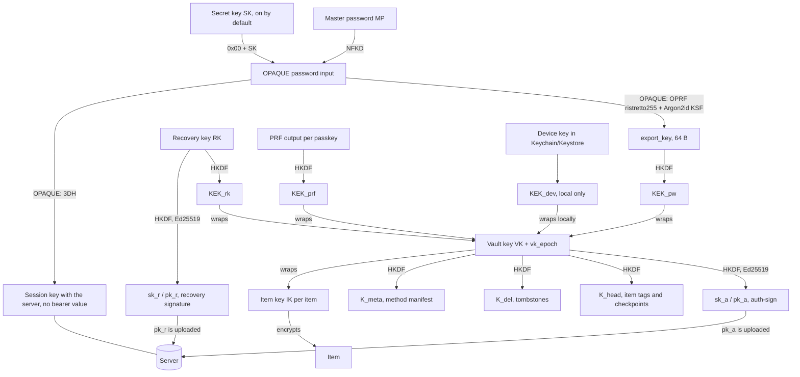

# Phase 1 – Security design for Faithful Ferret

> [!NOTE] Status
> **Approved by the maintainer on 2026-10-30.** This is draft 2. It builds on draft 1 and on an independent review with 38 findings. Every finding has been handled (§ 0).
> The draft builds on the idea note, the roadmap for v1 and the phase 0 report. These are not published.
> - **References** such as U2, U17 and E11 point to clarifications in the implementation plan. Where a clarification matters for the design, its content is written into this document.
> - **Applies to all clients:** web vault, browser extension, iOS and Android. Step B therefore needs no new design.
> - **Purpose:** cover gates 3, 4 and 6, and the design part of gate 5.
> - **Cryptography:** nothing here is home-grown. We use established constructions: OPAQUE (RFC 9807), Argon2id (RFC 9106), HKDF-SHA256 (RFC 5869), XChaCha20-Poly1305, Ed25519 (RFC 8032), ECDSA P-256. The libraries are `opaque-ke`, RustCrypto and dalek.
> - **Labels:** "Default choices" are defaults that can be changed later. "Maintainer's decisions" are marked where the maintainer has already decided.
> - **One maintainer decision is reversed:** sign-in moves from "Bitwarden style with a login value" to OPAQUE in v1. See E11 in § 16. The old design is in Appendix A.
> - **Finally:** the document ends with a list of decisions the maintainer must make (§ 16).

---

## 0. Changes from draft 1

One line per finding. Severity is in parentheses. All fixes are included as the review presented them, with the clarifications that came afterwards.

| ID | Change |
|---|---|
| F-01 (critical) | The client has built-in floors and ceilings for Argon2id parameters. With OPAQUE they never come from the server. Pinning per device, upgrades controlled by the client only, and the emergency sheet carries a QR with server and account (§ 4.1, 4.2, 13). |
| F-02 (high) | OPAQUE replaces the login value (E11, reverses a maintainer's decision). SK is on by default (E12). The SK bit is pinned locally and never taken from the server. A1–A3 are rewritten to be accurate. The old LV design is in Appendix A (§ 2.2, 4.2). |
| F-03 (high) | "Rotate vault key" is now a full rekey: new VK, new IK, `vk_epoch`, atomic endpoint, revocation of all others. Procedure for a stolen device. Backup is kept for 30 days (E14) (§ 4.7, 7.6). |
| F-04 (high) | Filling happens primarily outside the page DOM. The in-page menu is secondary, with a full ancestry check, `isTrusted`, a delay and tainting (§ 10.3). |
| F-05 (medium) | The recovery proof is changed from MAC and verifier to an Ed25519 signature from RK. RK is rotated after use, sessions are revoked, and the user is notified (§ 6.3). |
| F-06 (medium) | OPAQUE's fake response covers pre-login. Other paths for account discovery and timing are specified (§ 4.2, 11). |
| F-07 (medium) | The wrap AAD is TLV with suite, account, vault, method, `vk_epoch`, `kek_generation` and KDF parameters. A method manifest sits inside the vault. All changes to wraps require signed proof (§ 3.1, 4.3, 4.6). |
| F-08 (medium) | Item tags (`tag`, HMAC under `K_head`) and signed checkpoints (`{seq, digest, mac}`) replace a head chain, so writes to different items stay independent (*default choice*). A durable non-secret record and the action "accept older state". The residual risk is spelled out (§ 8.6). |
| F-09 (medium) | Tombstones are authenticated with `K_del`. Local trash for 30 days. Unverified deletions are quarantined (§ 8.4). |
| F-10 (medium) | The mobile PIN is bound to hardware-enforced rate limiting. The browser extension's PIN is only a convenience and is kept in memory only. The "PIN after restart" option is removed (E3 is gone) (§ 7). *Changed 2026-11-24: in the extension the PIN is kept on disk by default, with a warning and an admin switch; see "Changes for local unlock" below.* |
| F-11 (medium) | Auto-lock with `chrome.alarms` and `lockAt`. VK lives only in an offscreen document or worker, encrypted under a session key in `storage.session`. Strict CSP and Trusted Types (§ 7.2). |
| F-12 (medium) | The passkey origin is the calling frame. Cross-origin requests are denied in v1. The request is bound to `(tabId, frameId, documentId, origin, rpId, challenge-hash)`. Exact `rp_id` at signing (§ 9.2). |
| F-13 (medium) | The override is off on Ferret's own origin. Ferret passkeys can never be an unlock factor (§ 9.4). |
| F-14 (medium) | § 2.4 is rewritten honestly: SRI does not help against a malicious operator. Own origin and a full header list. PWA pinning and a hash check in the browser extension are "after v1" (§ 2.4, 12). |
| F-15 (medium) | List of sensitive operations that need MP again, 2FA and a signature from a VK-derived Ed25519 key. Session revocation and notifications. Delay on e-mail change (§ 4.6). |
| F-16 (medium) | No tokens in URLs. Short-lived access tokens, rotating refresh tokens with reuse detection, device key (DPoP). SSE via fetch. CSRF protection (§ 7.6, 8.2). |
| F-17 (medium) | `Secret<T>`, an allowlist for error reporting, canary tests, a proxy without body logging, `RLIMIT_CORE=0` (§ 11). |
| F-18 (medium) | Rate limiting on operations and bytes, quotas per account, size limits, no server-side Argon2id (§ 8.2, 11). |
| F-19 (medium) | "Deterministic CBOR" is removed for bodies. Unknown fields are preserved, a newer schema is read-only, parser limits (§ 5.2, 13). |
| F-20 (medium) | One Rust core, WASM and UniFFI (Swift and Kotlin as bindings). The AutoFill extension never runs Argon2id (§ 3, 14). |
| F-21 (medium) | The emergency sheet is two sheets. Setup requires typing RK and SK in full, and actually unwraps locally (§ 6.1). |
| F-22 (medium) | The default match is the exact host. Registrable domain is a per-item choice (E13). PSL with private domains. Frame rule per frame (§ 10.4, 10.5). |
| F-23 (low) | The Unicode version is pinned for suite 1. Rejection rules and the unit of length. More test vectors (§ 3.1, 4.1, 14). |
| F-24 (low) | All AADs are TLV. UUIDs are 16 raw bytes. All AADs carry `suite`; which ones also carry `version` and `kind` is stated in the AAD lists in § 4.3, § 5 and § 8.4 (body and manifest have all three) *(clarified 2026-10-30)*. Padding is ISO/IEC 7816-4 (§ 3.1, 5). |
| F-25 (low) | Key commitment (`commit`) on wraps made from human secrets: password and PIN (§ 4.3). |
| F-26 (low) | Exact encodings for RK and SK with checksums. 14 groups of 4 and 6 groups of 5 (§ 6.1, 6.2). |
| F-27 (low) | The export format binds the whole header in the AAD, validates parameters on import, uses stronger parameters, and protects CSV (§ 6.4). |
| F-28 (low) | Idempotency stores the request hash. `min_valid_since`, `as_of_seq`, a dedicated `seq` counter and the rules for batches are defined (§ 8.3, 8.4). |
| F-29 (low) | Two PRF seeds (with and without UV), one fixed AAGUID that is open, `NotAllowedError` when UV is missing, no distinction between "does not exist" and "cancelled" (§ 9.3, 9.5). |
| F-30 (low) | `https` items are never filled on `http`. Clipboard, MV3 manifest and a private bridge between the MAIN world and the content script (§ 10). |
| F-31 (low) | TOTP: allowlist for `otpauth://`. The Ferret account's own 2FA secret must not be stored in the vault (§ 5.2). |
| F-32 (low) | Zeroize feature in `argon2`, a dedicated worker that is terminated, `mlock` on mobile, constant time also on WASM output (§ 2.3 L6, 3). |
| F-33 (low) | `account_id` is on the emergency sheet and in the QR. A separate flow for moving to a new server (§ 4.1, 6.1). |
| F-34 (low) | Rate limiting on (account, IP), no hard lockout; a soft limit per account is planned and not built (§ 11, § 8.8). |
| F-35 (note) | iOS: `WhenPasscodeSetThisDeviceOnly` and no passcode fallback on biometrics. Android: per-operation authentication with `CryptoObject`, StrongBox, strong biometrics only (§ 7.4, 7.5). |
| F-36 (note) | Rule for the mobile passkey provider: trust only the origin the operating system supplies (§ 9.7). |
| F-37 (note) | The README says there is no external audit. A paid review or a bug bounty before 1.0 is a maintainer's decision (E15) (§ 2.3 L7, 14). |
| F-38 (note) | The minimum MP length is 12 with SK and 15 without, plus an estimator and a local blocklist without SK (§ 4.1, E8). |

**Other changes:** E3 was removed, and reopened and decided again on 2026-11-24 (§ 16). E11–E15 are new. The device token from draft 1 is replaced by access and refresh tokens (§ 8.2). Phase 2 in vole-kit gets an OPAQUE module instead of a login value (§ 16).

**Changes for local unlock in the extension (2026-11-24).** PIN and passkey unlock for the browser extension and the web vault are designed again, after the maintainer's answers and a probe of Firefox. What changed, and where:

- **PIN (§ 7.2):** it is kept on disk by default, in a database of the extension's own, so it works after a restart and without a network. A copy of the browser profile can then be attacked offline, one Argon2id (256 MiB) per guess; the limit of five attempts does not apply to a copy. The extension says so every time a PIN is set or changed, and asks for a tick. "Require master password after restart" (off by default) and an admin switch keep the PIN in memory only. The wait between attempts is fixed (0, 0, 5, 15 and 30 seconds) instead of exponential. The PIN is digits or text, with a minimum length from the server (4 to 64, default 6).
- **Offline PIN and revocation (§ 7.6, § 2.2 A8):** a device with a PIN can be unlocked without the server for at most seven days after its last contact with the server. A revoked device that is kept offline can still be unlocked with its PIN during that time (seven days as the device's own clock counts them, § 7.6).
- **Passkey unlock (§ 7.2, § 9.4, § 2.2 A9):** a hardware or platform authenticator, device-bound or synced. A synced passkey is as safe as the cloud account it lives in, and a passkey method opens VK without MP and without SK for whoever has the wrap and the authenticator. The list shows which kind a passkey is.
- **Server and releases (§ 11, § 4.6, § 2.5, § 12):** an admin rule for the PIN and `GET /api/vault/policy`; the AAGUID of a passkey is stored as display data; the web vault of a release is built with the WASM package of that release, and its SHA-256 is checked against the signed `SHA256SUMS`.
- **Manifest (§ 4.3, Appendix B):** a passkey's entry carries a name and a synced flag.
- **Decisions (§ 15, § 16):** E3 is reopened and decided; E1 gets its decision rule; E16 and E17 are new.

**Changes for the passkey provider in the extension (2026-11-25).** Ferret as a passkey provider in the extension is designed to the end, after the maintainer's answers and a probe of Firefox. What changed, and where:

- **Origin and frames (§ 9.2):** Ferret acts only when seven conditions hold, otherwise the call goes untouched to the browser; `localhost` goes to the browser in a release; every frame up to the top must have the origin of the top; related origins are not supported; `pushState` no longer cancels a request (the origin is checked again); a request without user activation shows a badge and a card in the popup, and the click there is the user action (this relaxes the rule that `create` requires activation in the page); the limits and the calm period.
- **Verification and privacy (§ 9.3, E7):** user verification is a recent unlock (5 minutes, on by default), then PRF, PIN and MP, as a one-time token per request; the answer fields and the errors; imported passkeys and the counter; the chooser is always shown, also when Ferret has no passkey, and automatic handover depends on the request alone.
- **Choice and handover (§ 9.4):** the chooser is a window of its own, with Ferret first, "Use the browser instead" and "Never on this site"; the browser's dialog is given only when the user chooses it, or when Ferret cannot or must not answer; Ferret's own servers are refused in the background too; another extension may have taken the call.
- **Conditional UI and import (§ 9.5, § 9.6):** a section of the popup and a badge, with four rules; PRF from Ferret is in (E10); import of Bitwarden and AliasVault passkeys.
- **The bridge (§ 10.8):** no `postMessage`, a synchronous handshake that does not depend on script order, built-ins kept, answers boxed, a MAIN script that is untrusted, and a ping for a suspended Manifest V3 background.
- **Storage and sync (§ 8.3, § 8.5, Appendix B):** a new passkey is written online only and never goes into the outbox or the conflict view; `rp_name` and `user_display_name` are new optional keys.
- **Threat model and limits (§ 2.2 A10, § 9.8):** someone at the unlocked machine; the known limits of the provider.
- **Server and decisions (§ 11, § 15, § 16):** the build feature `passkey-import` and `passkeys.import` in the policy answer; the result of the Firefox probe; E7 is decided (on, 5 minutes) and E10 is decided (yes).

---

## 1. Scope and terms

| Term | Meaning |
|---|---|
| **Account** | Sign-in on the Ferret server (vole-kit): e-mail, OPAQUE record (no password value), 2FA/passkey for the server. |
| **Vault** | The user's encrypted items. One vault per user in v1 (no sharing). |
| **MP** | The master password. Never leaves the client. |
| **SK** | Secret key (*Secret Key*), 128 random bits. **On by default**, can be opted out of with a warning (E12). Maintainer's decision: optional per user. |
| **VK** | The vault key, 256 random bits. Encrypts the keys of the items. The server never sees it. |
| **`vk_epoch`** | Counter (u64, starts at 1) that increases on every full rekey. Part of the AAD of all wraps. |
| **IK** | Item key, 256 random bits per item, wrapped with VK. |
| **KEK** | Key that wraps VK. One per unlock method. |
| **`kek_generation`** | Counter per method (u64, starts at 1). Increases each time the wrap for the method is replaced. The largest valid value is 2^32 − 1; a larger value is rejected (*clarified 2026-10-30*). |
| **RK** | Recovery key, 256 random bits. Shown at setup. |
| **`export_key`** | Output of OPAQUE (64 bytes) known only to the client. Yields `KEK_pw`. |
| **`sk_a` / `pk_a`** | Ed25519 key derived from VK. Signs changes to wraps. The server has only `pk_a`. |
| **`sk_r` / `pk_r`** | Ed25519 key derived from RK. Signs recovery. The server has only `pk_r`. |
| **Unlock** | The client obtains VK locally. Separate from sign-in. |

---

## 2. Threat model (gate 3)

### 2.1 Assets to protect
1. The plaintext of the vault: passwords, TOTP seeds, passkey private keys, notes.
2. VK, IK, MP, SK, RK, `export_key`, `sk_a`, `sk_r` and all KEKs.
3. The integrity of the vault: no silent change, swap or deletion.
4. Availability: no silent data loss during sync, migration or recovery.

### 2.2 Attackers and what they must not achieve

One principle governs the numbers below: **whoever has the server's database and its OPAQUE setup (`opaque_setup`) can try MP guesses offline, at a cost of one Argon2id (64 MiB, t = 3) per attempt.** No design prevents this, because the wrap of VK is itself a check of the guess. What helps is SK. Keeping `opaque_setup` in a separate file outside the database (§ 11) only means that a leaked database file alone cannot be used. A full backup set and a full server takeover also contain `opaque_setup`.

| # | Attacker | Has | Must **not** get |
|---|---|---|---|
| A1 | Thief of database or backup | A: only the database file (for example a copied `ferret.db`). B: a full backup set, which also contains `opaque_setup` as a separate file | Plaintext. **A:** MP cannot be guessed at all, because the OPRF key is missing. **B:** each guess costs one Argon2id, and with SK it is impossible without SK. |
| A2 | Curious operator | Root on the server, `session.key`, `opaque_setup`, logs | Plaintext, VK or MP for users **with SK**. Without SK, A2 can guess MP at a cost of one Argon2id per attempt. The admin panel never shows vault content. |
| A3 | Malicious server (active) | Can change API responses, has the database and `opaque_setup` | The same as A2. It also cannot swap, change or mix items without detection (§ 5.3, 8.6). It cannot lower the Argon2id parameters (§ 4.2). **Exception:** the web vault's JavaScript (§ 2.4). |
| A4 | Network (MITM) or just loggers and proxies | Sees and changes traffic | The same as A3 if TLS is broken. What is seen gives nothing to guess against, because OPAQUE sends no bearer value. TLS is required. |
| A5 | Malicious web page | Runs JS in a tab | Credentials for other origins. Autofill or passkey use without a user action in Ferret's own UI. |
| A6 | Another browser extension or page script | Can change the DOM and imitate buttons | Cannot trigger autofill or passkey signing by imitating the Ferret UI (§ 10.3, § 9.4). |
| A7 | Thief of a locked device, or anyone with a copy of the browser profile | The disk, the browser profile (a stolen laptop without disk encryption, malware that copies files, a backup, a synced or roaming profile folder) | Plaintext, **except when a PIN is kept on disk** (the extension's default, § 7.2). Then the profile holds the PIN's wrap of VK, and the attacker can try PINs on their own computer at the cost of one Argon2id (256 MiB, t = 3) per guess, with no limit on attempts. A 6-digit PIN falls in under three hours on one powerful machine (a 64-core server, measured: § 7.2), and faster on many (the table in § 7.2); a PIN that people choose themselves falls much sooner. On iOS and Android the hardware limits the attempts (§ 7.4, § 7.5), and a PIN kept in memory only is not in a copy of a closed profile. MP and a passkey leave nothing to guess in a copy. |
| A8 | Former device, signed out or revoked | Old local cache and VK from before the revocation | New changes after the revocation. **But** the device still has VK and IK for what it had. Only a full rekey (§ 4.7) changes that. See § 7.6. **Offline PIN:** a revoked device that is kept offline can still be unlocked with its PIN for at most seven days after its last contact with the server, and it then opens the cache it already has. The server cannot reach a device that never connects. After seven days the PIN needs a contact, and the contact deletes it (§ 7.6). Seven days as the device's own clock counts them: whoever controls that clock can stretch the window for as long as they hold the clock still, and a copy of the profile (A7) can be attacked offline regardless (§ 7.6). |
| A9 | Holder of the wrap of a passkey method and of the authenticator (or of the cloud account of a synced passkey) | The server's database or a backup (the wraps are there: A1 B, A2, A3), and the authenticator, or control of the cloud account that a synced passkey lives in (iCloud keychain, a Google account) | VK from the database alone: the PRF output is never stored and exists only on the authenticator, which requires user verification. **That does not hold for whoever also has the authenticator or the cloud account:** a passkey method opens VK **without MP and without SK**, so the secret key that protects a stolen database against password guessing does not apply on that path. This is the price of unlocking without a password. A synced passkey is as safe as its cloud account, and a device-bound one as safe as the device and its user verification. The list of methods says which a passkey is (§ 7.2). |
| A10 | Someone at the unlocked machine | Physical access within 5 minutes after the user unlocked, with the vault open | More than one click's worth: no sign-in to a site without a click in Ferret's window, and nothing at all after a lock. **Consequence of the recent-unlock rule (§ 9.3, E7):** an unlock within the last 5 minutes counts as user verification for a passkey, so one click in Ferret's window gives `UV = 1`. Every lock erases the time, auto-lock and screen lock apply (§ 7.2), and the user can turn the rule off. The same person could already fill a password from the open vault, so the extra exposure is small, but the verified PRF seed of a site's passkey is given after one click as well. |

### 2.3 Outside the threat model (documented limitations)
- **L1 Compromised device or OS while the vault is unlocked.** The attacker can read what is open.
- **L2 Malicious update of a client.** This covers the browser extension, the app and the web vault's code. The protection is signed releases and a documented release process (§ 12).
- **L3 Loss of both MP and all recovery methods.** Then the data is gone. That is zero knowledge.
- **L4 Rollback, withholding and forking by the server.** Item tags and checkpoints (§ 8.6) catch mixing of items and rollback of single items for devices that have seen a newer checkpoint. **Residual risk:** a rollback of the newest writes since the last checkpoint, or of the whole vault to an older, consistent checkpoint, is noticed only by devices that have seen a newer checkpoint. A server can show two devices different histories (fork) without detection in v1. Withholding new changes cannot be detected either.
- **L5 Metadata.** The server sees the number of items, size after padding, timestamps, revisions, devices and IP addresses (§ 2.5). Padding does not hide the size class.
- **L6 Memory.** JavaScript and WASM cannot guarantee that keys are erased from memory. MP is a JS string before it reaches the core. We zeroize as well as we can (§ 3).
- **L7 No external audit.** The project has not had an independent cryptographic audit by a person. The README says so plainly. See E15.
- **L8 Old ciphertext.** Rekey does not protect ciphertext that has already leaked, for example old backups, or anything a thief has already read. That is why backup has a fixed retention period (E14).
- **L9 Deleted data on disk.** Firefox does not wipe the extension's database when a record is deleted (measured: a deleted record stays in the free pages of the SQLite file after a clean shutdown, and overwriting it first is not reliable), and an SSD may keep old blocks. A deleted PIN wrap, and the older ones after a change, can therefore remain in a copy of the profile. The extension has no reliable counter-measure, so the strength of a PIN never depends on deletion (§ 7.2).

### 2.4 The web vault's trust boundary (maintainer's decision, 2026-10-27)
- The web vault trusts the server that delivers the code. A malicious operator can deliver modified JavaScript that steals MP at unlock. This is stated in the README and on the sign-in page.
- **SRI and CSP do not protect against this.** The HTML with the integrity hashes comes from the same server as the scripts. They help against injected code (XSS) and against third-party CDNs, and we have no external origins.
- Countermeasures that do work against XSS and misconfiguration:
  - the web vault lives on its **own origin** (its own hostname), separate from the admin panel and other vole-kit pages (XSS in the admin panel would otherwise be XSS in the vault);
  - a full header list (§ 12).
- The **real** protection for those who fear the operator is the browser extension and the apps. They are recommended.
- **The PRF output of a passkey method is a lasting secret.** Unlike a sign-in, there is no challenge that makes a copy useless: whoever sees the output (for example JavaScript of a malicious operator in the web vault, or another extension that intercepts WebAuthn on the vault's origin) has it until the method is removed. Anyone who suspects the web vault removes the passkey methods (§ 7.2). An older backup still holds the wrap, and only a full rekey (§ 4.7) makes a leaked output useless.
- **There is no switch to turn the web vault off** *(maintainer's decision, 2026-11-22)*. The server always serves the web vault, and setup, recovery, the device list and export are done in it, so the trust caveat above applies to every deployment (§ 8.8). Anyone who does not want to trust the server that delivers the code uses the browser extension and the apps.
- **After v1:** an installable PWA with a service worker that pins the release by hash and requires confirmation for new code, and a hash check in the browser extension against the signed release list.

### 2.5 Metadata the server sees

| Sees | Does not see |
|---|---|
| E-mail, account creation, sign-in times and IP, devices (name set by the client) | MP, SK, RK, VK, IK, `export_key` |
| Item ID (random UUIDv4), revision, `seq`, deleted yes/no, size **after padding**, timestamps, item tags (`tag`) and checkpoint (`seq`, `digest`, `mac`) | Type, name, URL, username, password, notes, TOTP, passkeys |
| The OPAQUE record, `ksf_profile`, `pk_a`, `pk_r`, which unlock methods exist (password, RK, PRF IDs and the AAGUID of the authenticator, which is display data only and may be all zero), an optional `sk_hint` (only a suggestion in the UI) | PRF output, device keys, the name of a passkey and whether it is synced (both are inside the manifest), the PIN; it is not told whether a device has a PIN, though it may infer it from how a device renews its token |

---

## 3. Primitives and libraries

| Use | Construction | Crate |
|---|---|---|
| Sign-in and password protection against the server | **OPAQUE** (RFC 9807) | `opaque-ke` |
| Password-based key derivation (OPAQUE KSF, PIN, export) | **Argon2id** v1.3 (RFC 9106) | `argon2` (with `zeroize`) |
| Key derivation and domain separation | **HKDF-SHA256** (RFC 5869) | `hkdf`, `sha2` |
| Symmetric encryption | **XChaCha20-Poly1305** (24-byte random nonce) | `chacha20poly1305` |
| Signatures for change proofs (VK and RK) | **Ed25519** (RFC 8032) | `ed25519-dalek` |
| Passkeys | **ECDSA P-256 / SHA-256** (ES256) | `p256` (`ecdsa`) |
| TOTP | HMAC-SHA1/256/512 (RFC 6238) | `hmac`, `sha1`, `sha2` |
| Item tags and checkpoints | HMAC-SHA256 | `hmac`, `sha2` |
| Randomness | OS CSPRNG | `getrandom` (WASM: `crypto.getRandomValues`) |
| Zeroization | `Zeroize`/`ZeroizeOnDrop` on all key types | `zeroize` |
| Constant-time comparison | – | `subtle` |
| Unicode normalization of MP | NFKD, table version pinned | `unicode-normalization` |

**Rules:**
- **One core.** All crypto code (envelope, AAD, padding, CBOR, KDF, OPAQUE client, TOTP, WebAuthn) exists only **once**, in a Rust core. It is compiled to WASM (web and browser extension) and to native libraries through UniFFI for iOS and Android. Swift and Kotlin are bindings, not separate implementations.
- The AutoFill extension on iOS and its equivalent on Android **never** run Argon2id. They use the shared `KEK_dev` (§ 7.4).
- All keys are dedicated types (`VaultKey`, `ItemKey` and so on) that cannot be copied and that are zeroized.
- There is no `Debug` or `Display` for key types.
- `argon2` runs with the `zeroize` feature on. In the browser, Argon2id for sign-in runs in the long-lived vault worker, which is terminated and restarted on lock (U2). Only export and import use a separate worker that is terminated after each use *(corrected 2026-10-30)*. On mobile, `mlock` is used where possible, and app data backup is off.
- Dependencies are locked with `cargo-deny` (licenses and RustSec advisories) and `cargo-vet`.
- **PIN profiles (extension).** The PIN has its own table of Argon2id profiles, apart from `ksf_profile`: profile 1 is `m = 256 MiB (262 144 KiB), t = 3, p = 1`. The number is stored with the PIN's wrap and bound into the wrap's AAD as `kdf` (§ 7.2). An unknown number, or one below the floor of the build, deletes the blob and computes nothing. A profile is replaced only by a new one, which voids every stored PIN. The numbers are one constant in the core, and so is the guess rate that the texts about the cost of a guess read. The mobile PIN keeps the 64 MiB sign-in profile (§ 7.4). The numbers are measured on a reference container and on one Mac; Windows is still to be measured (§ 7.2).
- **Crypto suite** is in every envelope as `suite: 1`. Suite 1 means: OPAQUE with the Argon2id profiles in § 4.2, HKDF-SHA256, XChaCha20-Poly1305, Ed25519. A new suite gets a new value and new label prefixes (`ferret/v2/...`), and the old one stays readable.

### 3.1 Encoding rules (apply everywhere)

- **UUID** (`account_id`, `vault_id`, `item_id`, `method_id`) is always **16 raw bytes** in RFC 4122 order. Never text form.
- **Integers** are big-endian: `u8`, `u32be`, `u64be`.
- **TLV:** `tlv(tag, value) = tag (1 byte) ‖ len (u16be) ‖ value`. `value` is at most 65 535 bytes.
- **AAD and HKDF salts** are a concatenation of TLV fields in the order given, with no other delimiter. Written `TLV[field1, field2, ...]`. Each field name has one fixed tag from the table.
- **Labels** (`label`) are ASCII and start with `ferret/v1/` for suite 1.
- **`AEAD(key, nonce, pt, aad)`** is XChaCha20-Poly1305. The result is stored as `nonce (24) ‖ ct ‖ tag (16)`. The nonce is 24 random bytes, new for every encryption.

| Tag | Field | Encoding |
|---|---|---|
| 0x01 | `label` | ASCII |
| 0x02 | `version` | u8 |
| 0x03 | `suite` | u8 |
| 0x04 | `kind` | u8 (1 = item, 2 = manifest) |
| 0x10 | `account_id` | 16 bytes |
| 0x11 | `vault_id` | 16 bytes |
| 0x12 | `item_id` | 16 bytes |
| 0x13 | `method_id` | 16 bytes |
| 0x14 | `method_type` | u8 (1 = password, 2 = recovery, 3 = prf, 4 = pin, 5 = device) |
| 0x20 | `vk_epoch` | u64be |
| 0x21 | `kek_generation` | u64be |
| 0x22 | `rev` | u64be |
| 0x23 | `seq` | u64be |
| 0x30 | `kdf` | `m_kib` u32be ‖ `t` u32be ‖ `p` u32be (12 bytes) |
| 0x31 | `credential_id` | bytes |
| 0x32 | `prf_salt` | 32 bytes |
| 0x33 | `nonce` (challenge from the server) | 32 bytes |
| 0x35 | `hash` | 32 bytes |
| 0x36 | `op` | ASCII |
| 0x37 | `device_salt` | 16 bytes |
| 0x38 | `salt_a` (Appendix A only) | 16 bytes |
| 0x39 | `header` | bytes (export header, stored verbatim) |

**MP normalization (F-23):** `mp = NFKD(MP)` as UTF-8, Unicode table version **pinned in the specification for suite 1** (Unicode 16.0, *default choice*).
- Reject: lone surrogates, characters that are not assigned in the pinned table, and all control characters (category Cc, including U+0000).
- Length is counted in Unicode scalar values. The minimum is checked after NFC, the maximum (1 024) after NFKD (clarified 2026-10-29, U9). NFC is never longer than NFKD, so the minimum is never weaker. Input with more than 1 024 scalars is rejected before NFKD. At most 4 096 bytes as UTF-8.
- NFKD merges visually different characters ("fi" and "fi", full-width digits). This causes a small loss of entropy. It is accepted and documented.

---

## 4. Key hierarchy (gate 4)



### 4.1 From master password to OPAQUE input
1. `mp = NFKD(MP)` as in § 3.1. Length: **at least 12** with SK, **at least 15** without SK (E8). At most 1 024.
2. **Without SK** the client also requires an estimate from a strength meter (zxcvbn score 4 or equivalent), and rejects passwords on a local list of the most common leaked passwords (a compact blocklist shipped with the client). The UI recommends generated passphrases (for example 6 words) and shows an estimate of how long the password would last against an attacker who has the database.
3. **OPAQUE input:**
   - without SK: `pwd = mp`;
   - with SK: `pwd = mp ‖ 0x00 ‖ SK` (SK is 16 raw bytes). The delimiter is unambiguous, because MP can never contain U+0000.
4. **No salt and no parameters come from the server.** That is OPAQUE's job (§ 4.2). Draft 1 had `salt_a` and an HKDF step here; both are gone.
5. **KDF floors and ceilings are built into the client** and cannot be turned off. They apply everywhere Argon2id is used (OPAQUE KSF, PIN, import of an export):
   - floor: `m ≥ 64 MiB`, `t ≥ 3`, `p` from 1 to 4. The floor is raised with each release;
   - ceiling: `m ≤ 512 MiB`, `t ≤ 16`, `p ≤ 4`;
   - outside the range: hard error "the server specifies unsafe parameters". Nothing is computed.
6. **`account_id`** is a UUID the server assigns at registration. It is in the HKDF salts and in all wraps, so identical passwords on two accounts never give the same keys. It is pinned locally (§ 4.2) and is on the emergency sheet and in the QR code. There is a separate flow for moving to a new server: export, import, or rewrap under a new `account_id` while the vault is open (F-33).

### 4.2 Sign-in to the server: OPAQUE (E11, reverses the maintainer's decision from 2026-10-27)

> [!WARNING] Reversal of a maintainer decision
> On 2026-10-27 the maintainer chose "Bitwarden style now, OPAQUE after v1". The review shows that the login value (LV) is a bearer value and an offline oracle for MP when SK is not used (F-02). OPAQUE removes both. The recommendation is therefore OPAQUE in v1. This is E11 in § 16. If the maintainer says no, Appendix A applies.

**Configuration (RFC 9807, crate `opaque-ke`, version pinned):**

| Part | Choice |
|---|---|
| Group and OPRF | ristretto255 with SHA-512 |
| Key exchange | 3DH over ristretto255 |
| Hash, MAC, KDF | SHA-512, HMAC-SHA-512, HKDF-SHA-512 |
| KSF (stretching) | **Argon2id** v1.3, salt = 16 zero bytes, output 64 bytes (= `Nh`), parameters from `ksf_profile` |
| Envelope | internal mode (default in RFC 9807) |
| Context | ASCII `ferret/v1/opaque` |
| `credential_identifier` | `account_id` (16 raw bytes). Only the server needs it. |
| Identities | client and server use the default (public keys). E-mail is not included, so an e-mail change does not touch the record. |

**KSF profiles (built into the client, in a table):**

| `ksf_profile` | `m` | `t` | `p` |
|---|---|---|---|
| 1 | 64 MiB (65 536 KiB) | 3 | 1 |

- The server states only the number `ksf_profile`. The client looks it up in its own table. An unknown profile, or a profile below what is pinned on the device, is a hard error. The parameters are never sent over the network.
- Because `ksf_profile` determines `export_key`, a downgrade is always detected: a different profile gives a different `KEK_pw`, and the unlock fails (and the AAD of the wrap has `kdf`, § 4.3).
- The Argon2 trait in `opaque-ke` is to be used through a dedicated wrapper that carries the profile's parameters. A test vector in the cross-client tests pins this (§ 14).

**Registration** (`POST /api/auth/opaque/register/start` and `/finish`, only with an invitation or a valid session):
1. The client sends the e-mail and `registration_request`. The server answers with `registration_response` and a new `account_id` and `vault_id`.
2. The client generates VK, SK (if on), RK, `sk_a`, `pk_a`, `sk_r`, `pk_r`, creates the wraps and the manifest (§ 4.3, 4.5, 6), and sends everything in `finish` together with `registration_record`.
3. The server stores the record in `opaque_records` with `ksf_profile`. It stores nothing that can be used to sign in without running OPAQUE.

**Sign-in** (`POST /api/auth/opaque/login/start` and `/finish`):
1. The client sends the e-mail and `ke1`. The server answers with `ke2`, a `login_id`, `ksf_profile` and an `sk_hint` (a suggestion only).
2. The client checks `ksf_profile` against its table and its pinned value, runs Argon2id, and sends `ke3` in `finish`. Everything after `ke2` happens locally, so a malicious server sees no MP-dependent value it can guess against.
3. The response gives `account_id`, `vault_id` and a session. If 2FA is on for the account, the session is **partial** until 2FA is complete. A partial session may not fetch wraps or changes (§ 4.6).
4. `export_key` is used to create `KEK_pw` (§ 4.3). The session key from 3DH is used for nothing else.

The sealed login state the server keeps between `start` and `finish` is bound to a hash of the registration record it was made from, and `finish` refuses, with the same answer as a wrong password, a sign-in whose record was replaced in between (a new MP, a recovery or a restore).

**Pinning and the SK bit (F-01, F-02):**
- After the first successful unlock, the device stores a non-secret record: `(server_url, account_id, ksf_profile, kek_generation_max, vk_epoch_max, sk_bit, pk_a)`. See also § 8.6. *Clarified 2026-10-30:* the full record is the one in § 8.6. It also has `vault_id` and the server's public OPAQUE key (U19). `kek_generation_max` is kept per method type (password, recovery) and per passkey, not one for the whole account.
- The server cannot change any of these. A mismatch gives a loud error, not "wrong password".
- **The SK bit is never taken from the server.** On a new device, the sign-in screen asks explicitly: "Does this account have a secret key?". `sk_hint` is only a preselection. If the device holds `sk_bit = yes` and the server claims "no SK", that is a hard error with a warning about a possible attack. The emergency sheet's QR also carries "SK: yes/no".
- On a completely new device without an emergency sheet, the first sign-in is trust on first use (TOFU) for `account_id`, but not for the KSF parameters (the floor applies) and not for SK.

**Upgrading the KSF profile** (F-01 point 3): only the client starts it. The server can say "upgrade available" (yes/no). The client picks `max(current, profile in this build)`, runs a new OPAQUE registration at the next unlock with MP, creates a new `KEK_pw` and a new password wrap, and sends everything as one signed change (§ 4.6). A profile lower than the pinned one is never allowed. **Exception:** a recovery (§ 6.3) may set any profile that the server's table accepts, including one lower than the stored profile. A recovery is the way out of an account whose stored profile was claimed wrongly and never opened; the holder of the recovery key proves with `sk_r`, and the server does not read the stored profile for that decision. A device that had pinned a higher profile refuses the lower one until it is pinned again (the pin only goes up).

**Unknown e-mails and account discovery (F-06):**
- OPAQUE's fake response for an unknown user replaces the fake salt from draft 1. The fake `credential_identifier` is `HMAC-SHA256(server_secret_prelogin, "prelogin-id" ‖ lower(email))[..16]`. An unknown name and a disabled account are answered from a **made-up record** that OPAQUE accepts in place of a stored one: the server's own dummy public key, then 160 bytes of `HKDF-SHA512(server_secret_prelogin, "ferret/v1/prelogin/record" ‖ credential_id)`. The same name gives the same record every time, and the server holds no private key for the dummy public key, so a made-up login can never finish. The made-up record goes through the same steps as a real one, in the same order, and the choice between the two is made without a branch. The fake `ksf_profile` and `sk_hint` are drawn from `HMAC-SHA256(server_secret_prelogin, "prelogin-hint" ‖ lower(email))`, one number below 1000 for each, set against the shares of the real accounts (the share of each profile among active accounts, and the share that use a secret key), so the answers are spread as the real ones are.
- **What this does not hide.** The two values are drawn separately, so their pairing does not follow the joint spread of the real accounts. The shares are rounded and refreshed at start-up and after larger changes, so a name can change its made-up answer when a share crosses a bucket. On a server with a few accounts the shares are coarse: a minority answer is weak evidence that the account is real. Timing and response sizes are covered separately (§ 14).
- `server_secret_prelogin` is durable, backed up and kept separate from `session.key`. If it were rotated, fake responses would change over time while real ones would not, so it is not rotated.
- Same code path, same error body, status code and headers for known and unknown accounts. `login/start` has two rate limiters, 10 per minute per address and 5 per minute per account and address together (§ 11); `login/finish` is not counted yet (§ 8.8). Both limiters answer the same for known and unknown accounts.
- Other paths that must not reveal whether an account exists: registration ("e-mail exists"), invitation, 2FA recovery, e-mail from the administrator's reset, device endpoints, and 429 responses. All give the same response regardless.
- Integration test: compare response bytes and delay distribution for known and unknown e-mail.

**What OPAQUE gives and does not give (honestly):**
- Gives: no bearer value on the server or in logs. No precomputation. The server cannot guess against what it sees in network traffic. Parameters cannot be lowered. No server-side Argon2id to attack (§ 8.2).
- Does not give: protection against whoever has both the database and `opaque_setup`. Then each guess costs one client Argon2id (A2, A3). SK is the answer to that.

### 4.3 Vault key and wraps
- **VK** = 32 random bytes, created once at setup. `vk_epoch = 1`. It changes only on a full rekey (§ 4.7).
- **KEK derivations** (HKDF-SHA256, 32 bytes out):

  ```
  KEK_pw  = HKDF(salt = TLV[label="ferret/v1/kek/password", account_id],
                 ikm  = export_key,
                 info = "ferret/v1/kek/password")
  KEK_rk  = HKDF(salt = TLV[label="ferret/v1/recovery", account_id],
                 ikm  = RK,
                 info = "ferret/v1/kek/recovery")
  KEK_prf = HKDF(salt = TLV[label="ferret/v1/prf", credential_id],
                 ikm  = prf_output,
                 info = "ferret/v1/kek/prf")
  ```
- **Wrap** per method:

  ```
  wrap = AEAD(key = KEK_x, nonce, pt = VK, aad = aad_wrap)

  aad_wrap = TLV[ label="ferret/v1/wrap", suite, account_id, vault_id,
                  method_type, method_id, vk_epoch, kek_generation,
                  + method-specific ]
  ```
  - `password`: adds `kdf` (= the parameters in `ksf_profile`). There is no `salt_a` in the OPAQUE design.
  - `prf`: adds `credential_id` and `prf_salt`.
  - `recovery`: no extra fields.
  - `device` (local method, never on the server): no extra fields and no key commitment. The AAD is 104 bytes, the wrap 72 bytes *(clarified 2026-10-30, see `docs/WRAP-AAD.md` in the repo)*.
  - `pin` (local method, never on the server): adds `device_salt` and `kdf` (the Argon2id parameters of the PIN profile used, § 7.2), and has the key commitment below.
- **Key commitment (F-25):** for `password` (and for local `pin`), `wrap` is extended by 32 bytes at the end: `commit = HKDF(salt = none, ikm = KEK_x, info = "ferret/v1/commit")`. The recipient checks `commit` in constant time **before** AEAD is opened. This stops attacks where one ciphertext opens under several keys. Length: `password` 24 + 32 + 16 + 32 = 104 bytes. The others 72 bytes.
- **Stored on the server** in `unlock_methods`: `method_id` (UUID), `method_type` (`password`, `recovery`, `prf`), `wrap`, `kek_generation`, `created_at`, and for PRF also `credential_id`, `prf_salt` and AAGUID. Device methods (`device`, `pin`) are stored locally only: a local PIN is no unlock method on the server and is never in `unlock_methods` or in the manifest. The AAGUID is display data only: it can be all zero (shown as "unknown"), it is never relied on for a decision, and Ferret's own AAGUID is refused as an extra guard (§ 9.4).
- **The client remembers** the highest `kek_generation` and `vk_epoch` per account and rejects lower ones (§ 4.2, § 8.6). The server therefore cannot roll back an old wrap.
- **Method manifest (F-07):** an AEAD item inside the vault (`kind = 2`, key `K_meta`, § 4.5) that lists `(method_type, method_id, kek_generation)` for all server-stored methods, with `vk_epoch`. For a passkey (`prf`), `credential_id` is also in the entry (Appendix B, key `c`), so that the floor for `kek_generation` is tied to the credential by the authenticated manifest and not by a mapping from the server (2026-10-29, task 6). The entry of a passkey also carries its **name** (the rule of folder names, Appendix B: NFC, trimmed, 1 to 64 characters, no control, separator, bidirectional or zero width character) and whether it can be synced (`BE`, the backup-eligible flag of the authenticator data, fixed for the key's life), and optionally `BS` (the backup state at registration, for information only, since it can be 0 then and 1 later), so the server neither sees nor can change them (Appendix B). The list of methods says "Synced passkey" or "This device only" from `BE`. After every unlock, the client compares the server's list with the manifest and warns about missing or unknown methods. The user also sees "recovery key exists: yes". The manifest is updated in the same request as a change to wraps.
- **Changing MP:** new OPAQUE registration, new `KEK_pw`, new password wrap with `kek_generation + 1`. VK, IK and the items are unchanged. Sensitive operation (§ 4.6). It does not touch old backups: whoever knows the old MP and has an old backup can still open VK. Only a full rekey (§ 4.7) changes that.
- **Removing a method** deletes only that wrap. There must always be at least `password` and `recovery`. The server and the client refuse to remove the last of each.

### 4.4 Item keys
- **Why IK per item:** it allows sharing after v1 without re-encrypting everything, VK rotation by wrapping IK again, and a clear separation for passkeys. The cost is 72 bytes per item.
- **Wrapping IK:**

  ```
  ik_wrap = AEAD(VK, nonce, pt = IK,
            aad = TLV[ label="ferret/v1/item-key", version, suite,
                       vault_id, item_id, vk_epoch ])
  ```
  `vk_epoch` makes a wrap from the wrong epoch fail closed.

### 4.5 Derivations from VK and signing keys

All four are derived with the same function. `name` is `info`.

```
vk_derive(name) = HKDF-SHA256(
    salt = TLV[ label="ferret/v1/vk-derive", account_id, vault_id, vk_epoch ],
    ikm  = VK,
    info = name,  L = 32 )
```

| Key | `name` | Use |
|---|---|---|
| `K_head` | `ferret/v1/head` | HMAC for item tags and checkpoints (§ 8.6) |
| `K_del` | `ferret/v1/tomb` | AEAD tag on tombstones (§ 8.4) |
| `K_meta` | `ferret/v1/meta` | Method manifest (§ 4.3) |
| `seed_a` | `ferret/v1/auth-sign` | Ed25519 seed for `(sk_a, pk_a)` |

Because `vk_epoch` is in the salt, each epoch gets new keys.

**The auth-sign key:** `(sk_a, pk_a) = Ed25519(seed_a)`. `pk_a` is uploaded at setup and at every rekey. The server has only `pk_a`.

**The recovery key:**

```
seed_r = HKDF-SHA256(salt = TLV[ label="ferret/v1/recovery-sign", account_id ],
                     ikm = RK, info = "ferret/v1/recovery-sign", L = 32)
(sk_r, pk_r) = Ed25519(seed_r)
```

### 4.6 Sensitive operations and signed proofs (F-15, F-05, F-07)

**Sensitive operations:** add or remove an unlock method, change MP, regenerate or show RK, change e-mail, export, show SK or the SK QR, full rekey, revoke all devices, upgrade the KSF profile.

Every sensitive operation requires **all three**:
- (a) MP again in the client within the last 5 minutes (a new OPAQUE sign-in with `purpose: "reauth"`, even if the vault is already open). *Clarified 2026-11-21:* the server records the time of the last `reauth` sign-in on the session itself, so freshness is bound to the session id. It is not used up by an operation (it holds for the whole five minutes), and an ordinary sign-in does not set it. A sensitive call without it gets `403 reauth_required`;
- (b) fresh 2FA for the account, when 2FA is on. *Clarified 2026-11-21:* no account can turn 2FA on before the second-factor work, and an account that has it gets `403 second_factor_required` on every sensitive operation until that work is done (it fails closed);
- (c) for changes to wraps and the manifest: a **signature** from `sk_a` (or `sk_r` for recovery). *Clarified 2026-11-21:* "revoke all devices" asks for (a) and (b) and carries no signature, because it changes no wrap and no manifest. It is a call of the web vault's session, and a device with tokens cannot make it (§ 7.6).

**The signature:**
1. The client fetches a challenge: `POST /api/auth/challenge` returns `{nonce (32 bytes), expires_in: 300}`. The nonce is single-use and bound to the session.
2. The client sends the body together with the headers `Ferret-Nonce` and `Ferret-Proof`. The proof is:

   ```
   Ferret-Proof = Ed25519.Sign(sk_a,
       TLV[ label="ferret/v1/mutation", op, account_id, nonce,
            vk_epoch, hash = SHA-256(request body) ])
   ```
   `op` is the name of the operation (for example `unlock-method.add`). For recovery, `sk_r` and `label = "ferret/v1/recovery-req"` are used.
3. The server checks the signature against `pk_a` (or `pk_r`), that `nonce` is unused and under 5 minutes old, and that `hash` matches. The proof is bound to the exact body, including the new wrap.

Without the proof, an attacker with only a session cannot even delete a wrap. Partial sessions (before 2FA) do not get `unlock-methods` or `changes`.

**After an MP change, recovery and rekey:** all other sessions and device tokens are revoked (for an MP change the user can opt out, with a clear warning). *Clarified 2026-11-21:* in this release an MP change always ends the other sessions, in the web vault and on the admin pages alike, with no opt-out (§ 11). The open event streams of those sessions are told and close. Every device with tokens is revoked in the same transaction, so its streams close too and its next request is answered `401 device_revoked` (§ 7.6). The same holds after a redeemed sign-in code and after "revoke all devices". No new token is issued without the master password.

**E-mail notifications** (to the old and the new address on an e-mail change): new device, new unlock method, MP change, recovery used, RK regenerated, export, e-mail change, 2FA change, device revoked. *Clarified 2026-11-21:* none of them is sent in this release, a new device and a revoked device included, because the server sends no e-mail yet (§ 11). The vault's own pages say what has changed, and the other devices see that their session has ended.

**An e-mail change** takes effect after 24 hours with a cancellation link, when 2FA is off.

**The Ferret account's own 2FA secret must not be stored in the vault.** The UI warns on entry (otherwise security becomes circular). The admin's reset of account sign-in and 2FA recovery codes never touch the vault, but they trigger notifications.

**Passkey methods and the local PIN.** Adding or removing a passkey method is a sensitive operation of the web vault (MP again, the `sk_a` proof over the exact body, and a new manifest in the same transaction). The body of an add carries the authenticator's `aaguid` (16 bytes, display data); the name and the synced flag travel inside the manifest. A local PIN is **no unlock method on the server**: setting, changing or turning it off calls no sensitive route and carries no signature. The demand for MP again when a PIN is set is a local check in the extension: the master password is typed in the same dialog and checked by the device's ordinary unlock path, in a separate job, which must give the same `pk_a`.
**Endpoints for the vault:**

| Method | Path | Proof | Body |
|---|---|---|---|
| `GET` | `/api/vault/unlock-methods` | full session | list of wraps (a passkey also has its `aaguid` and `created_at` in seconds, display data), `pk_a`, `kek_generation`, `vk_epoch` |
| `GET` | `/api/vault/policy` | full session or device token | `{pin: {allowed, after_restart, min_length}, prf: {enabled}}` (§ 11) |
| `POST` | `/api/vault/unlock-methods` | sensitive + `sk_a` | `{method_type: 3, method_id, wrap, kek_generation: 1, credential_id, prf_salt, aaguid?, manifest}`: the binary fields are lower-case hexadecimal, exactly as the core writes them. The server refuses a method id or a credential id that is listed (`409 conflict`), the eleventh passkey method (`413 quota_exceeded`), an all-zero `prf_salt`, an `aaguid` that is not 16 bytes or is Ferret's own, and a manifest that is not the next revision (`409 write_conflict`). All zero is a valid `aaguid`, and so is none |
| `DELETE` | `/api/vault/unlock-methods/{method_id}` | sensitive + `sk_a` | `{method_id, manifest}` (the server checks that `method_id` equals the one in the URL; the proof covers the body, so the id has to be in it; `404` for a method the account does not have, `400` for the password or the recovery wrap) |
| `PUT` | `/api/vault/unlock-methods/password` | sensitive + `sk_a` | `{registration_record, ksf_profile, wrap, kek_generation, manifest}` (MP change and KSF upgrade) |
| `PUT` | `/api/vault/unlock-methods/recovery` | sensitive + `sk_a` | `{wrap, kek_generation, pk_r, manifest}` (RK is regenerated) |
| `GET` | `/api/vault/recovery` | full or reset session | `{account_id, vault_id, vk_epoch, ksf_profile, wrap, manifest}`: the recovery wrap, for `recover` (§ 6.3) |
| `POST` | `/api/vault/recover` | `sk_r` | see § 6.3 |
| `POST` | `/api/vault/rekey` | sensitive + `sk_a` (old) | see § 4.7 |
| `POST` | `/api/auth/challenge` | full or reset session | `{nonce, expires_in}`; `429 throttled` after 30 challenges per session in a minute |
| `POST` | `/api/auth/opaque/reregister/start` | full or reset session, only the session's own account | `{registration_request}` gives `{registration_response}`: the new password record of a recovery or an MP change (§ 6.3) |
| `POST` | `/api/auth/redeem` | none | `{email, code}` gives `200 {scope:"account_reset"}` and the reset session's cookies (§ 6.3). Every refusal about the code or the account is one `401 denied`. `400 bad_request`, `413 too_large`, `insecure_transport` and `429 throttled` with `Retry-After` depend only on the request and the caller's address, never on the account |

The sensitive routes answer `400` (the request is not well-formed), `401 denied` (the proof does not verify, or the nonce is spent), `403 reauth_required` or `403 second_factor_required` (above), `409 write_conflict` (the unlock methods changed while the client worked: nothing was written) and `422`. The signed body is read as raw bytes (at most 256 KiB) and parsed only after the permission is granted; a header of the wrong length is `400` and burns no nonce, a wrong signature is `401` and has burned it. The wrap, the new manifest row and the vault's `seq` are written in one transaction, together with the end of the other sessions, and the server is asked for a backup right after (§ 11).

### 4.7 Full rekey (F-03)

Draft 1 called this "rotate vault key", but it did not replace IK. Now it is a full rekey.

- **Endpoint:** `POST /api/vault/rekey`, one atomic transaction. No series of individual PUTs (a half-finished rekey gives a mixed state).
- **The client does:**
  1. `VK' = random(32)`, `vk_epoch' = vk_epoch + 1`. New `K_head`, `K_del`, `K_meta`, `seed_a` (and so `pk_a'`).
  2. For each item: new `IK' = random(32)`, re-encrypt the body (new nonce, `rev + 1`), new `ik_wrap`. For each tombstone: new tag under `K_del'`.
  3. New wraps for the methods: `password` (same `KEK_pw`, new AAD and `kek_generation + 1`). `recovery`: **always a new RK**, shown to the user, with a new `pk_r`. `prf`: removed; the user registers again afterwards. `device`: other devices must unlock with MP.
  4. A new manifest, new item tags (`tag`) under the new `K_head`, and a new checkpoint (§ 8.6).
- **The request:** `{base_seq, vk_epoch', pk_a', pk_r', items[], unlock_methods[], manifest, checkpoint}`, signed by the old `sk_a`. The server applies all or nothing, and fails if `base_seq` is not the top.
- **In the same transaction:** all other sessions and device tokens are revoked. All remaining devices see `vk_epoch'` and must do a full reconciliation (§ 8.4). The rekey proof (signed with the previous `sk_a`) is stored, and the devices check it against the `pk_a` they have pinned.
- **Until the rekey proof is checked, a higher epoch is refused** *(added 2026-11-24)*. The core's server unlock (`Pinned::unlock_server`: password, recovery and passkey wraps) refuses a `vk_epoch` above the pinned `vk_epoch_max` with `pinned_epoch_ahead`, before it opens the wrap. Without the proof there is no `pk_a` to hold the new vault key against, and a server could otherwise serve a wrap of another vault key at epoch + 1. This release builds no server rekey (§ 11), so no honest server shows a higher epoch. Clients treat the refusal as an attack warning, like the other pinning refusals: the device says that the server showed a newer vault key than it knows, and the user signs in again on a trusted device or tells the administrator. A first unlock, with no pinned record, is not affected. When the server rekey is built, the check becomes: accept epoch + 1 only with a rekey proof, signed with the previous `sk_a`, that verifies under the pinned `pk_a`, and then pin the new `pk_a`. *(added 2026-11-25)* A recovery with the recovery key (`recover`, for a forgotten master password) follows the same rule on a device that has a pinned record: it refuses a recovery wrap or a vault at a higher epoch than the record with `pinned_epoch_ahead`, and merges a recovery into a record only at the record's own epoch. A server alone cannot forge a recovery wrap, because it never knows the recovery key, so this closes no attack by itself; it keeps the rule that a device follows a higher epoch nowhere without a rekey proof, and it costs no honest path while no rekey exists. A device with no record (a new device) takes the epoch it is shown, as it does at a first unlock.
- **Alternative action:** "Change MP and rotate keys" in one operation. Recommended when MP has leaked.
- **Documented honestly:** rekey does not protect ciphertext that has already leaked, and not what a thief has already read (L8).

---

## 5. Item format and integrity

### 5.1 Envelope (what the server stores, as bytes)
```
version  u8   = 1
suite    u8   = 1
kind     u8   = 1 (item) or 2 (manifest)
ik_wrap  [24 nonce ‖ 32 ct ‖ 16 tag]   (kind = 1 only)
body     [24 nonce ‖ ciphertext ‖ 16 tag]
```
- For `kind = 2` there is no `ik_wrap`, and the body is encrypted with `K_meta` instead of IK.
- **The server rejects** unknown `version`, `suite` or `kind`, and oversize payloads, **before** any work in the database.
- `version`, `suite` and `kind` are in the AAD (see below), so a server cannot swap them without detection.

### 5.2 Body
- **Format:** the plaintext is CBOR. Deterministic encoding is **not** used for the body: nothing hashes or signs the plaintext, so it is not needed and cannot be enforced across four languages. What is hashed is the ciphertext (§ 8.6).
- **Content:** `{ schema: 1, type, name, fields[], urls[], totp?, passkey?, notes?, created, modified, favorite, device?, folders?, password_history?, … }`.
- **The decoder rejects:** duplicate keys, indefinite lengths, tags outside an allowlist, depth over 16, arrays or maps with more than 10 000 elements, text or byte strings over 64 KiB. *Clarified 2026-10-30:* the allowlist for tags is empty. Floating-point numbers in known fields are rejected. In unknown fields they are kept and written back unchanged. Unknown keys are written back after the known keys (in schema order), in the order they were read. This applies to both body and manifest.
- **Unknown fields are preserved.** The client decodes into a typed structure plus `extra: Map`, which is written back unchanged. An item with a `schema` higher than the client knows is opened **read-only** and is never rewritten ("update the app to edit"). Migration between schemas is explicit, one-way, and done only by a client that understands both.
- **Padding:**
  ```
  padded = plaintext ‖ 0x80 ‖ 0x00 × n
  ```
  (ISO/IEC 7816-4). The length of `padded` is the smallest of 256, 512, 1 024, 2 048, 4 096, then every 4 096, that is at least `len(plaintext) + 1`. At most 61 440 bytes of padded body in v1, so that the whole envelope is ≤ 65 536 bytes (clarified 2026-10-29). Remove it by searching backwards for the last `0x80` followed only by zero bytes. No compression before encryption. The size class leaks (L5).
- **AEAD for the body:**
  ```
  body = AEAD(IK, nonce, pt = padded_cbor,
         aad = TLV[ label="ferret/v1/item", version, suite, kind,
                    vault_id, item_id, rev ])
  ```
  For `kind = 2` the key is `K_meta` and `label = "ferret/v1/manifest"`.
- **`rev`** is the revision the item **gets** after the write, always `base_rev + 1`, which the server assigns deterministically.
  - The client encrypts with the expected `rev`.
  - The server stores only if `base_rev` matches.
  - If the server accepts a write with a `rev` other than the one the client encrypted for, decryption fails on all clients, and this is detected.
  - The client trusts `rev` only after the AAD check has passed.
- **TOTP (F-31):** the seed is in the body. `otpauth://` is read with an allowlist: algorithm SHA1/SHA256/SHA512, digits 6–8, period 1–120, base32 with tolerance for padding, unknown parameters rejected, a maximum length for the secret. Codes are generated only in the core from the device clock. Codes are never logged. The UI warns that password and TOTP in the same vault mean a vault breach also takes the second factor.

### 5.3 What the AAD binding gives
- **Swapping:** the server cannot present the content of item X as item Y, because `item_id` is in the AAD.
- **Revision forgery:** the server cannot present old content under a new revision, because `rev` is in the AAD. **But** an old valid pair `(blob, rev)` decrypts correctly if the server presents it as current. This is caught by item tags and checkpoints (§ 8.6), not by the AAD alone.
- **Vault mixing:** the server cannot move an item to another vault, because `vault_id` is in the AAD.
- **Downgrade:** `version`, `suite` and `kind` are in the AAD.
- **Modification:** any modification causes a decryption error, including unknown `version`, `suite` and `kind` bytes as long as only suite 1 exists (clarified 2026-10-29), so the server cannot get the client to ask for an update. The client shows "the item is damaged", keeps the last good local version and logs it, without content.

### 5.4 Nonces
- All nonces are 24 random bytes from the OS CSPRNG, new for every encryption.
- XChaCha20 makes random nonces safe: the collision probability is about 2⁻⁹⁷ at 2⁴⁸ messages per key.
- No counters or deterministic nonces.

---

## 6. Recovery (maintainer's decision: RK + encrypted export, the user's own only)

### 6.1 Recovery key (RK) and emergency sheet
- **RK** is 32 random bytes.
- **Code (F-26):** the 256 bits are written as a bit stream, most significant bit first, and padded with 4 zero bits to 260 bits. That gives 52 characters in Crockford Base32. Then 4 check characters: the first 20 bits of `SHA-256("ferret/v1/rk-check" ‖ RK)`. In total 56 characters, shown in **14 groups of 4**, with the prefix `FFR1-` and a hyphen between the groups.
- **Reading:** upper-case letters; `O` becomes `0`, `I` and `L` become `1`; hyphens and spaces are removed. Reject if the four spare bits are not zero (canonical encoding) or the checksum does not match ("typo"). The checksum is checked before any KDF.
- **Use:** `KEK_rk` and `seed_r` (§ 4.3, 4.5). RK has full entropy, so Argon2id is not needed.
- **Emergency sheet (F-21):** a PDF created locally in the client, as two sheets. Nothing is sent to the server.
  - **Sheet 1:** server URL, e-mail, `account_id`, `ksf_profile`, SK (if on) and a QR with the server URL, `account_id`, `ksf_profile` and "SK: yes/no". *Clarified 2026-10-30:* the QR also carries the server's public OPAQUE key (U19). The format is `ferret-setup:v1?u=…&a=…&k=…&s=…&o=…` with percent-encoding and at most 512 bytes of URL (U17). This closes trust on first use on a new device (F-01 point 6). *Clarified 2026-11-20:* a writer puts the server's canonical origin in `u` (scheme, lower-case host, the port only when it is not the default, no path). A reader compares `u` with the server as an origin, at sign-in and at recovery alike; the web vault hands the core's `recover` the same text rebuilt with the canonical origin, because the core compares the address as an exact string.
  - **Sheet 2:** RK only. Labelled to say that it opens the vault on its own, together with access to the server, and must be stored apart from sheet 1. It prints on a page of its own.
  - *Clarified 2026-11-21:* **recovery on a new browser needs both pages.** Page 2 is the strongest part, but it is not enough alone: recovery keeps the secret key (§ 6.3, step 3), so a browser that has never seen the account needs the setup text and the SK from page 1 as well as the RK from page 2. A device that remembers the account (and the SK) needs only page 2. The vault says so on the sheet, on the recovery page and on the page for a new recovery key. Page 1 can be made again on a device that remembers the SK, after a fresh re-authentication. Page 2 cannot be shown again, because no device keeps the RK; a new page 2 means a new RK.
  - *Clarified 2026-11-21:* the PDF is written by a small writer in the client itself (PDF 1.7, A4, one built-in font, no compression, no script, no link, no form, no metadata; every value on it is ASCII). The QR code is generated locally (error correction level M, byte mode, at most 512 bytes). An address that is too long for one code leaves the QR out, and the text under it stays. "Print" prints the on-screen sheet with page 2 on a page of its own and makes no file. "Download PDF" warns about synced folders first and does nothing until the user confirms.
  - No saving to synced folders by default. Print it, or "save as file" with a warning. The client clears the PDF bytes after handing the file over. The copy that the browser holds in a `Blob` and in JavaScript strings cannot be cleared, and a downloaded PDF is plaintext on that disk (§ 8.8).
  - Optional: the RK sheet encrypted with a passphrase (same KDF as the export format, § 6.4) for those who store the kit digitally. Not built in this release (§ 11).
- **Confirmation at setup:** the user types the **whole** RK. The client actually unwraps the recovery wrap locally with the typed RK and compares VK. The same for SK: the user types it, and it is compared in constant time with the one that was created. Setup does not complete until both match. The same holds whenever a new RK is made (§ 6.3, step 5, and a renewal while signed in): the new RK is shown alone, typed back and checked against the new wrap **before** anything is sent, and stopping before that changes nothing.

### 6.2 Secret key (SK)
- SK is 16 random bytes (128 bits). Code: pad to 130 bits with 2 zero bits, 26 Crockford Base32 characters, plus 4 check characters (the first 20 bits of `SHA-256("ferret/v1/sk-check" ‖ SK)`). In total 30 characters, shown in **6 groups of 5**, with the prefix `FFS1-`. Reading as for RK.
- Stored locally on each device (in Keychain/Keystore where available) and on the emergency sheet.
- A new device gets SK by typing it in or by QR from an existing device. The QR is shown only when the vault is open and after a sensitive-operation check. *Clarified 2026-11-21:* the check is a fresh re-authentication, the key is read from the SK that is sealed on the device, shown one field at a time (as text or as a QR code), and the QR holds only the `FFS1-` code.
- **On by default (E12).** If the user opts out of SK, a warning says that MP is then the only barrier against whoever has the database and the OPAQUE setup, and the MP requirement is tightened (15 characters, estimator, blocklist, § 4.1).

### 6.3 Recovery flow (new device, forgotten MP)
1. The user gets a session for the account. If the user has also forgotten MP, OPAQUE cannot run, so the administrator resets the **account sign-in** (one-time code, vole-kit). This never touches the vault. The session is a reset session: it may only fetch the recovery wrap (`GET /api/vault/recovery`), call `recover`, fetch a challenge (`/api/auth/challenge`, capability `Challenge`) and start an OPAQUE registration for its own account (capability `OpaqueRegisterStart`), which the recovery needs for the new password record. It can also sign out (`Logout`). It cannot do anything else, and a successful `recover` ends the session. *Clarified 2026-11-21:*
   - **The code.** It is vole-kit's sign-in code: one use, valid for 24 hours (the kit's own lifetime), replaced by a newer code for the same user and revoked by every successful sign-in and by a restore of the server (§ 8.6). The administrator hands it over from the Users page of the admin pages (the kit does not let an administrator make a code for their own account there), or on the server with `ferret sign-in-code issue --email <address> --yes`, which works while the server runs. Whoever has a shell on the server can therefore reset the sign-in of an account, never the vault (§ 11).
   - **Where it is typed.** Only on the recovery page of the vault origin (`#/recover`). The admin listener answers the kit's own sign-in-code pages and `/vault/password?code=1` with a redirect to that page, so the kit's form never spends a code and no path ever asks for the MP that was forgotten.
   - **Redeeming.** `POST /api/auth/redeem {email, code}` opens the reset session (30 minutes at most) and, in the same step, ends every other session of the account. Every refusal about the code or the account is one `401 denied`; `429 throttled` with `Retry-After` depends only on the caller's address and the typed e-mail, never on whether an account exists (F-34): 10 tries per address and minute, and 5 per address and typed e-mail address per hour. Every try counts, a good code included, and a throttled try does not count. The count is kept for the typed e-mail address and the network address together, so someone at another address cannot keep the real code from working; people behind the same public address, and callers whose address cannot be read, share one count (§ 8.8).
   - **A full session** may call `recover` too (for example when the page offers it after a restore, § 8.8); it needs no code and the session is kept. A later release will ask for fresh 2FA there.
2. The client asks for RK and unwraps VK via `KEK_rk` (`method_type = recovery`). A browser that does not know the account also needs the setup text (the QR text) and the SK from sheet 1 (§ 6.1). The client checks the setup text against the server before anything is sent, and compares its `u` as an origin.
3. The user chooses a new MP and **keeps SK**: recovery cannot replace the SK, because replacing it would need a new function in the core (§ 11). The client runs a new OPAQUE registration, creates a new password wrap (`kek_generation + 1`), a **new RK** with a new `pk_r` and a new recovery wrap, and a new manifest. The new RK is shown alone and typed back, and checked against the new wrap, before anything is sent (§ 6.1).
4. `POST /api/vault/recover`:

   ```
   body  = { registration_record, ksf_profile, pw_wrap, rk_wrap,
             pw_kek_generation, rk_kek_generation, pk_r_new, manifest }
   proof = Ed25519.Sign(sk_r,
             TLV[ label="ferret/v1/recovery-req", op="recover", account_id,
                  nonce, vk_epoch, hash = SHA-256(body) ])
   ```
   The server checks against the stored `pk_r`, a single-use nonce (from `/api/auth/challenge`) and a 5-minute expiry. No Argon2id, no bearer secret, and the proof is bound to the new wrap. The client sends both new KEK generations with the request, because the wrap AAD binds them and the server cannot derive them (the manifest is sealed and the floor lives on the device); the new recovery wrap keeps the stored recovery `method_id`.
5. After recovery: all other sessions and device tokens are revoked (also the reset session; a full session is kept), the page signs in with the new MP, and the server is asked for a backup at once, so that the newest set holds the newest wraps (§ 11). The old RK is useless on this server from now on. If the server is later restored from a backup made before the recovery, the old MP and the old RK work again and the new ones do not; the page says so and tells the user to keep the old sheet until a newer backup exists (§ 8.8). Exports and backups made before the recovery still open with the old MP. In this release there is no e-mail notification (§ 11), and no offer of a full rekey; both come with the second-factor work.
6. Without RK there is **no way into the vault**. That is L3, and it is explained clearly at setup.

*What the proof protects:* it stops an attacker with only a session (account takeover, reset sign-in) from replacing a wrap and locking the user out. It does not give access to VK.

### 6.4 Encrypted export
- **Format** `.ferretexport`:
  ```
  header = cbor{ v:1, suite:1, kdf:{salt,m,t,p}, created_at }   (stored verbatim)
  file   = header ‖ ek_wrap ‖ body
  ```
  - `K_exp = HKDF(salt = TLV[label="ferret/v1/export"], ikm = Argon2id(export_pw, salt, m, t, p, 32), info = "ferret/v1/export/key")`.
  - `EK` is 32 random bytes.
  - `ek_wrap = AEAD(K_exp, nonce, EK, aad = TLV[label="ferret/v1/export/ek", header])`.
  - `body = AEAD(EK, nonce, cbor(all items in the plaintext schema), aad = TLV[label="ferret/v1/export/body", header])`.
  - The AAD uses the **header bytes as they are in the file**, without re-encoding.
- **Export parameters:** stronger than sign-in: `m = 256 MiB, t = 3, p = 1`, because the file may sit with other people and be attacked offline. This is tested in WASM (§ 15).
- **On import** the parameters are validated against the floors and ceilings (§ 4.1). Outside the range, the import fails.
- **The export password** is separate, not MP, and at least 12 characters with the same strength meter. The client compares it with MP (known while the vault is open) and rejects equality. The UI shows an estimate of what it costs to guess the password.
- **Unencrypted export** (CSV/JSON for migration) exists only behind MP again, double confirmation, a warning about indexing and sync, and a path the user chooses. CSV neutralizes formulas: fields that start with `=`, `+`, `-`, `@`, tab or CR get `'` in front. Passkey private keys and `prf` seeds are **never** written to CSV. In unencrypted JSON they are included only if the user chooses so. *(E4 decided, clarified 2026-10-30.)*
- **Reminder** in the UI every 30 days to take a new export (*default choice*).

*Clarified 2026-11-21 (the web vault's export and import):*
- **Encrypted export** is a sensitive operation: it asks for MP again first. The export password is typed twice, has at least 12 characters, and the core refuses it when it equals MP. The key takes 256 MiB and three passes, with progress shown. The file holds only live items that were read and checked. The page warns first when the outbox is not empty or the device is not at the top of the sync, because the file would then miss changes ("export anyway" is an explicit choice, and the 30-day reminder is not reset by such a file). The file and the key are cleared after the download is handed over. The reminder shows after 30 days and can be put off.
- **Plain export** needs a fresh re-authentication grant (five minutes at most), two confirmations and the warning about indexing and sync; the CSV neutralizes formulas inside the core.
- **Import** reads `.ferretexport`, Bitwarden JSON and CSV (unencrypted) and AliasVault's unencrypted `.avux` and CSV; it refuses Bitwarden's encrypted JSON, AliasVault's encrypted export and `.zip` files. The plaintext of a foreign file never reaches the page's main thread: the main thread gives an import worker the `File` and a port to the vault worker; the worker checks depth and size before it parses (50 MiB, 10 000 items, 64 KiB per field, depth 16), refuses `__proto__`, `constructor` and `prototype`, and passes each draft over the port, which lets only `encrypt_item` through. The main thread gets sealed envelopes, counts and notes. A `.ferretexport` is opened and sealed entirely inside WebAssembly. Everything is sealed into the outbox before anything is sent, so a reload goes on with the same `idem` values. An address with a scheme other than `http` or `https` goes into a text field, never into the URL list. A preview shows counts, what is left out and the room that is left before anything is sent.

---


**Clarified 2026-10-29 (task 7 in the crypto core):**
- **Salt** is 16 bytes.
- **`m`** is given in KiB.
- **The header** has exactly four keys (`v`, `suite`, `kdf`, `created_at`). `ek_wrap` is not a key in the header: it sits right after the header in the file (`header ‖ ek_wrap ‖ body`, see above). The whole header is bound in the AAD of both `ek_wrap` and the body. *(Corrected 2026-10-30: an earlier note said five keys. § 6.4, `OPS.md`, the Rust code and the independent JS reference use four.)*
- **The number of items** is at most 10 000 per export. That is the same as the maximum number of items in a vault in v1, so an export never needs to be split.
- **Unencrypted JSON/CSV:** the layout is as in Appendix B.

## 7. Local unlock per client

### 7.1 Common rules
- Local unlock (PIN and biometrics) is an **extra wrap of VK that exists only on the device**. It is never uploaded.
- **MP is required** on a new device, after sign-out, after app data is deleted, after a change in biometrics (iOS and Android invalidate the key) or after the local key is lost.
- **Locking** erases VK, all IK and decrypted objects from memory. Zeroization as far as the platform allows.
- **Auto-lock:** default 15 minutes of inactivity, and on screen lock or sleep where it can be detected. The choices belong to each client; the extension's are in § 7.2 (15 seconds to 24 hours, default 15 minutes, no "never"). A new start of the client is always locked.
- **A PIN is a convenience.** It is a security boundary only where the hardware limits the number of attempts (iOS, Android). In the browser extension it is not: a PIN kept on disk, which is the default there, can be guessed offline from a copy of the browser profile (§ 7.2, § 2.2 A7).

### 7.2 Browser extension (Firefox and Chromium)
- **Master password** always exists.
- **Auto-lock in the extension:** the setting "Lock after" is one of a fixed list: 15 seconds, 30 seconds, 1 minute, 5 minutes, 15 minutes, 30 minutes, 1 hour, 4 hours, 8 hours and 24 hours. It is kept in `storage.local`. The default is 15 minutes, and there is no "never". A stored value outside the list reads as the default. Only activity in Ferret's own UI (its pages, the keyboard shortcut and the context menu) moves the deadline `lockAt`; activity in a web page never does, and neither does a page of Ferret that reloads itself. `lockAt` is checked on every message, by an alarm, and by a timer of the background page that reads the clock again at least every 15 seconds while the vault is open (so a sleep of the machine cannot stretch the time the vault stays open). It is also checked before every use of the vault by the sync, outside the messages: a deadline that has passed locks the vault and the call is refused. The browser reports the system idle for as long as the setting, or the screen locked, and either one locks. A new start of the browser or of the background page is locked. Residual risk: `storage.local` can also be written from a content script's context, so a compromised content process could change the setting, but only to another value of the list (at most 24 hours) and only from the next start of the background; the vault's keys are never in `storage.local`.
- **Where MP and SK are typed:** MP and SK are typed only on the vault origin **or** in the extension's own pages: pages loaded from the package under `moz-extension://<uuid>/` or `chrome-extension://<id>/`, opened as a tab or popup. Never in a web page, a content script, the MAIN world or an extension page that is framed inside a web page. These pages are never listed in `web_accessible_resources` and have `frame-ancestors 'none'`.
- **PRF passkey (A)** is a hardware or platform authenticator, device-bound or synced (Windows Hello, Touch ID with the iCloud keychain, a phone through a QR code, a security key).
  - **Where it is registered:** in the web vault (Account, Unlock methods), as a sensitive operation (§ 4.6). `rp.id` is **the exact host of the vault's origin, never a parent domain**, so that script on another host or a sibling domain cannot use the key; a change of the vault's host name makes every passkey method unusable (remove it and register again). `userVerification` is `required` and the UV flag of the authenticator data is checked; `residentKey` is `discouraged`. The PRF salt is 32 random bytes per registration, `evalByCredential` is used at use, and `results.first` must be exactly 32 bytes. If the authenticator gives no PRF output at creation (Firefox with a virtual authenticator does not; Touch ID does), a separate `get`, with its own click, is needed (Firefox allows one WebAuthn call per user action). At most 10 passkey methods per account. There is no rename: remove and add again. `KEK_prf` as in § 4.3, and `wrap` is stored on the server as method `prf`. The method belongs to the account, so every device that can reach the authenticator can use it.
  - **Where it is used:** in the web vault only while the vault session lives; when it has ended, MP is needed (§ 7.3). In the extension, **only if** a real Firefox gives the extension's own page the PRF output for the vault's host (§ 15, E1): then from a window or tab of the extension's own, never from the toolbar popup (it closes when the platform's dialog takes focus), with one WebAuthn call per click, only with live tokens and online, and the wraps are fetched every time and never kept. The popup only asks the background to open that window, and only the window's page may send the result of the call. Otherwise the extension has the PIN, and the passkey is for the web vault.
  - **A passkey method opens VK without MP and without SK** for whoever has the wrap and the authenticator. The secret key protects only the password path. A **synced passkey is as safe as the cloud account** (iCloud, Google) it lives in; a device-bound one is as safe as the device and its user verification (§ 2.2 A9). The list of methods says "Synced passkey" or "This device only" from `BE`, and the text explains the difference.
  - **The PRF output is never stored,** not in the extension, not in the web vault and not on the server: it lives for a moment in the unlock window, in the message and in the core, and the buffer is zeroed. It is a lasting secret (§ 2.4). Copies in JavaScript memory cannot be wiped (L6).
  - **After a passkey unlock** the same checks run as after an unlock with MP, when the server answers: the pinned record, `pk_a`, the floors per method and per passkey, and the manifest against the server's list. A refusal locks. In the extension a passkey unlock is only done online (the list of wraps is read for the unlock itself), so there the checks are always made; the OPAQUE server key handed to the core is the one the device has pinned, since no login runs and no response of the server is a source for it.
  - **Removing a method** in the web vault removes it for every device at the next unlock. The key on the authenticator is removed by the user in Windows, in the iCloud keychain or on the phone, and the text says so. A Windows Hello key survives a change of the user's fingerprints. Anyone who suspects the web vault or the cloud account removes the method; an older backup still holds the wrap, so only a full rekey (§ 4.7) makes a leaked output useless.
  - **AAGUID is display data** (§ 4.3, § 9.4).
  - **Another provider can take the call.** Another password manager's passkey provider can intercept the WebAuthn call; the passkey is then made and kept by that provider, which also holds the PRF secret. On macOS a passkey provider must be turned on in System Settings (the Passwords app), or creating a passkey fails at once. The web vault explains this when a registration fails at once. Another browser extension that has host permission for the vault's host can make WebAuthn calls with that host as relying party id, and so can ask the user's passkey for the PRF result (behind the same user verification) if it knows a credential id and a salt. That is no new capability: the same permission already lets it script the web vault.
- **Where VK lives (F-11):**
  - VK exists only in an **offscreen document** (Chromium) or a background page/worker (Firefox). The extension's UI contexts (popup, side panel, settings, iframe from the extension's origin) **never** get VK. They ask the core for operations and receive only results (for example decrypted fields, one at a time).
  - If anything must survive the service worker going to sleep, a copy sits in `storage.session` as `VK_enc = AEAD(K_session, VK)`. `K_session` is random and exists only in the memory of the offscreen document or worker. If whatever holds `K_session` dies, the vault locks. This is intentional (it fails closed). How often this happens in Firefox is tested in phase 6.
  - `storage.session.setAccessLevel("TRUSTED_CONTEXTS")` is used only after feature detection. The absence of the call does not mean content scripts are locked out. This is tested per browser version.
  - **Captured form values and generated passwords** (§ 10.9) are not vault data. Ferret keeps them only in the memory of the background page, and a captured password also in the popup's card while the user has chosen to show it (§ 10.9): captured values for at most five minutes, a generated password for at most fifteen minutes. Every lock of the vault drops both, as do sign-out, forgetting the server, closing the tab and a restart.
- **Auto-lock survives MV3:** `chrome.alarms` (durable), `idle.onStateChanged`, and an absolute time `lockAt` next to the key. `lockAt` is checked **every time** the worker wakes and before any use of VK. Tested with a forced termination of the worker.
- **The extension's pages:** strict CSP, no `innerHTML`, sanitization and Trusted Types where the browser supports them (`require-trusted-types-for 'script'`; in Firefox it is enforced with lint rules until support exists).
- **PIN** (optional) is **a convenience, and in the extension it is not a hard boundary**:
  - **Setting it.** Only with the vault open, a network, and the master password typed again in the same dialog; the device's ordinary unlock path checks it in a separate job and must give the same `pk_a`. Every set or change makes a **new `device_salt` and a new local `method_id`**. Turning the PIN off needs no master password. Only the extension's own top-level pages can send the messages that set, use or turn off a PIN; a web page, a content script or another extension cannot.
  - **Format.** Digits or text in one field. It is NFKD like MP (Unicode 16.0), control characters and unassigned characters are refused, the minimum length counts Unicode scalar values of the composed form (NFC of the NFKD form, so a letter with a combining accent, or a Hangul syllable written as separate jamo, counts as one), and a PIN has at most 64 scalar values of the NFKD form and 256 bytes of it. The popup, the settings and the background count the same way as the core, so a PIN the popup accepts is never refused later and a typo never costs an attempt. The composition takes slightly different time for different PINs; this is local, before any key exists, microseconds next to the Argon2id run, and is accepted. The minimum length comes from the server's rule (4 to 64, default 6), and the client never accepts less than 4: the core refuses to derive `KEK_pin` from a PIN below 4 whatever the rule says. **The record holds neither the length nor whether the PIN is digits or text:** the popup always shows a text field with a "123" switch that only changes the keyboard hint and is not remembered.
  - **Key and wrap.**
    ```
    KEK_pin = Argon2id(NFKD(PIN), device_salt, PIN profile 1: m = 256 MiB, t = 3, p = 1, L = 32)
    pin_wrap = AEAD(KEK_pin, nonce, VK, aad = TLV[label="ferret/v1/pin", suite, account_id, vault_id, method_type=4, method_id(local), vk_epoch, device_salt, kdf]) ‖ commit
    ```
    `kdf` is the 12-byte field of the PIN profile used, so a blob cannot be moved to a weaker profile (§ 3). The record is `{ method_id, wrap, device_salt, pin_profile, vk_epoch, rule: { min_length }, failures, last_failure_at, last_contact_at, last_online_at, highest_seen_at, created_at }`, and nothing in it is a secret in the clear. The server never sees the PIN (§ 4.6).
  - **Where it lives.**
    - **By default on disk,** in a database of the extension's own (`ferret-unlock`, in the extension's origin, one record per server and account). It survives a restart of the browser and works without a network. It is never in `storage.local` (a content script's process can write it) and never in the shared vault database, and only one module of the extension opens it.
    - **In memory only** (`storage.session`, gone after a restart) when the user turns on "Require master password after restart" (**off** by default), or when the admin forbids a PIN after restart (§ 11). Moving a PIN from memory to disk needs the master password; the other way does not. `storage.session` must not be readable from a content script: this is tested in Firefox Release and ESR before the feature is released, and where it fails the memory variant lives only in the memory of the background page (and is refused where there is no such page).
  - **The warning.** Every time a PIN is set or changed, and in the settings, the extension says what the default means: the PIN is kept encrypted on this computer, so it works after a restart and without a network; it is weaker than the master password because it has far fewer combinations; and anyone who gets a copy of the browser profile (a stolen laptop without disk encryption, malware, a backup, a synced profile folder) can try PINs on their own computer, where the limit of five attempts does not apply. It advises a long PIN, ideally with letters, only on a computer the user trusts fully that has an encrypted disk, and it mentions "Require master password after restart". Before a PIN is saved **on disk** the user must tick "I understand"; the box is never ticked beforehand.
  - **The cost of a guess.** One Argon2id with 256 MiB per guess, and about 100 guesses per second on one powerful machine (a server with 64 cores and memory for 64 parallel guesses; one constant in the core that the admin text and the extension's text read). The number comes from a native measurement of Argon2id with these parameters on one quiet 6-core desktop: 1.8 guesses per second on one core in the core's own code and 2.0 in the C reference implementation, with a parallel efficiency of 72 % with all six cores busy, which is 64 x 2.03 x 0.72 = 93.5 for the reference machine, rounded up to 100; one such machine would need about 200 GiB of memory traffic per second, which is what one large server socket can feed. The measurement, its method and its limits (no real 64-core server, no GPU) are in `ct/results/pin-guess-rate.md`. The table is the whole space, and on average a guess is found after half of it:

    | PIN | Combinations | One machine | 100 machines |
    |---|---|---|---|
    | 4 digits | 10 000 | under 2 minutes | about 1 second |
    | 6 digits | 1 000 000 | under 3 hours | under 2 minutes |
    | 8 digits | 100 000 000 | about 12 days | about 3 hours |
    | 6 characters, lower case and digits | about 2.2 billion | about 8 months | about 2.5 days |
    | 8 characters, lower case and digits | about 2.8 trillion | several hundred years | about 9 years |

    A PIN that people choose themselves (dates, 123456, patterns) falls much sooner. The memory makes parallel guessing dear (32 guesses at once need 8 GiB), but it does not make a short PIN safe.
  - **The Argon2id numbers** (measured on a reference container with 2 CPUs and 4 GiB, in Firefox Release 159 and ESR 153, and on one Mac with 10 cores in Firefox 160, where profile 1 took 0.37 seconds at the median and 0.44 seconds at the 95th percentile; **to be confirmed on real machines**, and Windows is still to be measured): profile 1 (256 MiB, t = 3) took 0.7 to 1.0 seconds at the median and at most 1.4 seconds at the 95th percentile; 192 MiB with t = 3 and 128 MiB with t = 4 took at most 1.2 seconds. The memory of the WebAssembly module grows by 256 MiB and does not shrink, and after an unlock with MP in the same worker (64 MiB) it reaches 321 MiB. Setting a PIN therefore derives `KEK_pin` in a separate worker, like export and import (§ 3), and only the 32-byte key crosses to the vault worker, which zeroes it after use. Setting a PIN also times its own Argon2id and refuses to save when the device runs out of memory or needs more than 10 seconds, with a clear message.
  - **Attempts.** The counter is in the same record. At the start of an attempt, with five failures the blob is deleted and no Argon2id runs. Otherwise the counter is raised and written **before** Argon2id runs, and the result is written in its own transaction (reset on a right PIN, delete when the counter reaches five). An interrupted attempt counts, and attempts run one at a time. The wait before attempt 1 to 5 is 0, 0, 5, 15 and 30 seconds, counted from the last failure in the record. A device that runs out of memory also counts as an attempt, and the popup says that the device did not have enough memory, not "wrong PIN". An unlock with the master password resets the counter. **The limits of the counter:** it stops only someone who uses the extension. A copy of the profile is attacked on another computer and never meets it; anyone who can write to the profile can reset the counter or put back an older copy of the blob; and the browser may not make a write durable before a crash (the extension asks for strict durability, and the tests say whether Firefox keeps it).
  - **When the blob is deleted** (a deletion never counts as an attempt and never runs Argon2id): five failures; the user turns the PIN off; sign-out (also without a network, because it is local); "Forget this server" (every account on that server); the device loses its tokens (`device_revoked`, `token_reused` or `token_expired` on a renewal); a new sign-in with the master password; a `vk_epoch` in the pinned record that is higher than the blob's; a pinned record that is missing or refuses; a blob whose VK does not give the pinned record's `pk_a` (a swapped blob); a stricter rule than the one the PIN was made under; the admin turns PINs off, or turns off PIN after restart (for the blob on disk); an unknown or too low profile.
  - **Honest about deleting.** A deleted record is not necessarily gone from the disk: the extension's database is a SQLite file, Firefox does not use `secure_delete` for it (measured: a deleted blob stays in the file's free pages after a clean shutdown, and overwriting it first is not reliable), and an SSD may move blocks. A copy of the profile may therefore still hold a deleted blob (§ 2.3 L9).
  - **Without a network and after revocation:** § 7.6.
- **Native helper (B)** is relevant only if the maintainer's real PRF tests fail (E1).

### 7.3 Web vault
- MP, or a PRF passkey (§ 7.2) **while the vault session lives**; when the session has ended, MP is required. There is no PIN in the web vault.
- **No** durable local unlock. VK lives only in memory in the tab.
- **Unlocking with a passkey:** the Unlock page offers it only when the session is valid, the server offers passkeys, the account has a passkey method and this device holds the pinned record (a passkey is never the first unlock of a device). The page makes one WebAuthn call, from the click: `allowCredentials` lists every passkey method and `evalByCredential` gives each its own salt, with `userVerification: "required"`. The answer must name one of them, carry the UV flag and give exactly 32 bytes. The list of methods is read again after the call, the core opens the vault under the pinned record only, and the same checks run as after MP (generation floors, the manifest against the server's list, `pk_a`, the key epoch); the pinned OPAQUE server key is not re-checked, because no login runs there: the server is authenticated by TLS and the session, and the data by the wrap, `pk_a` and the manifest. A refusal closes the vault and leaves the session, so MP still works; a wrong key, a missing result and one of the wrong size give one plain error. After a recovery the page asks the user to look at the passkey list, because a recovery leaves passkey methods in place. *(Added 2026-11-24.)*
- After the vault session has ended, a browser that signed in before asks for the master password only ("Unlock"); that is a full sign-in, not a local unlock (§ 7.6). *(Clarified 2026-11-22.)*
- Encrypted cache in IndexedDB (envelopes, never plaintext) gives fast startup.
- Own origin and headers as in § 12.

### 7.4 iOS (step B, designed now)
- **Biometrics:** VK is wrapped with a random `KEK_dev_bio`, stored in the Keychain with `kSecAttrAccessibleWhenPasscodeSetThisDeviceOnly` and `kSecAccessControlBiometryCurrentSet` (not in iCloud backup; removed if the passcode is removed). **No** `.devicePasscode` fallback on this Keychain entry. A changed Face ID invalidates the key, and MP is required.
- The Keychain entry is a secret released to the app after biometrics, not a Secure Enclave key. Making it hardware-based (an SE P-256 key with `.biometryCurrentSet`) is considered in step B.
- **The AutoFill extension** shares the Keychain group with the app and uses the same `KEK_dev_bio`. It never runs Argon2id.
- **PIN (F-10):** bound to the hardware. A separate Keychain entry `KEK_dev_pin` has access control `.devicePasscode`. Then:
  ```
  KEK_pin = HKDF(salt = TLV[label="ferret/v1/kek/pin", device_salt],
                 ikm  = KEK_dev_pin ‖ Argon2id(PIN, device_salt, m=64 MiB, t=3, p=1, 32),
                 info = "ferret/v1/kek/pin")
  ```
  The PIN can therefore be tried only on the device, with the Secure Enclave limiting the number of attempts. After 5 failures the wrap is deleted. The mobile PIN keeps the 64 MiB sign-in profile and the hardware limit, and it has the same AAD as the extension's PIN, with the `kdf` field stating that profile (§ 7.2). The WebAssembly build makes and opens only PIN profile 1; the mobile variant exists only in the native core.

### 7.5 Android (step B)
- **Biometrics:** an AES-256-GCM key in the Android Keystore, `setIsStrongBoxBacked(true)` where available (otherwise TEE). `setUserAuthenticationRequired(true)`, `setUserAuthenticationParameters(0, AUTH_BIOMETRIC_STRONG)` (per operation), `setInvalidatedByBiometricEnrollment(true)`. `BiometricPrompt` is always called with a `CryptoObject`. Strong (class 3) biometrics only. `KeyPermanentlyInvalidatedException` causes a fallback to MP. Wraps VK locally.
- **PIN (F-10):** as on iOS. The wrap is additionally wrapped with a Keystore key with `AUTH_BIOMETRIC_STRONG or AUTH_DEVICE_CREDENTIAL` and per-operation authentication through `CryptoObject`, so that the hardware rate limiting of the passcode (Gatekeeper/Weaver) applies.
- `allowBackup=false` and `dataExtractionRules` exclude all wraps.

### 7.6 Devices and revocation
- **Device registry:** each client registers as a device with a name, platform, last seen and a **device key** (a non-exportable ECDSA P-256 key pair: WebCrypto in IndexedDB in the browser, Keychain/Keystore on mobile).
  - *Clarified 2026-11-21:* the server gives the device its id when it signs in; a device never chooses one. The key is the one in the DPoP proof of that sign-in (the sign-in body carries no key and no id), and its RFC 7638 thumbprint is on at most one device row, so a key that was used before is refused (`400 bad_request`). A client therefore makes a new key at every sign-in and keeps the record only after the sign-in has worked. The name is 1 to 64 characters. The platform is `windows`, `macos`, `linux`, `android`, `ios`, `chromeos` or `other`.
  - A **browser** is a device through its sessions: the web vault holds no token and no device key. Its sessions carry a device id that the browser chooses, so the list groups the live sessions of the vault origin by that id.
  - *Clarified 2026-11-22, the web vault after its session ends:* a browser that has signed in remembers the account for that server: the account id in its local settings, next to the pinned record, whose e-mail index the browser holds already. That is no new personal data and nothing secret. When the session has ended (12 hours idle or 7 days absolute, both unchanged) or the server ended it, the page is "Unlock": the remembered e-mail read only, with "Not you? Sign out", and the master password. Behind it runs the full OPAQUE sign-in of the sign-in page, with that e-mail, the typed password and the secret key sealed on the device.
    - Nothing is weaker than the sign-in page. Every unlock after a session end needs the password (and the secret key when the account has one), runs `login/start` and `login/finish`, and passes the same checks: the pinned record, the KSF profile, the manifest and the unlock-method floors, `pk_a`, the pinned server key and `pinnedElsewhere`. The server makes a new session as for any sign-in, under the same limits. A wrong password ends in the core as on the sign-in page; KE3 is not posted and nothing is renewed.
    - The full sign-in page comes back after an explicit "Sign out" (it forgets the account on the device and keeps the pinned record), after "Forget this server", on a new device, when the account has a secret key and the device holds none, and after a refusal of a pinned check (the sign-in page then shows the refusal).
    - A browser has no device record of its own, so the server keeps nothing that tells it that it was revoked: its sessions end. A revoked browser is therefore shown "Unlock" as well, and still needs the master password (and the secret key) for a new session. The vault does not ask for the kit's second factor yet: `403 forbidden` ends the sign-in on either page.
  - An account has at most 20 live devices with tokens (§ 8.2).
- **Tokens (F-16):**
  - Short-lived access tokens (15 minutes) and rotating refresh tokens with reuse detection (reuse revokes the whole family).
  - Every renewal requires a proof from the device key (DPoP, RFC 9449). A copied token alone is then useless.
  - **Never tokens in URLs.** The web vault uses a `__Host-` cookie (`HttpOnly; Secure; SameSite=Strict`). *Clarified 2026-11-21:* the web vault keeps its cookie and its limits (12 hours idle, 7 days absolute) and uses no token and no DPoP; the renewal proof belongs to device clients only. A token travels only in `Authorization`, a proof only in `DPoP`, and a refresh token only in the JSON body of a renewal or a sign-out.
  - *Clarified 2026-11-21, the tokens:* an access token and a refresh token are each 32 random bytes, written as 43 characters of base64url (not a JWT). The database holds only `SHA-256("ferret/v1/token" ‖ the 32 bytes)` of each. An access token lives 900 seconds and is bound to the device's key. A refresh token is used once: a renewal marks it used and issues the next one. The next one lives 30 days without use, and no chain of refresh tokens outlives 90 days from the sign-in, after which the device signs in again with the master password.
  - *Clarified 2026-11-21, reuse:* a device has one chain of refresh tokens, so the family is the device. For 60 seconds after a renewal, the token that was just used, sent with a proof of the same key, gets the same successor again (the answer was lost on the way). The successor is held in the server's memory for those 60 seconds and never in the database. After that time, or when the successor has been used, or when the token comes with a proof of another key (it has leaked), the device is revoked and the answer is `401 token_reused`. After a restart of the server, a late retry of a renewal inside the 60 seconds is answered `401 token_expired` without a revocation, and the device signs in again. A refresh token that was used more than 30 days ago is no longer remembered (§ 8.8).
  - *Clarified 2026-11-21, the proof:* the proof is a compact JWS of at most 4 096 bytes with `typ` `dpop+jwt` and `alg` `ES256` only, and a header `jwk` that is a public P-256 key with `kty`, `crv`, `x` and `y` and nothing else (`x` and `y` canonical base64url). `htm` is the method. `htu` is the configured public address of the vault listener and the path, without query or fragment. `iat` is within 60 seconds of the server's clock. `jti` is 16 to 64 visible ASCII characters, used once per key for 5 minutes. `ath` is the base64url SHA-256 of the access token when a token is sent, and is absent on a sign-in, a renewal and a sign-out. Ferret reads the compact form, the header and the claims itself, strictly (any other member, a duplicate or a non-canonical value is refused), and the established JOSE library checks only the ES256 signature, so Ferret has no signature code of its own. Every fault in a proof is the one answer `401 dpop_invalid`, with no reason. A proof of another key sent with an **access token** is `401 dpop_invalid` and revokes nothing: someone who has seen a token in a log must not be able to throw the device out.
  - *Clarified 2026-11-21, the `jti` cache:* a `jti` is remembered only after the proof's key has been bound to the sign-in or to the token (inside the write transaction, before the commit; for a read, before the route runs), so nobody can fill the cache with proofs of a key that belongs to nothing. At most 1 024 live values per key and 4 096 per account (`429 throttled`) and 65 536 in all (`503 busy`): a full cache refuses and never forgets. A restart empties it.
  - *Clarified 2026-11-21, the clock:* there is no server nonce, and the server sends no `WWW-Authenticate` header. A device uses its own clock for its proofs. Only after a `401 dpop_invalid` does it take the `Date` of that answer (once, from an answer of the server itself, not redirected and `no-store`) and send the request once more with a new proof. The clock window, the `jti` cache and `ath` are what bind a captured proof.
  - *Clarified 2026-11-21, on the device:* the device key is a non-extractable WebCrypto key kept in IndexedDB (the store `device_keys`, one record per server, IndexedDB version 3). The refresh token is in that record and nowhere else, and the access token is only in memory. The new refresh token is written before the new access token is used, and renewals run one at a time across every page and worker of the origin (a Web Lock named after the server, and a compare-and-save of the record), so two contexts never send the same refresh token. A copy of the whole browser profile holds the key and the refresh token, and the vault still needs the master password (§ 8.8).
  - *Clarified 2026-11-21, unlocking a device:* a device that holds live tokens keeps its device across a lock, and a lock revokes nothing. It unlocks with the master password (and the secret key when the account has one) by running `login/start` and only the client's side of the OPAQUE finish, and only then reading `GET /api/vault/unlock-methods` with its token: the export key opens the password wrap. KE3 is not posted, so no device is made and no token is issued; the account and the vault are the device's own (its stored record and its pin, never a first use). A wrong password ends on the device and leaves the server's state as it was (the sign-in state of `login/start` expires after 60 seconds, as for every wrong password). A device whose tokens have ended (`device_revoked`, `token_reused`, `token_expired`, signed out) signs in again with the same password: with a new key, and the older device of the server is signed out before the new one is added, so a sign-in never needs a second place in the device quota. The exposure is the one above: a copy of a locked profile holds a live refresh token and the key until revocation or 30 days without use, and the vault still needs the master password.
- **Revocation** stops sync immediately and closes all open SSE streams for the device. A revoked device sees no new changes. This applies to **the server only**: the device keeps VK, IK and the cache.
  - *Clarified 2026-11-21:* revoking a device only sets `revoked_at`. Every token lookup goes through the device row, so the tokens of a revoked device are invalid at once and answer `401 device_revoked`, also a token from before the revocation. The hashes of those tokens are deleted 30 days later, and the device row after that. `device_revoked` and `token_reused` are final: the device forgets its tokens and the user signs in again. `token_expired` on the renewal itself means that the refresh token is dead too, and ends the same way.
  - A device ends when it is revoked from the list or by "revoke all devices"; after a change of master password, a recovery or a redeemed sign-in code (§ 4.6); after the kit's own "sign out everywhere" or when the user is disabled (every token request compares the `session_version` the device signed in under); after a restore or a bump of the restore epoch (§ 8.6); and when no refresh token of it is alive any more (30 days without use, or 90 days from the sign-in), which a job that runs every 10 minutes sees. An account holds at most 20 live devices with tokens, and a revoked or ended device leaves the count.
  - *Clarified 2026-11-21, the list of devices.* The calls below take the web vault's session cookie and nothing else, and never a token. `GET /api/auth/devices` gives `{devices:[{id, kind:"device"|"web", name, platform?, created_at, last_seen, current}], more?}`: the live devices with tokens, the asking browser as "this browser" (`current`), and every other browser with a live session of the vault origin once per device id, with the name of its newest session. At most 200 rows, and `more` says how many were left out. `DELETE /api/auth/devices/{id}` revokes the device with tokens that has that id **and** ends every browser session that carries that id (a browser chooses its own device id, so one may carry the id of a token device), in one transaction. It never ends the session that asks: with the asking browser's own id it ends the other sessions that carry it, and is `400 bad_request` when there are none (to end this browser, sign out). It is `404 not_found` for an id that the account has neither as a device nor as a browser. `POST /api/auth/devices/revoke-all` needs the master password again within 5 minutes (§ 4.6), ends every other session, every device with tokens and every pending sign-in code, and answers `200 {revoked}`. The asking browser's vault session stays and its admin session ends. `POST /api/auth/devices/forget-old` revokes the devices with tokens that were not seen for 7 days (so that a full account can make room) and answers `200 {revoked}`; it leaves browsers alone, because their sessions end by themselves.
- **A PIN can unlock without the server, for at most seven days** *(2026-11-24)*. A locked extension still needs the server to unlock with MP (the password wrap is fetched with the device's token), but a device with a PIN may unlock **without the server** while its last contact with the server is not older than seven days.
  - **Contact** is a successful renewal of the device's token (the renewal with a DPoP proof, above), **also while the vault is locked**: it shows that the device is not revoked. The window counts from it. The answers `device_revoked`, `token_reused` and `token_expired` to that renewal delete the PIN blob (§ 7.2). After seven days the extension tries a renewal before it offers the PIN. The renewal while locked runs on the same schedule whether or not a PIN is set, so that the server learns nothing from it. A separate time, "last online", is set only after a PIN or MP unlock has passed the checks below while online, and is shown to the user as status.
  - **The clock.** The window uses the device's own time, never the server's (a slow clock would lose the offline PIN altogether, and a frozen clock is not helped by the server's time anyway). The highest time the extension has seen (kept at start, at every PIN unlock and every contact with the server, and by the hourly contact alarm) guards only against a clock set back (one set back by less than the hour since the last of these is not noticed, and the window still ends seven days after the last contact): if the clock now is below it, or more than seven days after the last contact, a renewal is needed before the PIN can be used. The PIN is not deleted then; it works again when the renewal has succeeded. A contact sets the highest time seen to the device's own time **on purpose**, so that a device that once saw a wrong clock gets its PIN back after a successful renewal.
  - **Revocation deletes the PIN at the first contact.** A revoked device that is kept offline can still be unlocked with its PIN for at most seven days after its last contact with the server, within five attempts in the extension, and it opens the cache it already has (§ 2.2 A8). Those are seven days on the device's own clock, which whoever holds the device can hold still, and a copy of the profile can be attacked without the extension (§ 2.2 A7). After that the server is needed, and the first contact deletes the blob.
  - **Why seven days.** It covers a week without a network (a trip, a cabin). A longer window gives little, because MP needs the server anyway. A shorter one, 72 hours for example, would lock a user out on an ordinary holiday. It is the same limit as the web vault's absolute session.
  - **Honest.** The clock can be forged by someone who controls the machine before the extension has seen a later time, and whoever can set the system clock can keep an offline PIN usable for as long as they hold the clock still inside the window's logic; the window and the guard limit a revoked device that is kept offline, and do not defend against whoever controls the machine. A copy of the profile (§ 2.2 A7) does not care about the window; and a revocation cannot reach a device that never connects. The window and the attempt limit are all the extension can enforce without the server.
  - **After every PIN unlock,** the blob's VK is checked against the pinned record's `pk_a`, offline too (a swapped blob is refused). While online, the floors per method and per passkey and the manifest against the server's list are also checked, as after MP. A refusal locks the vault, deletes the PIN blob and shows the refusal (with the attack warning after an accepted restore). The rule of `GET /api/vault/policy` (§ 11) is fetched at unlock and at sync and cached; a stricter rule or a switch off deletes the blob.
- **If the device is stolen** (procedure, in this order):
  1. Revoke the device.
  2. Run a full rekey (§ 4.7). That protects new and future data.
  3. The UI marks **all items** as "was on the stolen device". Change passwords and TOTP seeds at the services. Cryptography can do nothing about what the thief may already have read.
  4. Change MP only if MP was ever typed on the device. "Change MP and rotate keys" exists as one action.
- Backups are kept for **30 days** (E14), since only a rekey makes old backups useless to someone who knows the old MP.

---

## 8. Sync protocol (gate 6)

Built on the phase 0A prototype (7/7 scenarios). See the phase 0 report (not published). Draft 2 adds item tags, signed checkpoints and authenticated tombstones. Writes to different items are still independent.

### 8.1 Model
- **Per item** there is `rev` (u64, starts at 1). A conflict occurs when `base_rev` differs from the current `rev`.
- **Per vault** there is `seq`, monotonically increasing, from a **dedicated counter row** (`vault_counters`), never `MAX(seq)+1` and never a rowid that can be reused. Assigned in the same write transaction. SQLite has a single writer, so there are no visible gaps.
- **Per vault** there is also one stored checkpoint (§ 8.6) and `restore_epoch`.
- **Independent writes:** writes to different items need no shared state and do not conflict with each other (phase 0A scenario `different_items_no_conflict`). Only `base_rev` for the same item decides a conflict.
- **No client time** is used in the protocol, apart from `modified` inside the encrypted body.

### 8.2 API (behind an access token, or a session cookie for the web vault)

All mutating calls require the header `Ferret-Protocol: 1` (forces a CORS preflight). On cookie-authenticated calls, `Origin` and `Sec-Fetch-Site` are checked, and `cross-site` is rejected. No open CORS.

**Device tokens** *(clarified 2026-11-21)*. Nine routes take a device's access token as well as the web vault's session cookie: `GET /api/sync/changes`, `GET /api/sync/items`, `GET /api/sync/restore-rows`, `PUT /api/sync/items/{id}`, `POST /api/sync/batch`, `GET` and `PUT /api/sync/checkpoint`, `GET /api/sync/events` and `GET /api/vault/unlock-methods`. A device can therefore leave a `410` through the full listing, and read the frozen rows after a restore. Every other route refuses a token (no cookie, so `401 unauthorized`): the list is closed by default, and the sensitive operations, `POST /api/sync/import`, the hand-over to the admin pages, recovery and the pages of the devices stay with the session cookie. The rules:

- **A token request** carries `Authorization: DPoP <access token>`, a `DPoP` header with a proof that has `ath` (§ 7.6), and `Ferret-Protocol: 1` on every method, `GET` included. It carries no cookie, so the `Origin` check of cookie requests does not apply to it.
- **What counts as a token header:** an `Authorization` header whose scheme is `DPoP` (in any case) and the header `DPoP`. Any other `Authorization`, such as the `Basic` that a proxy in front of the server may ask for, is not one: it changes nothing and is not looked at. A token header together with a cookie is `400 bad_request` on both listeners (a request is a session's or a device's, never both). Two `DPoP` headers, or two `Authorization` headers one of which has the scheme `DPoP`, are `400 bad_request`. The admin listener takes no token: a token header there is `400 bad_request`.
- **The order of the checks:** one `Authorization` header with one token of 43 characters (else `401 unauthorized`); the proof against the method, the address and the path as the router got it, and `ath` (`401 dpop_invalid`); the token's row through its device (`401 token_expired` when there is none or it ended, `401 device_revoked` when the device was revoked); the proof's key against the device's key (`401 dpop_invalid`, nothing revoked and nothing remembered); the device still valid (`401 device_revoked` when its user is disabled or signed out everywhere, or it is older than its longest life); then the proof's `jti` (§ 7.6), and the device's `last_seen`, at most once a minute. Every refusal from the proof check onward carries a `Date` of the server's clock, and so does every answer of the sign-in, renewal and sign-out routes once their body has been read; the first-step `401 unauthorized` (a missing, repeated or ill-formed `Authorization`) and the `400` refusals of the header rules do not.
- **The stream and `Sec-Fetch-Site`.** A browser sends `none`, or a cross-site value, for a request that an extension makes, so the check that guards a cookie against a page of another site would refuse every real extension. A stream with `Authorization: DPoP` and no cookie therefore skips the `Sec-Fetch-Site` check, as it skips the `Origin` check. That is safe: such a request holds no ambient credential, and a page cannot add `Authorization` or `DPoP` without a pre-flight that Ferret never allows. A stream with a cookie is checked as before.

**Sign-in, renewal and sign-out of a device** *(clarified 2026-11-21)*:

| Method | Path | Credential | Body and response |
|---|---|---|---|
| `POST` | `/api/auth/opaque/login/finish` | the `DPoP` proof of a new key (no `ath`) and `Ferret-Protocol: 1`; no cookie | `{login_id, ke3, client:"device", device_name, platform}` gives `200 {account_id, vault_id, vk_epoch, device_id, access_token, refresh_token, token_type:"DPoP", expires_in:900}` and sets no cookie. It is the web vault's path and the same OPAQUE steps; the key `client` tells the two bodies apart, and each keeps its own field errors. The proof is checked before the sign-in state is taken and before any account is read, so every fault in it is the one `401 dpop_invalid`, the same for an account that exists and one that does not, and the state is still there for a client whose clock was off. Then `401 denied` (as for the web vault), `403 forbidden` (the kit's second factor, when on), `413 quota_exceeded` (20 live devices), `400 bad_request` (the key is on a device row already, a field the body does not have, a name that is empty or over 64 characters), `429 throttled` or `503 busy`. The device row, its first tokens, the time of the sign-in, the revocation of the user's pending sign-in codes and the proof's `jti` are written in one transaction. |
| `POST` | `/api/auth/token/refresh` | `DPoP` proof (no `ath`) | `{refresh_token}` gives `200 {access_token, refresh_token, token_type, expires_in}`; `401 dpop_invalid`, `token_expired`, `token_reused` or `device_revoked`; `429 throttled`; `503 busy`. Body at most 1 KiB. |
| `POST` | `/api/auth/token/revoke` | `DPoP` proof (no `ath`) | `{refresh_token}` gives `204`, also for a token the server does not know and for a device that was revoked already. A proof of another key revokes the device (the token has leaked). A refused body or proof is `400` or `401 dpop_invalid`. |


| Method | Path | Body and response |
|---|---|---|
| `GET` | `/api/sync/changes?since=<seq>&limit=500` | `{changes:[{id,rev,seq,deleted,blob?,tag?,tomb?}], latest_seq, vk_epoch, restore_epoch, restore_seq, checkpoint?:{seq,digest,mac}, has_more}`. The response is limited to 4 MiB and 500 items. `restore_seq` is the vault's `seq` at the last restore bump (0 if the vault was never restored). A `since` below the retention floor gives `410 {error:"gone", min_valid_since}` (§ 8.4). *(clarified 2026-11-08)* |
| `GET` | `/api/sync/items?after=<32 hex>&limit=<1–500>` | Session cookie or device token. One page of the full listing, in `item_id` order, with tombstones and the manifest row: `{items:[{id,rev,seq,deleted,blob?,tag?,tomb?}], as_of_seq, vk_epoch, restore_epoch, restore_seq, next_after?, has_more}`. It is never `410`: it is the way out of one. `as_of_seq` is the vault's `seq` in the transaction that read that page, so the pages of one listing are not promised to be one snapshot (§ 8.4). `next_after` is present exactly when `has_more` is true. *(clarified 2026-11-08)* |
| `GET` | `/api/sync/restore-rows?after=<32 hex>&limit=<1–2000>` | Session cookie or device token. One page of the list that `restore-epoch bump` froze: `{restore_epoch, restore_seq, rows:[{id,rev,seq,hash?}], next_after?, has_more}`. `hash` is SHA-256 of the envelope and is left out for a tombstone. The server has no key, so the list has no MAC. A client uses it, in the honest case, to tell a write made after a restore from one that came before it (§ 8.6). *(clarified 2026-11-08)* |
| `PUT` | `/api/sync/items/{id}` | `{base_rev, blob, tag, idem, resurrect?, restore_epoch?}` or `{base_rev, deleted:true, tomb, idem, restore_epoch?}` gives `200 {rev,seq,replayed}`, `409 {current_rev,blob?,tag?,deleted}`, `409 {error:"restore_epoch_changed", restore_epoch}`, `422` (idem used with a different request), `429 throttled` or `503 busy`. `resurrect` is only allowed on the live form; the tombstone form with `resurrect` is `400 bad_request`. `restore_epoch` is an optional condition: if it is present and is not the vault's `restore_epoch`, nothing is stored and the answer is `409 restore_epoch_changed`. The order of the checks is the idempotency record, then the epoch condition, then quota and `base_rev`. Writes to different items are independent. *(clarified 2026-11-08)* |
| `POST` | `/api/sync/batch` | `{ops:[…]}`, 1 to 100 operations (the fields of the single write, including the optional `restore_epoch`), body at most 6 MiB, processed in order. The answer is `200 {results:[…]}` with one result per operation in the same order: `{status:200, rev, seq, replayed}`, `{status:409, current_rev, blob?, tag?, deleted}`, `{status:409, error:"restore_epoch_changed", restore_epoch}`, `{status:4xx, error}`, or `{status:500, error:"internal"}` when the store fails unexpectedly for that one operation (the others stay committed, and sending the same `idem` again is safe). Each is its own transaction, so one conflict does not stop the others. Two operations on the same `item_id` in one batch are rejected as a whole with `400 bad_request`, and nothing is written. *(clarified 2026-11-08)* A batch may carry `import_window` (32 hex characters, or null). Its operations then count against that window (next row) and not against the operation bucket; a window that is not open gives `409 import_window_invalid`. Without the field a batch counts as before. *(clarified 2026-11-21)* |
| `POST` | `/api/sync/import` | `{ops}` (1 up to the room that is left) opens an **import window**: `200 {window_id, ops, expires_in:1800}`. It needs a session with a fresh re-authentication (§ 4.6) and gives `403 reauth_required` without one. `409 import_window_open` if another window is open for the vault, `413 quota_exceeded` if `ops` is more than the room that is left (10 000 live rows including the manifest row, so at most 9 999 items, and none once the byte quota is used), `400 bad_request` for 0. One window is open per vault; it is bound to the device that opened it, and that device may replace it (the old one closes at once). It ends after 30 minutes or when the server restarts. A batch reserves its operations in the window, and only operations that are actually stored count: a replay of an earlier `idem` takes nothing and needs no valid window. The byte bucket and the write queue still apply. The window is not tied to the session that opened it (§ 8.8). *(added 2026-11-21)* |
| `PUT` | `/api/sync/checkpoint` | `{seq, digest, mac, entries, restore_epoch?}` (§ 8.6), body at most 4 MiB, gives `200 {seq}`; `409 {error:"checkpoint_stale", stored_seq}` if `seq` is lower than the stored one, or equal with other bytes (harmless); `409 restore_epoch_changed` if the optional `restore_epoch` is not the vault's (checked before anything about `seq`); `422 checkpoint_invalid` if the structure is wrong (the server checks the structure only, never the MAC); `413 too_large`; `429 throttled`. *(clarified 2026-11-08)* |
| `GET` | `/api/sync/checkpoint` | `{seq, digest, mac, entries}` for the stored checkpoint. |
| `GET` | `/api/sync/events` | SSE via `fetch` with an `Authorization` header (or a cookie in the web vault): `hello {seq}` (only after authentication), then `sync {seq}`. Only a hint; the client fetches on its own. Heartbeat comment every 25 seconds, and the session is checked again at every heartbeat and just before every frame. The call needs `Ferret-Protocol: 1`. On a cookie stream `Sec-Fetch-Site` must be `same-origin` or absent; a stream with `Authorization: DPoP` and no cookie skips that check (above). A device's stream ends at the first of its access token's expiry (at most 15 minutes) and one hour, the heartbeat reads the token and the device again, and revoking the device closes its streams at once. At most 2 streams per device, 40 per vault and 256 on the server; a stream beyond a limit is refused with `429 throttled` and `Retry-After: 30` (an open stream is never cut to make room). A stream ends after one hour and the client opens a new one. Proxy buffering off. *(clarified 2026-11-08)* |

- Draft 1 had `DELETE /api/sync/items/{id}`. It is removed. A deletion is a `PUT` with `deleted: true` and an authenticated tomb (§ 8.4).
- Blobs are sent as raw bytes, base64 only in the JSON variant.
- **Error codes of the sync routes** *(clarified 2026-11-08)*: `busy` is `503` with `Retry-After` (the write queue is full), `checkpoint_stale` is `409`, `checkpoint_invalid` is `422`, `restore_epoch_changed` is `409`, and `throttled` is `429` with `Retry-After`. *Clarified 2026-11-21:* the codes of the tokens are all `401`: `dpop_invalid` (a fault in a proof, with no reason), `token_expired`, `token_reused` (a renewal only) and `device_revoked`.
- **Limits:** at most 65 536 bytes per envelope (padded body ≤ 61 440 bytes plus envelope overhead), body at most 8 MiB.
- **Quotas per account (F-18):** 10 000 items, 256 MiB of ciphertext, 20 devices with tokens (browsers do not count; § 7.6), 10 unlock methods, a limited number of tombstones. `idem` rows: the last 1 000 per device and at most 30 days.
- **Rate limiting:** token bucket on operations (120 per minute sustained, burst 300) and on bytes (20 MiB per minute per device). A global concurrency limit and a bounded queue on the write path: a write that finds the queue full gets `503 busy` and is sent again later. *Clarified 2026-11-21:* at 120 operations per minute, an import of 10 000 items would take 83 minutes, so an **import window** (above) lets one import go past the operation bucket, after a fresh re-authentication. The byte bucket, the write queue, the quotas and the per-item checks apply as always. Ordinary changes, also those made by a device while it imports, go with `PUT` and the operation bucket.

### 8.3 Idempotency
- `idem` is a UUID **per write**, created when the change is stored locally.
- The client holds `inflight{idem, op}` and resends **exactly the same** request until it gets a response.
- The server checks `idem` **before** `base_rev` and answers with the original result (`replayed: true`).
- The server stores `SHA-256(request)` together with `idem`. If the same `idem` arrives with a different request, it answers `422`. Uniqueness applies to `(vault, device)`, so `422` does not become an oracle across accounts.
- `idem` is stored for 30 days. If a client gets `409` after expiry, and `409.blob` is byte for byte equal to what the client sent, the write counts as done, and no conflict is shown.
- **A new passkey is written online only** (§ 9.3, § 9.4). The write of an item that `create` just made never goes into the offline outbox and never to the conflict view. It is sent at once with an `idem` of its own, and the answer to the page waits for the outcome. **A sure yes** (2xx): the passkey is confirmed and the page gets its answer. **A sure no** (`409`, other `4xx`, `restore_epoch_changed`, `429`, `503`): the passkey is dropped, and the user chooses to try again, use the browser or cancel. **An unknown outcome** (timeout, broken connection): the same request with the same `idem` is sent again until a sure answer, for at most 30 seconds, while the window says "Saving…"; no answer by then counts as a sure no, and the item is cleaned up. **Accepted too late:** if the server accepts the item after the page has gone, has navigated or has cancelled, or the user cancelled, the item is deleted at once with an ordinary tombstone, so it lands in the trash with a note that it is not registered at the site; for a passkey added to an existing item only the passkey is removed again, so that the next "add" is not refused. No passkey stays in the vault that the site never received, and no site gets a public key without the private key in the vault.

### 8.4 Deletion and tombstones
- **A deletion** is a new revision with `deleted = true`, no blob, but an **authenticated tomb**:

  ```
  tomb = AEAD(K_del, nonce, pt = empty,
         aad = TLV[ label="ferret/v1/tomb", version, suite,
                    vault_id, item_id, rev ])
  ```
  `K_del` (not IK) is used, so deletion does not require the item key.
- **The client rejects** tombstones without a valid tag. The item is then put in **quarantine** ("server says deleted, unverified") and the user is notified. The local copy is not deleted.
- **Local trash:** a *verified* deletion moves the item to a local trash for 30 days before it is removed from the device.
- **No resurrection without an active choice:** a `PUT` with an old `base_rev` against a tombstone gives `409 deleted`. Resurrection requires `base_rev` equal to the tombstone's `rev` **and** `resurrect: true`, which the client sets only after the user has chosen "keep mine".
- **Retention:** tombstones are kept for **400 days** (*default choice*, E5).
  - *Clarified 2026-11-21:* the server purges a tombstone only when it is older than 400 days **and** its `seq` is at or below the `seq` of the stored checkpoint (§ 8.6), so a checkpoint never lists a tombstone that its own server has already thrown away (E5). A vault that never gets a checkpoint newer than the one from registration therefore never purges (§ 8.8).
  - The horizon is `min_valid_since`: a monotonic server counter equal to the highest `seq` that has been purged (0 until the first purge), and never above the stored checkpoint's `seq`. *(Before 2026-11-21 this said "the highest `seq` among deleted tombstones".)*
  - *Clarified 2026-11-21:* a client that no longer sees a tombstone it holds, with a `seq` at or below `min_valid_since`, **keeps it**: it leaves the tombstone out of the rows that go into the checkpoint check (§ 8.6) and leaves it in its local store. A deletion of its own that the server purged before the device read it back counts as done. An item that the user brings back from the trash over a tombstone that the server purged cannot be resurrected on that line (the tombstone is gone), so it becomes a **copy under a new id** (the core's `copy_item`: the same body under a new item key, at revision 1); the old item stays deleted (§ 8.8).
  - A client with `since` lower than `min_valid_since` gets `410 Gone {min_valid_since}` and must do a **full reconciliation**: fetch all active items in `item_id` order and compare with the local cache. The reconciliation returns an `as_of_seq` snapshot value, and the client continues incrementally from there, so writes during the listing are not lost.
  - Local items the server does not know are shown as "exists only on this device". **The default action is "keep and upload again".** Discarding requires explicit confirmation, because a malicious server can hide items to get the user to discard the only copy.
- A change of `vk_epoch` (rekey) also triggers full reconciliation (§ 4.7).

### 8.5 Conflicts (maintainer's decision: the user chooses)
- **On `409`** the client stores the server version and keeps its own as `pending_conflict`.
- **The UI** shows both, field by field, with the time and device name from the encrypted body.
- **Autofill** uses the server version until the conflict is resolved.
- **Resolution:**
  - "Keep mine" gives `PUT` with `base_rev = current_rev`.
  - "Keep theirs" discards the local change.
  - "Keep both" creates a new item. It is not in the first sync release: it comes after that release, because it needs a new binding function (a copy under a new item key) that the published web package does not have yet (§ 8.8). Until then the vault offers "Keep mine" and "Keep theirs", each after a confirmation, because the version that is not kept is gone for good. *(clarified 2026-11-08)*
- **No automatic merging of fields** in v1.
- **A new passkey never makes a conflict** (§ 8.3): its write is not queued, so a `409` for it is a sure no and shows no conflict screen.

### 8.6 Rollback protection: item tags and signed checkpoints (L4)

*Default choice.* Writes to different items are independent (§ 8.1). The protection therefore builds on per-item tags and checkpoints, not on a chain that requires a shared order.

**Item tag.** Every write carries a tag:

```
tag = HMAC-SHA256(K_head,
        TLV[ label="ferret/v1/item-tag", item_id, rev, hash = SHA-256(blob) ])
```

- Tombstones use the tag under `K_del` (`tomb`, § 8.4) instead.
- The server stores the tag with the row and returns it in `/changes`.
- The client verifies the tag **before** it accepts a row. The server does not have `K_head`, so it cannot create valid `(item_id, rev, blob)` triples. This stops mixing of items and forged revisions.
- It does **not** stop the server from presenting an old, valid triple as current, or hiding a row. That is the checkpoint's job.

**Checkpoint.** After a successful sync where the client is at the top, it can upload a checkpoint for the top `S`:

```
entries = for all rows in the client's state at seq = S, sorted ascending by item_id:
            item_id (16) ‖ u64be(rev) ‖ h
          # h = SHA-256(blob), or 32 zero bytes for a tombstone. A live row with a hash equal to 32 zero bytes is rejected (cannot be told apart from a tombstone).
digest  = SHA-256(entries)
mac     = HMAC-SHA256(K_head, TLV[ label="ferret/v1/checkpoint", seq = S, hash = digest ])
checkpoint = { seq: S, digest, mac }
```

- The server keeps the checkpoint with the **highest `seq`** per vault. A lower checkpoint gets `409`, and that is harmless. The checkpoint's `seq` cannot be higher than the vault's `seq`.
- Current rows may later have been overwritten, so another device cannot recreate the state at `S` from them. Therefore the server also stores the `entries` list itself (56 bytes per row, about 560 KB at 10 000 items) together with the checkpoint. The client uploads it in the same call. `/changes` returns only `{seq, digest, mac}`. The list is fetched with `GET /api/sync/checkpoint` when needed. This is the only addition to the approved `{seq, digest, mac}` form, and it is needed so that the check can be done without false alarms.
- Rate: at most one checkpoint per device per 10 minutes, and only if something has changed since the previous one.

**What a recipient checks** (on a full download, on `410` reconciliation and on unlock after a long time):
1. Each row: the tag (or `tomb`) is valid. Otherwise the row is rejected.
2. The checkpoint: `digest = SHA-256(entries)` and `mac` are valid. Otherwise a hard warning.
3. For every live entry in `entries`, the server must now present the row with `rev` equal or higher. If `rev` is equal, `SHA-256(blob)` must equal `h`. If the row is deleted, the tomb must be valid and have a higher `rev`. A missing row, a lower `rev` or a different hash gives a hard warning: "the server shows an older state or hides an item".
4. For a tombstone in `entries`, absence is fine (tombstones are removed after 400 days). A live row with a lower `rev` than the tomb gives a hard warning.
5. If the server's top is at `S`, the rows must match the entries exactly: each row has an entry with the same `rev` and the same hash (or both deleted), and a row without an entry is an alarm. A tombstone entry without a row is accepted (tombstones are removed after 400 days); a live entry without a row is always an alarm (clarified 2026-10-29).

**Local memory.** Each client remembers the highest `rev` it has seen per item and the highest `seq`, and rejects lower ones (with a warning). The **durable, non-secret record** survives sign-out and a cleared cache: `{server_url, account_id, max_seq, checkpoint_seq, vk_epoch, kek_generation_max, ksf_profile, sk_bit, pk_a}`, where `checkpoint_seq` is the highest verified checkpoint. It is deleted only by an explicit "forget this server". In the browser it lives in IndexedDB/`storage.local`. An attacker who clears site data can reset it, and that is a residual risk.

**After a rekey** a new `K_head` applies. All rows get new tags, and the rekey request carries a new checkpoint that replaces the old one regardless of `seq`. The new checkpoint is created for `seq = base_seq`, and the rows in it are the new rows with `rev + 1`, the tombstones and the manifest (2026-10-29, task 6). Tombstones can be deleted by the server after 400 days. When comparing at the top (`top == cp.seq`), the rows must therefore match the entries in the checkpoint exactly, but a **tombstone** entry without a matching row is accepted (it is deleted). A **live** entry without a row is always an alarm (clarified 2026-10-29 after the review of task 6). Devices that remember an older epoch check the rekey proof (signature from the previous `sk_a`) against their pinned `pk_a` (§ 4.7).

**Legitimate rollbacks:** if the administrator restores the server from an older backup, it sets `restore_epoch` higher. The client sees a lower `seq` with a higher `restore_epoch` and shows "the server has been restored from an older backup". The action **"accept older state"** is explicit, with a warning, and the client uploads local changes that the server is missing.

*(clarified 2026-11-08, rule changed 2026-11-21)* The bump is done by the server's own commands (`ferret backup restore`, which restores a backup set and bumps in one safe sequence, or `restore-epoch bump` for a data directory that was put back by other means; see `docs/OPERATIONS.md`), and nothing else raises `restore_epoch`. **The new epoch is `max(stored + 1, now, at_least)`** for every vault, where `stored` is the epoch in the database that was restored, `now` is the server's clock in Unix seconds and `at_least` is an optional number the operator gives (`--at-least`). `ferret backup restore` also keeps the epoch above the highest epoch of the data that it replaces (that data's epoch plus one). The epoch is therefore not one that browsers have already stored, even when the backup is older than an earlier bump, as long as the clock is right; it rests on the server's clock, and `--at-least` covers a clock that has gone backwards. The values stay below 2^53, and a bump that would pass it is refused. In the same transaction it records `restore_seq`, the vault's `seq` at that moment, and freezes one row per item the vault then had (id, `rev`, `seq`, hash of the envelope, none for a tombstone). The client pages that list from `GET /api/sync/restore-rows` and uses it when it accepts the older state: a row with a `seq` above `restore_seq` was written after the restore, so it is never overwritten silently, and every local version that the server lacks is queued for upload or becomes a conflict that the user settles (a local version that is older than the server's on the same line is skipped). Every write carries the restore epoch the client has accepted, from the first contact with the server on, so a restore that happens in the middle of a session is refused with `409 restore_epoch_changed` and read again before anything else is sent. The list has no MAC, so this protects the honest case only (§ 8.8).

*Clarified 2026-11-21:* a restore is done on a stopped server, from a backup set (§ 11), and it ends everything that a backup can bring back to life. In the transaction of the bump (the standalone `restore-epoch bump` of a data directory that was put back by hand does the same) the server ends every session, hand-over, login state and pending registration, revokes every pending sign-in code, deletes every access token and refresh token, revokes every device with tokens, and raises every user's `session_version` (so the kit's cookies stop working too). Every device therefore signs in again, and a code from before the restore is dead after it. A backup holds the token hashes that were live when it was taken, and a token that was renewed or revoked since must not come back to life. Both commands print how many devices they signed out, and nothing raises the epoch without this sweep. The restore is done in steps behind a marker file in the data directory that stops the server from starting until the restore has finished or been undone (`docs/OPERATIONS.md`), so an interrupted restore never leaves an empty server with new keys.

*Clarified 2026-11-21:* queued writes, also after a new sign-in, wait for the first pass that reads the feed to its end. A device whose reads fail therefore keeps its writes held (the status says "Offline, trying again", the items say "Waiting to sync"; nothing is lost) and sends them at the first clean pass.

**Residual risk (L4), stated honestly:**
- A rollback of the **newest writes since the last checkpoint** is not noticed.
- A rollback of **the whole vault to an older, consistent checkpoint** is noticed only by devices that have seen a newer checkpoint.
- Forking (two histories for two devices) and withholding of new changes are not noticed in v1.
- Comparing checkpoints between devices comes after v1.

### 8.7 Performance goals
- Changes visible on an open client within **5 seconds** via SSE (the maintainer's requirement).
- No polling more often than every 5 minutes when SSE does not work.
- Sync on focus and unlock.

---

### 8.8 Known limits of the first sync release *(clarified 2026-11-08)*

These are written down on purpose. None of them loses a stored item silently. Where a limit can drop unsent changes, it says so and says what stops it.

**Conflicts and deletions**
- **"Keep both"** as a choice on the conflict screen, and uploading a hidden item again under a new id, are not there yet (§ 8.5). The core can make a copy of an item under a new id and a new item key (`copy_item`), and the vault uses it in one place only: an item that is brought back (from the trash, or with "keep mine") over a tombstone that the server has purged becomes a copy under a new id, at revision 1 (§ 8.4). Until the conflict screen offers it, another device that holds a hidden item at a higher revision refuses the re-uploaded item with a warning.
- **Checkpoint checks pause.** While every failing entry belongs to an item that the server hid and the device uploaded again under the same id, the device does not verify checkpoints and uploads none, and a banner says so. The pause ends when the item has moved past its old revision. An item that was uploaded again at revision 1 and is never edited keeps the pause until it is edited. Saving it once without a change, so that the revision rises, is not done yet.
- **A tombstone that the server purged after 400 days** no longer fails the checkpoint check *(fixed 2026-11-21)*: the server purges only tombstones that its stored checkpoint covers, and a device holds a tombstone that the server has purged and leaves it out of the check. A deletion of the device's own that was purged before the device read it back counts as done. An item that is brought back over a purged tombstone becomes a copy under a new id (§ 8.4). What is left: two devices that bring the same purged item back, each from its own trash, each make a copy under their own id, so the vault ends with two items with the same content (nothing is lost, no warning is raised, and the engine does not remove duplicates); and an item that holds a passkey is not copied by the core, so it is written again under its own id at revision 1, and another device that holds it at a higher revision refuses that write with a warning. A vault that never gets a checkpoint newer than the one from registration never purges, and so never lets any tombstone go.
- A conflict that was settled can still show, for display only, the server version from the `409` answer. A deletion that the user chose in a window of a few milliseconds while the vault re-checked an item can be dropped, and the item then stays live (nothing is lost). Closing a page at exactly the wrong moment can start one sync engine in a page that is leaving.

**Rollback protection (§ 8.6)**
- The residual risks of § 8.6 stay: the newest writes since the last checkpoint, an older consistent checkpoint for devices that have not seen a newer one, a fork, and withheld writes.
- `top_seq` is not signed. A server that once claims a very high `seq` makes later honest answers look like a rollback until the user accepts an older state or forgets the server.
- The sync memory is full at 50 000 item ids seen in all, including deleted ones that the server has purged. The sync then stops with an explanation, and the way out is "Forget this server".
- Clearing site data resets the sync memory of that browser (§ 8.6, local memory).
- When the same account id is pinned under two different server addresses in one browser, the two share one local cache. "Forget this server" then leaves the shared rows, outbox, trash and flags in place, because the other server still uses them. A sign-in that would pin a second server address for an account id that is already pinned is refused (`pinned_elsewhere`): the check runs right after `login/finish`, before anything is pinned, the client logs the new session out (best effort), and the page offers "Forget the other server" first. A re-authentication is not refused when this server is already pinned for the account; one that would make a new pin is refused too, its session is kept, and nothing is pinned.

**After a restore**
- The frozen row list and `restore_seq` have no MAC, so accepting an older state protects the honest case only. A server that forges them can, after the user accepts, turn a conflict into an overwrite of another device's change made after the restore. The accepting device's own version is not lost, and the other device still holds its version until it accepts too. This is the same class as the residual risks of § 8.6.
- When two devices accept the same restore, the second one gets a conflict for every item that was created or changed after the backup, even if both devices hold the same content, because each copy was sealed separately and cannot be compared without showing the secrets. No data is lost; the user picks "Keep theirs" or "Keep mine". The preview shows the number. A later fix is a binding call that compares two bodies inside the worker.
- **A backup older than the last bump** *(rule changed 2026-11-21)*. The bump used to add only one to the stored number. The new epoch is now `max(stored + 1, now, at_least)` (§ 8.6), so a backup taken before an earlier bump no longer lands on an epoch that browsers have already stored, and the "looks like a rollback" notice that this used to cause does not come. The rule rests on the server's clock. If the clock has gone backwards, so that it is behind an epoch that browsers have stored, the operator gives `--at-least` a number above the highest epoch that was printed before; if browsers do get the rollback notice anyway, the operator stops the server, bumps again with a higher `--at-least`, and starts it (`docs/OPERATIONS.md`). Nobody should press "Forget this server" for it, because "Forget" removes the changes of that device that were not sent yet (the forget page lists them first).
- **A backup from before migration 0006** (every backup made before the `restore_seq` column existed) is migrated by `ferret backup restore` itself, in the staging folder, before the bump. A data directory that was put back by hand cannot be bumped before the server has migrated it: the operator starts the server once with its ports closed, stops it, bumps and starts it again (`docs/OPERATIONS.md`). While it runs in between, open tabs can show the rollback notice until the bump.
- **Unlock methods that the restore took back.** The newest backup holds the newest unlock methods only if it was made after the last change to them, so the server asks for a backup right after every change of MP, recovery and new recovery key (§ 11). When a restored server holds older methods than a device has seen, the device refuses them and the vault offers the way out that fits: with the vault open and the older state accepted, "Reapply the unlock methods" makes a new recovery key with a generation above everything seen; when the unlock of the password is refused because the server now holds an older password, the page offers "Use the recovery key" (a recovery from a full session, where the user types the newest master password as the new one). This works only with the recovery key that the server knows. If the recovery key was renewed after the backup, the newest key does not work on this server: the key from the sheet that was current before the renewal does, and otherwise the way out is "Forget this server" and a sign-in with the password that the server knows. No path lowers a floor that a device has pinned. An unknown unlock method after a restore always keeps the text that says it can be an attack, even when the cause was a restore.

**One tab per browser and account**
- The sync engine runs in one tab per server and account in a browser. A second tab shows "the vault is open in another tab" with "Use here".
- After "Use here" takes the lock, there is no fence for an old tab that is alive but not answering. It can still send writes for a short time; the server's checks on every write still apply.
- A standby tab unlocks the account keys into its own worker even though it syncs nothing.
- "Use here" first asks the tab that holds the vault whether it has changes that are not saved (a yes or a no over the tabs' channel; nothing of the form is sent). A yes, or no answer within a second, shows a warning with "Use here anyway". If the user goes on, the old tab keeps the form on screen, read-only, with "Take back"; nothing is saved from it until the vault is taken back, and a lock wipes it. The form lives in the page only: it is never written to IndexedDB, web storage or a URL.
- A tab that is unlocked and waits stands in the queue of the lock. When the tab that holds the vault locks, signs out or closes, the first waiting tab gets the lock and starts the engine, but only when it is in view (a tab out of view lets the lock go on and asks again when it comes into view).
- Locking or signing out in a tab while "Use here" is going on hands the vault to a waiting tab that is in view; when no waiting tab is in view, no tab syncs until one is.
- A tab that goes out of view leaves the queue, so a background tab that the browser has frozen cannot sit at the head of it.
- Standby behaviour across two accounts in one browser, which existed before this release, is not handled.
- The sync tests exercise handovers between tabs, not two engines writing at the very same time.

**Server and operations**
- Sessions that end by expiry, a changed `session_version` or a deactivated user close their event stream at the next heartbeat (at most 25 seconds), not at once. A sign-out and a replaced session close it at once. The session is checked again before every frame, so a stream never sends another byte for an invalid session.
- The limit of 256 event streams is shared by all vaults. With one account it cannot be reached (at most 40); revisit it when more users can register.
- An import that sends batches does not meet the 120 operations per minute of one device: it runs in an import window (§ 8.2). Ordinary changes made at the same time do.
- The calm notice about a failed checkpoint upload goes away when a later upload goes through. It does not tell a failure that keeps coming (an upload the server always refuses, for example when the entries are too large) from a passing one, so checkpoints could stay unstored while the notice comes and goes. Escalating after several failures in a row comes later.
- A vault that keeps failing in the retention job turns the daily pass into one every ten minutes, each with a warning in the log. With one vault this is acceptable; backing off (for example doubling up to a day) comes later.
- **The web vault is always served** *(written down 2026-11-22)*. The server always delivers the web vault, and there is no switch to turn it off (§ 2.4). Every deployment therefore has the web vault's trust caveat, and the browser extension and the apps are the protection against a malicious operator.
- **No per-account soft limit on sign-in** *(written down 2026-11-22)*. Only `login/start` is limited: 10 per minute per address and 5 per minute per account and address together (§ 11). `login/finish` is not counted, and nothing counts failed sign-ins per account across addresses, so guesses spread over many addresses (an IPv6 /48 holds 65,536 /64 networks, and each counts as its own address) are not slowed. The secret key, which is on by default, and the master password rules are what stop online guessing. The planned soft limit with exponential backoff and no hard lockout is not built.
- Outside this release: 10 000 items in the browser, one unlock page, clearing the clipboard, hiding revealed values; full rekey; a leader and follower model for tabs; the password-guess cost estimate (§ 6.4). A trusted proxy address on the default Docker bridge is refused by the server (it would be the address of every direct client of a published port).

**Recovery, export and backup** *(known limits, written down 2026-11-21)*

None of these loses a stored item silently. Where a limit leaves something weaker than § 6 and § 11 describe, it says so.

- **No e-mail notices, no account 2FA, no rekey.** The server sends no e-mail, so none of the notices in § 4.6 exists. No account can have 2FA, and every sensitive operation of an account that has it fails closed with `403 second_factor_required`. Recovery from a session that is already signed in asks for no fresh 2FA, and the `recovery used` notice goes with the e-mail work. All three come with the second-factor work.
- **A new MP does not make old exports and backups worthless.** An export or a backup made before the change still opens with the old MP (and, for a backup, the old recovery key). The pages for a change of MP and for a recovery say so. Only a rekey changes that.
- **An MP change always ends the other sessions**, on both origins, with no opt-out.
- **The secret key cannot be changed.** Recovery keeps SK, so recovery on a new browser needs both pages of the sheet (§ 6.1). The client does not upgrade the KSF profile yet.
- **After a new recovery key**, the old key works only if the server is restored from a backup made before the renewal. The server is asked for a backup at once to keep that window short, and the page tells the user to keep the old page 2 until a newer backup exists (§ 8.8, "Unlock methods that the restore took back").
- **The one-time code lives 24 hours** (the kit's own lifetime). It is single-use and dies when a newer code is made, at every sign-in and at a restore. The limits on redeeming (and the kit's own code throttle) are kept per typed e-mail address and network address together, so someone who knows only the e-mail address cannot keep the real code from working from another address; people behind one public address, and callers whose address cannot be read, share a count. Whoever has a shell on the server can make a code and so reset the sign-in of an account (never the vault).
- **The export password is checked only for length and against the MP**, not for strength. The RK sheet with a passphrase does not exist.
- **PDF and plain files.** The copy of the sheet that the browser holds in a `Blob` and in JavaScript strings cannot be cleared. A downloaded PDF and a plain export are plaintext on the disk of whoever downloads them.
- **Import.** No duplicates are removed. Passkeys, tags, attachments and linked custom fields are not imported (a count is shown); the folder and collection names of an item become its folder labels, and a name that breaks the rules of a folder name is left out and counted; Bitwarden's encrypted JSON and the `.zip` export with attachments are refused, and AliasVault is read only as its unencrypted `.avux` or CSV. Hit rules that Ferret cannot express are narrowed, never widened (a pattern rule becomes an exact match, with a note).
- **An import window outlives the session that opened it.** Windows are per vault and per device and are kept in memory. If the importing session ends (an MP change or a recovery in another browser, a sign-out, an expiry), the window stays until it runs out (30 minutes) or the server restarts (a restore needs a stopped server, so it clears every window), and another device that tries to import is told that an import is open although no device is using it. The page says how long it can take. Writes made in a window of an ended session are refused with the session.
- **A backup set together with the database** lets whoever takes the machine guess passwords at one Argon2id per try (§ 11); the secret key stops it. Copies outside the machine are always encrypted. The server can still delete its own local sets, and the copy container its own copies: this release has no protection against ransomware that reaches them. Snapshots on the copy target are the operator's to add.
- **A restore** needs the command and a stopped server, and every device signs in again: every session ends and every device with tokens is revoked, with its tokens deleted.
- **The epoch that never repeats rests on the server's clock** (§ 8.6); `--at-least` covers a clock that goes backwards.
- **Proxy and tunnel.** The server trusts what the proxy in front of it says (`X-Forwarded-*`) from exactly one address. A raw TCP or UDP resource on the tunnel for the app's ports, or client access to the host from the tunnel's network, would let a remote client pass the proxy's sign-in and forge those headers. `docs/OPERATIONS.md` says not to make them; the server cannot tell.
- **Data on a test server** is migrated like any other, but it is test data and never becomes real data.

**Devices and tokens** *(known limits, written down 2026-11-21)*

- **The web vault keeps its cookie** and its limits (§ 7.6). It uses no token and no DPoP.
- **A copy of a device's browser profile** holds its key and its refresh token. The vault still needs the master password.
- **A background that dies between the answer to a renewal and the write of the new refresh token** is covered by the 60 seconds of grace only. After that the old token counts as reused, the device is revoked and the master password is needed.
- **A restart of the server** empties the cache of used `jti` values and the successors of the grace period. A proof that was captured just before it could be used again inside its clock window (60 seconds, and only with the access token it names), and a lost renewal answer that is retried after the restart gives `token_expired`.
- **Revocation is for the server only** (§ 7.6): a device keeps what it already holds until a full rekey.
- **A refresh token that was used more than 30 days ago** is no longer remembered, so a very old stolen one is answered `token_expired` and does not revoke the device. The hashes of revoked tokens stay for 30 days. They are invalid, but they show that the device existed.
- **No e-mail notices** of a new or a revoked device, and the admin pages do not list devices yet; the Devices page of the web vault does (§ 7.6).
- **No sensitive operation from a device.** A device reads and writes items, checkpoints and the unlock methods, and reads the full listing and the frozen rows of a restore. Import, accepting an older state, changing a method and the pages of the devices take a session cookie only.
- **Browsers choose their own device id.** The list groups sessions by it, and a revoke of an id that a token device also has ends both (§ 7.6). After the kit's "sign out everywhere", a browser can stay in the list until its session reaches its own end.
- **No server nonce and no `WWW-Authenticate`** (§ 7.6). The answers are Ferret's own `401 {error}` codes, not OAuth forms.

---

## 9. Passkey provider (design part of gate 5)

### 9.1 Storage
- The passkey private key is P-256 (PKCS#8 DER). *Clarified 2026-10-30:* the form is exactly 138 bytes: PKCS#8 v1 (`version 0`), `AlgorithmIdentifier` = `id-ecPublicKey` with `prime256v1`, and inside it an `ECPrivateKey` (RFC 5915) with `version 1`, the 32-byte scalar and `[1] publicKey` (65 bytes, uncompressed), without `[0] parameters`. The core always writes this form, and it is the same form that WebCrypto `exportKey("pkcs8")` gives.
- It is stored in the item's encrypted body (`passkey: {cred_id, rp_id, user_handle, user_name, priv, sign_count, created, rp_name?, user_display_name?, prf_seed_uv?, prf_seed_nouv?}`). `rp_name` and `user_display_name` are the site's own texts from the registration, kept only to show the passkey to the user; no decision is ever made from them (Appendix B).
- It syncs like all other items. The key is created and used **only in the crypto core** (the single Rust core, § 3), never in page context.
- **A `get` writes nothing to the vault:** no counter and no "last used". That is why a `get` works without a network (§ 9.3) and why counters cannot conflict between devices.

### 9.2 Origin and RP ID (F-12)
- **When Ferret acts.** Only when all of these hold. Otherwise the call goes to the browser **untouched**:
  - (a) "Use Ferret for passkeys" is on (**off** by default; the user turns it on in the settings, with the same optional `https://*/*` permission as saving passwords, § 10.9);
  - (b) the extension is signed in;
  - (c) the origin is `https` and **not `localhost`**: a release build never acts on `localhost`, with any scheme, and leaves the call to the browser (the test variant of the extension also acts on `https://localhost` for its fixtures; `http://localhost` goes to the browser in every build, because the scripts are registered for `https://*/*` only and the feature asks for no other permission);
  - (d) the calling frame and **every ancestor up to the top** have the origin of the top (below);
  - (e) the origin is not a signed-in Ferret server and is not on the "Never on this site" list (§ 9.4);
  - (f) where `document.featurePolicy` exists, it says that `publickey-credentials-create` and `publickey-credentials-get` are allowed (Firefox 159 and ESR 153 do not have it, so there only the other conditions apply, § 9.8).
- **The origin** is `sender.origin` of the **calling frame**, checked against `webNavigation.getFrame` with `frameId` and `documentId`. Never from the page: the messages from a page have no field for origin, top or frame.
- **Cross-origin is not supported in v1,** and neither are "related origins" (a relying party that lists other origins of its own). The background goes up the `parentFrameId` chain with `webNavigation.getAllFrames`, the same rule as for filling (§ 10.5): the calling frame and every frame between it and the top must have the origin of the top. Anything else goes **untouched to the browser**, which then answers: a cross-origin frame, a frame inside a foreign frame, a frame with an opaque origin, `about:blank`, `srcdoc` and `data:`. (The MAIN script can run in sandboxed frames, as the probe showed, but the background answers none of those calls, and a page could reach the browser's own API from there anyway.) Ferret never writes `crossOrigin: false` into `clientDataJSON` where the browser would have said something else. (WebAuthn L3 allows cross-origin use with a permissions policy; that may come later.)
- **Canonicalization:** host in IDNA A-label form, lower case, without a trailing dot. The core rejects IP hosts, ports in the RP ID and invalid origins (`null`, `about:blank`, `srcdoc`, `data:`, `file:`, a frame with an opaque origin). A malformed RP ID from the page gives the page a `SecurityError`, as in the browser; a call from an origin that the extension does not serve never reaches the core, because it goes to the browser (above).
- **The RP ID** must equal the host or a dot-delimited suffix of it, and must not be a public suffix.
- **The Public Suffix List** is built in, **with the private domains** (`github.io`, `vercel.app` and so on). The snapshot is updated with each release, and a test fails if it is older than 90 days.
- **Binding to navigation:** each pending request is bound to `(tabId, frameId, documentId, origin, rpId, hash of challenge)`. A new document in the frame (`webNavigation.onCommitted`, or a new `documentId`) cancels it. A change of address with `pushState` (`onHistoryStateUpdated`) **does not** cancel it: real sign-in pages change their address in the middle of the flow, and the browser's own WebAuthn does not cancel then either. Instead the origin is checked again before the answer is sent, and the answer goes only to the same `documentId`. The bridge in the page passes on an answer or an error only for a request id that it issued itself, and drops everything else. *Changed 2026-11-25:* earlier text cancelled on both events. The approval screen shows the canonical origin, RP ID and username from Ferret, never strings from the page in a position of trust: the texts that the site supplies (`rp.name`, `user.name`, `user.displayName`) are shown only as "the site calls itself" and "user name from the site", with control characters removed and left-to-right isolated.
- **User activation.** Ferret opens its window only for a request that came with transient user activation in the page (`navigator.userActivation.isActive`, read in the isolated world and never in the MAIN world). That goes for `get` and for `create`. A request without it is not refused and opens no window: it is shown as a badge on the toolbar button and a card in the popup, and the click on the card opens the window. That click is the user action, in Ferret's own UI. *Relaxed 2026-11-25:* earlier text said that `create` requires transient activation in the page.
- **Limits:** challenge at most 1 KiB, `allowCredentials` and `excludeCredentials` at most 200, a credential id at most 1 023 bytes, texts at most 1 KiB, a message at most 64 KiB (checked in the bridge, in the background and in the core). One pending **modal** request per tab (a conditional request may wait beside it until a modal one replaces it, § 9.5) and one Ferret window at a time; a request from another tab while the window is busy gets a badge and waits, and never replaces the open one. `timeout` is clamped to 30 seconds to 10 minutes (default 5 minutes); a conditional request has none. **Calm period:** three cancelled requests within one minute from the same tab give five minutes in which new requests from that tab only get the badge and the card in the popup, with no window. That is not a silent refusal, so the user's own new attempts still work.
- **At signing**, the stored `rp_id` must be **exactly equal** to the requested `rpId`. No suffix logic here.

### 9.3 Flags and responses (F-29)
- **`UP`** is set only after a click with `isTrusted` in **Ferret's own UI**: the chooser window or the popup, never DOM in the page. The click counts only for the request id that the page of the extension was given, and only 400 ms after the window got focus or its content last changed (a new list, a new step), as for the other approval screens (§ 10.3.3). There is no setting that answers without a click.
- **`UV`** is set only if the user has been verified **for this request**. Ferret tries these, in this order:
  1. **Recent unlock (on by default; the user can turn it off in the settings):** the vault was unlocked with MP, PIN or a passkey (PRF) at most **5 minutes** ago, and the user clicks in Ferret's window or popup. A verification in the chooser counts as a new unlock. The time is held only in the background's memory, is measured on a monotonic clock and on the wall clock (it ends when either says 5 minutes have passed or went backwards, so neither a clock set back nor a machine asleep stretches it) and is erased at every lock. Only a verification that the user performs starts the window: an unlock with MP, PIN or passkey, or a verification in the chooser. A restored session, a renewal of tokens and an unlock that verified nobody do not.
  2. **A passkey for unlock (PRF):** Windows Hello, Touch ID or a phone, as a real WebAuthn call against the vault's host **in Ferret's window, never in the popup** (§ 7.2). The PRF output opens VK, and `pk_a` must equal the open session's. It needs the network, and one click gives one call.
  3. **PIN:** the same check and the same limit of five attempts as at unlock (§ 7.2). Without a network only within seven days after the last contact with the server (§ 7.6).
  4. **MP:** the same job as at unlock, with the same `pk_a`: **a full OPAQUE sign-in to the server**, which the window says. It needs the network.
  Unlocking a locked vault in the same window counts as verification.
- **`required` and `preferred`** ask for verification; **`discouraged`** gives the click only (`UV = 0`). If no verification is possible (for example no network, more than seven days since contact and no recent unlock): `preferred` answers with `UV = 0` after the click, like an authenticator without verification; `required` says why and offers the browser, and the page gets `NotAllowedError` only if the user cancels.
- **The result is a one-time token** in the background's memory, bound to the request id, used at signing and then deleted. It is never reused for another request, and a `UV` flag that was not earned for the request is never written.
- **What the verification carries.** The PIN, the master password (and the secret key) and the 32 bytes of a passkey for unlock go from Ferret's chooser window of that request to the background in one request (`passkey_verify`): never in a reply, never stored or logged. Ferret's popup may send the PIN or the master password in the same request for its tab's conditional `get` (never the 32 bytes of a passkey: the popup opens the window for that), naming the request it listed; no other page may send it. The message keys `pin` and `prf_output` are refused everywhere except in the requests that carry them: `pin` in `pin_set`, `pin_unlock` and `passkey_verify`, `prf_output` in `prf_unlock` and `passkey_verify`. The check of a PIN or a passkey runs the unlock of the core in a worker of its own that is ended as soon as it is done, so the open vault is never replaced; a PIN counts against the same five attempts as at unlock, and a refusal of the server's list by a passkey check deletes the PIN as after an unlock (§ 7.2).
- **`BE` = `BS` = 1** (synced passkey). `BE` is fixed for the credential's lifetime. `signCount` is always 0, as for other synced passkeys. `AT` and attached credential data are set at `create`, `ED` when extension output exists.
- **Attestation** is `none`. Ferret has **one fixed AAGUID** (UUIDv4) for all installations. The value is `dc704a44-b994-410c-a689-ed8d71a84ac3` *(fixed 2026-10-30)*. It is not per instance and not per user (a separate AAGUID per instance would identify self-hosters). It is **exposed** and documented, so that sites can allow Ferret on an allowlist.
- **The answer to the page** has `authenticatorAttachment: "platform"` and `getTransports()` = `["hybrid", "internal"]` (as synced passkeys have today, in lexicographical order as WebAuthn requires). `clientExtensionResults` has `credProps: { rk: true }` when the site asked for it, and `prf` when the site asked for it (§ 9.5). **PRF exists only for a passkey whose `create` asked for `prf`** (as CTAP `hmac-secret`): a passkey made without it never gives PRF later. Ferret's passkeys are always discoverable. The core builds these fields, not JavaScript.
- **Errors to the page** are those of the browser: `NotAllowedError` for cancelled, no match, timeout, verification impossible and a wrong RP at signing (the same type, and a cancellation is answered no sooner than a normal answer would be, with a small random delay); `InvalidStateError` only for `excludeCredentials`, **after** the user's click; `SecurityError` for an RP ID the page cannot use; `AbortError` with the page's `signal.reason`; `TypeError` for malformed options (among them a `user.id` of 0 or more than 64 bytes, or a PRF salt that is not bytes).
- **On `create`**, `excludeCredentials` is respected against Ferret's stored keys, and only for the same RP. If Ferret already has a passkey for the same RP ID and the same `user.id`, the chooser says so and offers a new item; it never replaces a passkey (a "replace" needs its own design, because an item with a passkey is not copied, § 8.8).
- **Imported passkeys** (§ 9.6) get counter 0 like every Ferret passkey. A site that uses a common library rejects a counter that is not above the one it stored when either is above zero, so a passkey that had a counter above zero must be registered again at the site. The import report says which.
- **Privacy:** "no match" and "user cancelled" cannot be told apart by the page, neither by error type nor by timing, **because the chooser is always shown**: also when Ferret has no passkey for the site, the window opens (when the page has a user action, § 9.2) with "No Ferret passkey for this site" and the choice "Use the browser or a security key". Otherwise a page could find out whether Ferret has a credential for an RP. **Automatic handover** to the browser without a window is decided only by properties of the request, never by what the vault holds (§ 9.4).

### 9.4 Choice between Ferret and the browser (F-13)
- The page's `navigator.credentials.create` and `get` are replaced by a script in the page's own world, installed at `document_start`, before the page's own scripts (§ 10.8). The script keeps the browser's own functions first, and sends the request to the background through the bridge.
- **The override is off** on the origin of every Ferret server that the extension is signed in to and on the extension's own pages. The background refuses such requests itself as well, because the registration of the script excludes a server by address and lags behind a change of server until the registration is reconciled; the call then goes untouched to the browser. Unlock with PRF always calls the real WebAuthn API against a hardware or platform authenticator, device-bound or synced, with `rp.id` equal to the exact host of the vault's origin and never a parent domain (§ 7.2).
- Registering an unlock method is rejected if `credential_id` belongs to a passkey that Ferret itself stores, and if the AAGUID is Ferret's own. The AAGUID is only display data (an all-zero AAGUID is accepted and shown as "unknown"), so refusing Ferret's own is an extra guard; the real protections are that the override is off on the vault's origin and that the core refuses to wrap VK under a passkey that Ferret stores. Otherwise the PRF seed would depend on VK, which needs `KEK_prf`: a circle that causes lockout.
- **The choice** is shown **in the extension's UI**, not in the page: **a window of its own** from the extension (`windows.create` with `type: "popup"`), at the top level, with `frame-ancestors 'none'`, never in `web_accessible_resources`. The toolbar popup closes when a system dialog takes focus, so it is not used for it. The page cannot see, imitate or click the window. **Ferret comes first:** create a passkey (a new item, or an item that matches the site and has no passkey) or choose one. Beside it: **"Use the browser instead"** (Windows Hello, Touch ID, a phone, a security key, in one button because the `hints` of a request showed no effect in Firefox with a virtual authenticator; a hand test can change this, § 15), **"Never on this site"** and **Cancel**. The window has no default button, no initial focus on an action, and Enter does nothing; a click counts only with `isTrusted` and 400 ms after the window got focus or its content changed. It shows the canonical origin and RP ID from the core at the top (with the A-label beside an internationalized host), and the site's texts only as the site's.
- **The browser's own dialog is given only when the user chooses it, or when Ferret cannot or must not answer.** Ferret cannot or must not answer when a condition in § 9.2 fails and when the request itself says so: `pubKeyCredParams` that is not empty and has no ES256 (an **empty** list means ES256 and RS256, and Ferret answers it); `extensions.appid` or `appidExclude`; `attestation: "enterprise"`; `authenticatorAttachment: "cross-platform"` with `hints` that are only `security-key` or `hybrid` (`create`); and a call without `publicKey` (`password`, `federated`, `identity`, `otp`). `attestation: "direct"` or `"indirect"` is answered by Ferret with `none`, which is allowed.
- **Handover.** The script calls the saved original with the page's **own options**, which Ferret never changes. If the browser needs a fresh user action for the call, the window closes, the tab gets focus, the badge says "Click the button on the page once more", and the **next** call of the same kind (`create` or `get`) from the same tab, frame, `documentId` and origin within 60 seconds goes untouched to the browser, once. **The one-time pass is the handover on both channels, Release and ESR; the original is not called at the moment the window closes.** *Why:* the probe of 2026-11-25 ran headless with a virtual authenticator, which needs neither focus nor a fresh user action, so it shows nothing about a real window that has just taken the focus from the browser (Windows Hello, a phone through a QR code, a security key); Firefox 159 accepted the direct call in that setting, but ESR 153 under the same harness already made it a race (the page got NotAllowedError in some runs and the credential in others, depending on whether the tab had its focus back). One flow gives one code path, one text and one test for both channels, and a flow that sometimes fails costs more than a known extra click. *What would reopen it:* the hand tests on real hardware (§ 15). Only if they show the direct call working every time, not headless, on Windows Hello and on a security key in Release, may Release call the original at once; the pass stays the rule unless the user asks for that. "Never on this site" has no pass: the site is on the list, so the next call goes untouched to the browser by the list, with the click whole.
- **"Never on this site"** is kept per host of the RP ID in `storage.local` (only in memory in private windows), can be edited in the settings, and holds at most 500 hosts.
- **Another extension** may already have replaced `navigator.credentials` before the script runs, or may replace Ferret's override later. The script checks at `document_start` whether `create` and `get` still are the browser's own, and if they are not, the chooser and the popup say "Another password manager also handles passkeys on this page. Turn the passkey feature off in it, or use it.", and "the browser" means whatever was there first. The help text for "the browser" also says that macOS needs a passkey provider turned on.
- The override can be detected by the page (properties, `toString`, timing). We treat it as detectable and do not rely on it being invisible.

### 9.5 Conditional UI and PRF via Ferret
- **Conditional mediation** (`mediation: "conditional"`, passkey autofill) is included in phase 6, **as a part of the popup and a badge, not a list in the page.** The menu in a field stays parked, and the browser's own list cannot show Ferret's passkeys. The script holds the page's promise open and tells the background. The popup shows a section "Passkeys for <host>" with Ferret's passkeys for the RP ID (name and user name from the vault), and the toolbar button gets a badge. A click in the popup is `UP`; `UV` follows § 9.3 (recent unlock, PIN and MP in the popup; Windows Hello opens the window). Only the popup page may send that click or that verification, only for its own tab (the tab in its address, or the active tab), and each names the request the popup listed (its id and origin): when the tab's request is another one by then (the page re-armed, or the tab went to another site), the answer is that it is gone and nothing is marked or signed. A verification in the popup counts for five minutes at most (a conditional request has no deadline), and reading the list never ends the page's request, so a page cannot learn that the popup was opened. With no waiting conditional request the popup shows the site's passkeys as information only, without a button. The section goes away when the page cancels or navigates. The rules:
  - (a) a new **modal** request from the same document **replaces** a waiting conditional one, which is rejected with `AbortError` as the browser does it (*probed 2026-11-25*); the bridge sends cancellations and requests in the order of its port;
  - (b) a conditional request has **no timeout** (WebAuthn ignores `timeout` for it) and lives until the page cancels, the page navigates, the vault locks or the tab closes;
  - (c) **at the same time** the script gives a conditional call to the browser's original with its own `AbortController`, so that the browser's own autofill list still shows the platform's passkeys; **only a successful answer** from the original wins, an error from it is swallowed while Ferret's part waits, and the call is started once more if the browser aborted it;
  - (d) if a probe shows that the browser runs one WebAuthn transaction at a time, and a Windows Hello verification or the unlock window cancels the conditional call, the conditional call to the original is stopped before Ferret starts its own and started again afterwards; if that does not work cleanly, only Ferret's part is called, and the text says that the browser's own passkeys are then used with the button on the page.
- **PRF delivered by Ferret** (E10: yes) follows WebAuthn L3 `prf` and CTAP `hmac-secret`:
  ```
  prf_out = HMAC-SHA256(prf_seed, SHA-256("WebAuthn PRF" ‖ 0x00 ‖ input))
  ```
  - There are **two seeds** per passkey, `prf_seed_uv` and `prf_seed_nouv` (32 random bytes each), corresponding to `CredRandomWithUV` and `CredRandomWithoutUV`. The seed is chosen by whether UV was actually performed.
  - Support `eval.first`/`eval.second` and `evalByCredential`. The result goes only in `clientExtensionResults.prf.results`, and `prf.enabled` is set at `create` (§ 9.3).

### 9.6 Export, import and passkeys
- **Export.** Passkey private keys and PRF seeds are included in the encrypted export, and not in CSV by default (§ 6.4). Unencrypted JSON has them only after an explicit choice; CSV never.
- **Import** (a server with `passkey-import`, § 11) reads **Bitwarden's unencrypted JSON** (`login.fido2Credentials`) and **AliasVault's `.avux`** (`items[].passkeys`). Both hold the private key in clear text in a format the core reads (P-256, as PKCS#8 or as a JWK). The key goes from the file straight to the core's `passkey_import`, which checks the curve, makes the canonical form of § 9.1 and seals it; JavaScript holds only the file, as with passwords in an import (L6). A credential id of 1 to 1 023 bytes is accepted; Bitwarden writes it as a GUID or as `b64.<…>`, and both are read. **A passkey that is not discoverable** (Bitwarden `discoverable: "false"`, or no `userHandle`) is skipped and counted, because Ferret's passkeys are always discoverable and `user_handle` must be 1 to 64 bytes. A Bitwarden export has no PRF seeds, so those passkeys come without PRF. AliasVault's `prfKey` uses the same PRF formula as Ferret (§ 9.5) and is **one secret**, so **both seeds are set to it**; a source with another formula brings no PRF, and the report says so. An encrypted Bitwarden export and `.avex` are not read. A passkey with a counter above zero is reported (§ 9.3).

### 9.7 Mobile passkey provider (F-36)
This is the rule, even though the implementation is step B:
- On iOS (`ASCredentialProviderViewController`) and Android (Credential Manager), the operating system states who is calling. Ferret **trusts only what the operating system states**.
- For apps: associated domain (`webcredentials`) on iOS, Digital Asset Links (`assetlinks.json`) on Android. The provider checks the relationship.
- For browsers on Android: only browsers on a built-in allowlist of privileged callers may state the `origin`.
- Same rules for canonicalization and exact `rp_id` at signing as in § 9.2.

### 9.8 Known limits of the passkey provider in the extension *(written down 2026-11-25)*
- **A recent unlock counts as verification for 5 minutes** (§ 9.3). Someone who sits down at the unlocked machine in that time can sign in to a site with one click (§ 2.2 A10). The user can turn the option off; every lock erases the time.
- **Counter 0 and `BS = 1`:** a site cannot detect a cloned Ferret passkey, as with other synced passkeys. Whoever has VK has the passkeys.
- **The override can be detected** by the page. It is no secret that Ferret is installed, and, because the scripts are registered only then, that it is signed in with passkeys on. A page (or another password manager) that changes `create` or `get` itself is reported to Ferret's UI as "another password manager or the site itself"; that report is text only and never changes where a call goes.
- **There is no official provider API in Firefox.** The design rests on a script in the page's own world that runs before the page's own scripts. That held in every combination probed (§ 15); if Firefox changes the order, or a provider API arrives, the bridge must change, and a fixed test catches it (`the_main_script_installs_before_the_first_page_script`, in Release and ESR, Manifest V2 and V3, also for the first page after a restart). The handshake is built so that an unexpected order only means that Ferret does not take the call (§ 10.8). **Right after an update of the extension** the registration of the scripts is made again at once, but a page that loads in that very moment can miss the script and then uses the browser's own WebAuthn, which is safe.
- **A `Permissions-Policy` that a page sets on itself** is not seen where `document.featurePolicy` does not exist (Firefox 159 and ESR 153); Ferret may then answer where the browser would have refused (§ 9.2 f).
- **A page can open a window that looks like Ferret's chooser** and ask for the master password. The address bar shows that it is the page's. In the chooser, a recent unlock, Windows Hello and the PIN are asked before the master password, and the test script and the help text explain the difference.
- **Without a network** Ferret cannot create passkeys (the write is online only, § 8.3), and verification is a recent unlock or a PIN, the PIN only within seven days after the last contact (§ 9.3, § 7.6). After that `required` goes to the browser and `preferred` answers with `UV = 0`.
- **When the browser needs a fresh user action** for the handover (§ 9.4), choosing the browser costs one more click on the page, also when Ferret did not have the passkey.
- **The browser's event page can be suspended** in a Manifest V3 build after 30 seconds without events, also with an open port and an open Ferret window. Ferret keeps it awake with a ping every 20 seconds while a request waits and not otherwise, and a request that still loses the background fails closed with `NotAllowedError` (§ 10.8).
- **A malicious server** can withhold a new passkey or a deletion (L4). Keep another way to sign in at sites that matter.
- **Another password manager** with a passkey feature may take the call first. Ferret says so, and cannot fix it (§ 9.4).
- **Not supported:** replacing a passkey, related origins, cross-origin frames, `largeBlob`, the U2F `appid`, conditional create, Ferret as the phone for other devices, and a passkey list inside the page.

---

## 10. Browser extension – security rules

1. **Messages** between content script and background are validated strictly: schema, size and sender (`sender.id`, `sender.tab`, `frameId`). The one message from a content script that carries a secret is the capture of a submitted form (§ 10.9): what the user typed into it. It is size- and rate-limited, its origin is taken from `sender`, and nothing is sent back. The origin **always** comes from `sender`.
2. **Autofill** happens only after an action in Ferret's UI. Nothing is ever filled automatically on page load.
3. **Clickjacking (F-04).** The review shows that a menu in the page DOM with `IntersectionObserver v2` is not enough (v2 exists only in Chromium, and the page controls the ancestors). Therefore:
   1. **Primary paths are outside the page DOM** and cannot be styled by the page: the toolbar popup (`action`), the side panel, the keyboard shortcut (`commands`) and the context menu. The in-page menu is optional and secondary.
   2. **If the in-page menu is kept**, the background asks the content script to confirm a "clean ancestor chain" before an action is accepted: go from the host element up to `documentElement` (also through shadow roots) and require `opacity == 1`, `visibility == visible`, no `filter`, `transform`, `clip-path`, `mask` or `mix-blend-mode` on ancestors, that the rectangle is within the viewport with a minimum size, and that `elementsFromPoint` at the click point has the host element first. A `MutationObserver` on `style`/`class` of the ancestors **taints** the menu for the rest of the page if anything changes while it is open (a new page load is required).
   3. The click must have `event.isTrusted`, and at least 400 ms must pass from the menu becoming visible until the click is accepted.
   4. Filling happens only in visible, active fields with a size above zero, within the viewport, without `aria-hidden`, not covered and with a full opacity chain. Never in hidden fields.
      - One fill action fills one group: the password field of a form with the user name field before it and the one-time code of the same form. It never fills a field that sets a new password (`autocomplete="new-password"`), except a value Ferret generated, on the user's click, into the new and confirm fields of a sign-up, change or reset group, and never a field outside that form.
      - **Stated limit:** "not covered" is decided with `elementsFromPoint`, which reports what a click would reach. It does not see a cover that a click passes through (`pointer-events: none`) or one that paints outside its own box (a large `box-shadow` spread, an `outline`, `filter: drop-shadow()`, `border-image-outset`). A second, bounded pass reads the computed styles of the page's elements (the last 5 000 of the document, at most 256 painted areas that meet the viewport) and refuses a field when an element that is not one of its ancestors paints over it: an opaque `box-shadow`, `outline` or `drop-shadow` outside the element's own box, or the box of an element with `pointer-events: none` that has a background of its own or is an image, a video, an SVG, a canvas or a frame, and the painted area holds the centre of the field or a quarter of its area. The opacity of the elements above an element counts. The field's own labels are treated like its ancestors for the click-through case (a label at rest sits over its empty field), and a floating label with no background or a small notch passes. An element that paints below the field in the stack is not a cover (a heuristic from `z-index`, positioning, tree order and the stacking contexts that opacity, transforms, filters, fixed and sticky positions, `will-change`, containment, container queries, backdrop filters, masks and view transitions make; an outline always counts, and an element in the top layer, such as an open popover or a modal dialog, is always above the field). A label's paint is the label's only while it stays within its field (no taller, give or take a few pixels, and no larger in area). A click-through canvas, SVG or background image over 90 % of the viewport is taken for decoration (grain, confetti, a scrim) and not for a cover: the pass cannot see its alpha, and a page can hide a field with a pseudo-element anyway. A background image that is a gradient of opaque colours is a colour, not a picture, and counts as a cover. Blind spots that can still hide a field: a cover drawn by `border-image`, a pseudo-element or a canvas that is not click-through, a page with more elements than the caps (a cover past them is not seen), and a cover that the heuristic takes for lying below the field. Cases that are refused although the user sees the field: a painted area that an `overflow` clip hides.
   5. Card, TOTP and passkey choice always happen in the extension's UI (popup or side panel), never in the in-page menu.
   6. `web_accessible_resources` for the menu page with `use_dynamic_url: true` (Chromium). Firefox has a random UUID per profile.
   7. An adversarial test suite in Playwright for both browsers: opacity on `html`, overlays, popover/top-layer abuse, `iframe sandbox`.
4. **Site matching (F-22, E13):** **the default is the exact host.** The registrable domain (via PSL with private domains) is a per-item choice, or "also offer on related subdomains" with one click.
   - The fill step re-checks the current URL, not the URL from the suggestion.
   - A stored `https://` item is **never** offered on an `http://` page (downgrade), loopback included. Mixed-content frames and all insecure ancestors are rejected.
   - A stored `http://` item is offered only on an `http://` page with the same host and port, whatever its match type: it is never widened to other hosts of the registrable domain. It is shown with an "Unencrypted connection" warning and needs one more click.
   - Loopback (`http://localhost` and the loopback addresses) counts as secure: no warning and no extra click for a stored `http://` item there, and such a page does not make a frame or an ancestor insecure. This changes nothing else in the matching rules above.
   - Other ports count as a different origin.
5. **Iframes (F-22):** the origin of the **frame** is taken from `sender.origin` for that frame. Frames with an opaque origin (sandbox without `allow-same-origin`, `about:blank`, `srcdoc`) are rejected. Fill only in frames where the origin matches the item **and** the frame is on the same site (*same-site*) as the top. Never in a cross-site frame without an explicit "allow this embedding" setting per item. *Clarified 2026-11-22:* every frame between the top and the frame must itself pass this rule (same site as the top, secure, not opaque), so a frame of the site inside a cross-site or opaque frame is refused. The field must also be shown in every document above its frame, since the frame cannot see from inside that the page hides or covers it: in each document up to the top, the element that holds the frame below (`<iframe>`, `<frame>`, `<object>` or `<embed>`) must pass the ancestor chain of item 3.4 (and have no `zoom`) and the minimum size, and the field's sample points, moved into that document's coordinates by the holder's content box, must lie in its viewport and reach the holder in `elementsFromPoint`. The check runs when the frame is chosen and again right before each value is sent; a frame that fails is not filled (`frame_hidden`). *Limits:* the check and the write run in different documents, so a page that hides the frame between the last check and the write can still get that one value (it can be the password); a frame below a frame of another origin can only be checked with that origin's host permission, and is refused without it; with the optional permission for `https` pages it is checked like any other frame; and the limit of item 3.4 applies to the holder as well (the second pass checks the field's points moved into the document above, and refuses when its centre or two of its points are painted over).
6. **Clipboard:** reading the clipboard to compare requires permission and, in MV3, an offscreen document (`CLIPBOARD`) and a user action. If reading is not possible, the clipboard is cleared after 30 seconds only if the copy was Ferret's last action. Browser APIs cannot set the platform's "sensitive" flag (Windows history, Android `EXTRA_IS_SENSITIVE`, iOS `UIPasteboard`); native apps set them. Copying is a weaker path than autofill, and autofill is offered first.
7. **No remote code:** no `eval`, no external JS. CSP for extension pages: `script-src 'self' 'wasm-unsafe-eval'; object-src 'self'; base-uri 'none'; frame-ancestors 'none'`. No `externally_connectable`. Minimal `permissions`. `host_permissions` only where needed (an optional permission for the server URL). `web_accessible_resources` as small as possible. Content scripts have neither keys nor crypto code. MP and SK are typed only on the vault origin **or** in the extension's own pages: pages loaded from the package under `moz-extension://<uuid>/` or `chrome-extension://<id>/`, opened as a tab or popup. Never in a web page, a content script, the MAIN world or an extension page that is framed inside a web page. These pages are never listed in `web_accessible_resources` and have `frame-ancestors 'none'`.
8. **Bridge between the MAIN world and the content script (the passkey provider, § 9):** no `window.postMessage` at all, not even for the handshake, because all page scripts can observe and forge `postMessage`, and a message is delivered in a later task, so an inline script in the page's `<head>` could take the port first.
   - **Registration.** The MAIN script and the bridge script of the isolated world are registered with `scripting.registerContentScripts` (`world: "MAIN"` and the isolated world, `runAt: "document_start"`, `allFrames: true`, `matches: ["https://*/*"]`, `persistAcrossSessions: true`, the origins of signed-in Ferret servers excluded). The background registers them at every start of its page, and an install or an update starts it, so the registrations an update clears are made again at once. (No `runtime.onInstalled` listener: in Firefox ESR 153 one kept a Manifest V3 event page from stopping.) A build with the passkey feature off registers nothing, and removes a registration that an earlier build left. *Probed 2026-11-25 in Firefox Release 159 and ESR 153, Manifest V2 and V3:* the MAIN script ran before the page's first inline script in the top page, in frames of the same origin and in sandboxed frames, under a strict CSP with Trusted Types, in the tabs restored after a restart, and in new pages after an update. A page that loads in the same instant as an update can miss the script and then uses the browser's own WebAuthn (§ 9.8).
   - **The handshake is synchronous.** One script makes a `MessageChannel` and calls `document.dispatchEvent` with a cancelable `MessageEvent` of a fixed type (not a secret: the package is public) that carries a port; the listener of the other script runs inside that call, takes the port, calls `preventDefault` to say "taken" and removes itself, so each listener accepts one handshake only. The handshake is safe because both scripts run at `document_start`, before the page's own scripts; a page that completes a handshake with a script that was left without its partner (§ 9.8) gets no more than it could ask WebAuthn for. **It does not depend on which script runs first:** both listen and both send (after a restore of the session the bridge ran first in the probe). After the handshake everything goes over the port.
   - **The MAIN script keeps every built-in it uses** when it is installed (`MessagePort.prototype.postMessage`, `EventTarget.prototype.addEventListener` and `dispatchEvent`, `Promise`, `Uint8Array`, `ArrayBuffer.prototype.slice`, `JSON.parse` and `JSON.stringify`, `Object.defineProperty` and `Object.create`, `Reflect.apply`), so a page that changes them later only breaks its own calls. It **fails closed:** on anything unexpected the call goes to the browser's original, never a malformed request.
   - **Answers are boxed.** What comes from the port is put in an object with a null prototype before any promise resolves it, because a page that defines `Object.prototype.then` would otherwise reach the script's own promises (found in the probe). The `PublicKeyCredential` that the page receives has its methods as getters on an intermediate prototype, no own enumerable fields, and a `then` that is not enumerable. Options of the wrong type, such as a PRF salt that is text, give a `TypeError` as the browser does.
   - **The MAIN script is untrusted and dumb:** no secrets, no keys, no decisions, no network, no change to the DOM, no dependencies, at most 30 KiB. The page can read, change and imitate everything in its world, and what it can do to the bridge it could do to WebAuthn anyway. Origin, ancestors, user activation and frame come from the bridge and the background, from the browser (`sender`, `webNavigation`, `navigator.userActivation` in the isolated world), never from the MAIN script, and the messages have no field for them. The bridge passes on an answer only for a request id that it issued itself.
   - **A Manifest V3 background can sleep in the middle of a request:** the event page was suspended after 30 seconds in the probe, also with an open port and an open Ferret window. The bridge pings the background every 20 seconds, only while a request waits, and the background holds the resolvers of waiting requests in a map (a promise that nothing refers to is collected). If the background is lost anyway, the request fails closed with `NotAllowedError`. A conditional request has no deadline, so a sign-in page that holds one keeps the event page awake for as long as the page stays open.
9. **Detection of new and changed passwords.** When the user turns on "Offer to save passwords" and grants access to `https` pages (asked in an extension tab), a small capture script runs in every `https` page and frame. It changes nothing in the page, leaves no marker and sends nothing until the page has a password field, except the user name a person typed into a step that asks for the user name only, which it reports when that step is submitted and which never leads to an offer by itself. On a submission (a form submit, a click on a submit control, Enter in a field) it reads the form group's password fields only when their last change came from the user's own input (a trusted `input` event) and the page has not changed them since, and only fields that are shown; a user name may also come from the page and is then shown as editable. A form submit event counts only within two seconds of the user's own click or Enter (a page can make the browser fire one itself), and a user name is never taken from a field below the window that the user did not type in. When a sign-up, change or reset form is submitted and the new password is in its field but did not come from the user's own input (Ferret filled it), the script reports the form without any password, so that the extension can join it to the password Ferret generated for that form; no value the page could have set is ever sent. It never runs on `http://` pages; a capture from a frame whose ancestors are not all same-site with the top, secure and not opaque, or whose frame the page hides, is dropped; the origin is taken from the browser, never from the page. Ferret keeps the captured values only in the memory of the background page and drops them after at most five minutes, on every lock of the vault, and when the tab closes; they are never written to extension storage or a log and never sent to a content script; the popup gets the password of one offer only when the user asks to see it (below). Copies made by the browser's JavaScript engine are freed but cannot be wiped; the copy inside the core is wiped, except that for a value with characters outside ASCII the start of it that the glue copies first may remain in freed WebAssembly memory. A login form leads to an offer only after the page navigated or the form went away and no password form is shown afterwards; a sign-up, change or reset form leads to an offer three seconds after the last input. The offer is shown only in Ferret's UI (the popup and a badge on the toolbar button), never in the page. The card shows the password hidden, and shows it only after the user clicks "Show" on that card: the request must come from a top-level page of the extension, in the popup session that was told of the offer, with the vault open, and a click counts only after the card's buttons have been on screen for 400 milliseconds. Only the answer to that request carries the password. The popup keeps it only in the card's field while it is shown, empties the field when the user hides it, when the card is answered or rebuilt, when the vault locks and when the popup closes, and asks again for each "Show". Whether it is "save" or "update" is decided in the core, which compares passwords without revealing them; "update" is offered only for items that match the exact host (or the exact address), and an offer names other items that use the same password. Nothing is stored without the user's click on the offer, and an offer can be used once. A new item stores the frame's origin (no path) with host matching; an update changes only the password, keeps every other field, the addresses and the folders, and moves the old password into the item's history (at most five).
10. **Privacy:** injected UI is visible to the page. It leaks that the user has an item for the site. Low severity, and documented.

---

## 11. Server and vole-kit – limits

- **Architecture test** (phase 3): the vault modules cannot import `vole_kit::crypto` or read `session.key`. The test examines the module graph.
- **OPAQUE setup:** `opaque_setup` (the server's OPRF seed and key pair) lives in a **separate file** with permission 0600, **not in the database** (*default choice*). It is kept separate from `session.key` and `server_secret_prelogin`.
  - **It must be included in backup.** The backup set contains `opaque_setup` as a separate file next to the database. A restore without it breaks all sign-ins, because all OPAQUE records become unusable.
  - A leaked **database file alone** (for example a copied `ferret.db`) cannot be used to guess passwords (A1, variant A).
  - A **full backup set** or a **full server takeover** can be used to guess passwords, at a cost of one Argon2id per attempt. With SK it is impossible without SK.
  - The restore procedure must check that `opaque_setup` is in place before the server starts. If it is lost for good, no one can sign in with a password, but the vaults are safe, and users recover via RK (§ 6.3).
- **Logging (F-17):**
  - **The sync API never logs request or response bodies.** Errors are logged with item ID and status code, never blob.
  - Tokens, signatures, blobs and OPAQUE messages live in a `Secret<T>` whose `Debug`, `Display` and `Serialize` hide the value. `#[derive(Debug)]` is forbidden on request types that contain them (lint in CI). *Clarified 2026-11-21:* a device token is its own type (`TokenSecret`): it is zeroed when dropped and prints as `[redacted]`, and the database holds only its hash (§ 7.6), so a copy of the database holds no usable token. A DPoP proof and a device key are never logged either.
  - Error reporting (also Keen Kestrel) uses an **allowlist** for headers and bodies. `Authorization`, `DPoP`, `Cookie` and `Set-Cookie` are always removed.
  - Test: send a canary token and a canary OPAQUE message, and search logs and error reporter payloads for them.
  - Reverse proxy: no body logging, `Authorization` and `DPoP` removed from the access log (and both passed on to the server), no URL query in the log for `/api/*`.
  - `RLIMIT_CORE=0` for the server process. IP addresses are not stored longer than necessary: on the stack for real data the log of peer addresses is on only while the proxy check is done (`docs/OPERATIONS.md`), and off otherwise.
- **The admin panel** shows users, devices (count and last seen), number of items, storage use and backup status. **Never** content. *Clarified 2026-11-21:* the devices are on the Devices page of the web vault (§ 7.6); the admin pages do not list them yet. *Clarified 2026-11-21:* the backup page (administrators only) shows times, counts and fixed codes, never a path, a set name or the monitor's address, and has "Take a backup now" (refused while a backup runs or is already asked for). The kit's own sign-in-code pages never spend a code: they redirect to the recovery page of the vault (§ 6.3).
- **PIN rule and the policy route** *(2026-11-24)*. The admin pages have a tab **Settings, Unlock** (administrators only, behind the kit's CSRF guard) with three choices: **Allow PIN** (on; an emergency switch), **Allow PIN after restart** (on; when off, a PIN is kept in memory only and PINs on disk are deleted at the next contact) and the **minimum length** (4 to 64, default 6; "require a letter" does not exist). The rule is one row in the table `ferret_unlock_policy`, which is in the backup set. The tab shows the cost of a guess for the chosen length from the same constant as § 7.2: that the extension keeps the PIN encrypted on the user's computer by default, how many combinations the minimum gives (6 digits: 1 000 000), that someone with a copy of a user's browser profile can try them all in under three hours with one powerful computer and faster with more, that the limit of five attempts applies only inside the extension, and what turning each switch off does. A stricter rule is announced before it is saved.
  - **`GET /api/vault/policy`** (a full session or a device token and nothing else; no account or store in the path) answers `{ "pin": { "allowed", "after_restart", "min_length" }, "prf": { "enabled" }, "passkeys": { "import" } }`. `passkeys.import` says whether the build of this server has the cargo feature `passkey-import` (below); a client that does not know the field ignores it. Clients cache the rule and enforce it when a PIN is set, at every PIN unlock, when the vault is opened, when the popup is opened and at least once an hour: a stricter rule, or a switch off, deletes the PIN blob. An older server without the route (404) means "no PIN": the extension offers none and deletes a blob at that contact. A client never accepts a minimum below 4, so a server that lowers it or turns the PIN off only annoys. The server never sees the PIN.
  - **Build feature `quick-unlock`.** A server built without it (a variant that proves the flag off; the release image has the feature) has no routes for passkey methods (a `POST` on the path of the list is answered `405`, because the list is there in both builds, and a `DELETE` on the path of a method `404`) and no Unlock tab (`404`). The migration of the table runs in every image, because a schema cannot be switched off, and `GET /api/vault/policy` is mounted in both builds; with the feature off it answers `pin.allowed: false` and `prf.enabled: false`. `ferret --build-info` lists the feature.
  - **Build feature `passkey-import`** *(2026-11-25)*. A server built without it (the release image, until the passkey provider is released) answers `passkeys: { import: false }` in `GET /api/vault/policy`, and the web vault then does not read passkeys from an import file (it counts and skips them, as before). The feature adds no route and no table: it only tells clients that this server has the passkey import. The policy route is mounted in both builds. `ferret --build-info` lists the feature, and a release image says `features: quick-unlock` and nothing else until the feature is released.
- **vole-kit features:**
  - **With:** users and roles, invitation (*default choice*), 2FA and passkey for the **account**, notifications (new sign-in, failed backup, and the list in § 4.6; no e-mail is sent in this release, § 8.8, and a failed backup is told by the monitor, below). Phase 2 needs an **OPAQUE module**.
  - **Without:** API tokens, API documentation and MCP (maintainer's decision).
- **Request limiting (F-34):**
  - Sign-in, as built: `login/start` is limited to 10 per minute per address (`LOGIN_PER_ADDRESS`) and 5 per minute per account and address together (`LOGIN_PER_ACCOUNT_ADDRESS`), in a sliding window of 60 seconds (`WINDOW_SECS`), in `crates/ferret-server/src/auth/throttle.rs`. `register/start` is limited to 5 per minute per address. `login/finish` is not counted yet. A refused attempt is not counted, and a full table never refuses a caller, so there is no hard lockout (otherwise anyone could lock out a known user). Unknown accounts get the same response.
  - **Planned, not built:** a soft limit per account across all addresses, with exponential backoff and still without hard lockout, so that guesses spread over many addresses against one account are slowed too. The auth library already has a key for it, but the server does not count it (§ 8.8).
  - Sync: operation-based (§ 8.2).
  - *Clarified 2026-11-21, device tokens:* the used `jti` values are limited per key, per account and in all (§ 7.6), and the quota is 20 live devices per account (§ 8.2).
  - *Clarified 2026-11-21, clocks:* a proof is accepted within 60 seconds of the server's clock. A device uses its own clock until the server refuses a proof with `dpop_invalid`, and then takes the `Date` of that answer once and retries once. A proxy that writes its own `Date` (nginx does) gives it the proxy's time then, while the server checks against its own, so one resync repairs a device whose clock is off, but a proxy and a server that differ by close to the 60 second window leave devices failing with `dpop_invalid`. The host of the proxy and the host of the server therefore both need a synchronised clock (NTP; `docs/OPERATIONS.md`).
  - Redeeming a one-time code and fetching a challenge have limits of their own (§ 6.3, § 4.6); their answers depend only on the caller and the typed text, never on whether an account exists.
  - No server-side Argon2id: with OPAQUE the server has no password hash to compute, so there is no CPU amplifier.
- **Backup (E9, E14)** *(rewritten 2026-11-21; the draft relied on vole-kit's automatic SQLite backup, which does not cover the OPAQUE setup or the other secret files)*. Ferret makes its own backup sets.
  - **A set** is a folder `<name>/` in the backup folder (`FERRET_BACKUP_DIR`; on a stack with real data a volume of its own) with `ferret.sqlite` (made with `VACUUM INTO` into a temporary folder next to it, so the copy is consistent while writes go on), `opaque_setup`, `prelogin_secret`, `session.key` (byte for byte, compared with the files the server loaded) and `MANIFEST.json` (the format `ferret-backup/1`, the server version, the list of migrations (Ferret's and the kit's), the time, each file with length and SHA-256, a fingerprint of the setup, and `seq` and `restore_epoch` per vault). Everything is written under `.tmp-<name>/`, every file and the folder are synced, a `.complete` file is written inside the temporary folder, and one `rename` gives the folder its name, with a sync of the parent. Permissions are `0700` and `0600`. `session.key` is in the set because without it and `prelogin_secret` nobody can sign in after a restore.
  - **The set is checked after it is written**: read-only open, `integrity_check`, the files against the manifest, the fingerprint and the migrations. Only a set that passes counts as good.
  - **When:** the first run 15 minutes after the server starts, then every 24 hours (`FERRET_BACKUP_EVERY_HOURS`, 1 to 168). A run is also asked for right after every change to the unlock methods (a change of MP, a recovery, a new recovery key, re-applying them after a restore), collected for 60 seconds and run one at a time, so that the newest set holds the newest wraps. The admin pages have "Take a backup now".
  - **Retention:** a set is kept while it is younger than `FERRET_BACKUP_KEEP_DAYS` (30 by default, 1 to 365), and the three newest good sets by creation time are always kept (E14). A half-written set is never listed and is removed after a day. With less free space than twice the database the run ends as `failed` and touches no older set.
  - **Monitoring:** after every checked set the server sends one push to an uptime monitor (`FERRET_BACKUP_PUSH_URL`, with a fixed text that holds no name, path or secret). The address is a secret: it lives in the environment, is never logged and is never shown. The monitor alerts when no push has come within the interval and a grace period. The admin pages show the last good time, the last failure as a fixed code, the number of sets, the last message to the monitor and the next run. There is no health path to poll, because the stack for real data has no way in.
  - **Copies outside the machine** are always encrypted. A separate copy container reads the backup folder read-only, packs each new set, encrypts it with `age` to a public key that the operator owns (the private key is never on the server, and the container refuses to run if it finds one), writes `<name>.tar.age` and its SHA-256 to an SFTP target with a pinned host key, reads the copy back and checks it there, trims the target by the same retention rule, and sends its own push to a second monitor. `age` is a tool, not new cryptography in Ferret. A set in plaintext on another machine would be a full attacker under § 2.2, so no plaintext copy ever leaves.
  - **Restore** is a command on a stopped server (`ferret backup restore --from <set> --yes [--at-least <n>]`), done in steps behind a marker file that stops the server, `restore-epoch bump` and `backup create` from running until it is finished or undone: the set is copied into a staging folder inside the data directory and checked there, brought up to the migrations of this build, bumped and cleaned of sessions in one transaction (§ 8.6), the live files are moved aside (never deleted), the staged files are put in place, and the marker is removed. Run again with the marker present, the command goes on from the stored step; `ferret backup restore --abort --yes` puts the moved files back, and running the abort again after a cut-off is safe. A set that lacks `opaque_setup`, has the wrong fingerprint or a damaged file, a newer migration than this build knows, or a trigger or view that the schema does not have, is refused before anything is changed (`docs/OPERATIONS.md`). The sweep of sessions, hand-overs, login states, pending registrations and sign-in codes, the deletion of every device token with the revocation of every device that had tokens, and the raise of every user's `session_version`, runs on both paths and is reported in the command's output, with the number of devices signed out: `ferret restore-epoch bump`, for a data directory that was put back by hand or by a snapshot (or a rollback after a migration), does the same in the same transaction as the epoch. The sweep does not touch the kit's own API-token and passkey tables, because this product has both switched off (below); a later switch of either feature has to add its tables to the sweep.
  - **Migrations.** Every change to the SQL schema (Ferret's and the kit's), the IndexedDB schema and its records, the backup set, the export file and the setup text gets a migration (or a read path) and a test from the old form. A server build that is older than the database refuses to open it, so rolling back a deploy that migrated means putting back the copy that was made before the migration; what was written since is lost (`docs/OPERATIONS.md`).
- **Where this release differs from the draft** *(2026-11-21)*:

  | Where | The draft said | This release does | Why |
  |---|---|---|---|
  | § 11, E9 | vole-kit's automatic backup | Ferret's own backup sets (above) | The kit's backup does not hold the OPAQUE setup or the other secret files |
  | § 6.1 | A PDF made locally | A PDF with a QR code, written by a small writer in the client | No dependency at run time (the QR generator is vendored and listed in the third-party notices) |
  | § 11 | The set holds the database and `opaque_setup` | Also `prelogin_secret` and `session.key` | Without them nobody signs in after a restore |
  | § 4.6 | E-mail notices for sensitive operations | None | The server sends no e-mail yet |
  | § 4.6 | The user may opt out of revoking sessions at an MP change | Always revoked, on both origins | Stricter |
  | § 6.1, 6.3 | Recovery keeps or replaces SK; page 2 opens the vault alone | SK is kept. Recovery on a new browser needs both pages | Replacing the SK needs a new function in the core |
  | § 6.4 | The same strength meter for the export password | Length (12) and not equal to the MP | The meter comes later |
  | § 6.1 | An optional RK sheet encrypted with a passphrase | Not built | Later |
  | § 4.6 | Fresh 2FA for sensitive operations | Fails closed (`403 second_factor_required`) when the account has 2FA, which none can yet | No 2FA for the vault yet |
  | § 8.2 | One operation limit per device | An import window with a fresh re-authentication goes past the operation bucket for one import | 10 000 items would take 83 minutes |
  | § 6.3 step 1 | The administrator resets the sign-in through vole-kit | Also a command on the server makes the code | The only administrator has forgotten the MP and has no one else to ask |
  | § 4.6 (a) | "MP again within 5 minutes" | Freshness is kept on the session, not used up, and an ordinary sign-in does not set it | Only `purpose: "reauth"` gives freshness |
  | § 6.3 step 1 | No lifetime for the reset | The kit's fixed lifetime: 24 hours, single use, revoked by a newer code and by every sign-in | No clock of our own; a change in the kit is a later matter |
  | § 7.6 | The web vault uses the cookie in addition to the same renewal proof | The web vault keeps its cookie and its limits, and uses no DPoP and no token | The proof and the tokens are for device clients; the web vault is served by the same server and stays as it was |
  | § 7.6 | Reuse of a refresh token revokes the family | The token that was just used gets the same successor again for 60 seconds, with a proof of the same key; later reuse, or any use with another key, revokes the device (a device has one family) | A lost answer must not sign a device out |
  | § 7.6 | Each client registers itself as a device | The server gives the id at the sign-in; a browser is a device through its sessions | A client never chooses its own id |
  | § 8.2 | 20 devices per account | 20 live devices with tokens; browsers do not count | The quota stops a flood of tokens; browser sessions have limits of their own |
  | § 8.2 | `Sec-Fetch-Site` is checked on the stream | A stream with `Authorization: DPoP` and no cookie skips it | A browser sends `none` or a cross-site value for an extension's request, and a token request holds no ambient credential |
  | § 11 | Tokens live in a `Secret<T>` | A token type of its own (zeroed, printed `[redacted]`), only hashes in the database, and `DPoP` removed from logs as `Authorization` is | Tokens are compared by hash, which is not the shape of `Secret<T>` |
  | RFC 9449 § 7.1, § 8, § 11.1 | `WWW-Authenticate: DPoP algs=…`, OAuth error forms, a server nonce | Plain `401 {error}` answers with Ferret's own codes, no nonce (the clock comes from `Date`), and a restart empties the `jti` cache | A closed client with its own error vocabulary; the clock window, the `jti` cache and `ath` bind a captured proof |

---

## 12. Releases and update chain (L2)

- **Browser extensions:** builds are reproducible.
  - **Firefox:** signed by AMO (unlisted or listed).
  - **Chromium:** Chrome Web Store, or a signed `.crx` for self-hosting.
  - Source code and checksums are on GitHub releases.
- **iOS:** App Store or TestFlight. **Android:** APK signed with an offline key. The app verifies signature and checksum before an update (designed).
- **The web vault** follows the server (Docker image, signed with cosign, *default choice*). It is delivered from a **separate origin** with these headers:
  ```
  Content-Security-Policy: default-src 'none'; script-src 'self' 'wasm-unsafe-eval';
      style-src 'self'; connect-src 'self'; img-src 'self' data:; frame-ancestors 'none';
      base-uri 'none'; form-action 'self'; require-trusted-types-for 'script';
      trusted-types ferret
  Cross-Origin-Opener-Policy: same-origin
  Cross-Origin-Resource-Policy: same-origin
  Referrer-Policy: no-referrer
  Strict-Transport-Security: max-age=63072000; includeSubDomains; preload
  ```
  No third-party scripts.
  *Clarified 2026-11-21:* a worker keeps the policy of its own script, not that of the page. The two files of the import worker (the entry that the page starts and the module that it loads) therefore get the same list with `connect-src 'none'`, so the worker that reads a file that must not leave the browser cannot send, fetch or open anything over the network. The page hands it the file and a port to the vault worker; it gets no other way out.
- **WASM package and releases** *(2026-11-24)*. The web vault and the extension use the same WASM package of the core. **A release build uses either the locked package** (`web/wasm.lock.json`, the SHA-256 of a published release) **or the package built in its own release run**, never one built from the working tree outside a release. The server image of a release builds the web vault with the package of the same run (the release job builds the package first and hands it to the image job), and writes the package's SHA-256 in `ferret --build-info`; it must equal the entry in that release's cosign-signed `SHA256SUMS`. The extension is signed only from the locked package, after a change that moves the lock to the published release. Test builds (the test variant of the extension, the CI jobs and the test stacks) may build the package from the same commit; the build result then says `source: tree`. A feature that is not released yet sits behind a build flag (`unlock` in the extension, `quick-unlock` on the server) that is off in release builds; when the feature is released the flag is turned on in the release build, and the release check of the extension requires exactly the flags a release has (and refuses any other). The release image of the unlock release is built with `FEATURES=quick-unlock`, and the release workflow, the deploy scripts and the image test check that `--build-info` says `features: quick-unlock` (the end-to-end image says `features: e2e-clock, quick-unlock`; a build with the flag off says `features: none`).
- **Supply chain:** lockfile and `npm ci --ignore-scripts`, reproducible build, SBOM, `cargo-deny` and `cargo-vet` for the Rust core.
- **URLs in items:** only `http`, `https` and `mailto` can be opened by click. Favicon fetching through a third party is off by default (or goes through an own proxy).
- **After v1:** a PWA with a pinned release, and a hash check of the web vault against the signed list (§ 2.4).

---

## 13. Versioning and agility

- The following have their own version numbers:
  - envelope (`version`, `suite`, `kind`);
  - the body's `schema`;
  - AAD prefix (derived from `suite`: `ferret/v1/...` for suite 1);
  - `ksf_profile`;
  - the sync API (`/api/sync`, with the header `Ferret-Protocol: 1`);
  - the export format.
- **KDF upgrade:** client-controlled (§ 4.2). The client moves to a higher `ksf_profile` at the next unlock with MP. This gives a new OPAQUE record, a new `KEK_pw` and a new password wrap in one signed change. The server can only say "upgrade available".
- **Backward compatibility:** clients read all known `suite` and `schema` values and write the newest one they understand. Unknown fields are preserved (§ 5.2). A newer `schema` is read-only. The server rejects any `suite`, `version` and `kind` it does not know.
- **API answers and the extension** *(clarified 2026-11-21)*: the web vault comes from its own server and refuses an API answer with a field it does not know. A device client (the browser extension) is released apart from the server, so it reads each answer field by field and drops the fields it does not know, at every depth; it still refuses a repeated field, a missing field and a known field with a wrong value. Requests are written strictly by every client, and the server keeps refusing an unknown request field. A server adds a field to an answer only when a client that ignores it stays correct; a change that an older client must not ignore (a new meaning for a field, a field that changes what the client must do) takes a new `Ferret-Protocol` value. A signal that ends or limits what a device may do (a revocation, a restore, a rekey, a required upgrade) is a status code, a required field or a new protocol value, never an optional answer field. The server answers each client in the protocol value it sent, or refuses it.

---

## 14. Test vectors and verification

1. **Cross-client test vectors** in the repo (JSON): MP, SK and `ksf_profile` to OPAQUE input and `KEK_pw` (with fixed OPAQUE randomness in test mode); RK to `KEK_rk` and `seed_r`; VK to `K_head`, `K_del`, `K_meta` and `seed_a`; TLV AAD; RK and SK codes with checksums; wrap and item with fixed nonces (test mode only). The same vectors run in Rust, WASM, and the Swift and Kotlin bindings. Because the core is one (§ 3), this is a guard against binding errors.
2. **Unicode vectors:** ligatures, Hangul, combining characters, Ångström and Ohm signs, full-width digits, and æøå in both NFC and NFD.
3. **Known vectors:** RFC 9497 (OPRF) and RFC 9807 (OPAQUE), the vectors that fit the chosen suite, RFC 9106 (Argon2id), RFC 5869 (HKDF), RFC 8032 (Ed25519), draft-irtf-cfrg-xchacha (XChaCha20-Poly1305) and Wycheproof for ECDSA P-256, ChaCha20-Poly1305 and Ed25519.
4. **`proptest`:**
   - wrapping and unwrapping is a round trip;
   - any change of a byte in AAD or ciphertext gives an error;
   - padding is reversible;
   - TLV is unambiguous (two different field lists never give the same bytes).
5. **Fuzzing** (`cargo-fuzz`) of all parsers: envelope, CBOR body, export file, PSL lookup, WebAuthn requests, OPAQUE messages.
6. **Constant time:** comparison of verifiers, `commit` tags and MACs via `subtle`. Trail of Bits `constant-time-analysis` is run on the crypto core and on the **compiled WASM output**, not only the source code.
7. **Sync:** the prototype's 7 scenarios become integration tests, plus `410`/full reconciliation, batch where each operation is its own transaction, `different_items_no_conflict`, item tags, checkpoint (approved, lower `seq`, hidden item, rolled-back item), rollback, `restore_epoch`, tombstones without a valid tag, and 10 000 items.
8. **Account discovery:** compare response bytes and delay distribution for known and unknown e-mail on all endpoints in § 4.2.
9. **Adversarial clickjacking tests** in Playwright (§ 10.3), and a test that auto-lock works after a forced termination of the worker.
10. **Zeroize:** test that `argon2` runs with `zeroize`, and that key types are zeroized on drop.
11. **Independent review** of every crypto-related PR by a person or a tool that does not have the author's conclusions, with Trail of Bits tools and a high-level review.
12. **No external audit (L7).** The RustCrypto crates have had an audit for `chacha20poly1305` and `aes-gcm` (NCC Group, 2020); `argon2`, `hkdf` and `p256` have, as far as we know, not been audited. We pin versions, follow RustSec, keep the API surface small and run all RFC vectors. The README says the project has not had an external audit. A time-limited paid review of the crypto core, or a bug bounty, before 1.0 is E15.

---

## 15. What phase 0A has not proven yet (affects choices)

- **PRF** with real Windows Hello, Touch ID and a phone (through a QR code) in Firefox. Decides A or B (§ 7.2) and whether the extension can use a passkey itself. *Probed on 2026-11-24 with a virtual authenticator (Firefox Release 159 and ESR 153): PRF works from a web page and from an extension page for a host that the extension has permission for (32 bytes, equal across calls, different for another salt), and an extension page gets a security error for a host it has no permission for. On a Mac (Touch ID, Firefox 160, 2026-11-24): PRF works in a web page and in an extension tab (32 bytes, equal across calls, different for another salt, equal after a restart of Firefox). It does not work in the toolbar popup, which closes when the system dialog takes focus. Firefox allows one WebAuthn call per user action. Another password manager's passkey provider can take the call, and macOS needs a passkey provider turned on. Still to be checked by hand: Windows Hello, a phone through a QR code, and one credential shared by the web vault and the extension.*
- **Argon2id** in real Firefox, Safari and mobile. Decides the parameters of profile 1 (§ 4.2). The floor is `m ≥ 64 MiB, t ≥ 3`. *PIN profile 1 (256 MiB, t = 3) is measured in Firefox on a reference container and on a Mac (95th percentile 0.44 seconds, § 7.2); Windows, Safari and mobile are still to be measured.*
- **OPAQUE with Argon2id** in WASM and on mobile: performance and memory, and whether the Argon2 trait of `opaque-ke` can carry the profile parameters.
- **Export with `m = 256 MiB`** in WASM and on mobile.
- **The passkey provider** in Firefox. Decides whether Firefox is on the supported list at 1.0. *Probed on 2026-11-25 with a virtual authenticator (Firefox Release 159.0.1 and ESR 153.6.0, Manifest V2 and V3):* a script in the page's own world runs before the page's own scripts, and a synchronous handshake held against a hostile page (§ 10.8); Ferret's answers, made by the core, passed 46 of 50 fixture cases with two server libraries in every combination (the other four were expected refusals: a wrong RP ID, and a request that offers RS256 only); `webauthn.io` worked with all 15 settings; the original call worked directly after the Ferret window had been open for 0 to 30 seconds (§ 9.4); the passkey files of Bitwarden and AliasVault are readable (§ 9.6); a Manifest V3 event page is suspended after 30 seconds (§ 10.8). **Still open:** Windows Hello, a phone through a QR code and Touch ID (the handover, and one transaction at a time), and real accounts at the large sites.
- **`storage.session` behavior** in Firefox ESR (access level, survival when the background page is unloaded, and that a content script cannot read it, § 7.2).

---

## 16. Decisions the maintainer must make

| # | Question | Proposal |
|---|---|---|
| E1 | **A or B** for biometrics in the browser extension | A (PRF) – but only after real tests. **Decision rule (2026-11-24):** if the extension's own page gets PRF output for the vault's host (32 bytes, equal across calls and after a restart) with Windows Hello, and the window stays open during the platform's dialog, the extension uses PRF. If only a web page does, PRF is for the web vault and the extension has the PIN. If neither does, there is no PRF. **Provisional outcome on the Mac (2026-11-24):** the extension can use PRF from its own window or tab, never from the toolbar popup; Windows decides (§ 15). |
| E2 | Argon2id parameters | Profile 1: m = 64 MiB, t = 3, p = 1. Now **built into the client per suite**, never from the server. Provisional, pending the maintainer's measurements in § 15. The extension's **PIN profile 1** is separate: 256 MiB, t = 3, p = 1 (§ 3, § 7.2), at most 1.4 seconds at the 95th percentile on a reference container and 0.44 seconds on a Mac. |
| E3 ✅ | "PIN after browser restart" | **Reopened and decided 2026-11-24:** a PIN on disk, which survives a restart, is the **default** in the extension, with a warning shown every time, a tick before it is saved, the user's option "Require master password after restart" and the admin switch "Allow PIN after restart" (§ 7.2, § 11). The removal of F-10 is reversed. |
| E4 | Unencrypted export (CSV/JSON) | Allow behind MP again and double confirmation (needed to move to other services) |
| E5 | Retention of tombstones | 400 days, and only below the stored checkpoint (§ 8.4), then full reconciliation |
| E6 | Auto-lock default | 15 min inactivity + screen lock |
| E7 ✅ | "Trust recent unlock" for passkey UV | **Decided 2026-11-25: on by default, 5 minutes,** and the user can turn it off in the settings (§ 9.3, § 2.2 A10). The proposal in draft 2 was off by default. |
| E8 | Minimum MP length | 12 characters with SK. 15 characters without SK, plus estimator (score 4) and a local blocklist. |
| E9 | **Gate 7 – backup** | The server's own automatic backup sets (encrypted data only, plus `opaque_setup`, `prelogin_secret` and `session.key` as separate files in the set, § 11) **and** the user's encrypted export with a reminder every 30 days. No server-side recovery key. |
| E10 ✅ | PRF delivered by Ferret (§ 9.5) in v1? | **Decided 2026-11-25: yes,** in phase 6, for a passkey whose `create` asked for `prf` (§ 9.3). |
| **E11** ✅ | **OPAQUE in v1 instead of a login value.** **Decided 2026-10-29: the maintainer chose OPAQUE.** | **Yes.** It removes the bearer value and the oracle in logs and network traffic, and it means the server cannot lower the KDF parameters. It means an OPAQUE module in phase 2 and more work there. If the maintainer says no, Appendix A applies. |
| E12 | SK on by default | Yes, on by default, can be opted out of with a warning and stricter MP requirements |
| E13 | Autofill: default match | Exact host. Registrable domain is a per-item choice. |
| E14 | Retention of backup | 30 days (rekey is the only way to make old backups useless) |
| E15 | Time-limited paid review of the crypto core, or a bug bounty, before 1.0 | **Decided: no paid external audit.** The design and the core are public, and `docs/REVIEW-PACKAGE.md` makes it easier for others to look at them. The README says there is no external audit. |
| E16 ✅ | PIN without a network | **Decided 2026-11-24: yes,** for at most seven days after the last contact with the server (§ 7.6). A revoked device that is kept offline can be unlocked with its PIN during that time (§ 2.2 A8); the device's own clock counts the days (§ 7.6). |
| E17 ✅ | Synced passkeys as an unlock method | **Decided 2026-11-24: yes.** The list shows "Synced passkey" or "This device only", and the text says that a synced passkey is as safe as its cloud account and that a passkey method goes around the secret key (§ 2.2 A9, § 7.2). |

**Next steps after approval:** plan for phase 2 (vole-kit: **OPAQUE module**, invitation, reset without SMTP, tokens with device key) and phase 4A (the crypto core per this specification, as one Rust core). Phases 2 and 4A can run in parallel.

---

## Appendix A – Alternative if E11 = no (login value)

This is the design from draft 1 with all the measures from F-01 and F-02. Use it only if the maintainer holds on to "Bitwarden style".

**Derivation:**
```
stretched = Argon2id(mp, salt_a, m, t, p, len = 32)       # salt_a: 16 bytes, created by the CLIENT
ikm       = stretched                  (without SK)
          = stretched ‖ SK             (with SK, 16 bytes)
master    = HKDF-Extract(salt = TLV[label="ferret/v1/master", account_id], ikm)
KEK_pw    = HKDF-Expand(master, info = "ferret/v1/kek/password", 32)
LV        = HKDF-Expand(master, info = "ferret/v1/login", 32)
```
The server stores `Argon2id(LV, salt_s)` with vole-kit's parameters and compares in constant time. `salt_a` and the parameters are stored on the server and returned by pre-login.

**Measures (all required):**
1. **Floors and ceilings** built into the client, as in § 4.1. Outside the range, `LV` is never computed.
2. **Pinning** of `(server_url, account_id, salt_a, m, t, p, kek_generation, sk_bit)` after the first unlock. A mismatch, except an upgrade, is rejected.
3. **The upgrade is client-controlled.** The target is `max(current, recommended in this build)`. The server can only say "upgrade available". The client creates a new `salt_a`. Never lower parameters, never a salt the server chooses.
4. **`salt_a` is created by the client** at registration and uploaded.
5. **Parameters and `salt_a` in the AAD** of the password wrap (`kdf` and `salt_a` in `TLV`), so that a change fails at the next unlock.
6. **Emergency sheet with QR** as in § 6.1: `server_url`, `account_id`, `m`, `t`, `p` and "SK: yes/no".
7. **SK on by default** (E12). The SK bit is pinned, never taken from the server, and a mismatch is a hard error.
8. **Pre-login (F-06):** one function `prelogin_response(email)` with the same code path: `salt = HMAC-SHA256(server_secret_prelogin, "prelogin-salt" ‖ lower(email))[..16]`, `account_id = HMAC(..., "prelogin-id")[..16]` as a UUID, parameters from the account row or the default, SK flag from the row or a fixed bit from the HMAC. A known and an unknown account both run a dummy `Argon2id(LV, fake_salt_s)` with the same cost and give the same error body, status and headers. Concurrent server-side Argon2id is limited with a semaphore. One rate limiter per IP. Integration test on response bytes and delay.
9. **LV is a bearer value (F-17):** it is hidden everywhere (`Secret<T>`, no body logging, canary tests), and is valid only together with 2FA.
10. **Stricter MP without SK:** 15 characters, estimator and blocklist (E8).

**Exact claims in this variant:**
- **A1** (database thief): each guess costs one client Argon2id (64 MiB, t = 3). The server's `Argon2id(LV, salt_s)` is not part of the calculation, because whoever steals the wrap uses `KEK_pw` to check the guess. With SK it is impossible without SK.
- **A2/A3/A4:** `LV` arrives in plaintext at the server on every sign-in, and is a direct check of MP guesses: for each guess, compute `Argon2id` and HKDF and compare with `LV`. Without SK this means that whoever gets hold of `LV` (logs, proxy, a TLS-terminating intermediary, a core dump) can guess MP at a cost of one Argon2id per attempt, and when MP is found, the wrap opens VK. With SK it is impossible without SK. That is why SK is on by default.
- `LV` is a bearer value: it grants sign-in until MP is changed.
- That `LV` and `KEK_pw` are HKDF-independent is correct, but it is not the property that is missing: both depend on the same low-entropy MP.
- Server downgrade of the parameters is prevented by measures 1–5. Without them, a malicious server could have answered `m = 8 KiB, t = 1`, got an LV that it cracks in seconds, and fetched VK from its own database.


---

## Appendix B – Schema: body, manifest, export

*Moved here 2026-10-30 from the phase 4A plan (U4, approved), with later clarifications. All keys are text. Unknown keys are preserved everywhere and written back after the known keys (in schema order), in the order they were read.*

**Item body (`schema: 1`)**

```text
{ "schema": 1,
  "type":     "login" | "note" | "card" | "identity" | <unknown text, preserved>,
  "name":     text,
  "fields":   [ { "id": text, "label": text, "kind": "text"|"password"|"hidden"|"url"|"email"|"phone",
                  "value": text } ],
  "urls":     [ { "url": text, "match": "host"|"domain"|"exact" (E13, default host) } ],
  "totp":     { "uri": text }?,                         // otpauth://, parsed on save
  "passkey":  { "cred_id": bytes, "rp_id": text, "user_handle": bytes, "user_name": text,
                "priv": bytes (PKCS#8 DER, 138 bytes, § 9.1), "sign_count": 0, "created": u64,
                "rp_name": text?, "user_display_name": text?,
                "prf_seed_uv": bytes(32)?, "prf_seed_nouv": bytes(32)? }?,
  "notes":    text?,
  "created":  u64 (unix ms), "modified": u64 (unix ms), "favorite": bool,
  "device":   text?, (name of the device that wrote it)       // used by the conflict view § 8.5
  "folders":  [ text ]? (folder names, see below)
  "password_history": [ { "value": text, "until": u64 (unix ms) } ]? (earlier passwords, see below)
}
```

- Limits (§ 5.2): ≤ 64 KiB per text/byte string, ≤ 10 000 elements, depth ≤ 16.
- `fields[].kind` with an unknown value is preserved and treated as `text`.
- `passkey` and `totp` are fields, not separate types in v1.
- **`passkey` texts from the site:** `rp_name` and `user_display_name` are optional, at most 1 KiB each, and are the site's own words at registration. They are shown only as "the site calls itself" and are never used in a decision. A passkey made before they existed has neither, and an older reader keeps them as unknown keys (§ 5.2).
- **Folders:** `folders` holds the item's folder names. An item can be in several folders or in none, and a folder exists only as a name that items carry: there is no separate folder list. The names are inside the encrypted body, sync and the wire are unchanged, and the server never sees a name. Within L5: names add to the padded size, and a folder rename or delete rewrites every item that carries the name together, so the timing can show which items share a label. A write puts each name in Unicode NFC and trims it; it must then have 1 to 64 characters and no control character (Cc), line or paragraph separator (U+2028, U+2029), bidirectional mark, embedding, override or isolate (U+061C, U+200E, U+200F, U+202A to U+202E, U+2066 to U+2069), zero width space (U+200B) or byte order mark (U+FEFF); the zero width joiner and non-joiner are allowed. At most 20 names per item, and no two names equal when case is ignored (each character of the NFC form in lower case; simple lowercase mapping, not full case folding). A name that breaks a rule is refused (`folder_empty`, `folder_too_long`, `folder_bad_character`, `folder_too_many`, `folder_duplicate`), never dropped, and the NFC form is what is stored. An empty list removes the key. In the WASM draft, `folders` absent or `null` keeps the list, `[]` clears it. A reader returns the names in NFC and skips entries that break the rules, without changing the body; a later write that sets the folders stores only the list it is given. The key is kept with the unknown keys, so an older client preserves it, and an edit that does not set folders keeps them. The encrypted export and the JSON export include it; the CSV export has no folders column. Pinned folders are a per-device preference, kept only sealed by the core under the vault key in the local settings store (never sent); "Forget this server" removes it. *(Clarified 2026-11-22.)*
- **Earlier passwords:** `password_history` holds up to five earlier values of the field with the id `password`, newest first, each with `until`, the time at which it stopped being the password. An edit adds an entry only when the client asks for it (`keep_password_history` in the WASM draft) and the value of that field changes (compared byte for byte, in constant time); the old value is moved inside the core and never passes through the interface, and the draft has no key that writes the list. A sixth entry drops the oldest. The view shows the dates only; one value is shown on the user's request (`reveal_password_history`). The key is kept with the unknown keys, like `folders`, so an older client preserves it; a reader skips entries that are not a map with a text `value` and an unsigned `until`, and a later write keeps only the entries it read. The entries are secrets inside the encrypted body (they count towards its padded size, L5); the encrypted export and the JSON export include them, the CSV export does not. The web vault lists them as "Previous passwords" (dates first, each value hidden until its own Show, one value on the page at a time, wiped with the rest of the page on a lock or when the page is left), and its own edit asks for them to be kept when the password changes. There is no client action that clears the list in this version: an entry leaves it when five newer ones push it out, or with the item itself; a clear action needs a draft key of its own in the core and is left for a later release. *(Clarified 2026-11-22.)*
- **Newer schema** (`schema` > 1) is read-only. The body is shown, and on export (encrypted and unencrypted JSON) it is written out exactly as it was read. CSV export rejects such items (`unsupported`), so that no secret fields disappear silently. *(Clarified 2026-10-30.)*

**Manifest (`kind = 2`)**

`{ "v": 1, "vk_epoch": u64, "methods": [ { "t": u8 method_type, "id": bytes(16), "g": u64 kek_generation, "c": bytes? credential_id (passkey only, t = 3), "n": text? name (passkey only, the folder-name rule above: NFC, trimmed, 1 to 64 characters, no control, separator, bidirectional or zero width character), "be": bool? (passkey only: the BE flag, "can be synced", fixed for the key's life; the list shows "Synced passkey" when true), "bs": bool? (passkey only: the BS flag at registration, for information only, since it can be 0 then and 1 later; a registration with BS set and BE not set is refused, because BS without BE is not a conformant combination) } ] }`

The manifest is padded like items, with `item_id = 00…00` and the ordinary `rev` (U5). `n`, `be` and `bs` are optional keys of a passkey entry; an older reader keeps them as unknown keys (§ 5.2), and the server never sees them because the manifest is sealed.

**Export (body)**

`{ "v": 1, "items": [ { "id": bytes(16), "body": <item body> } ] }`, without padding (U18). The body is at most 128 MiB and 1 000 000 nodes.

**Passkey records** in export and body use the same fields. `priv` and `prf_seed_*` are never included in `item_view` across the WASM boundary.
